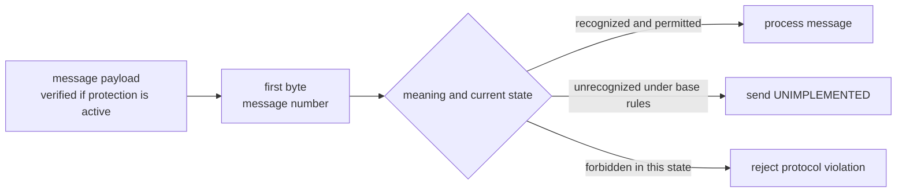
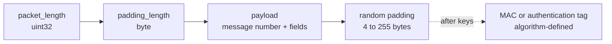
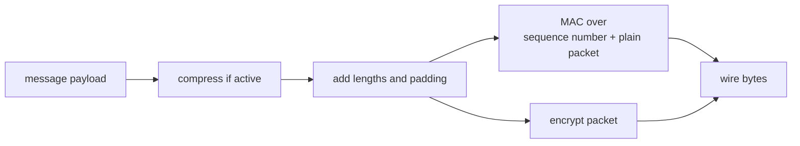
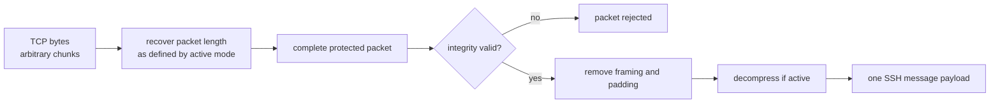

# SSH binary packets and data types

After the identification lines, SSH is a sequence of binary packets. Each
packet carries exactly one SSH message payload plus padding and, once keys are
active, cryptographic protection. SSH framing recovers those packets from
TCP's continuous byte stream; TCP segment boundaries do not mark SSH messages.

The canonical definitions are the data types in
[RFC 4251, section 5](https://www.rfc-editor.org/rfc/rfc4251#section-5) and the
packet format in
[RFC 4253, section 6](https://www.rfc-editor.org/rfc/rfc4253#section-6).

## Integers, strings, and name-lists

SSH encodes messages with a small set of types. Multi-byte integers use
network byte order: most significant byte first.

| Type | Wire representation | Important property |
| --- | --- | --- |
| `byte` | one octet | Often carries a message number. |
| `boolean` | one octet | Zero is false; any nonzero value is read as true, though writers use zero or one. |
| `uint32` | four octets, big-endian | An unsigned value from 0 to 2³² − 1. |
| `uint64` | eight octets, big-endian | An unsigned value from 0 to 2⁶⁴ − 1. |
| `string` | `uint32` byte length, then that many bytes | Binary-safe; no terminator and no implied text encoding. |
| `name-list` | a `string` containing comma-separated names | The list may be empty; individual names may not be empty. |
| `mpint` | a `string` containing a signed two's-complement integer | Used by some cryptographic methods; canonical encoding matters. |

For example:

```text
uint32 5
00 00 00 05

string "cat"
00 00 00 03 63 61 74

name-list "publickey,password"
00 00 00 12 70 75 62 6c 69 63 6b 65 79 2c 70 61 73 73 77 6f 72 64
```

A `string` length counts bytes, not characters. The contents may include NUL
bytes and are not inherently UTF-8; the containing message defines whether a
string is text, a public-key blob, or arbitrary data.

A `name-list` has no empty elements, and the zero-length string is the empty
list. Algorithm names are exact protocol identifiers: they are compared
without trimming, case-folding, or other normalization.

### Why `mpint` is different from an arbitrary string

An `mpint` holds an integer in the shortest signed two's-complement form. A
positive value whose top bit would be one needs a leading zero byte so that it
does not read as negative. Zero has an empty body.

| Integer | Complete SSH `mpint` encoding |
| ---: | --- |
| 0 | `00 00 00 00` |
| 127 | `00 00 00 01 7f` |
| 128 | `00 00 00 02 00 80` |
| −128 | `00 00 00 01 80` |

The length prefix includes any sign byte. The encoding matters because key
exchange hashes encoded values: an integer and a fixed-length byte string with
similar bytes are different transcript inputs. The
[method survey](./key-exchange-methods.md#hybrid-post-quantum-exchange)
shows why hybrid methods explicitly encode their shared secret as a string.

## One payload, one message number

The first payload byte is the message number; the remaining bytes are fields
whose types and order that message defines. Do not confuse it with the packet
sequence number:

- the **message number** is a byte inside the payload that says how to
  interpret the payload;
- the **packet sequence number** is a per-direction `uint32` that both peers
  track outside the packet and feed into integrity checks.

[RFC 4251, section 7](https://www.rfc-editor.org/rfc/rfc4251#section-7) divides the
number space by layer:

| Range | Used for |
| ---: | --- |
| 1–19 | Transport generic (disconnect, ignore, debug, service request, …) |
| 20–29 | Algorithm negotiation |
| 30–49 | Key-exchange method specific |
| 50–59 | User authentication generic |
| 60–79 | User authentication method specific |
| 80–89 | Connection protocol generic |
| 90–127 | Channel messages |
| 128–191 | Reserved for client protocols |
| 192–255 | Local extensions |

The transport messages the client meets first are:

| Number | Symbol | Purpose |
| ---: | --- | --- |
| 1 | `SSH_MSG_DISCONNECT` | End the SSH connection with a reason. |
| 2 | `SSH_MSG_IGNORE` | Carry data that the recipient ignores. |
| 3 | `SSH_MSG_UNIMPLEMENTED` | Report an unrecognized message. |
| 4 | `SSH_MSG_DEBUG` | Carry optional diagnostic text. |
| 5 | `SSH_MSG_SERVICE_REQUEST` | Request a service such as user authentication. |
| 6 | `SSH_MSG_SERVICE_ACCEPT` | Accept the requested service. |
| 7 | `SSH_MSG_EXT_INFO` | Announce protocol extensions ([RFC 8308](https://www.rfc-editor.org/rfc/rfc8308)). |
| 20 | `SSH_MSG_KEXINIT` | Offer algorithms and begin key exchange. |
| 21 | `SSH_MSG_NEWKEYS` | Switch one sending direction to new keys. |

Numbers in the method-specific ranges have no fixed meaning: 30–49 depend on
the negotiated key-exchange method and 60–79 on the active authentication
method. A number's meaning therefore depends on protocol state. Under the base
transport rules, a peer answers an unrecognized message with
`SSH_MSG_UNIMPLEMENTED`, which carries the sequence number of the rejected
packet; see
[RFC 4253, section 11.4](https://www.rfc-editor.org/rfc/rfc4253#section-11.4).

A recognized message arriving in the wrong state is different. An
`SSH_MSG_USERAUTH_SUCCESS` before the client has made any authentication
request, or a channel message before authentication, is a protocol violation,
not an unknown message. Strict KEX also requires disconnection on any
unexpected message during the initial key exchange, overriding the generic
`UNIMPLEMENTED` rule.



### Transport control messages

`DISCONNECT`, `IGNORE`, `DEBUG`, and `UNIMPLEMENTED` can appear in almost any
transport state. Disconnect descriptions and debug text are peer-controlled,
not trusted terminal output; the numeric reason code and the state in which
the message arrived are stronger evidence.

`SERVICE_REQUEST` and `SERVICE_ACCEPT` cross a layer boundary. After the
initial key exchange, the client requests `ssh-userauth`. Each authentication
request then names the service to start on success, normally
`ssh-connection`. A service name is not a channel type.

## The base packet layout

The unencrypted form shows the framing most clearly:



`packet_length` counts `padding_length`, payload, and padding. It does **not**
include its own four bytes or the MAC:

```text
packet_length = 1 + payload_length + padding_length
base_packet_length = 4 + packet_length
```

Padding is at least four bytes, and the sender chooses its length so that the
base packet length, excluding the MAC, is a multiple of the cipher block size
or eight, whichever is larger. The padding bytes should be
[cryptographically random](./cryptography-primer.md#randomness); the receiver
discards them before interpreting the payload. Varying padding blurs exact
message sizes, but it does not hide timing or make all messages the same size.

### Worked packet

This unencrypted packet is illustrative. The separators are not on the wire,
and real padding should not be a fixed pattern.

```text
00 00 00 0c | 05 | 05 00 00 00 01 78 | aa bb cc dd ee
```

1. `packet_length` is 12, so 12 bytes follow the length field.
2. `padding_length` is 5.
3. The payload length is `12 - 1 - 5 = 6` bytes.
4. The payload starts with message number 5, `SSH_MSG_SERVICE_REQUEST`.
5. The remaining five bytes are a one-byte string containing `x`.
6. The complete base packet is 16 bytes, a multiple of eight.

The service name `x` is deliberately useless. Framing and field decoding are
separate from deciding whether a field value is valid in the current state.

## Sequence numbers

Each direction has its own packet sequence number. Under the base protocol it
starts at zero for the first binary packet, increments after every packet,
wraps modulo 2³², and is never reset by rekeying. It is not sent on the wire,
but the base [MAC](./crypto-hashes.md#message-authentication-codes) covers it:

```text
uint32(sequence_number) || unencrypted_packet
```

The endpoints must therefore agree exactly on which packet is next; a
different sequence number produces a different integrity result
([RFC 4253, section 6.4](https://www.rfc-editor.org/rfc/rfc4253#section-6.4)).
The negotiated
[strict-KEX extension](https://datatracker.ietf.org/doc/draft-ietf-sshm-strict-kex/)
changes this rule: each direction's sequence number resets to zero immediately
after its `NEWKEYS`. The
[Terrapin attack](./crypto-symmetric.md#terrapin-when-implicit-state-is-not-authenticated)
shows why this implicit counter is security-relevant.

## Before and after keys

Protection starts, and later changes, independently in each direction at
`NEWKEYS`.

| Stage | Framing | Protection |
| --- | --- | --- |
| Identification | CRLF-terminated line | Clear text; not a binary packet. |
| Initial key exchange | Binary packet | Random padding, no encryption or MAC. |
| After first `NEWKEYS` | Binary packet | Negotiated protection for that direction. |
| Rekey | Binary packet | Old keys until that direction switches at `NEWKEYS`. |

The original RFC 4253 construction is *encrypt-and-MAC*:



The MAC is appended unencrypted. Other packet-protection algorithms, such as
authenticated encryption (AEAD), which produces ciphertext and tag together,
protect the length, ciphertext, and tag differently. The negotiated algorithm
is therefore part of the wire format; the base diagram does not describe every
mode byte for byte.

A protected packet has protocol meaning only after its
[MAC](./crypto-hashes.md#message-authentication-codes) or tag verifies.
Decrypted bytes from a packet with a bad tag are not an SSH message.
[Symmetric encryption and packet protection](./crypto-symmetric.md) explains
what these primitives guarantee and how the negotiated names map to them.

### Packet-protection families

The negotiated names determine when packet bytes become trustworthy. Three
families are common (compared in depth under
[three ways to combine encryption and integrity](./crypto-symmetric.md#three-ways-to-combine-encryption-and-integrity)):

| Family | Integrity covers | Receiver consequence |
| --- | --- | --- |
| RFC 4253 encrypt-and-MAC | Sequence number and plaintext packet | Decrypt enough to recover the packet, then verify the MAC. |
| Encrypt-then-MAC | Sequence number, clear packet length, and ciphertext | Verify the ciphertext before decrypting the packet body. |
| AEAD | Algorithm-defined ciphertext and associated data | Accept plaintext only if the authentication tag verifies. |

Encrypt-then-MAC algorithm names end in `-etm@openssh.com`; their construction
is documented in OpenSSH's
[`PROTOCOL` file](https://github.com/openssh/openssh-portable/blob/master/PROTOCOL),
section 1.5. AEAD modes define their own length, nonce, and tag handling.
[AES-GCM](./crypto-symmetric.md#aes-gcm) leaves the packet length in
cleartext but authenticates it, while
[`chacha20-poly1305@openssh.com`](./crypto-symmetric.md#chacha20-poly1305)
encrypts the length under a separate key. There is no universal “modern SSH
packet” layout beyond the base fields.

Alignment is mode-specific too. The base construction aligns
`4 + packet_length`. In OpenSSH's encrypt-then-MAC and AEAD modes the
four-byte length sits outside the encrypted body, and only the body is
aligned. A visible length may thus be an authenticated cleartext field in one
mode and separately encrypted in another; in no mode is a boundary trusted
merely because a tentative length was recovered.

### Compression changes payloads, not channels

Compression applies to payloads before packet protection when sending and
after verification when receiving. Its state is directional and spans packets,
so one packet need not be independently decompressible; the state restarts
after each key exchange. The base `zlib` method starts at `NEWKEYS`. The
widely deployed `zlib@openssh.com` starts only after user authentication
succeeds, keeping decompression code away from unauthenticated peers.

[RFC 8308](https://www.rfc-editor.org/rfc/rfc8308#section-3.2) offers another
route, the `delay-compression` extension, which negotiates compression in
`EXT_INFO` and takes effect only if both peers send it. The new algorithm
starts with the message after each side's trigger: `SSH_MSG_USERAUTH_SUCCESS`
for the server and a new `SSH_MSG_NEWCOMPRESS` (8) for the client. The
client's explicit trigger resolves a race, since the server cannot otherwise
tell whether a client packet was sent before or after the client saw
authentication succeed. RFC 8308 also restricts rekeying around these triggers
so that key and compression transitions cannot collide.

## Framing over TCP and size limits

TCP may split a packet across several reads or deliver it together with the
next packet. The SSH layer sees neither division:



With encryption active, recovering the length is mode-specific, as described
above. In every mode, the length, padding length, and alignment must agree
before the bytes can form a valid packet.

RFC 4253 requires implementations to handle packets with an uncompressed
payload of up to 32,768 bytes and a total size of up to 35,000 bytes. These
are minimum interoperability capacities, not protocol maxima; implementations
may accept larger packets
([RFC 4253, section 6.1](https://www.rfc-editor.org/rfc/rfc4253#section-6.1)).

A connection that ends partway through a declared packet has delivered a
truncated packet, not a shorter message.

## Check your understanding

1. In the worked packet, which bytes does `packet_length` count, and which
   bytes are outside it?
2. Why does five bytes of padding make that base packet align?
3. Which byte selects the message, and how does it differ from the sequence
   number?
4. If TCP splits the four-byte length field across two segments, does any
   byte of the SSH packet change?
5. After keys are active, when do recovered plaintext bytes become an
   authenticated SSH message?
6. Why is packet-length handling different under encrypt-and-MAC,
   encrypt-then-MAC, and AEAD?
7. A client receives message number 60 during user authentication. Why can
   it not interpret the message from the number alone?

<details>
<summary>Answers</summary>

1. It counts the padding-length byte, the six payload bytes, and the five
   padding bytes: 12 in total. The four-byte length field itself (and any MAC,
   once keys are active) is outside it.
2. The base packet is 4 + 1 + 6 + 5 = 16 bytes, a multiple of the eight-byte
   minimum block size, and the padding meets the four-byte minimum.
3. The first payload byte, `05`, is the message number. The sequence number
   is never sent; each peer counts packets per direction and feeds that count
   into the integrity check.
4. No. TCP segmentation is invisible to SSH; the receiver buffers bytes until
   it has a complete packet.
5. Only after the MAC or AEAD tag verifies. Until then, the bytes are
   untrusted and must not be interpreted as a message.
6. Encrypt-and-MAC encrypts the length with the packet, so the receiver must
   decrypt before knowing the packet size. Encrypt-then-MAC leaves the length
   in cleartext, covered by the MAC. AEAD modes define their own treatment: the
   length is associated data in AES-GCM and separately encrypted in
   `chacha20-poly1305@openssh.com`.
7. Numbers 60–79 are authentication-method specific. Number 60 means
   `USERAUTH_PK_OK`, `USERAUTH_PASSWD_CHANGEREQ`, or `USERAUTH_INFO_REQUEST`
   depending on which method the client is running.

</details>

## References

- [RFC 4250, section 4.1: Message numbers](https://www.rfc-editor.org/rfc/rfc4250#section-4.1)
- [RFC 4251, section 7: Message numbers](https://www.rfc-editor.org/rfc/rfc4251#section-7)
- [RFC 4251, section 5: Data type representations](https://www.rfc-editor.org/rfc/rfc4251#section-5)
- [RFC 4253, section 6: Binary packet protocol](https://www.rfc-editor.org/rfc/rfc4253#section-6)
  and [section 11: Additional messages](https://www.rfc-editor.org/rfc/rfc4253#section-11)
- [RFC 5647: AES Galois Counter Mode for SSH](https://www.rfc-editor.org/rfc/rfc5647)
- [RFC 8308: Extension negotiation in SSH](https://www.rfc-editor.org/rfc/rfc8308),
  including `delay-compression`
- [OpenSSH `PROTOCOL`](https://github.com/openssh/openssh-portable/blob/master/PROTOCOL):
  encrypt-then-MAC (section 1.5) and `zlib@openssh.com` (section 1.2)
- [ChaCha20-Poly1305 for SSH (draft-ietf-sshm-chacha20-poly1305)](https://datatracker.ietf.org/doc/draft-ietf-sshm-chacha20-poly1305/)
- [Strict key exchange (draft-ietf-sshm-strict-kex)](https://datatracker.ietf.org/doc/draft-ietf-sshm-strict-kex/)
