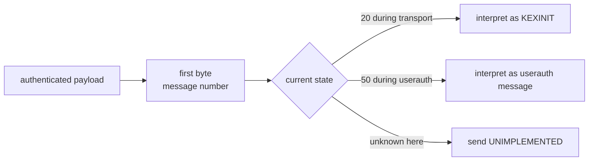
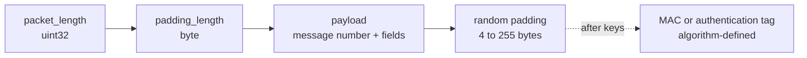
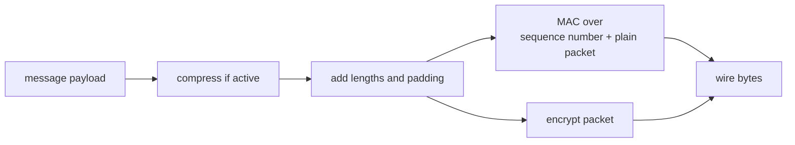
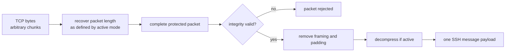

# SSH binary packets and data types

After the identification lines, SSH is a sequence of binary packets. A packet
contains exactly one SSH message payload plus padding and, once keys are active,
cryptographic protection. SSH framing recovers those packets from TCP's
continuous byte stream; TCP segment boundaries do not mark SSH messages.

The canonical definitions are the SSH data types in
[RFC 4251, section 5](https://www.rfc-editor.org/rfc/rfc4251#section-5) and the
packet format in
[RFC 4253, section 6](https://www.rfc-editor.org/rfc/rfc4253#section-6).

## Integers, strings, and name-lists

SSH encodes structured messages with a small set of types. Multi-byte integers
use network byte order: most significant byte first.

| Type | Wire representation | Important property |
| --- | --- | --- |
| `byte` | one octet | Often carries a message number. |
| `boolean` | one octet | Zero is false; any nonzero value is read as true, though writers use zero or one. |
| `uint32` | four octets, big-endian | An unsigned value from 0 to 2³² − 1. |
| `uint64` | eight octets, big-endian | An unsigned value from 0 to 2⁶⁴ − 1. |
| `string` | `uint32` byte length, then that many bytes | Binary-safe; no terminator and no implied text encoding. |
| `name-list` | a `string` containing comma-separated names | The list may be empty; individual names may not be empty. |
| `mpint` | a `string` containing a signed two's-complement integer | Used by some cryptographic methods; canonical encoding matters. |

For example, these values have the following encodings:

```text
uint32 5
00 00 00 05

string "cat"
00 00 00 03 63 61 74

name-list "publickey,password"
00 00 00 12 70 75 62 6c 69 63 6b 65 79 2c 70 61 73 73 77 6f 72 64
```

The length of a `string` counts bytes, not characters. It can contain NUL bytes
and is not inherently UTF-8. Whether a particular string represents text, a
public-key blob, or arbitrary data is defined by the message containing it.

A `name-list` uses the same length prefix as a string. Its contents are names
separated by commas, with no empty element. The zero-length string represents an
empty list. Compare algorithm names as exact protocol identifiers; do not trim,
case-fold, or normalize them.

## One payload, one message number

The first byte of an SSH packet's payload is its message number. The remaining
payload bytes are fields whose types and order are defined for that message.
Message numbers and packet sequence numbers are different things:

- the **message number** is a byte inside the payload and identifies how to
  interpret that payload;
- the **packet sequence number** is a per-direction `uint32` maintained outside
  the packet and included in integrity calculations.

Some transport message numbers are fixed by RFC 4253:

| Number | Symbol | Purpose |
| ---: | --- | --- |
| 1 | `SSH_MSG_DISCONNECT` | End the SSH connection with a reason. |
| 2 | `SSH_MSG_IGNORE` | Carry data that the recipient ignores. |
| 3 | `SSH_MSG_UNIMPLEMENTED` | Report an unrecognized message. |
| 4 | `SSH_MSG_DEBUG` | Carry optional diagnostic text. |
| 5 | `SSH_MSG_SERVICE_REQUEST` | Request a service such as user authentication. |
| 6 | `SSH_MSG_SERVICE_ACCEPT` | Accept the requested service. |
| 20 | `SSH_MSG_KEXINIT` | Offer algorithms and begin key exchange. |
| 21 | `SSH_MSG_NEWKEYS` | Switch one sending direction to new keys. |

Numbers 30 through 49 are interpreted by the negotiated key-exchange method.
Higher-layer RFCs define their own message layouts. A number's meaning therefore
depends on the current protocol state. An unknown message is answered with
`SSH_MSG_UNIMPLEMENTED`, whose field identifies the sequence number of the
unrecognized packet; see
[RFC 4253, section 11.4](https://www.rfc-editor.org/rfc/rfc4253#section-11.4).



### Transport control messages

Four generic messages can appear across several transport states:

- `SSH_MSG_DISCONNECT` ends the SSH connection and supplies a reason code;
- `SSH_MSG_IGNORE` carries bytes with no higher-layer meaning;
- `SSH_MSG_DEBUG` carries peer-controlled diagnostic text; and
- `SSH_MSG_UNIMPLEMENTED` reports an unrecognized message by packet sequence
  number.

A disconnect description and debug message are not trusted terminal text.
They may explain a failure, but the numeric reason and the state in which the
message arrived are stronger evidence.

`SSH_MSG_SERVICE_REQUEST` and `SSH_MSG_SERVICE_ACCEPT` cross a layer boundary.
After initial key exchange, the client normally requests `ssh-userauth`. A
successful authentication request names the service to start next, normally
`ssh-connection`. A service name is not a channel type.

## The base packet layout

The unencrypted form makes the framing easiest to see:



`packet_length` is the combined byte length of `padding_length`, payload, and
padding. It does **not** include its own four bytes or the MAC. Thus:

```text
packet_length = 1 + payload_length + padding_length
base_packet_length = 4 + packet_length
```

There must be at least four padding bytes. The base packet length, excluding a
MAC, must be a multiple of the cipher block size or eight bytes, whichever is
larger. The padding length is chosen to meet that alignment. Padding frustrates
simple traffic-size analysis, but it does not hide timing or make all messages
the same size.

The padding bytes should be cryptographically random. They are removed before
the payload is interpreted and have no meaning to the message layer.

## Before and after keys

The identification lines come before binary framing. The first `KEXINIT` and
initial key-exchange packets are binary packets, but there is not yet an active
cipher or MAC. Protection changes independently by direction at `NEWKEYS`.

| Stage | Framing | Protection |
| --- | --- | --- |
| Identification | CRLF-terminated line | Clear text; not a binary packet. |
| Initial key exchange | Binary packet | Random padding, no encryption or MAC. |
| After first `NEWKEYS` | Binary packet | Negotiated protection for that direction. |
| Rekey | Binary packet | Old keys until that direction switches at `NEWKEYS`. |

For the original RFC 4253 encrypt-and-MAC construction, sending can be viewed as:



The MAC is not itself encrypted in that base construction. Other negotiated
packet-protection algorithms, including authenticated-encryption modes, define
different details for protecting the length, ciphertext, and authentication tag.
The negotiated packet algorithm is therefore part of the wire format: the base
diagram must not be assumed to describe every modern mode byte for byte.

At a black-box level:

- a **compressor** maps payload bytes to a usually shorter byte sequence;
- an **encryption algorithm** maps plaintext and secret state to ciphertext;
- a **MAC** maps a secret key plus packet data to an integrity tag;
- an **authenticated-encryption algorithm** produces ciphertext and a tag
  together, and returns either verified plaintext or failure when opening it.

A protected packet has protocol meaning only after its MAC or authentication tag
has been verified. Decrypted bytes from a packet with a bad tag are not an SSH
message.

### Packet-protection families

The negotiated names determine when packet bytes become trustworthy. Three
families are common:

| Family | Integrity covers | Receiver consequence |
| --- | --- | --- |
| RFC 4253 encrypt-and-MAC | Sequence number and plaintext packet | Decrypt enough to recover the packet, then verify the MAC. |
| Encrypt-then-MAC | Sequence number, clear packet length, and ciphertext | Verify the ciphertext before decrypting the packet body. |
| AEAD | Algorithm-defined ciphertext and associated data | Accept plaintext only if the authentication tag verifies. |

Encrypt-then-MAC algorithm names end in `-etm@openssh.com`; their packet
construction is documented in the
[OpenSSH protocol extensions](https://github.com/openssh/openssh-portable/blob/master/PROTOCOL).
AEAD mappings such as AES-GCM define their own length, nonce, and tag handling.
There is no universal “modern SSH packet” layout beyond the base fields.

This distinction matters when reading a trace. A visible length may be an
authenticated cleartext field in one mode, encrypted state in another, or
handled by a separate algorithm-specific construction. Packet boundaries are
not trusted merely because a tentative length was recovered.

### Compression changes payloads, not channels

Compression applies to message payloads before packet protection and after
packet verification. Its state is directional. The base `zlib` method starts
after `NEWKEYS`; the deployed `zlib@openssh.com` method delays compression
until user authentication succeeds, reducing exposure of decompression code
to unauthenticated traffic.

[RFC 8308](https://www.rfc-editor.org/rfc/rfc8308#section-3.2) also defines the
`delay-compression` extension. After authentication succeeds, the server starts
compressing its direction after sending `SSH_MSG_USERAUTH_SUCCESS`. The client
then sends `SSH_MSG_NEWCOMPRESS` uncompressed and compresses later packets in
its direction. These methods use the same compression algorithm but have
different transition rules.

## Sequence numbers

Each direction has its own packet sequence number. Under the base protocol it
starts at zero for the first binary packet, increments after every packet, wraps
modulo 2³², and is not reset by rekeying. Although the number is not placed on
the wire as a field, the base MAC calculation covers:

```text
uint32(sequence_number) || unencrypted_packet
```

The endpoints therefore have to agree about exactly which packet is next. A
different sequence number produces a different integrity result. These rules are
in
[RFC 4253, section 6.4](https://www.rfc-editor.org/rfc/rfc4253#section-6.4).
The negotiated
[strict-KEX extension](https://datatracker.ietf.org/doc/draft-ietf-sshm-strict-kex/)
changes this invariant by resetting the appropriate directional sequence number
immediately after each `NEWKEYS`.

## Framing over TCP and size limits

Because TCP is a stream, a packet may arrive in several chunks or share a chunk
with the next packet. These divisions are invisible at the SSH layer. The
protocol-visible reconstruction is:



With encryption active, "recover packet length" is algorithm-specific. A classic
block cipher construction reveals the length by decrypting the first block. An
authenticated-encryption mode may protect or expose the length differently. In
all cases the advertised length, padding length, and required block alignment
must agree before the bytes can represent a valid SSH packet.

RFC 4253 requires implementations to be able to process packets with an
uncompressed payload of 32,768 bytes or less and a total packet size of 35,000
bytes or less. These are required interoperability capacities, not absolute
protocol maxima; implementations may support larger packets. The normative
wording is in
[RFC 4253, section 6.1](https://www.rfc-editor.org/rfc/rfc4253#section-6.1).

An EOF after only part of the declared frame is a truncated packet, not a shorter
message. Conversely, receiving only part of a packet while the TCP connection
remains open says nothing about where the next TCP chunk will begin.

## Worked packet

Consider this unencrypted illustrative packet. The separators are not on the
wire, and real padding should not be a fixed pattern.

```text
00 00 00 0c | 05 | 05 00 00 00 01 78 | aa bb cc dd ee
```

Read it from left to right:

1. `packet_length` is 12, so 12 bytes follow the length field.
2. `padding_length` is 5.
3. The payload length is `12 - 1 - 5 = 6` bytes.
4. The payload starts with message number 5, `SSH_MSG_SERVICE_REQUEST`.
5. Its remaining bytes encode a one-byte string containing `x`.
6. The complete base packet is 16 bytes, a multiple of eight.

The service name is deliberately illustrative rather than a useful SSH service.
Framing and field decoding are separate from deciding whether a field value is
valid in the current state.

## Protocol review

Use the worked packet to check the following:

- Which bytes are counted by `packet_length`, and which are outside it?
- Why does a five-byte padding field make this particular base packet align?
- Which byte selects the message, and how is that different from the unseen
  sequence number?
- If TCP splits the four-byte length across two segments, does any byte of the
  SSH packet change?
- After keys are active, at what point do the recovered plaintext bytes become
  an authenticated SSH message?
- Why can packet-length handling differ between encrypt-and-MAC,
  encrypt-then-MAC, and AEAD?
