# Channels and the connection protocol

After user authentication succeeds, the server starts the requested service, normally `ssh-connection`. This layer turns one encrypted SSH transport into many independent byte streams called **channels**. A shell, an executed command, and each forwarded TCP connection can all share one transport without sharing channel state.

[RFC 4254](https://www.rfc-editor.org/rfc/rfc4254.html) specifies the connection protocol: global requests, channel creation, flow control, channel requests, sessions, and TCP forwarding.

## Learning objectives

After this chapter, you should be able to:

- map each logical channel to the two peers' local channel numbers;
- explain per-direction window flow control;
- distinguish channel data, channel requests, and global requests;
- close a channel without losing its final output or exit status; and
- explain `direct-tcpip` and `forwarded-tcpip` from the SSH peer's point of view.

## One transport, many channels

SSH multiplexes logically separate activities into the packet stream protected by the transport layer.

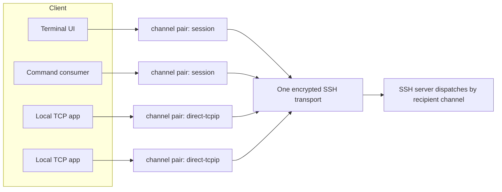

Loss of one channel does not inherently close the others. Likewise, closing a session does not close independent forwarded TCP channels.

## Channel numbers are local

Each peer chooses its own number for the same logical channel. Suppose the client calls a new channel `7` and the server calls it `42`:

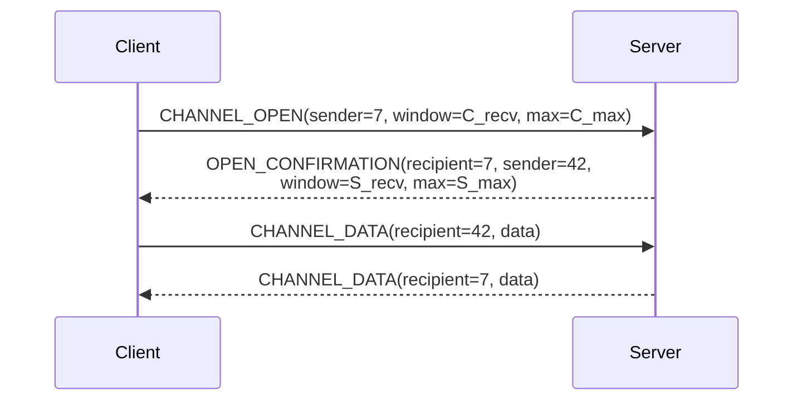

The `sender channel` field introduces the number chosen by the sender. Subsequent messages carry the *recipient's* local number. The same logical channel therefore has a pair of identifiers, not one universal channel ID:

```text
local channel 7 <-> remote channel 42
```

The words *sender* and *recipient* are relative to the message carrying the field. Each channel's identifier pair keeps its data, windows, and lifecycle separate from every other channel.

## Opening a channel

Either peer may open a channel. The generic message is:

```text
byte      SSH_MSG_CHANNEL_OPEN
string    channel type
uint32    sender channel
uint32    initial window size
uint32    maximum packet size
...       channel-type-specific fields
```

The recipient returns `SSH_MSG_CHANNEL_OPEN_CONFIRMATION`, which introduces its own channel number and receive limits, or `SSH_MSG_CHANNEL_OPEN_FAILURE`, which contains a reason code and description. Standard failure reasons distinguish administrative prohibition, connection failure, unknown type, and resource shortage. See [RFC 4254, Section 5.1](https://www.rfc-editor.org/rfc/rfc4254.html#section-5.1).

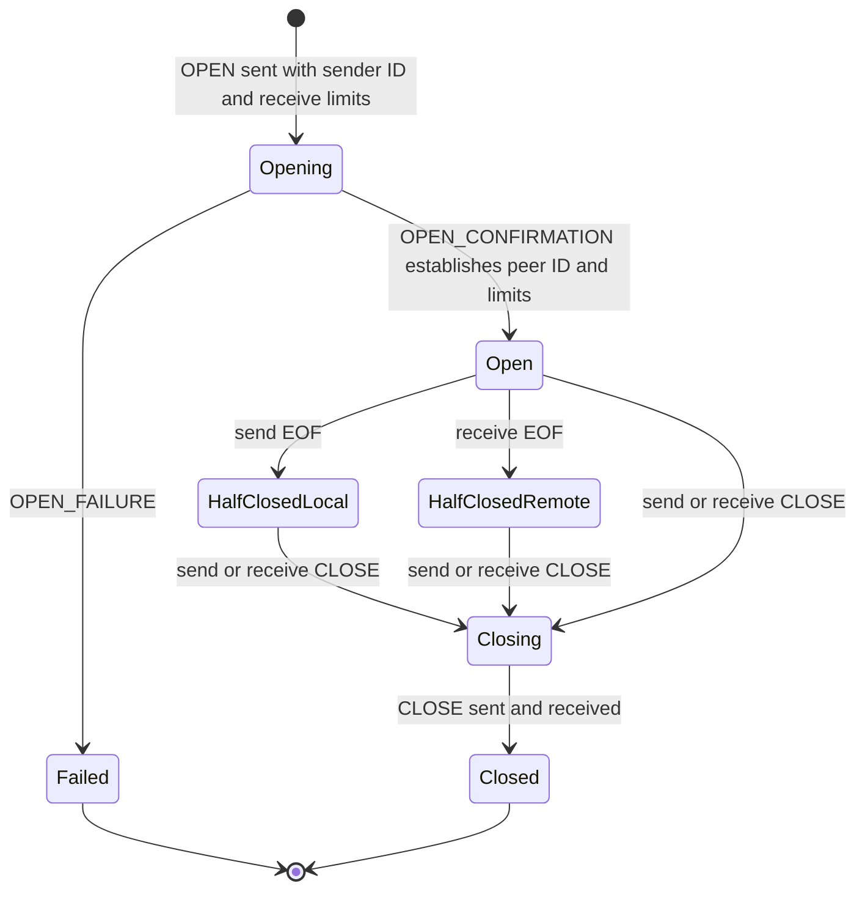

A channel number does not become reusable merely because one side has sent CLOSE. Under RFC 4254, the channel is closed for a peer only once that peer has both sent and received `SSH_MSG_CHANNEL_CLOSE`.

## Windows and flow control

TCP already has flow control, but one TCP receive buffer is shared by all multiplexed SSH traffic. SSH adds a receive window to each channel and each direction, so a slow consumer can stop its own stream without requiring every channel to stop.

The window advertised in `CHANNEL_OPEN` or `OPEN_CONFIRMATION` is a promise: “you may send me this many bytes of channel data.” It describes the sender's receive capacity, not its send capacity.

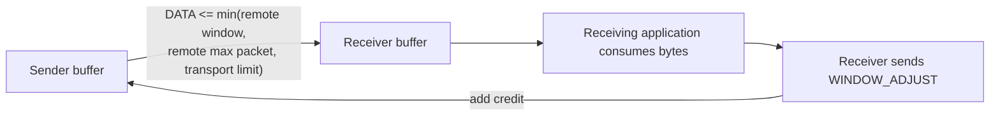

For each direction, sending follows this arithmetic:

```text
allowed_channel_data = min(remote_window, remote_max_packet)
remote_window  -= bytes_sent
```

When the receiver has made capacity available, it sends:

```text
SSH_MSG_CHANNEL_WINDOW_ADJUST(recipient_channel, bytes_to_add)
```

The sender adds that credit without allowing the 32-bit window to overflow. Data must stop when the remote window reaches zero, but control messages such as window adjustments, EOF, CLOSE, and channel requests do not consume window space.

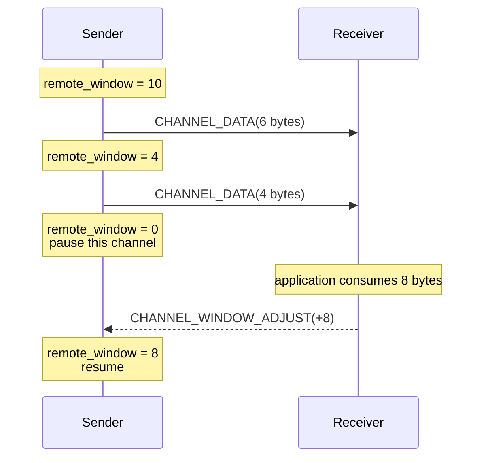

Both `SSH_MSG_CHANNEL_DATA` and `SSH_MSG_CHANNEL_EXTENDED_DATA` consume the same channel window. For session channels, extended-data type 1 is stderr. The maximum channel packet size is independent from the transport packet ceiling, and both limits apply. [RFC 4254, Section 5.2](https://www.rfc-editor.org/rfc/rfc4254.html#section-5.2) defines these rules.

The receiver decides when and by how much to replenish the window. This ties permission to send to the receiver's capacity to consume data. Until `WINDOW_ADJUST` adds credit, a zero-window sender must pause that channel even if the underlying TCP connection remains writable.

## Requests are not data

SSH has two request scopes:

| Scope | Message | Example | Reply if requested |
| --- | --- | --- | --- |
| Whole connection | `SSH_MSG_GLOBAL_REQUEST` | Ask the server to listen for remote forwarding | `SSH_MSG_REQUEST_SUCCESS` or `FAILURE` |
| One channel | `SSH_MSG_CHANNEL_REQUEST` | Allocate a PTY or start a command | `SSH_MSG_CHANNEL_SUCCESS` or `FAILURE` |

Both include a `want reply` boolean. When it is false, no success or failure reply is sent. When it is true, the generic reply contains no request identifier, so its meaning comes from ordering. Global replies preserve global request order; channel-request replies preserve order within that channel, while replies for different channels may be interleaved. See [RFC 4254, Sections 4 and 5.4](https://www.rfc-editor.org/rfc/rfc4254.html#section-4).

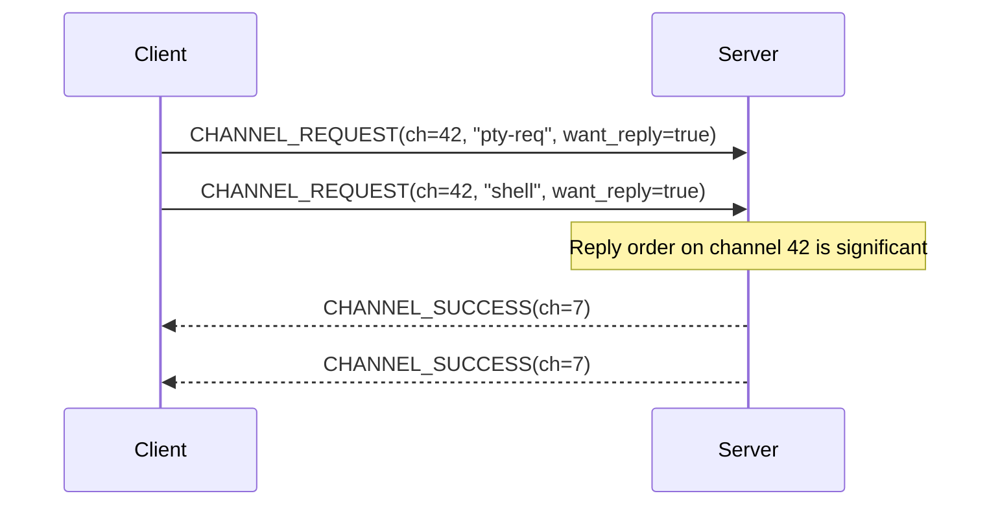

For setup operations whose success affects correctness, request and check a reply. A client that sends `exec` with no reply and immediately treats bytes as command output cannot distinguish refusal from delayed output or later channel closure.

## Session channels

A `session` channel represents one remote program: a shell, a command, or a named subsystem. Several session channels may coexist on the same SSH connection.

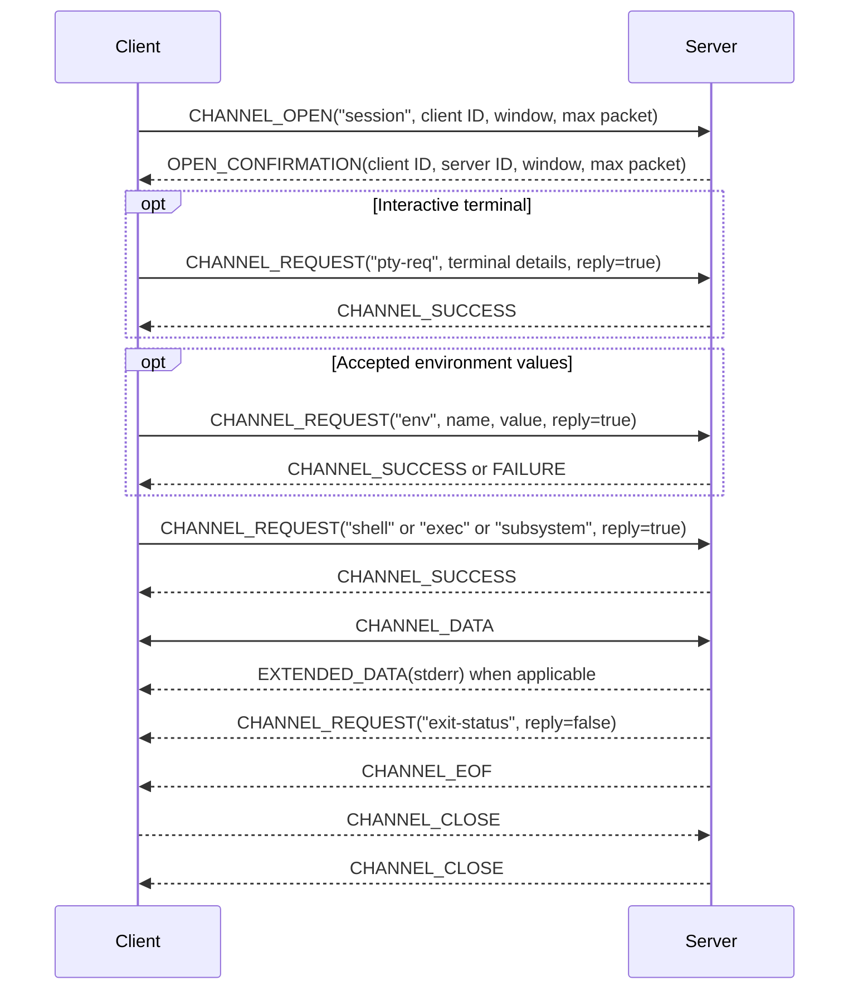

Only one of `shell`, `exec`, or `subsystem` can succeed on a session channel:

- `shell` starts the account's default shell, usually for interactive use.
- `exec` requests execution of the command string carried in the message.
- `subsystem` requests a configured name such as an SFTP service.

Requesting a PTY is optional and separate from starting the program. Non-interactive protocols generally should not request one: terminal line discipline, echo, signals, and newline conversion can alter a byte stream. Environment requests are also advisory; servers may accept only a configured allowlist because applying attacker-controlled environment variables to a privileged process is dangerous. These session operations are defined in [RFC 4254, Section 6](https://www.rfc-editor.org/rfc/rfc4254.html#section-6).

The server can report normal termination with an `exit-status` channel request or signal termination with `exit-signal`. These messages do not themselves close the channel, and data sent before CLOSE still belongs to the channel exchange.

## EOF and CLOSE

`SSH_MSG_CHANNEL_EOF` means “I will send no more data in this direction.” It is a half-close. No protocol reply is required, and the other direction remains usable.

`SSH_MSG_CHANNEL_CLOSE` means “terminate this channel.” A recipient must send CLOSE back unless it already did. EOF is conventional before a graceful close but is not required.

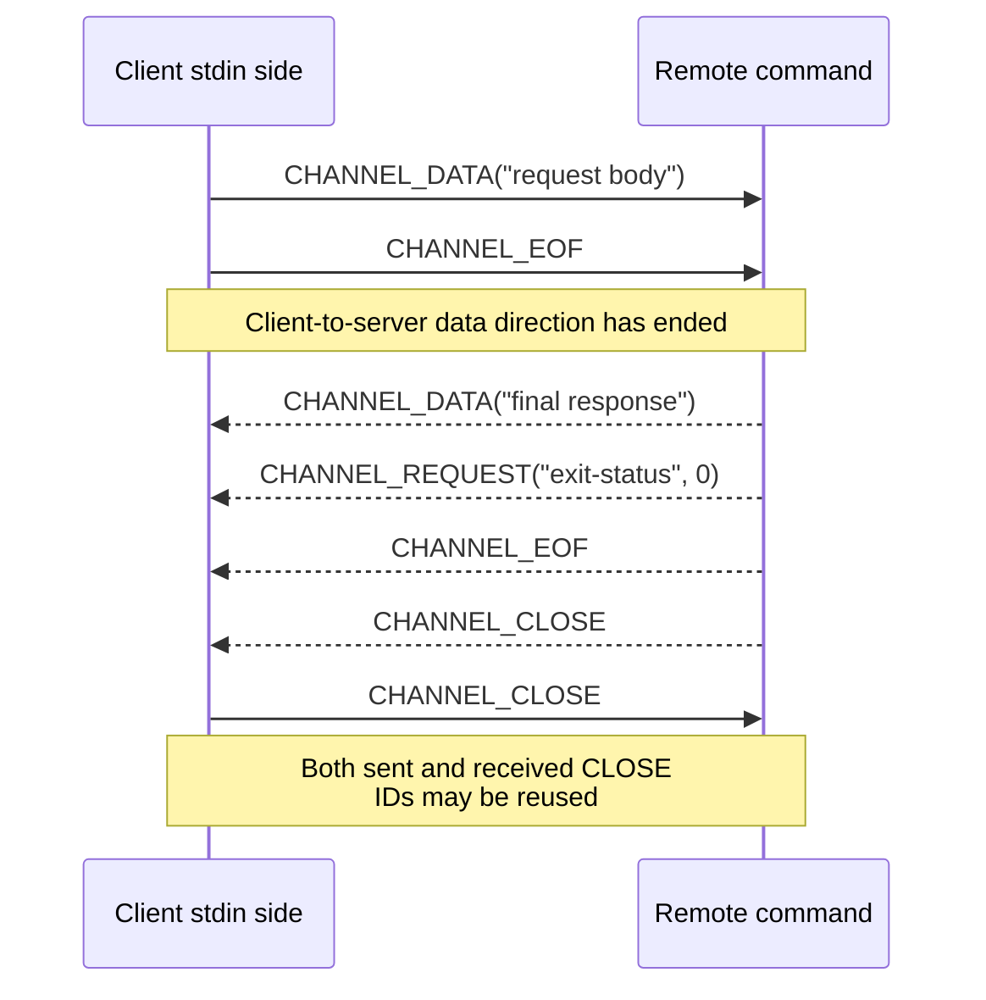

Local stdin reaching EOF ends only the client-to-server data direction; the remote command may still send final output and an exit status. EOF and CLOSE can be sent even when the data window is zero, so exhausted data credit does not make shutdown impossible. See [RFC 4254, Section 5.3](https://www.rfc-editor.org/rfc/rfc4254.html#section-5.3).

## Direct TCP channels

A `direct-tcpip` channel asks the receiving SSH peer to make an outbound TCP connection. This is the channel used for local port forwarding and, with client-side SOCKS handling, dynamic forwarding.

```text
SSH_MSG_CHANNEL_OPEN
string    "direct-tcpip"
uint32    sender channel
uint32    initial window size
uint32    maximum packet size
string    host to connect
uint32    port to connect
string    originator IP address
uint32    originator port
```

For a conceptual `-L 127.0.0.1:8080:db.internal:5432` forwarding:

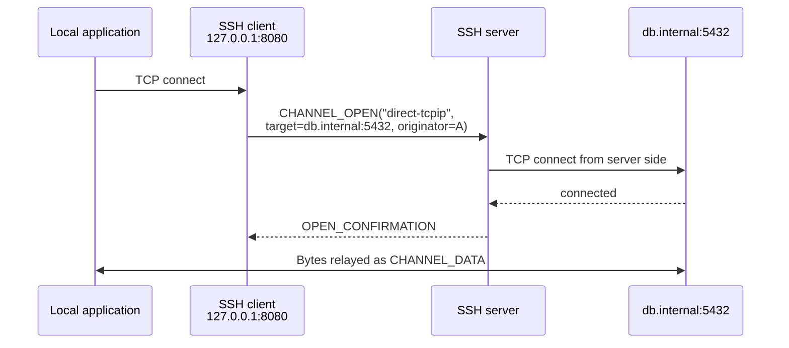

The target name is resolved and connected from the receiving server's environment. It may therefore reach names or addresses visible to the server but not to the client. The SSH channel is a byte relay; it does not add application-layer semantics or verify the identity of the target service.

## Requested and forwarded TCP channels

Remote forwarding begins with a connection-wide `tcpip-forward` global request. It asks the server to listen at an address and port. When a connection arrives, the server opens a `forwarded-tcpip` channel back toward the client.

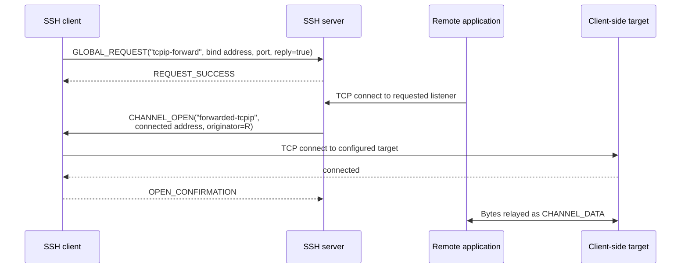

The `forwarded-tcpip` open fields identify the address that was connected and the connection's originator. They do not carry the final client-side target from an `ssh -R` command; the SSH client remembers that mapping in local forwarding state.

A listening request can be canceled with `cancel-tcpip-forward`. Channel opens may still arrive until the cancellation reply. Each accepted TCP connection gets a new channel, independent of session channels and able to outlive a shell.

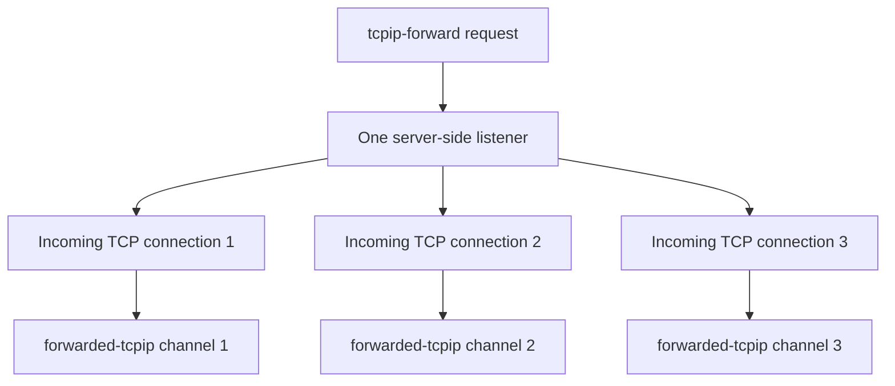

The formats and listener address semantics are defined by [RFC 4254, Section 7](https://www.rfc-editor.org/rfc/rfc4254.html#section-7).

## Forwarding policy and safety

Port forwarding deliberately crosses a network boundary. Treat a forwarding request like a request to create a network capability, not merely another stream.

- A loopback listener limits who can reach it; a wildcard listener deliberately permits wider network exposure.
- Server policy can restrict bind addresses, ports, destination hosts, and destination ports.
- RFC 4254 requires rejection of `forwarded-tcpip` opens that do not match a previously requested remote forwarding.
- Remember that an originator address is peer-supplied metadata, not cryptographic identity.
- Do not assume encryption to the SSH server protects traffic between the server and the forwarding target.

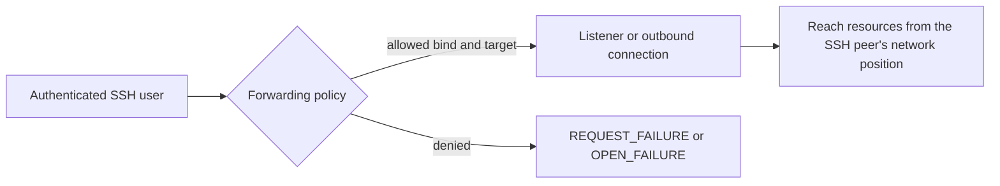

A remote listener bound to a wildcard address can expose a client-side service to other machines. A direct channel can let a user reach server-internal services. Both may be legitimate; both require explicit policy.

## Protocol review

The connection protocol has these invariants:

- one logical channel has different local IDs at its two endpoints;
- each direction has independently advertised windows and maximum packet sizes;
- ordinary and extended data consume the same receive credit;
- a zero-window channel does not block control traffic or unrelated channels;
- request replies derive their meaning from scope and ordering;
- session startup allows only one successful `shell`, `exec`, or `subsystem` request;
- EOF half-closes one direction without discarding the other; and
- channel IDs are reused only after CLOSE has been both sent and received.

## Lab: simulate two channels

Open a session channel and a `direct-tcpip` channel on paper. Give the client and server different local IDs for each. Then trace this sequence:

1. The TCP channel exhausts its server-advertised window.
2. The session channel continues to deliver terminal output.
3. The TCP receiver consumes data and replenishes only the TCP channel.
4. The session client sends EOF while still receiving final output.
5. Both channels complete independent CLOSE handshakes.

At each step, record the recipient channel number and both directional window values. If one exhausted window stalls the other channel, the design is not actually multiplexed.

## References

- [RFC 4254: The Secure Shell (SSH) Connection Protocol](https://www.rfc-editor.org/rfc/rfc4254.html).
- [RFC 4251: The Secure Shell (SSH) Protocol Architecture](https://www.rfc-editor.org/rfc/rfc4251.html).
