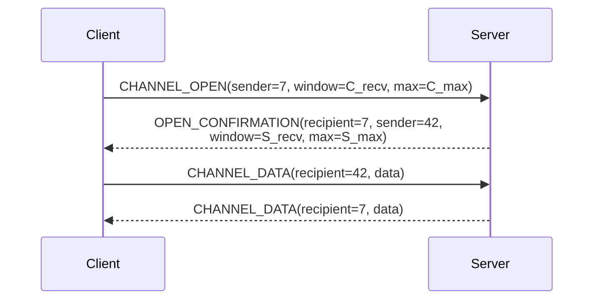
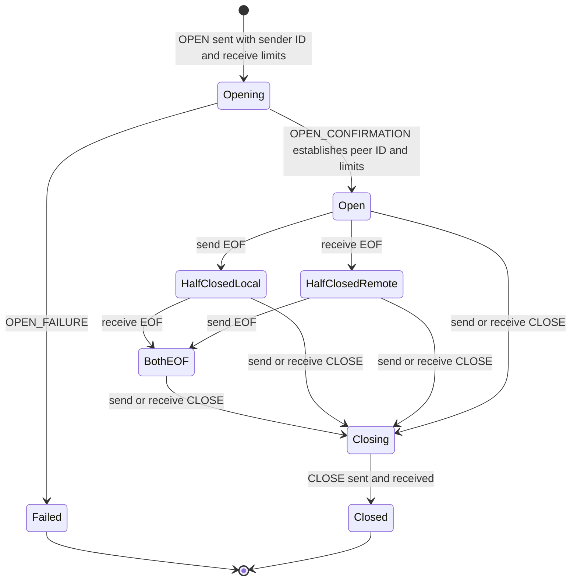
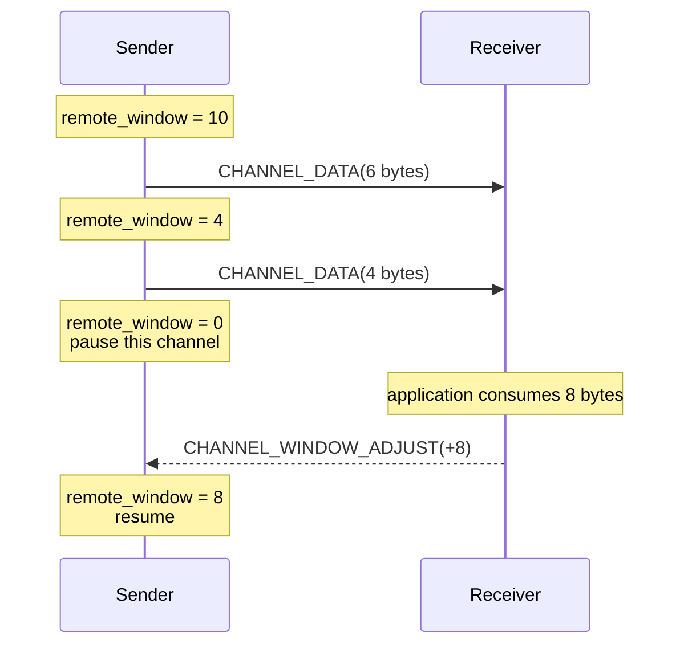
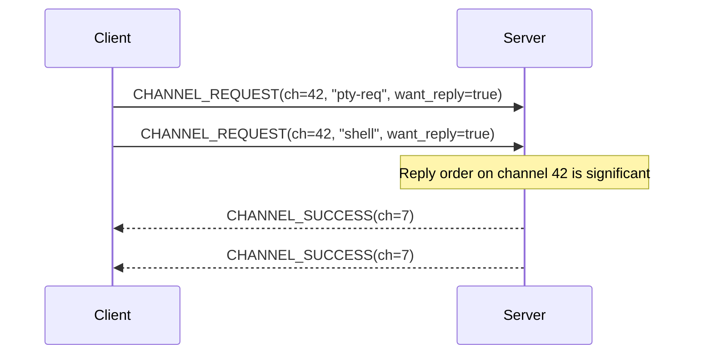
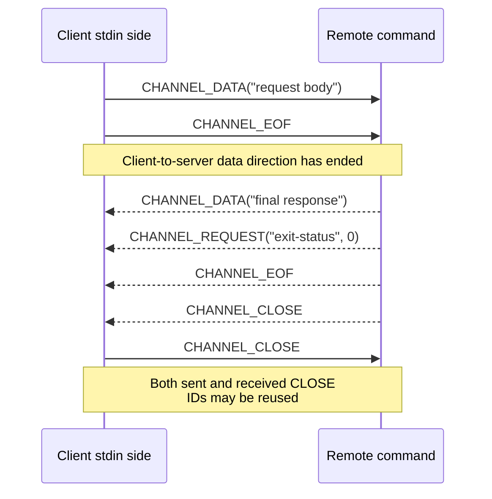

# Channels and flow control

After user authentication, the `ssh-connection` service multiplexes many
logical byte streams over one transport. Each stream is a **channel** with its
own identifiers, flow-control windows, requests, and close state.
[RFC 4254](https://www.rfc-editor.org/rfc/rfc4254.html) specifies this layer;
the following chapters apply it to sessions and forwarding.

## One transport, many channels

Closing one channel does not close the others or end the SSH transport.

The channels still share one ordered TCP stream. If a TCP segment is lost,
later bytes for every channel wait for its retransmission (TCP
*head-of-line blocking*). Channel windows isolate receive credit, not latency,
bandwidth, or scheduling. Rekeying and transport failure affect all channels.

## Channel numbers are local

Each peer chooses its own number for the same logical channel. Suppose the
client calls a new channel `7` and the server calls it `42`:



The `sender channel` field introduces the sender's own number. Every later
message carries the *recipient's* number. A channel therefore has a pair of
identifiers, not one universal ID:

```text
local channel 7 <-> remote channel 42
```

*Sender* and *recipient* are relative to the message that carries the field.

## Opening a channel

Either peer may open a channel. The generic message is:

```text
byte      SSH_MSG_CHANNEL_OPEN
string    channel type
uint32    sender channel
uint32    initial window size
uint32    maximum packet size
...       channel-type-specific fields
```

The recipient answers with `SSH_MSG_CHANNEL_OPEN_CONFIRMATION`, which
introduces its own channel number and receive limits, or with
`SSH_MSG_CHANNEL_OPEN_FAILURE`, which carries a reason code and description.
The standard reasons are administrative prohibition, connection failure,
unknown channel type, and resource shortage
([RFC 4254, Section 5.1](https://www.rfc-editor.org/rfc/rfc4254.html#section-5.1)).

The opener sends no channel data until the confirmation arrives; only then does
it know the peer's channel number and the credit available in that direction.



A channel number becomes reusable for a peer only once that peer has both sent
and received `SSH_MSG_CHANNEL_CLOSE`.

## Windows and flow control

TCP has its own flow control, but one TCP receive buffer is shared by all
multiplexed traffic. SSH therefore gives each channel a receive window in each
direction, so a slow consumer can stop its own stream without stopping the
others.

The window advertised in `CHANNEL_OPEN` or `OPEN_CONFIRMATION` is a promise:
“you may send me this many bytes of channel data.” It describes the
advertiser's receive capacity, not its send capacity. For each direction, the
sender follows this arithmetic:

```text
allowed_channel_data = min(remote_window, remote_max_packet)
remote_window  -= bytes_sent
```

When the receiver has room again, it sends:

```text
SSH_MSG_CHANNEL_WINDOW_ADJUST(recipient_channel, bytes_to_add)
```

The sender adds that credit, never letting the 32-bit window overflow. Data
stops when the remote window reaches zero; control messages such as window
adjustments, EOF, CLOSE, and channel requests consume no window.



The receiver decides when and by how much to replenish, which ties permission
to send to its capacity to consume. A zero-window sender must pause that
channel even while the TCP connection remains writable.

`SSH_MSG_CHANNEL_DATA` and `SSH_MSG_CHANNEL_EXTENDED_DATA` consume the same
window; for session channels, extended-data type 1 is stderr. The maximum
channel packet size is separate from the transport packet ceiling, and both
apply ([RFC 4254, Section 5.2](https://www.rfc-editor.org/rfc/rfc4254.html#section-5.2)).

Window accounting counts the bytes of the `data` string only: not its length
prefix, the surrounding fields, padding, or protection. Compression buys no
extra credit: 1,000 bytes of channel data consume 1,000 bytes of window however
small the packet on the wire.

Shared credit also links stdout and stderr. A client that reads stdout but
leaves stderr buffered can let stderr fill the whole receive window and stall
all further output on that session.

## Requests are not data

SSH has two request scopes:

| Scope | Message | Example | Reply if requested |
| --- | --- | --- | --- |
| Whole connection | `SSH_MSG_GLOBAL_REQUEST` | Ask the server to listen for remote forwarding | `SSH_MSG_REQUEST_SUCCESS` or `FAILURE` |
| One channel | `SSH_MSG_CHANNEL_REQUEST` | Allocate a PTY or start a command | `SSH_MSG_CHANNEL_SUCCESS` or `FAILURE` |

Both carry a `want reply` boolean. When it is false, no reply is sent. When it
is true, the reply carries no request identifier, so ordering gives it meaning:
global replies follow global request order, and channel-request replies follow
request order within that channel, though replies on different channels may
interleave ([RFC 4254, Sections 4 and 5.4](https://www.rfc-editor.org/rfc/rfc4254.html#section-4)).



Request a reply whenever success matters. A client that sends `exec` without
one and treats incoming bytes as command output cannot tell refusal from
delayed output or a later close.

## EOF and CLOSE

`SSH_MSG_CHANNEL_EOF` means “I will send no more data in this direction.” It is
a half-close: no reply is required, and the other direction stays usable.

`SSH_MSG_CHANNEL_CLOSE` means “terminate this channel.” The recipient must send
CLOSE back unless it already has. EOF usually precedes a graceful close but is
not required.



When local stdin reaches EOF, only the client-to-server direction ends; the
remote command can still send final output and an exit status. EOF and CLOSE
may be sent with a zero window, so exhausted credit never blocks shutdown
([RFC 4254, Section 5.3](https://www.rfc-editor.org/rfc/rfc4254.html#section-5.3)).

EOF has no reverse form: the core protocol cannot say “stop sending to me”
while keeping the channel open. OpenSSH adds the channel request
`eow@openssh.com` (end of write) between OpenSSH peers for that purpose; see
the [OpenSSH protocol extensions](https://github.com/openssh/openssh-portable/blob/master/PROTOCOL).

## Keepalives and evidence of liveness

An idle connection can be healthy: SSH needs no continuous traffic. To detect
an unresponsive peer, a client sends a protected request that requires a
reply. OpenSSH's server-alive mechanism sends the global request
`keepalive@openssh.com` with `want_reply = true`; see its
[client implementation](https://github.com/openssh/openssh-portable/blob/master/clientloop.c).

A peer that does not recognize the request answers
`SSH_MSG_REQUEST_FAILURE`. That failure is still a protected reply, so it
proves the peer processed the request even though the operation failed. Its
position in the reply order identifies which request it answers.

| Observation | What it establishes |
| --- | --- |
| A local write succeeds | The local system accepted bytes for sending. |
| A TCP acknowledgement arrives | TCP received stream bytes; no SSH authentication or application processing is implied. |
| A protected SSH request receives its reply | The SSH peer processed that request. |
| A command produces output or an exit report | That channel has application progress or a result. |

`SSH_MSG_IGNORE` requests no reply, so it cannot show that the peer is
responsive. A global keepalive does not show that a shell, forwarded target,
or other channel is making progress either. It consumes no channel window,
though TCP stalls and rekeying can still delay it.

OpenSSH exposes this policy as `ServerAliveInterval` and
`ServerAliveCountMax`, separately from `TCPKeepAlive`; see
[`ssh_config(5)`](https://man.archlinux.org/man/ssh_config.5#ServerAliveInterval).
A timeout shows only that the reply did not arrive in time; it cannot
distinguish a failed server from a broken network path.

## Lab: simulate two channels

Open two channels on paper, giving the client and server different local IDs
for each. Trace this sequence:

1. The first channel exhausts its server-advertised window.
2. The second channel continues to deliver data.
3. The first receiver consumes data and replenishes only that channel.
4. The second channel's client sends EOF while still receiving final data.
5. Both channels complete independent CLOSE handshakes.

At each step, record the recipient channel number and both directional window
values. Exhausting the first channel's credit leaves the second channel's
credit untouched, though a shared TCP stall could still delay both.

## Check your understanding

1. A client numbers a channel `3`; the server numbers it `9`. Which number does
   the client put in `CHANNEL_DATA` it sends?
2. A session channel's remote window is zero. Which messages can the client
   still send on it?
3. Why can buffering stderr without reading it stall stdout?
4. How does a client know which `CHANNEL_SUCCESS` answers which request?
5. After sending CLOSE, may the client reuse the channel number at once?
6. A keepalive gets `REQUEST_FAILURE`. Is the peer alive?

<details>
<summary>Answers</summary>

1. `9`, the recipient's number. The client's own number, `3`, appeared only as
   `sender channel` in its open message.
2. Control messages: channel requests, `WINDOW_ADJUST` for the other
   direction, EOF, and CLOSE. Only `CHANNEL_DATA` and `CHANNEL_EXTENDED_DATA`
   consume window.
3. Stdout and stderr consume one shared receive window. Unread stderr keeps the
   client from replenishing it, so the server eventually cannot send either.
4. By order. Replies on one channel follow that channel's request order;
   replies carry no request identifier.
5. No. It must also receive the peer's CLOSE; only then is the channel closed
   for the client.
6. Yes. The failure is a protected reply, so the peer processed the request,
   although that says nothing about progress on any channel.

</details>

## References

- [RFC 4254: The Secure Shell (SSH) Connection Protocol](https://www.rfc-editor.org/rfc/rfc4254.html).
- [RFC 4251: The Secure Shell (SSH) Protocol Architecture](https://www.rfc-editor.org/rfc/rfc4251.html).
- [OpenSSH protocol extensions (`PROTOCOL`)](https://github.com/openssh/openssh-portable/blob/master/PROTOCOL).
- [`ssh_config(5)`](https://man.archlinux.org/man/ssh_config.5).
