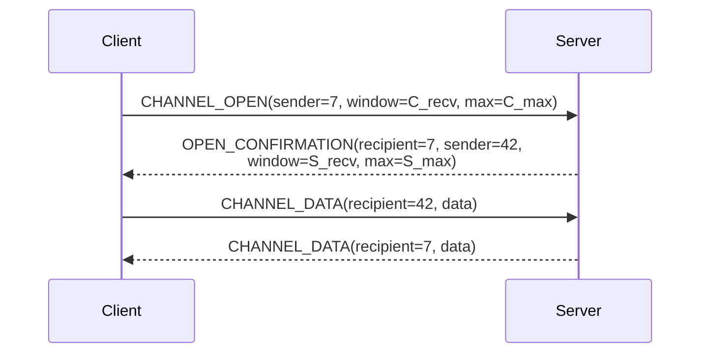
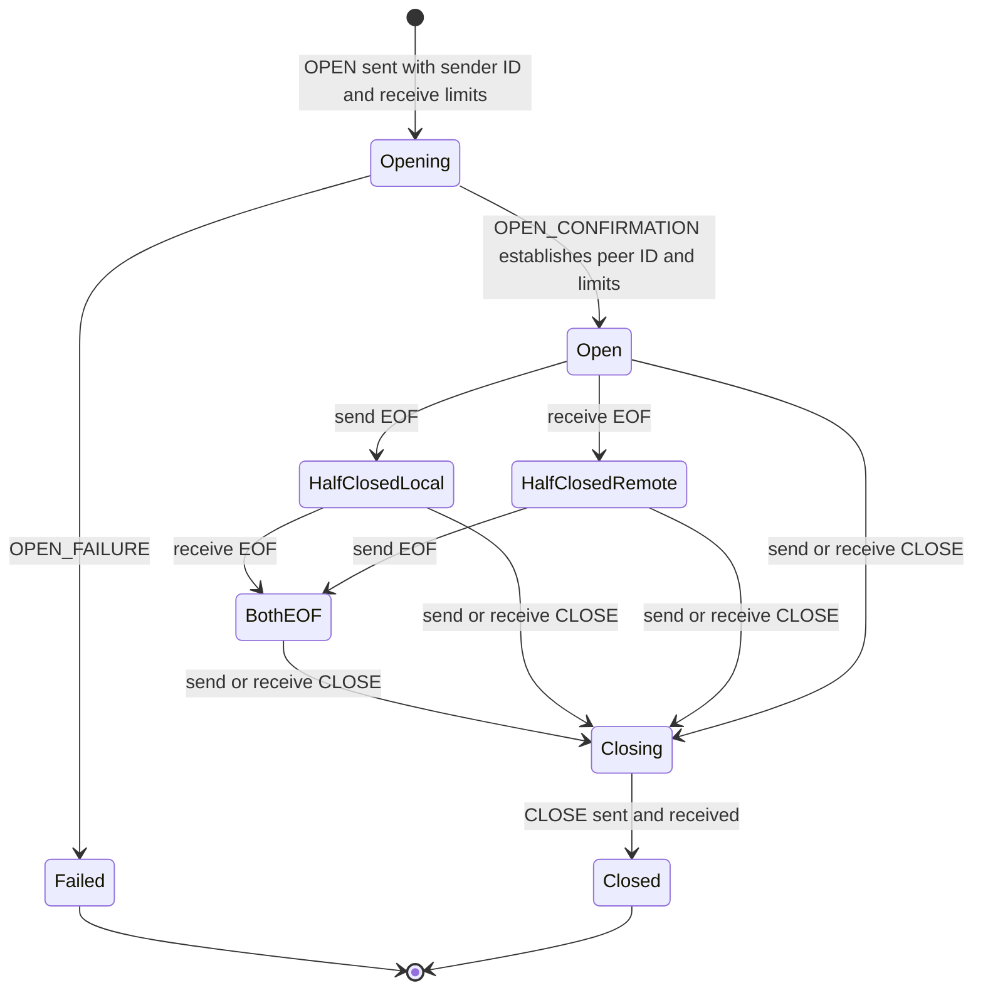
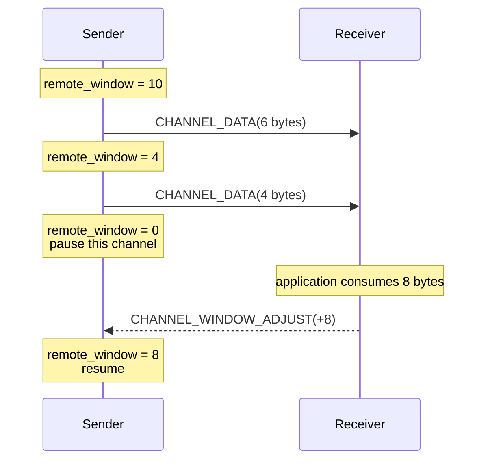
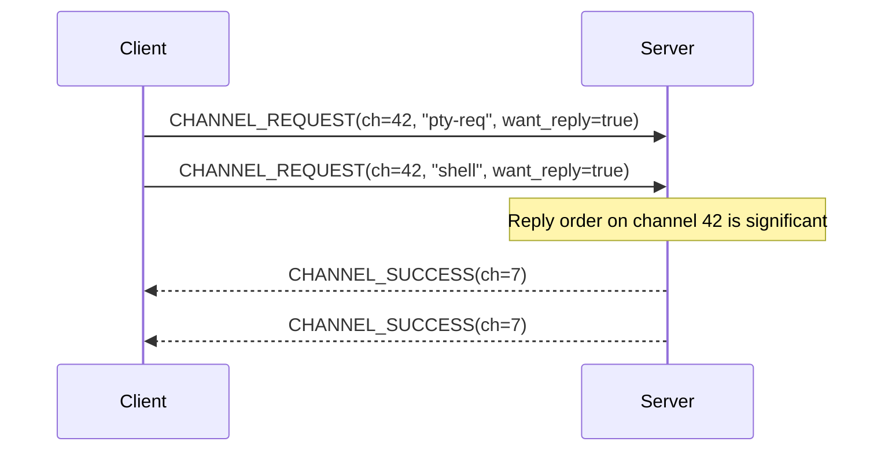
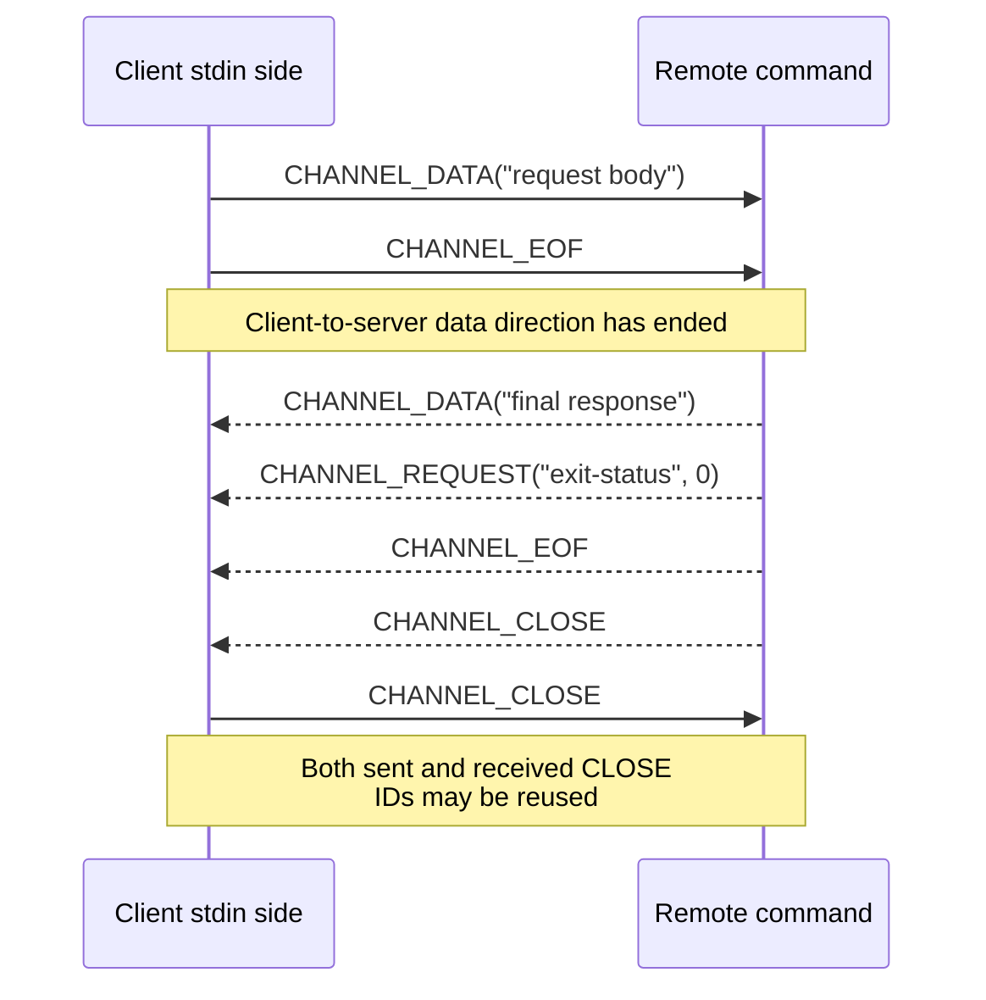

# Channels and flow control

After user authentication, the `ssh-connection` service multiplexes many
logical byte streams over one transport. Each stream is a
**channel** with its own identifiers, flow-control windows, requests, and
close state.

[RFC 4254](https://www.rfc-editor.org/rfc/rfc4254.html) specifies this layer.
The next two chapters apply its common rules to sessions and TCP forwarding.

## One transport, many channels

SSH multiplexes independent activities into the transport packet stream.

Closing one channel does not close the others or end the SSH transport.

The channels still share one ordered TCP stream. If a TCP segment is lost,
later bytes for every channel wait for retransmission. This is TCP
*head-of-line blocking*. Channel windows isolate receive credit, but they do
not guarantee independent latency, bandwidth, or scheduling. Rekeying and a
transport failure also affect all channels.

## Channel numbers are local

Each peer chooses its own number for the same logical channel. Suppose the client calls a new channel `7` and the server calls it `42`:



The `sender channel` field introduces the number chosen by the sender. Subsequent messages carry the *recipient's* local number. The same logical channel therefore has a pair of identifiers, not one universal channel ID:

```text
local channel 7 <-> remote channel 42
```

The words *sender* and *recipient* are relative to the message carrying the field. Each channel's identifier pair keeps its data, windows, and lifecycle separate from every other channel.

## Opening a channel

Either peer may open a channel. The generic message is:

```text
byte      SSH_MSG_CHANNEL_OPEN
string    channel type
uint32    sender channel
uint32    initial window size
uint32    maximum packet size
...       channel-type-specific fields
```

The recipient returns `SSH_MSG_CHANNEL_OPEN_CONFIRMATION`, which introduces its own channel number and receive limits, or `SSH_MSG_CHANNEL_OPEN_FAILURE`, which contains a reason code and description. Standard failure reasons distinguish administrative prohibition, connection failure, unknown type, and resource shortage. See [RFC 4254, Section 5.1](https://www.rfc-editor.org/rfc/rfc4254.html#section-5.1).

The opener waits for confirmation before sending channel data. At that point
it knows the recipient's channel ID and the credit available in that direction.



A channel number does not become reusable merely because one side has sent CLOSE. Under RFC 4254, the channel is closed for a peer only once that peer has both sent and received `SSH_MSG_CHANNEL_CLOSE`.

## Windows and flow control

TCP already has flow control, but one TCP receive buffer is shared by all multiplexed SSH traffic. SSH adds a receive window to each channel and each direction, so a slow consumer can stop its own stream without requiring every channel to stop.

The window advertised in `CHANNEL_OPEN` or `OPEN_CONFIRMATION` is a promise: “you may send me this many bytes of channel data.” It describes the sender's receive capacity, not its send capacity.

For each direction, sending follows this arithmetic:

```text
allowed_channel_data = min(remote_window, remote_max_packet)
remote_window  -= bytes_sent
```

When the receiver has made capacity available, it sends:

```text
SSH_MSG_CHANNEL_WINDOW_ADJUST(recipient_channel, bytes_to_add)
```

The sender adds that credit without allowing the 32-bit window to overflow. Data must stop when the remote window reaches zero, but control messages such as window adjustments, EOF, CLOSE, and channel requests do not consume window space.



Both `SSH_MSG_CHANNEL_DATA` and `SSH_MSG_CHANNEL_EXTENDED_DATA` consume the same channel window. For session channels, extended-data type 1 is stderr. The maximum channel packet size is independent from the transport packet ceiling, and both limits apply. [RFC 4254, Section 5.2](https://www.rfc-editor.org/rfc/rfc4254.html#section-5.2) defines these rules.

Window accounting counts bytes in the `data` string, excluding its length
prefix and the surrounding SSH fields, padding, and protection. Compression
does not buy extra channel credit: 1,000 bytes of channel data consume 1,000
bytes of window even if the protected packet on the wire is much smaller.

Sharing credit also links stdout and stderr. If a client consumes stdout but
leaves stderr buffered, stderr can eventually occupy the entire receive
window and stop further output on that session channel.

The receiver decides when and by how much to replenish the window. This ties permission to send to the receiver's capacity to consume data. Until `WINDOW_ADJUST` adds credit, a zero-window sender must pause that channel even if the underlying TCP connection remains writable.

## Requests are not data

SSH has two request scopes:

| Scope | Message | Example | Reply if requested |
| --- | --- | --- | --- |
| Whole connection | `SSH_MSG_GLOBAL_REQUEST` | Ask the server to listen for remote forwarding | `SSH_MSG_REQUEST_SUCCESS` or `FAILURE` |
| One channel | `SSH_MSG_CHANNEL_REQUEST` | Allocate a PTY or start a command | `SSH_MSG_CHANNEL_SUCCESS` or `FAILURE` |

Both include a `want reply` boolean. When it is false, no success or failure reply is sent. When it is true, the generic reply contains no request identifier, so its meaning comes from ordering. Global replies preserve global request order; channel-request replies preserve order within that channel, while replies for different channels may be interleaved. See [RFC 4254, Sections 4 and 5.4](https://www.rfc-editor.org/rfc/rfc4254.html#section-4).



For setup operations whose success affects correctness, request and check a reply. A client that sends `exec` with no reply and immediately treats bytes as command output cannot distinguish refusal from delayed output or later channel closure.

## Keepalives and evidence of liveness

An idle connection can be healthy: SSH does not require continuous channel
traffic. To detect an unresponsive peer, a client can send a protected request
that requires a reply. OpenSSH's server-alive mechanism sends the global
request `keepalive@openssh.com` with `want_reply = true`; see its
[client implementation](https://github.com/openssh/openssh-portable/blob/master/clientloop.c).

A peer that does not recognize a global request returns
`SSH_MSG_REQUEST_FAILURE` when a reply was requested. That failure still
demonstrates that the peer processed the request and sent a protected reply.
It is useful evidence of liveness even though the requested operation did not
succeed. As with every global reply, its position in the reply order identifies
which request it answers.

| Observation | What it establishes |
| --- | --- |
| A local write succeeds | The local system accepted bytes for sending. |
| A TCP acknowledgement arrives | TCP reports receipt of stream bytes; it provides no SSH authentication or evidence of application processing. |
| A protected SSH request receives its corresponding reply | The SSH peer processed that request. |
| A command produces output or an exit report | That particular channel has application progress or a reported result. |

`SSH_MSG_IGNORE` requests no reply, so sending it alone cannot establish that
the peer is responsive. A global keepalive also does not prove that a shell,
forwarded target, or other channel is making progress. It consumes no channel
window, though TCP stalls and rekeying can still delay it.

OpenSSH exposes its policy through `ServerAliveInterval` and
`ServerAliveCountMax`, separately from `TCPKeepAlive`; see
[`ssh_config(5)`](https://man.openbsd.org/ssh_config#ServerAliveInterval).
A timeout establishes that the expected response did not arrive in time. It
cannot distinguish a failed server from a delayed or broken network path.

## EOF and CLOSE

`SSH_MSG_CHANNEL_EOF` means “I will send no more data in this direction.” It is a half-close. No protocol reply is required, and the other direction remains usable.

`SSH_MSG_CHANNEL_CLOSE` means “terminate this channel.” A recipient must send CLOSE back unless it already did. EOF is conventional before a graceful close but is not required.



Local stdin reaching EOF ends only the client-to-server data direction; the remote command may still send final output and an exit status. EOF and CLOSE can be sent even when the data window is zero, so exhausted data credit does not make shutdown impossible. See [RFC 4254, Section 5.3](https://www.rfc-editor.org/rfc/rfc4254.html#section-5.3).

## Protocol review

The connection protocol has these invariants:

- one logical channel has an independently chosen local ID at each endpoint;
- each direction has independently advertised windows and maximum packet sizes;
- ordinary and extended data consume the same receive credit;
- a zero window prohibits that direction's channel data, while control
  traffic and other channels remain eligible to send;
- request replies derive their meaning from scope and ordering;
- EOF half-closes one direction without discarding the other; and
- channel IDs are reused only after CLOSE has been both sent and received.

## Lab: simulate two channels

Open two channels on paper. Give the client and server different local IDs for
each. Then trace this sequence:

1. The first channel exhausts its server-advertised window.
2. The second channel continues to deliver data.
3. The first receiver consumes data and replenishes only that channel.
4. The second channel's client sends EOF while still receiving final data.
5. Both channels complete independent CLOSE handshakes.

At each step, record the recipient channel number and both directional window
values. Exhausting the first channel's credit does not reduce the second
channel's credit. A shared TCP stall could still delay both.

## References

- [RFC 4254: The Secure Shell (SSH) Connection Protocol](https://www.rfc-editor.org/rfc/rfc4254.html).
- [RFC 4251: The Secure Shell (SSH) Protocol Architecture](https://www.rfc-editor.org/rfc/rfc4251.html).
