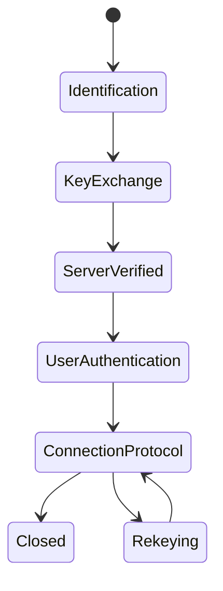
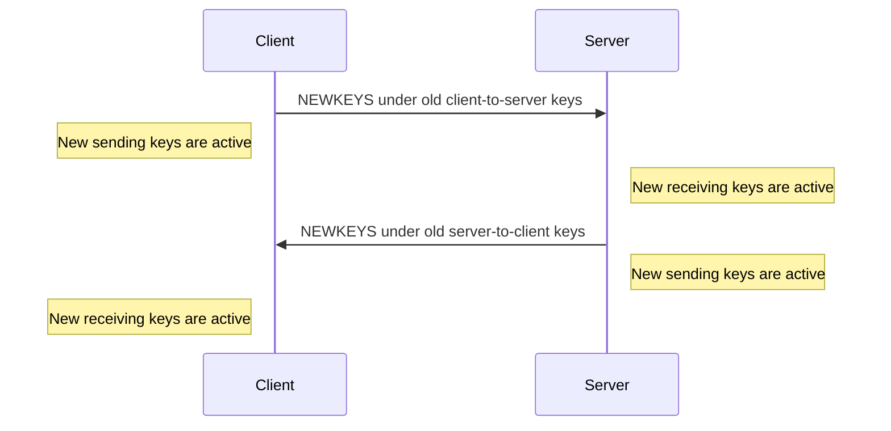
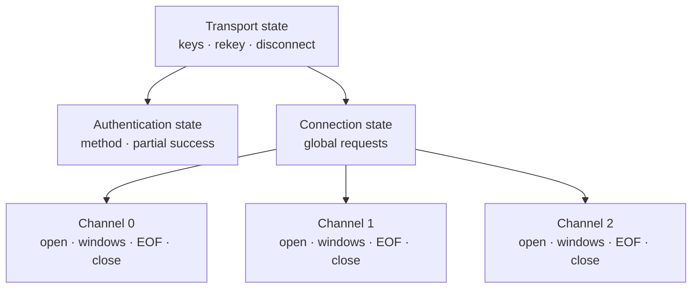

# The client's view of protocol state

SSH is easiest to understand as a conversation whose vocabulary changes over
time. The same byte value can mean different things in different phases, and a
message that is valid later may be a protocol error now.

## Layers are also a sequence

The protocol layers are nested, but the client encounters them in a definite
order. Transport stays active underneath authentication and connection traffic;
it does not disappear when the next layer begins.

This produces three important boundaries:

- server authentication is completed by the transport before user credentials
  are sent;
- user authentication succeeds before connection channels are used; and
- transport rekeying can occur later without repeating user authentication or
  discarding open channels.

The diagram shows the usual successful path. A disconnect or transport failure
can end any phase. Rekeying belongs to the transport and can also interrupt
authentication, although RFC 8308 recommends waiting until authentication
succeeds and imposes additional restrictions when delayed compression is in
use. See [compression transitions](./binary-packets.md#compression-changes-payloads-not-channels).

## Client and server roles are asymmetric

Both sides propose algorithms and contribute ephemeral key material, but their
responsibilities are not mirror images.

| Question | Client's role | Server's role |
| --- | --- | --- |
| Who starts the network connection? | initiates | listens and accepts |
| Whose algorithm order wins? | supplies preference order | supplies compatible set |
| Who proves a host identity? | verifies proof and trust | signs with host key |
| Who proves a user identity? | supplies authentication proof | applies account policy |
| Who may open channels? | either peer | either peer |

“Client” and “server” keep these meanings across a rekey. The peer which sends
the first new `SSH_MSG_KEXINIT` has initiated that rekey, but it has not become
the SSH client.

## State is directional

SSH protects client-to-server and server-to-client traffic separately. Each
direction has its own cipher state, integrity state, packet sequence number,
and `NEWKEYS` transition.

For the initial exchange, “old keys” means no packet protection. During a
rekey, it means the keys which were already carrying the authenticated session.
The two `NEWKEYS` packets may cross in flight, so there can briefly be different
epochs in the two directions.

Channel state is directional too. Each side advertises how much data it will
receive, and `SSH_MSG_CHANNEL_EOF` closes only the sender's data direction.
This recurring two-direction pattern explains many otherwise surprising rules.

## Several state machines coexist

Once user authentication succeeds, one transport can contain multiple channel
conversations while transport-level events still occur.

A zero window on channel 1 does not freeze channel 2. Closing channel 0 does
not end the transport. Rekeying changes packet protection beneath all of them
but does not create new logical channels.

This independence is at the SSH channel layer. All channels still share TCP
ordering and congestion control; a missing TCP segment can delay every
channel. The [flow-control chapter](./channels.md#one-transport-many-channels)
explains that limit.

The current conversation supplies context for message numbers. For example,
message number 60 can mean a public-key query acceptance, a password-change
request, or an interactive prompt. The active authentication method removes
the ambiguity.

## Four distinct questions

An SSH trace mentions several names and keys which answer different questions.

The network address tells the client where bytes were delivered. The host-key
trust decision tells it which server received them. User authentication asks
whether the client may act as an account on that server. A channel request then
asks what program or forwarding operation that authenticated connection may
start. Success at one boundary does not imply success at the next.

## Follow the unit currently in motion

SSH changes framing and data units as the conversation progresses. It begins
with identification lines on the reliable stream, then carries SSH packets
containing message payloads. Later, channel data carries application byte
streams inside those messages.

An identification line is not a binary packet. A packet is not the same as a
TCP segment. A channel data message can carry only part of an application's
stream, and its boundary normally has no meaning to that application.

When reading a trace, annotate every item with its unit, direction, layer, and
current state. That is often enough to explain why a length, number, or close
event behaves the way it does.

## Protocol review

Before moving into packet details, make sure you can explain:

1. why the transport layer remains active after user authentication starts;
2. why sending and receiving can switch keys at different moments;
3. why rekeying does not authenticate the user again;
4. why a channel number has meaning only to the peer which chose it; and
5. why message number 60 cannot be decoded without authentication-method state.
