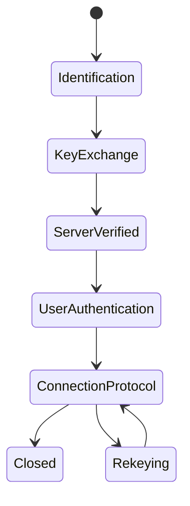
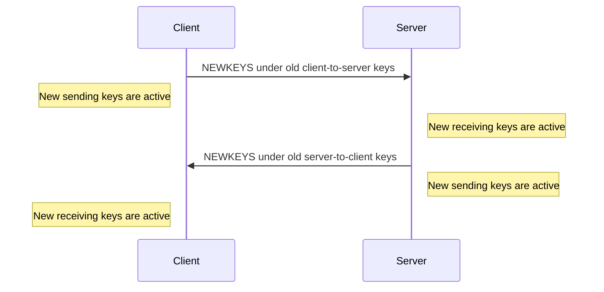
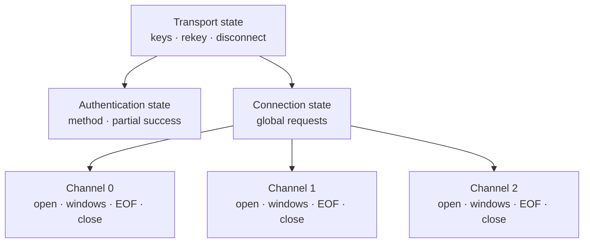

# The client's view of protocol state

SSH is a conversation whose vocabulary changes over time. The same byte value
can mean different things in different phases, and a message that is valid
later may be a protocol error now.

## Layers are also a sequence

The protocol layers are nested, but the client meets them in a fixed order.
Transport stays active underneath authentication and connection traffic; it
does not disappear when the next layer begins.

The sequence creates three boundaries:

- the transport authenticates the server before the client sends user
  credentials;
- user authentication succeeds before connection channels are used; and
- later rekeying neither repeats user authentication nor discards open
  channels.

The diagram shows the successful path; a disconnect or transport failure can
end any phase. Rekeying belongs to the transport, so it can also interrupt
authentication, although RFC 8308 says peers should wait until authentication
succeeds and restricts rekeying further when delayed compression is
negotiated. See
[compression transitions](./binary-packets.md#compression-changes-payloads-not-channels).

## Four distinct questions

An SSH trace mentions several names and keys that answer different questions:

1. The network address says where bytes were delivered.
2. The host-key trust decision says which server received them.
3. User authentication decides whether the client may act as an account on
   that server.
4. A channel request asks which program or forwarding operation that
   connection may start.

Success at one boundary does not imply success at the next.

## Client and server roles are asymmetric

Both sides propose algorithms and contribute ephemeral key material, but their
responsibilities are not mirror images.

| Question | Client's role | Server's role |
| --- | --- | --- |
| Who starts the network connection? | initiates | listens and accepts |
| Whose algorithm order wins? | supplies preference order | supplies compatible set |
| Who proves a host identity? | verifies proof and trust | signs with host key |
| Who proves a user identity? | supplies authentication proof | applies account policy |
| Who may open channels? | either peer | either peer |

These roles survive a rekey. The peer that sends the first new
`SSH_MSG_KEXINIT` initiates that rekey, but it does not become the SSH client.

## State is directional

SSH protects client-to-server and server-to-client traffic separately. Each
direction has its own cipher state, integrity state, packet sequence number,
`NEWKEYS` transition, and
[derived keys](./crypto-hashes.md#key-derivation-in-ssh).

In the initial exchange, “old keys” means no protection; during a rekey, it
means the keys already protecting the session. The two `NEWKEYS` packets may
cross in flight, so the two directions can briefly use different key epochs.

Channel state is directional too. Each side advertises how much data it will
receive, and `SSH_MSG_CHANNEL_EOF` closes only the sender's data direction.
This two-direction pattern explains many otherwise surprising rules.

## Several state machines coexist

After user authentication, one transport can carry several channel
conversations while transport-level events continue.

A zero window on channel 1 does not freeze channel 2. Closing channel 0 does
not end the transport. Rekeying changes packet protection beneath all of them
but creates no new channels.

This independence exists only at the SSH layer. All channels share TCP
ordering and congestion control, so a lost TCP segment can delay every
channel; see
[one transport, many channels](./channels.md#one-transport-many-channels).

Channel numbers are local names. Each peer picks its own number for a channel
when it opens or accepts it, so one channel has two numbers, one per side. The
open and its confirmation exchange these numbers; after that, every channel
message carries the *recipient's* number. The client's “channel 0” may be the
server's channel 5.

The current state also decides what a message number means. Message number 60
can be a public-key query acceptance, a password-change request, or an
interactive prompt; only the active authentication method tells them apart.

## Follow the unit in motion

SSH changes its data unit as the conversation progresses: identification lines
on the byte stream, then SSH packets carrying message payloads, then channel
data carrying application byte streams inside those messages.

An identification line is not a binary packet, and a packet is not a TCP
segment. A channel data message can carry part of an application's stream, and
its boundary normally means nothing to that application.

When reading a trace, annotate each item with its unit, direction, layer, and
current state. That often explains why a length, number, or close event
behaves as it does.

## Check your understanding

1. Why does the transport layer remain active after user authentication
   starts?
2. Why does rekeying not authenticate the user again?
3. A server's host key is trusted and user authentication succeeds, but the
   server refuses an `exec` request. Which of the four questions failed?
4. Why can sending and receiving switch keys at different moments?
5. The client calls a session channel 0, and the server calls it channel 5.
   Which number does each side put in the channel messages it sends?
6. Why can message number 60 not be decoded without authentication-method
   state?

Answers

1. Every later message still travels in transport packets. The transport
   provides encryption, integrity, sequence numbers, rekeying, and disconnect
   handling for authentication and connection traffic alike.
2. Rekeying replaces traffic keys underneath the existing session. User
   authentication belongs to a higher layer and remains valid; the session
   identifier from the first exchange does not change.
3. The fourth: the authenticated connection may not start that program.
   Server identity and user identity were both established.
4. Each direction switches at its own `NEWKEYS`: a peer changes sending keys
   after sending `NEWKEYS` and receiving keys after receiving the peer's. The
   two messages can cross in flight.
5. Messages carry the recipient's number: the client sends 5 and the server
   sends 0. Each number means something only to the peer that allocated it.
6. Numbers 60–79 are method-specific: 60 is `USERAUTH_PK_OK` under
   `publickey`, `USERAUTH_PASSWD_CHANGEREQ` under `password`, and
   `USERAUTH_INFO_REQUEST` under `keyboard-interactive`.

## References

- [RFC 4251, section 4: Architecture](https://www.rfc-editor.org/rfc/rfc4251#section-4)
- [RFC 4253, section 7: Key exchange](https://www.rfc-editor.org/rfc/rfc4253#section-7)
  and [section 9: Key re-exchange](https://www.rfc-editor.org/rfc/rfc4253#section-9)
- [RFC 4252: SSH Authentication Protocol](https://www.rfc-editor.org/rfc/rfc4252)
- [RFC 4254, section 5: Channel mechanism](https://www.rfc-editor.org/rfc/rfc4254#section-5)
- [RFC 8308, section 3.2.1: Awkwardly timed key re-exchange](https://www.rfc-editor.org/rfc/rfc8308#section-3.2.1)
