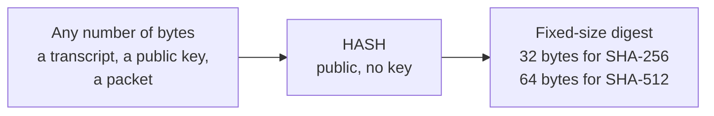
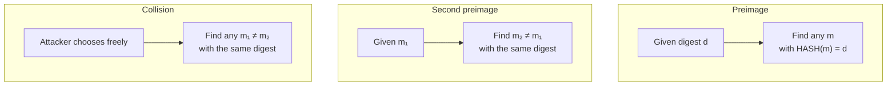
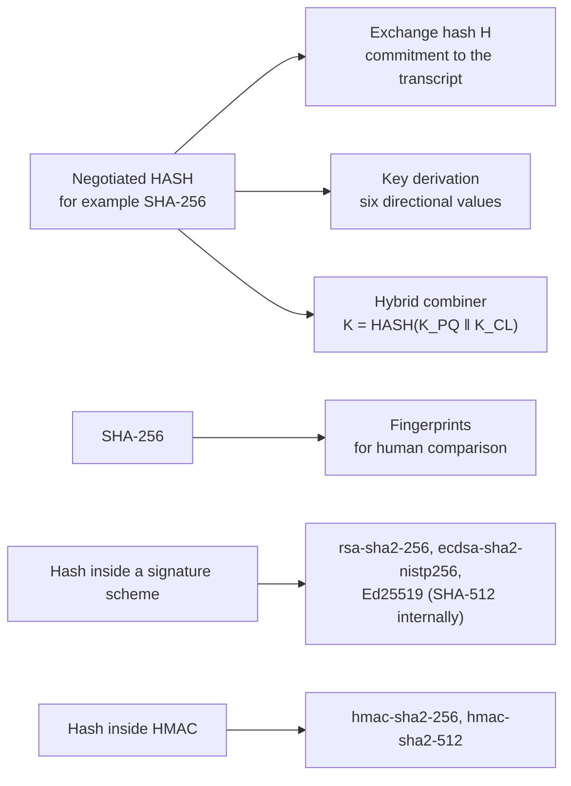
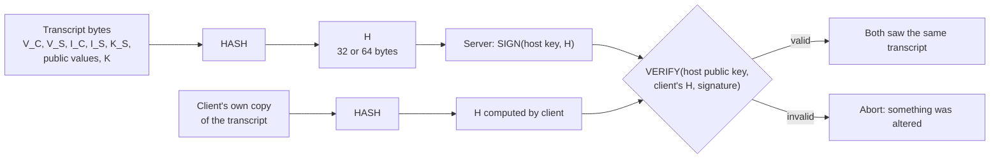
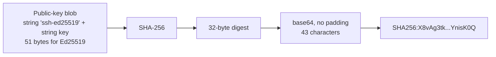
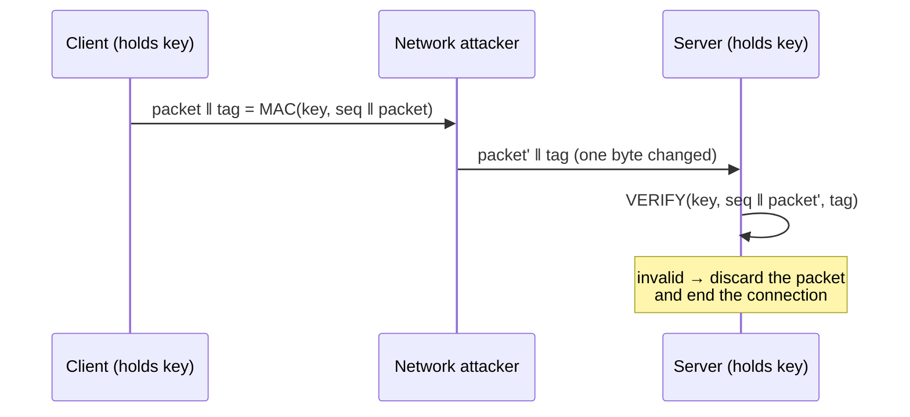
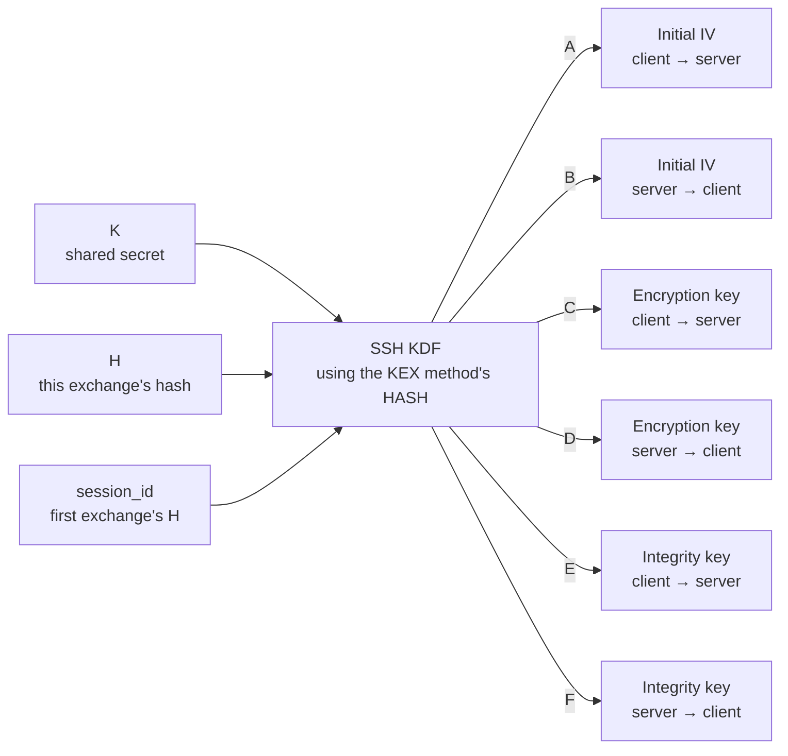
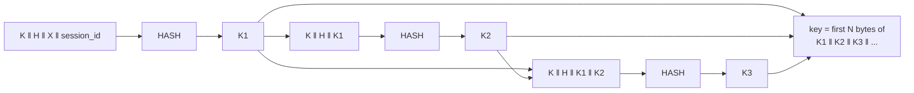

# Hashes, MACs, and key derivation

Three of SSH's black boxes are closely related:

- a **hash function** condenses any bytes into a short, fixed-size digest,
  with no secret involved;
- a **message authentication code** (MAC) uses a shared secret key to
  produce a tag that detects modification; and
- a **key derivation function** (KDF) turns one shared secret into many
  independent keys.

In SSH, all three are usually built from the same hash, such as SHA-256 or
SHA-512. This chapter opens those boxes. The overview in
[Cryptography as protocol building blocks](./cryptography-primer.md) shows
where they fit in a connection.

## Hash functions as a black box



```text
HASH(bytes) -> digest
```

A cryptographic hash is deterministic: the same input always gives the same
digest, on any machine. A small change to the input gives an unrelated
digest. For example, with SHA-256:

```text
SHA-256("ssh") = 7f5a55cf3f88be936fb9440249cb449f3067ccee4b525d0027dc9278a29c32c1
SHA-256("ssi") = 5eb50a4eaeac628268d07200700fad13e5e539f696a9d9483f57a6736197c6ec
```

The box has no failure result; every input has a digest. What makes it
*cryptographic* is that three kinds of search are infeasible.

| Property | Attacker is given | Attacker must find | Generic cost, n-bit digest | SSH relies on it for |
| --- | --- | --- | --- | --- |
| Preimage resistance | a digest `d` | any `m` with `HASH(m) = d` | about 2ⁿ | derived keys not revealing `K`; one output of the KDF not revealing another |
| Second-preimage resistance | a specific input `m₁` | a different `m₂` with the same digest | about 2ⁿ | fingerprints: a fake key must match a *particular* real key's digest |
| Collision resistance | nothing; free choice | any pair `m₁ ≠ m₂` with the same digest | about 2^(n/2) | signatures over digests: exchange hash, certificates, `rsa-sha2-256` |



Collision resistance is the hardest property to keep because the attacker
controls both inputs. It is also the first to fail when a hash ages: MD5 and
SHA-1 have both lost practical collision resistance, while no practical
second-preimage attack is known for either.

A hash does **not**:

- involve a secret, so anyone can compute it, including an attacker who has
  modified the input;
- authenticate anything by itself; a digest published over the same channel
  as the data can be replaced along with it; or
- hide low-entropy inputs; hashing a four-digit PIN leaves only 10,000
  candidates to try.

Authentication comes from adding a key (a MAC) or a private key (a
signature) to the picture.

## Where SSH uses hashes



The key-exchange method fixes one hash, called `HASH` in the RFCs, for the
exchange hash, the key derivation, and any hybrid combiner.
[RFC 4253, section 7.2](https://www.rfc-editor.org/rfc/rfc4253#section-7.2)
requires the same hash for the exchange hash and the key derivation. The
method name usually says which:

| KEX method | `HASH` | Digest size |
| --- | --- | ---: |
| `curve25519-sha256` | SHA-256 | 32 bytes |
| `ecdh-sha2-nistp256` | SHA-256 | 32 bytes |
| `ecdh-sha2-nistp384` | SHA-384 | 48 bytes |
| `diffie-hellman-group14-sha256` | SHA-256 | 32 bytes |
| `mlkem768x25519-sha256` | SHA-256 | 32 bytes |
| `mlkem1024nistp384-sha384` | SHA-384 | 48 bytes |
| `sntrup761x25519-sha512` | SHA-512 | 64 bytes |

The hashes inside signature and MAC names are separate choices. A
connection can use SHA-256 for its exchange hash, sign that hash with
`rsa-sha2-512`, and protect packets with `hmac-sha2-512`.

### The exchange hash commits to the transcript

The [exchange hash](./key-exchange.md#the-exchange-hash-authenticate-the-whole-decision)
`H` condenses everything the peers said during negotiation and key
exchange—version strings, both `KEXINIT` payloads, the host key, the
ephemeral public values—together with the shared secret `K`. It is a
*commitment*: any change to any input gives a different `H`.



Signing the hash rather than the transcript itself is called
*hash-then-sign*. The signature algorithm then only has to handle a short,
fixed-size input, and one signature covers the whole transcript. The
price is that the signature is exactly as trustworthy as the hash's
collision resistance: if an attacker can make two transcripts with the same
`H`, a signature on one is a signature on the other.

<details>
<summary>Go deeper: collisions, birthdays, and the retirement of SHA-1</summary>

**The birthday paradox.** In a room of just 23 people, the chance that two
share a birthday is about 50.7%. That seems too high because we
instinctively compare each person with *ourselves*—a second-preimage
search—when the question is about *any* pair. With 23 people there are
23·22/2 = 253 pairs.

The same arithmetic applies to an n-bit hash, which has 2ⁿ possible
digests. After trying k random inputs there are about k²/2 pairs, and a
repeat becomes likely once k²/2 approaches 2ⁿ, that is, around

```text
k ≈ 2^(n/2)          (about 1.18 · 2^(n/2) for a 50% chance)
```

So a 256-bit hash offers about 128-bit collision resistance, but still
about 256-bit second-preimage resistance.

**A toy you can run.** Truncate SHA-256 to its first 16 bits and hash the
strings `"0"`, `"1"`, `"2"`, … Searching for a collision among them, the
inputs `"157"` and `"251"` both give `c75d` after only 252 tries. Searching
instead for a *second preimage* of `"ssh"` (whose truncated digest is
`7f5a`) takes until input `"83647"`, roughly 2¹⁶ tries. The expected
collision cost for 16 bits is about 2⁸·√(π/2) ≈ 321 tries.

```text
python3 -c "import hashlib,itertools;s={};print(next((s[h],i) for i in itertools.count() if (h:=hashlib.sha256(str(i).encode()).digest()[:2]) in s or s.setdefault(h,i)<0))"
```

Sixteen bits is trivially small; the toy only shows the square-root gap
between the two searches.

**SHA-1's decline.** SHA-1 has a 160-bit digest, so its generic collision
cost is about 2⁸⁰. Cryptanalysis cut that far lower:

- In 2017, the [SHAttered](https://shattered.io/) team published the first
  SHA-1 collision, two different PDF files with the same digest. It took
  roughly nine quintillion (about 2⁶³) SHA-1 computations.
- In 2020, [SHA-1 is a Shambles](https://sha-mbles.github.io/) produced a
  *chosen-prefix* collision: the attacker picks two different starting
  messages and then finds suffixes that make the digests equal. They used it
  to make two PGP keys with different user IDs and colliding certificates,
  so one signature could be transferred from one key to the other, and
  estimated the cost at about USD 45,000.

Chosen-prefix collisions are the dangerous kind for signatures, because
the attacker can make both colliding messages meaningful. The
[OpenSSH 8.8 release notes](https://www.openssh.com/txt/release-8.8)
(September 2021) cite this attack when disabling RSA signatures using
SHA-1—the `ssh-rsa` signature algorithm—by default. RSA *keys* are
unaffected; they sign with `rsa-sha2-256` or `rsa-sha2-512` instead. See
[RSA](./crypto-signatures.md#rsa).

Learn more:

- [Wikipedia: Birthday problem](https://en.wikipedia.org/wiki/Birthday_problem)
  and [Birthday attack](https://en.wikipedia.org/wiki/Birthday_attack)
- [Wikipedia: Cryptographic hash function](https://en.wikipedia.org/wiki/Cryptographic_hash_function)
- [FIPS 180-4, Secure Hash Standard](https://csrc.nist.gov/pubs/fips/180-4/upd1/final)
  (SHA-1 and SHA-2)

</details>

## Fingerprints

A fingerprint is a short, human-comparable digest of a public key. OpenSSH
computes it as the SHA-256 hash of the SSH public-key *blob*—the same
binary encoding that is sent in protocol messages—and displays it in base64
without trailing `=` padding, prefixed by the hash name.



For a freshly generated Ed25519 key:

```text
$ ssh-keygen -lf demokey.pub
256 SHA256:X8vAg3tkZaJFhPVIjcDeOEf50Wnak3wGWVLWYnisK0Q demo (ED25519)

$ ssh-keygen -E md5 -lf demokey.pub
256 MD5:0c:d6:cc:6a:02:6a:36:1d:26:74:df:ca:6b:5d:de:e0 demo (ED25519)
```

The leading `256` is the key size in bits, and the trailing parts are the
comment and key type; only the `SHA256:` value is the fingerprint. The
colon-separated MD5 hex form was OpenSSH's default until version 6.8
(2015), which switched to SHA-256 and base64
([release notes](https://www.openssh.com/txt/release-6.8)). You still meet
MD5 fingerprints in old documentation and some other tools. Compare
fingerprints only when they use the same hash.

OpenSSH can also draw a fingerprint as "randomart", a small ASCII picture
(`ssh-keygen -lv`, or `VisualHostKey yes` in
[`ssh_config`](https://man.openbsd.org/ssh_config#VisualHostKey)). The
picture helps notice a change at a glance, but it is not a substitute for
comparing the fingerprint text when trust depends on it.

Because the fingerprint covers the key blob, it identifies the *key*, not
the signature algorithm: an RSA key has the same fingerprint whether it
signs with `rsa-sha2-256` or `rsa-sha2-512`. A fingerprint also says nothing
about *which host* the key belongs to. That binding is a trust decision,
covered in [Server authentication](./server-authentication.md#fingerprints-and-key-formats).

### Compare the whole fingerprint

People often check only the first and last few characters. An attacker who
wants a key that *looks* like a victim's fingerprint does not need to break
SHA-256. They generate key pairs until one matches the characters that
people actually check. This is a second-preimage search against the
*checked part* only, and its cost depends on how many bits that part
contains. Each base64 character carries 6 bits.

| Characters matched | Bits | Keys to try (expected) | Time at 10⁹ keys per second |
| ---: | ---: | ---: | --- |
| 4 | 24 | 1.7 × 10⁷ | about 0.02 seconds |
| 6 | 36 | 6.9 × 10¹⁰ | about 69 seconds |
| 8 | 48 | 2.8 × 10¹⁴ | about 3.3 days |
| 11 | 66 | 7.4 × 10¹⁹ | about 2,300 years |
| all 43 | 256 | 1.2 × 10⁷⁷ | infeasible |

Matching the first four and last four characters is about 46 bits, because
the final character carries only 4 bits (43 × 6 = 258, two more than the
digest has). At the table's rate that is under a day of work. Matching the full fingerprint requires a real second
preimage of SHA-256, which no one knows how to find. The practical rule:
compare the entire string, preferably by machine, for example by pasting the
expected value into a search or letting `known_hosts` do the comparison.

## Message authentication codes

A MAC is a hash-like function with a secret key. Only holders of the key
can compute a valid tag, so a valid tag shows that the data came from a key
holder and was not modified.

```text
MAC(key, data)            -> tag
VERIFY(key, data, tag)    -> valid | invalid
```



Unlike a signature, a MAC is symmetric: both endpoints hold the same key.
The server knows a valid tag came from the client only because the server
did not produce it itself—and directional keys make that true. A third party
cannot be convinced by a MAC, because either key holder could have made it.
A MAC does not provide confidentiality; the data may be sent in the clear.

### What an SSH MAC covers

In the base construction of
[RFC 4253, section 6.4](https://www.rfc-editor.org/rfc/rfc4253#section-6.4),
the sender computes, for every packet:

```text
mac = MAC(key, uint32 sequence_number || unencrypted_packet)
```

where `unencrypted_packet` is the length fields, payload, and padding. The
[sequence number](./binary-packets.md#sequence-numbers) is never sent; each
side counts packets in each direction. The `-etm@openssh.com` variants
instead cover the sequence number, the cleartext packet length, and the
*ciphertext*, and AEAD modes produce their tag as part of encryption. The
three arrangements, and why their order matters, are compared in
[Three ways to combine encryption and integrity](./crypto-symmetric.md#three-ways-to-combine-encryption-and-integrity).

Including the implicit sequence number turns a per-packet check into a
check on the *stream*:

| Attacker action | Why verification fails |
| --- | --- |
| Replay an earlier packet | Its tag was computed with an older sequence number. |
| Swap two packets | Each arrives at a position whose sequence number differs from the one it was tagged with. |
| Delete a packet | The next packet was tagged with a sequence number one higher than the receiver expects. |
| Reflect a packet back to its sender | The other direction uses a different MAC key. |

This coverage has a known edge: the sequence number authenticates the order
of packets that were *counted*, so any gap between the signed handshake and
the counter's starting state is a weakness. The
[Terrapin attack](./crypto-symmetric.md#terrapin-when-implicit-state-is-not-authenticated)
exploited exactly that, and [strict key exchange](./version-and-negotiation.md#strict-key-exchange)
closes it.

### MAC algorithms in SSH

| Name | Construction | Tag / key size | Notes |
| --- | --- | --- | --- |
| `hmac-sha2-256` | HMAC with SHA-256 | 32 / 32 bytes | [RFC 6668](https://www.rfc-editor.org/rfc/rfc6668) |
| `hmac-sha2-512` | HMAC with SHA-512 | 64 / 64 bytes | [RFC 6668](https://www.rfc-editor.org/rfc/rfc6668) |
| `hmac-sha2-256-etm@openssh.com`, `hmac-sha2-512-etm@openssh.com` | Same HMACs | same | Encrypt-then-MAC packet layout ([OpenSSH `PROTOCOL`](https://github.com/openssh/openssh-portable/blob/master/PROTOCOL)) |
| `umac-64@openssh.com`, `umac-128@openssh.com` | UMAC ([RFC 4418](https://www.rfc-editor.org/rfc/rfc4418)) | 8 or 16 / 16 bytes | Fast universal-hash MAC; `-etm` variants exist |
| `hmac-sha1` | HMAC with SHA-1 | 20 / 20 bytes | Required by RFC 4253; legacy today |

HMAC-SHA-1 is not broken as a MAC in the way SHA-1 signatures are, because
HMAC's security does not rest on collision resistance. It is retired as a
matter of hygiene in favor of SHA-2. When an AEAD cipher such as
`chacha20-poly1305@openssh.com` or `aes256-gcm@openssh.com` is selected, no
separate MAC is negotiated for that direction at all; see
[Algorithm negotiation](./version-and-negotiation.md#the-selection-rule-client-preference-wins).

A receiver compares the received tag with the expected tag in constant
time, examining every byte regardless of where the first difference is. An
early-exit comparison leaks, through timing, how many leading bytes were
correct. Reviewed libraries provide such a comparison; it is one of the
details that belongs inside the black box.

<details>
<summary>Go deeper: how HMAC works, and why not just HASH(key ‖ message)</summary>

**The obvious construction is broken.** It is tempting to define
`MAC(K, m) = HASH(K || m)`. SHA-1 and SHA-2 are *Merkle–Damgård* hashes:
they process the input in fixed-size blocks, carrying an internal state
from block to block. For SHA-1, SHA-256, and SHA-512 the digest *is* the
final state. Someone who knows
`HASH(K || m)` therefore knows the state after `K || m` and can keep
hashing more blocks from there, computing `HASH(K || m || padding || m')`
without ever learning `K`. This is a *length-extension attack*.

**A toy.** Use a toy "hash" that reads one number per block and updates its
state as `s ← (s · 31 + block) mod 257`, starting from `s = 0`. Let the
secret key be the blocks `42, 7` and the message `3, 9`:

```text
s = 0
s = (0   · 31 + 42) mod 257 = 42
s = (42  · 31 + 7)  mod 257 = 24
s = (24  · 31 + 3)  mod 257 = 233
s = (233 · 31 + 9)  mod 257 = 36      ← tag = 36
```

An attacker who sees the tag 36 appends a block `5` without knowing the key:
`(36 · 31 + 5) mod 257 = 93`. Recomputing from scratch with the key gives
the same 93, so the forged message `3, 9, 5` carries a valid tag. The toy
omits real padding and has only 257 states, but the weakness is structural.

**HMAC's fix.** [HMAC](https://www.rfc-editor.org/rfc/rfc2104) hashes twice
with two derived keys:

```text
HMAC(K, m) = HASH( (K ⊕ opad) || HASH( (K ⊕ ipad) || m ) )

ipad = the byte 0x36 repeated to the hash's block size (64 bytes for SHA-256)
opad = the byte 0x5c repeated to the block size
K    = the key, zero-padded to the block size (hashed first if longer)
```

`⊕` is bitwise XOR. The inner hash may be extendable, but its output is
then hashed again under a different key, and the attacker cannot extend
the outer hash without knowing `K ⊕ opad`. Bellare's 2006 proof shows that
HMAC is a secure MAC mainly on the assumption that the hash's compression
function behaves like a pseudo-random function; collision resistance is not
needed. That is why HMAC-SHA-1 stayed sound after SHA-1 collisions appeared.

Learn more:

- [RFC 2104 — HMAC: Keyed-Hashing for Message Authentication](https://www.rfc-editor.org/rfc/rfc2104)
- [Wikipedia: HMAC](https://en.wikipedia.org/wiki/HMAC)
- [Wikipedia: Length extension attack](https://en.wikipedia.org/wiki/Length_extension_attack)
- [Wikipedia: Merkle–Damgård construction](https://en.wikipedia.org/wiki/Merkle%E2%80%93Damg%C3%A5rd_construction)
- Mihir Bellare,
  [New Proofs for NMAC and HMAC: Security Without Collision-Resistance](https://eprint.iacr.org/2006/043)

</details>

## Key derivation in SSH

Key exchange produces one shared secret `K` and one exchange hash `H`.
Packet protection needs up to six values: an initial IV, an encryption key,
and an integrity key, for each direction. The SSH key derivation function
produces all six from the same inputs, separated by a one-letter label.

```text
KDF(K, H, letter, session_id) -> as many key bytes as the algorithm needs
```



The client *sends* with A, C, and E and *receives* with B, D, and F; the
server does the opposite. This is the byte-level view of the
[key schedule](./key-exchange.md#from-k-and-h-to-traffic-keys) described
in the key-exchange chapter.

### The exact inputs

[RFC 4253, section 7.2](https://www.rfc-editor.org/rfc/rfc4253#section-7.2)
defines the first block of output for letter `X` as:

```text
K1 = HASH(K || H || X || session_id)
```

The encodings are part of the definition:

- `K` is encoded as an `mpint` for traditional DH and ECDH methods. The
  post-quantum hybrid methods encode their combined `K` as a `string`
  instead; see
  [Hybrid post-quantum exchange](./key-exchange-methods.md#hybrid-post-quantum-exchange).
  Using the wrong encoding produces different, unusable keys.
- `H` is the raw digest bytes, with no length prefix.
- `X` is a single byte: ASCII `A` (65) through `F` (70).
- `session_id` is the raw bytes of the first exchange's `H`. On the first
  exchange, `H` and `session_id` are equal; after a
  [rekey](./key-exchange.md#session-identifier-versus-exchange-hash) they
  differ.

### Expanding to the needed length

One hash output may be too short. The RFC extends it by hashing again,
feeding back everything produced so far:



```text
K1 = HASH(K || H || X || session_id)
K2 = HASH(K || H || K1)
K3 = HASH(K || H || K1 || K2)
...
key = K1 || K2 || K3 || ...   truncated to the length needed
```

Only `K1` contains the letter and the session identifier; later blocks
inherit the separation by chaining from `K1`. Key bytes are always taken
from the beginning.

### Worked example: how much is needed

Each negotiated algorithm fixes how many bytes it takes from each letter.
With a 32-byte SHA-256 `HASH`:

| Packet protection | IV (A, B) | Encryption key (C, D) | Integrity key (E, F) | Blocks per letter |
| --- | ---: | ---: | ---: | --- |
| `chacha20-poly1305@openssh.com` | unused | 64 bytes | unused | C, D need `K1 ‖ K2` |
| `aes128-gcm@openssh.com` | 12 bytes | 16 bytes | unused | one block each |
| `aes256-gcm@openssh.com` | 12 bytes | 32 bytes | unused | one block each |
| `aes128-ctr` + `hmac-sha2-256-etm@openssh.com` | 16 bytes | 16 bytes | 32 bytes | one block each |
| `aes256-ctr` + `hmac-sha2-512-etm@openssh.com` | 16 bytes | 32 bytes | 64 bytes | E, F need `K1 ‖ K2` |

`chacha20-poly1305@openssh.com` needs 64 bytes of key: two 32-byte ChaCha20
keys, one for the payload and one for the packet length. With a SHA-512
method such as `sntrup761x25519-sha512`, `K1` alone suffices. Its nonce is
the packet sequence number, and AEAD modes produce their own tag, which is
why letters go unused. "Unused" means only that the cipher ignores them:
the derivation itself is unchanged, and OpenSSH, for example, still derives
all six values at one common length. See
[ChaCha20-Poly1305](./crypto-symmetric.md#chacha20-poly1305) and
[AES-GCM](./crypto-symmetric.md#aes-gcm) for how the values are used.

<details>
<summary>Go deeper: why derive separate keys at all</summary>

**Key separation.** A single secret should serve a single purpose. If both
directions used the same encryption key with a stream cipher, both would
use the same keystream: XOR-ing the two ciphertexts would cancel it and
leave the XOR of two plaintexts, a classic break. If both directions used
the same MAC key, an attacker could reflect a client's packet back to the
client and it could verify. Deriving six independent values rules out
these cross-purpose attacks without having to analyze each one.

**Domain separation.** The letters achieve that independence cheaply.
Because a good hash behaves like a random function, inputs that differ
only in one byte give unrelated outputs. A toy run with `K = 5` (encoded as
the `mpint` bytes `00 00 00 01 05`), `H` = 32 bytes of `0x11`, and
`session_id = H` gives, for the first 8 bytes of each `K1`:

```text
A  9f99cfe72d65d414
B  6a478aa920f6ea0e
C  73246b38d48df1bc
D  1007efa4e0b2d5a9
E  aad006897deca4de
F  d28555f00601d096
```

The C chain continues with `K2` beginning `f098ea134e42da66`. Knowing one
direction's key reveals nothing useful about another's, because that would
require inverting the hash. With `K = 5`, of course, anyone could redo the
calculation; a real `K` has at least 128 bits of entropy.

**The modern general pattern.** SSH's KDF predates
[HKDF (RFC 5869)](https://www.rfc-editor.org/rfc/rfc5869), which formalizes
the same idea in two steps: *extract* a uniformly random key from an
uneven secret, then *expand* it with a context label into as many
independent keys as needed. SSH's base KDF combines both steps into one
chained hash; it is not HKDF. RFC 4253 notes a limitation of its approach:
the output cannot carry more entropy than the hash's internal state, a
non-issue for SHA-256 and SHA-512 with today's key sizes.

Learn more:

- [RFC 4253, section 7.2](https://www.rfc-editor.org/rfc/rfc4253#section-7.2)
- [RFC 5869 — HMAC-based Extract-and-Expand Key Derivation Function](https://www.rfc-editor.org/rfc/rfc5869)
- [Wikipedia: Key derivation function](https://en.wikipedia.org/wiki/Key_derivation_function)

</details>

## Check your understanding

1. Why can a hash of the transcript not, by itself, authenticate the
   transcript?
2. Which hash property must hold for a fingerprint to be safe to compare,
   and which for a signature over the exchange hash?
3. Why does SHA-256 give about 128-bit collision resistance rather than
   256-bit?
4. A user checks only the first eight characters of a `SHA256:` fingerprint.
   Roughly how much work must an attacker do to produce a lookalike key?
5. Why is the sequence number included in the MAC input even though it is
   never transmitted?
6. With `curve25519-sha256` and `chacha20-poly1305@openssh.com`, how many
   hash blocks does the client-to-server encryption key need, and which
   letters are unused?
7. After a rekey, which of the KDF inputs change?

<details>
<summary>Answers</summary>

1. A hash has no secret. An attacker who alters the transcript can
   recompute its hash. Only a signature (or a MAC under a shared key) binds
   the digest to a key holder.
2. A fingerprint needs second-preimage resistance: the attacker must match
   one specific key's digest. A signature over a digest needs collision
   resistance, because an attacker who controls both inputs could have one
   signed and use the signature for the other.
3. The birthday bound: among about 2¹²⁸ random inputs, two are likely to
   share a 256-bit digest.
4. Eight base64 characters are 48 bits, so about 2⁴⁸ ≈ 2.8 × 10¹⁴ key
   generations—days of work for a well-resourced attacker.
5. It binds each packet to its position in the stream, so replayed,
   reordered, or deleted packets fail verification. Both sides count packets
   independently, so it need not be sent.
6. Two blocks, `K1 ‖ K2`, because the cipher needs 64 bytes and SHA-256
   gives 32. The IV letters A and B and the integrity letters E and F are
   unused.
7. `K` and `H` change; `session_id` stays the first exchange's hash.

</details>

## References

- [RFC 4253 — SSH Transport Layer Protocol](https://www.rfc-editor.org/rfc/rfc4253),
  section 6.4 (data integrity) and section 7.2 (key derivation).
- [RFC 6668 — SHA-2 Data Integrity Verification for SSH](https://www.rfc-editor.org/rfc/rfc6668).
- [RFC 2104 — HMAC](https://www.rfc-editor.org/rfc/rfc2104).
- [RFC 4418 — UMAC](https://www.rfc-editor.org/rfc/rfc4418).
- [RFC 5869 — HKDF](https://www.rfc-editor.org/rfc/rfc5869).
- [FIPS 180-4 — Secure Hash Standard](https://csrc.nist.gov/pubs/fips/180-4/upd1/final).
- [OpenSSH `PROTOCOL`](https://github.com/openssh/openssh-portable/blob/master/PROTOCOL)
  (encrypt-then-MAC, UMAC, AEAD modes).
- [OpenSSH 8.8 release notes](https://www.openssh.com/txt/release-8.8)
  (RSA/SHA-1 signatures disabled by default) and
  [OpenSSH 6.8 release notes](https://www.openssh.com/txt/release-6.8)
  (SHA-256 fingerprints).
- [`ssh-keygen(1)`](https://man.openbsd.org/ssh-keygen) — `-l`, `-E`, and
  `-v` for fingerprints and randomart.
- [SHAttered](https://shattered.io/) and
  [SHA-1 is a Shambles](https://sha-mbles.github.io/).
