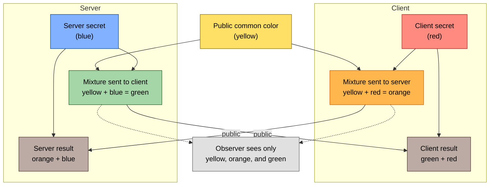
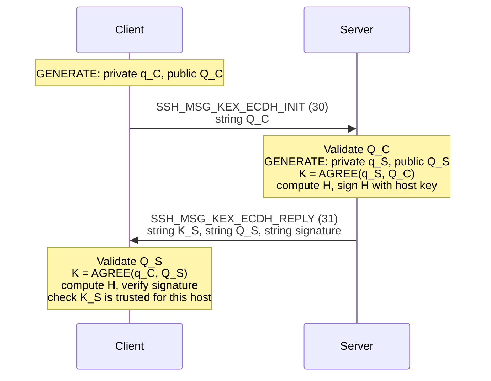
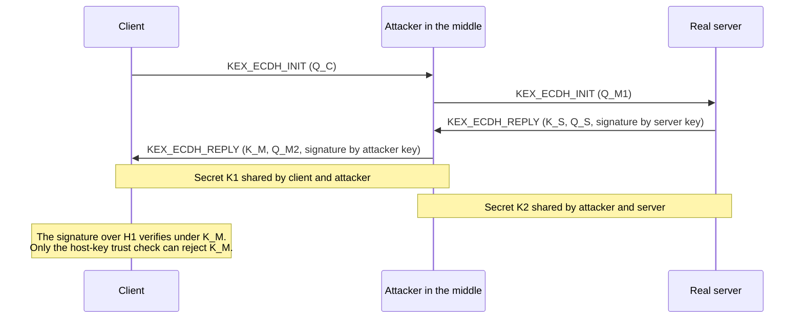
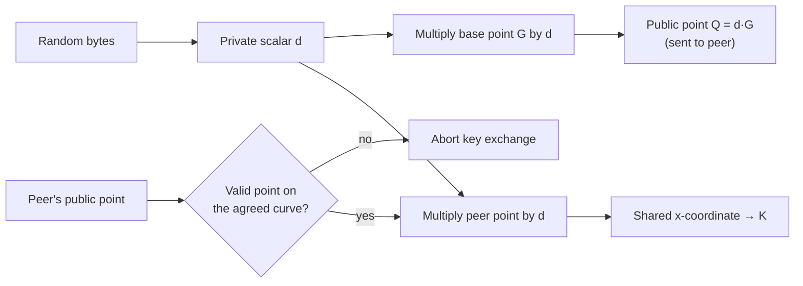
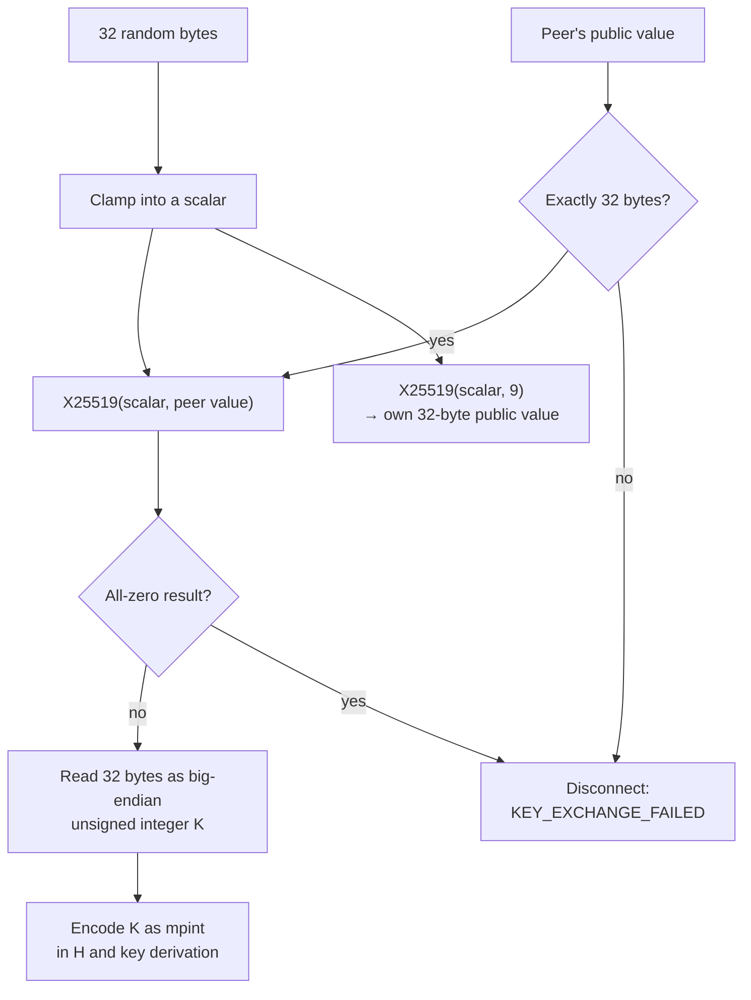
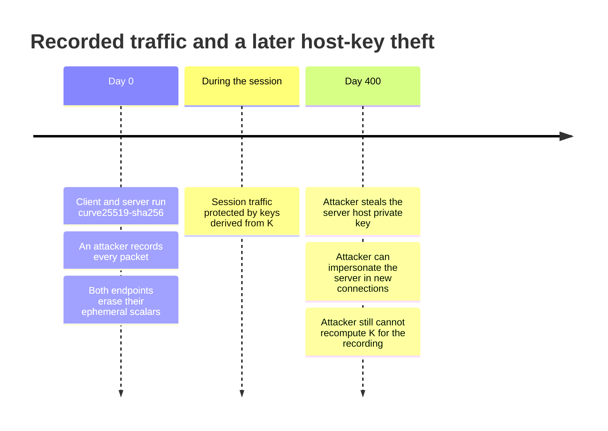
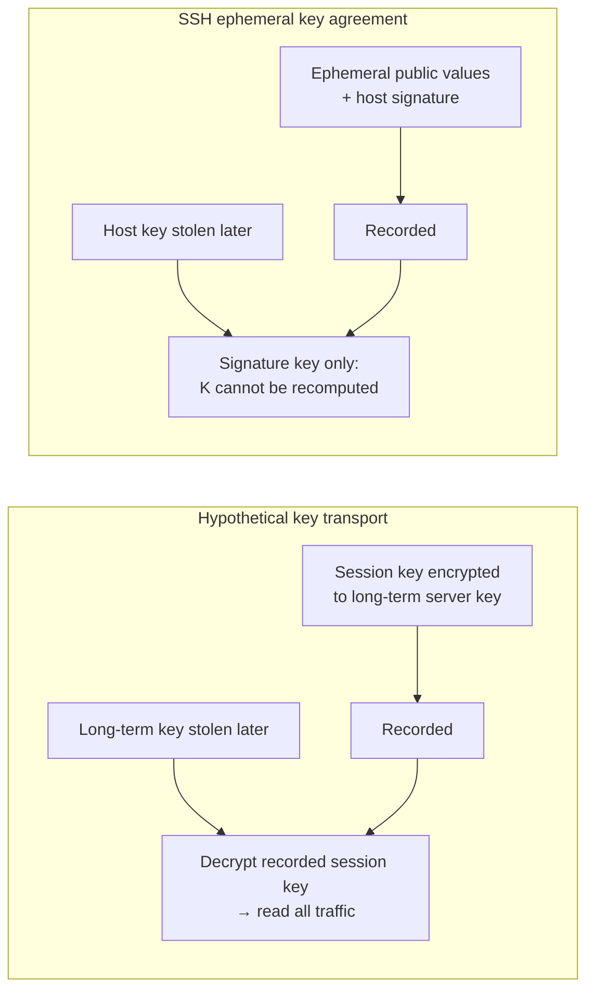

# Key agreement: Diffie–Hellman and elliptic curves

Every SSH connection begins with two strangers on an observable network who
need a secret that only they know. Key agreement produces that secret. It is
the first step of the [key exchange](./key-exchange.md): its output `K` feeds
the exchange hash `H`, which the server signs and from which all traffic keys
are derived.

This chapter explains key agreement from the outside in. Each section starts
with what the mechanism does for SSH and what a client must check. The
collapsible "Go deeper" sections show the underlying math with small numbers
you can verify by hand.

## Diffie–Hellman as a black box

A key-agreement scheme has two operations:

```text
GENERATE()                              -> private value, public value
AGREE(own private value, peer's public) -> shared secret | failure
```

Each side runs `GENERATE` once, sends its public value, and runs `AGREE` on
the value it receives. If both public values arrived unmodified, both sides
compute the same shared secret. The private values and the shared secret
never cross the network.

What the black box guarantees:

- A **passive** observer who sees both public values cannot feasibly compute
  the shared secret.
- The secret is fresh: new private values give an unrelated secret.

What it does **not** guarantee:

- It says nothing about *who* sent a public value. Anyone can run `GENERATE`.
- It does not detect modification of the public values in transit.

### The paint-mixing picture

The classic illustration uses paint. Mixing colors is easy, but separating
a mixture back into its ingredients is hard. Both sides start from a public
common color and each adds a secret color of its own:



Both final mixtures contain yellow, red, and blue, so both sides arrive at the
same brown. The observer holds yellow, orange, and green, but lacks a way to
extract red from orange or blue from green. In real Diffie–Hellman, "mixing"
is modular exponentiation or elliptic-curve scalar multiplication, and
"unmixing" is the discrete logarithm problem.

### In an SSH connection

For the elliptic-curve methods, including `curve25519-sha256`, the
[RFC 5656](https://www.rfc-editor.org/rfc/rfc5656.html#section-4) message pair
carries the public values:



Classic finite-field Diffie–Hellman
([RFC 4253, Section 8](https://www.rfc-editor.org/rfc/rfc4253.html#section-8))
has the same shape with `SSH_MSG_KEXDH_INIT` carrying `mpint e` and
`SSH_MSG_KEXDH_REPLY` carrying `K_S`, `mpint f`, and the signature. Message
numbers 30–49 are reused by different key-exchange methods, so a client
interprets them according to the negotiated method.

### Passive versus active attackers

A passive attacker only records. Against a passive attacker, the black-box
guarantee above is sufficient.

An active attacker can replace messages. Unauthenticated Diffie–Hellman gives
no defense: the attacker runs one exchange with the client and a second with
the server, and relays between them.



The attacker cannot forward the real server's reply unchanged: the server
signed an exchange hash that includes `Q_M1`, not the client's `Q_C`, so the
client would compute a different `H` and the signature would fail. The
attacker therefore must sign the client-facing transcript with a key it
controls. The signature is mathematically valid; it simply comes from the
wrong key.

This is why SSH pairs key agreement with a host-key signature over the
exchange hash *and* a trust decision about that host key. See
[The host-key signature and the trust decision](./key-exchange.md#the-host-key-signature-and-the-trust-decision)
and [Server authentication](./server-authentication.md).

<details>
<summary>Go deeper: modular arithmetic and the discrete logarithm</summary>

**Clock arithmetic.** Working "mod `p`" means keeping only the remainder after
dividing by `p`, like a clock that wraps around. On a 24-hour clock,
10 hours after 17:00 is 3:00, because `27 mod 24 = 3`. Powers wrap the same
way: `3^4 = 81`, and `81 mod 7 = 4`.

**Diffie–Hellman in one line.** Pick a prime `p` and a generator `g`. The
client picks a secret `a`, the server a secret `b`:

```text
client sends  A = g^a mod p
server sends  B = g^b mod p
client computes  B^a = g^(b·a) mod p
server computes  A^b = g^(a·b) mod p      (the same number)
```

**A toy example.** With `p = 23`, `g = 5`, `a = 6`, `b = 15`:

| Step | Client | Server |
| --- | --- | --- |
| Public value | `A = 5^6 mod 23 = 8` | `B = 5^15 mod 23 = 19` |
| Shared secret | `19^6 mod 23 = 2` | `8^15 mod 23 = 2` |

Try it yourself:
`python3 -c "print(pow(5,6,23), pow(5,15,23), pow(19,6,23), pow(8,15,23))"`
prints `8 19 2 2`.

**Why the forward direction is fast.** Computing `g^a mod p` does not need `a`
multiplications. *Square-and-multiply* reads the exponent's bits from the
left: square for every bit, and also multiply by `g` when the bit is 1.
For `5^15 mod 23`, with `15 = 1111` in binary:

| Bit | Square | Multiply by 5 |
| --- | --- | --- |
| 1 | `1² = 1` | `1·5 = 5` |
| 1 | `5² = 25 ≡ 2` | `2·5 = 10` |
| 1 | `10² = 100 ≡ 8` | `8·5 = 40 ≡ 17` |
| 1 | `17² = 289 ≡ 13` | `13·5 = 65 ≡ 19` |

A 2048-bit exponent needs at most about 4096 modular multiplications, which
a computer completes in milliseconds.

**Why the reverse is hard.** Recovering `a` from `A = g^a mod p` is the
*discrete logarithm* problem. The powers of 5 mod 23 jump around with no
obvious pattern:

```text
k       1  2  3  4  5  6  7  8  9 10 11 12 13 14 15 16 17 18 19 20 21 22
5^k    5  2 10  4 20  8 17 16 11  9 22 18 21 13 19  3 15  6  7 12 14  1
```

For `p = 23`, an attacker just reads `8` in the table and finds `a = 6`. For a
2048-bit prime, the table would have about `2^2048` entries. The best known
classical algorithms are much faster than trying every exponent, but still
far out of reach at that size.
[RFC 9142](https://www.rfc-editor.org/rfc/rfc9142.html) estimates the 2048-bit
group at about 112 bits of security.

**Real groups.** SSH does not let each connection invent a prime.
The fixed-group methods use the MODP groups of
[RFC 3526](https://www.rfc-editor.org/rfc/rfc3526.html), all with generator 2:

| SSH method | RFC 3526 group | Prime size |
| --- | --- | --- |
| `diffie-hellman-group14-sha256` | 14 | 2048 bits |
| `diffie-hellman-group16-sha512` | 16 | 4096 bits |
| `diffie-hellman-group18-sha512` | 18 | 8192 bits |

Group exchange ([RFC 4419](https://www.rfc-editor.org/rfc/rfc4419.html)) lets
the server supply `p` and `g` from its own list instead.

**Safe primes and small subgroups.** These primes are *safe primes*:
`p = 2q + 1` with `q` also prime. In the toy group, `23 = 2·11 + 1`. The
nonzero numbers mod a safe prime contain subgroups of only four sizes:
`1`, `2`, `q`, and `2q`. The two small subgroups are `{1}` and `{1, p − 1}`.
If a peer sends `p − 1` (here, 22) as its public value, the "shared" secret is
`22^a mod 23`, which is always 1 or 22. An attacker who forced that value
would know the secret without solving anything.

[RFC 4253, Section 8](https://www.rfc-editor.org/rfc/rfc4253.html#section-8)
states that values of `e` or `f` outside the range `[1, p-1]` "MUST NOT be
sent or accepted by either side." That range rejects 0 and oversized values,
but still admits 1 and `p − 1`. RFC 4419, for group exchange, adds that
endpoints must accept the shared secret only if `1 < K < p - 1`, "to prevent
confinement attacks." With a safe prime, rejecting those two degenerate
values rules out every small subgroup. OpenSSH applies the equivalent check to
every finite-field method: it rejects a peer's public value unless
`1 < e < p − 1`.

The toy is insecure because `p` is tiny: the whole table above fits on one
line.

Learn more:
[Diffie–Hellman key exchange](https://en.wikipedia.org/wiki/Diffie%E2%80%93Hellman_key_exchange),
[Modular arithmetic](https://en.wikipedia.org/wiki/Modular_arithmetic),
[Discrete logarithm](https://en.wikipedia.org/wiki/Discrete_logarithm),
[RFC 3526](https://www.rfc-editor.org/rfc/rfc3526.html).

</details>

## Elliptic curves

Elliptic-curve Diffie–Hellman (ECDH) has exactly the same black-box interface.
The private value is a large integer called a *scalar*. The public value is a
*point* on a curve. `AGREE` multiplies the peer's point by the local scalar.



The protocol advantage is size and speed at a comparable security level:

| Method | Client public value on the wire | Approximate security |
| --- | --- | --- |
| `diffie-hellman-group14-sha256` | `mpint`, up to 256 bytes (plus a possible sign byte) | 112 bits |
| `ecdh-sha2-nistp256` | 65 bytes (uncompressed point) | 128 bits |
| `curve25519-sha256` | 32 bytes | 128 bits |

Smaller values mean smaller key-exchange messages and much less
computation, which matters for busy servers and small devices.

[RFC 5656](https://www.rfc-editor.org/rfc/rfc5656.html) defines the
`ecdh-sha2-nistp256`, `ecdh-sha2-nistp384`, and `ecdh-sha2-nistp521` methods,
using the NIST prime curves. Points travel as octet strings in the SEC 1
format; point compression is allowed. The shared secret is the
x-coordinate of the resulting point, converted to an integer and encoded as
an `mpint` in the exchange hash.

The client-side rule that matters most:

> All elliptic curve public keys MUST be validated after they are received.
> ... If a key fails validation, the key exchange MUST fail.
> — [RFC 5656, Section 4](https://www.rfc-editor.org/rfc/rfc5656.html#section-4)

Validation means: the encoding is well formed, the coordinates are in range,
the point satisfies the curve equation, and it is not the special "point at
infinity." The deep dive below shows what goes wrong without it.

<details>
<summary>Go deeper: points on a curve</summary>

**The curve.** An elliptic curve used in cryptography is the set of points
`(x, y)` satisfying

```text
y² = x³ + a·x + b      (mod p)
```

plus one extra "point at infinity," written `O`, which acts like zero. All
arithmetic is modulo a prime `p`, so the "curve" is really a finite scatter of
points.

**Adding points.** Over the real numbers, the rule is geometric. Draw the line
through two points `P` and `Q`; it meets the curve in exactly one more point.
Reflect that point across the x-axis to get `P + Q`. To double a point, use
the tangent line at `P` instead. Mod `p` the picture disappears, but the same
algebra still works:

```text
slope λ = (y2 − y1) / (x2 − x1)       when adding P + Q
slope λ = (3·x1² + a) / (2·y1)        when doubling P + P
x3 = λ² − x1 − x2
y3 = λ·(x1 − x3) − y1
```

"Division" mod `p` means multiplying by a modular inverse: for example
`1/2 ≡ 9 (mod 17)` because `2·9 = 18 ≡ 1`.

**Scalar multiplication.** `d·G` means `G + G + ... + G` (`d` times). It is
computed by *double-and-add*, the elliptic-curve twin of square-and-multiply.
For `7 = 111` in binary: `G`, then `2G + G = 3G`, then `6G + G = 7G`.

The *elliptic-curve discrete logarithm problem* (ECDLP) is recovering `d` from
`d·G`. For well-chosen curves, no known classical method does meaningfully
better than generic search, which takes about `2^128` steps for a 256-bit
curve. That is why 32-byte ECDH values offer security comparable to a
finite-field group of roughly 3072 bits.

**A toy curve.** Take `y² = x³ + 2x + 2 (mod 17)` and `G = (5, 1)`. The point
is on the curve: `5³ + 2·5 + 2 = 137 = 8·17 + 1`, and `1² = 1`.

Doubling `G`: `λ = (3·25 + 2)/(2·1) = 77/2 ≡ 9·9 = 81 ≡ 13`, then
`x3 = 169 − 10 ≡ 6` and `y3 = 13·(5 − 6) − 1 = −14 ≡ 3`, so `2G = (6, 3)`.

Repeating gives every multiple; after 19 steps the sequence returns to `O`, so
`G` has order 19:

| k | k·G | k | k·G | k | k·G | k | k·G |
| --- | --- | --- | --- | --- | --- | --- | --- |
| 1 | (5, 1) | 6 | (16, 13) | 11 | (13, 10) | 16 | (10, 11) |
| 2 | (6, 3) | 7 | (0, 6) | 12 | (0, 11) | 17 | (6, 14) |
| 3 | (10, 6) | 8 | (13, 7) | 13 | (16, 4) | 18 | (5, 16) |
| 4 | (3, 1) | 9 | (7, 6) | 14 | (9, 1) | 19 | O |
| 5 | (9, 16) | 10 | (7, 11) | 15 | (3, 16) | | |

**Toy ECDH.** The client picks `a = 3` and sends `A = 3G = (10, 6)`. The
server picks `b = 7` and sends `B = 7G = (0, 6)`. The client computes
`3·B = 21G`, and the server computes `7·A = 21G`. Since `G` has order 19,
`21G = 2G = (6, 3)`. The shared secret is the x-coordinate, 6.

**Why points must be validated.** Look again at the addition formulas: the
constant `b` never appears. An implementation that multiplies whatever `(x, y)`
it receives is really computing on *whichever* curve `y² = x³ + 2x + b'`
passes through that point. Take `P = (12, 5)`. It is not on our curve
(`12³ + 24 + 2 ≡ 3`, but `5² ≡ 8`). It *is* on `y² = x³ + 2x + 7`, where it
has order 3: `P`, `2P = (12, 12)`, `3P = O`.

If the server with secret 7 accepts `P`, it computes `7·P = 1·P`, because
`7 ≡ 1 (mod 3)`. The result can only be one of three values, so an attacker
learns the secret mod 3 by testing three guesses against whatever the victim
does next with the key. Repeating with points of other small orders and
combining the remainders reveals the whole secret. This is the
*invalid-curve attack*. Checking that the received point satisfies the
correct equation stops it. SSH's use of fresh ephemeral scalars limits what
one leak reveals, but RFC 5656 still requires validation.

The toy is insecure because 19 possible secrets can be tried instantly.

Try it yourself with a short script that implements the formulas above; the
[gentle introduction](https://andrea.corbellini.name/2015/05/17/elliptic-curve-cryptography-a-gentle-introduction/)
includes interactive tools and code.

Learn more:
[Elliptic curve cryptography: a gentle introduction](https://andrea.corbellini.name/2015/05/17/elliptic-curve-cryptography-a-gentle-introduction/),
[A (relatively easy to understand) primer on elliptic curve cryptography](https://blog.cloudflare.com/a-relatively-easy-to-understand-primer-on-elliptic-curve-cryptography/),
[Elliptic-curve Diffie–Hellman](https://en.wikipedia.org/wiki/Elliptic-curve_Diffie%E2%80%93Hellman),
[Elliptic curve point multiplication](https://en.wikipedia.org/wiki/Elliptic_curve_point_multiplication).

</details>

## X25519

`curve25519-sha256` is the modern classical SSH key exchange and was
OpenSSH's default before the post-quantum hybrids. It is defined by
[RFC 8731](https://www.rfc-editor.org/rfc/rfc8731.html) and is identical to
the earlier `curve25519-sha256@libssh.org` name, which many implementations
still offer as an alias. It uses the X25519 function from
[RFC 7748](https://www.rfc-editor.org/rfc/rfc7748.html) and reuses the
`SSH_MSG_KEX_ECDH_INIT`/`SSH_MSG_KEX_ECDH_REPLY` flow and exchange-hash layout
of RFC 5656.

X25519 was designed so that the black box is hard to misuse:

- **Fixed sizes.** Private scalars, public values, and results are all
  32-byte strings. A client must abort if a received public value is not
  exactly 32 bytes.
- **x-only.** Only the x-coordinate (called `u`) is sent, as 32 bytes in
  little-endian order. There is no separate "is this point on the curve"
  check: every 32-byte string is accepted as input.
- **One mandatory check.** If the computed shared secret is all zeros, the
  peer sent a small-order point, and the client must abort the exchange.



### Why any input is fine but a zero output is not

Curve25519 is the Montgomery curve

```text
y² = x³ + 486662·x² + x      over the prime p = 2^255 − 19
```

with base point `u = 9`. Because only `u` is sent, a received 32-byte string
can name a point either on Curve25519 or on a closely related curve called
its *twist*. Curve25519 was chosen so that both are safe: the twist also has a
large prime-order subgroup, so the invalid-curve trick above gains an attacker
nothing useful. RFC 7748 also requires implementations to ignore the top bit
of the last byte and to accept values that are not fully reduced mod `p`.

What remains are a handful of *small-order* points. The private scalar is
always a multiple of 8 (see the deep dive), so multiplying any of these points
by it gives the neutral point, which X25519 outputs as 32 zero bytes. An
all-zero `K` would be known to the attacker, so RFC 8731 requires the
endpoint to "check whether the computed Diffie-Hellman shared secret is the
all-zero value and abort if so."

### How the result becomes `K`

RFC 8731 is precise about the conversion, and it differs from the
fixed-length byte strings used on the wire:

1. X25519 outputs 32 bytes, produced in little-endian form per RFC 7748.
2. SSH reinterprets those same 32 bytes as an unsigned **big-endian** integer
   `K`. No byte reversal happens; the bytes are simply read the other way.
3. `K` is encoded as an SSH `mpint` when hashed into `H` and into key
   derivation.

The `mpint` step means the length of the hashed value depends on the secret:

| First byte(s) of X25519 output | `mpint` body length | Reason |
| --- | --- | --- |
| `0x4a ...` (RFC 7748 test vector) | 32 bytes | Top bit clear, no leading zero |
| `0x9b ...` | 33 bytes | Leading `0x00` added so the value stays positive |
| `0x00 0x42 ...` | 31 bytes | Leading zero byte removed |

RFC 8731's security considerations note that this variable length could, in
principle, leak a bit of the secret through timing, and keep it for backwards
compatibility. The newer hybrid methods in
[Post-quantum key exchange](./crypto-post-quantum.md#hybrid-key-exchange-in-ssh)
avoid the issue by encoding `K` as a fixed-length `string`.

<details>
<summary>Go deeper: clamping and the Montgomery ladder</summary>

**Clamping.** X25519 turns 32 random bytes into a scalar by changing three
things (bytes are numbered from 0, least significant first):

```text
byte[0]  &= 248     clear the lowest 3 bits  → scalar is a multiple of 8
byte[31] &= 127     clear bit 255            → scalar is below 2^255
byte[31] |= 64      set bit 254              → every scalar has the same top bit
```

The curve has 8 times as many points as its large prime-order subgroup (its
*cofactor* is 8). Any small-order point has an order that divides 8, so
multiplying it by a multiple of 8 lands on the neutral point. Clearing the
low bits therefore stops an attacker from learning the scalar's low bits
through small-order inputs. The price is the all-zero output that SSH must
reject. Setting bit 254 makes every scalar the same bit length, so the
computation always runs the same number of steps.

**The Montgomery ladder.** Double-and-add does extra work for 1 bits, and
that timing difference can leak the secret. The ladder keeps two running
values, `R0 = k·P` and `R1 = (k+1)·P`, where `k` is the part of the scalar
processed so far. Their difference is always `P`. For each bit of the
scalar, from the top:

```text
bit 0:  R1 = R0 + R1,  R0 = 2·R0
bit 1:  R0 = R0 + R1,  R1 = 2·R1
```

Each step performs one addition and one doubling regardless of the bit. A
constant-time conditional swap chooses which register plays which role, so
the sequence of operations and memory accesses does not depend on the secret.
The known difference `P` is what makes x-coordinate-only formulas possible.

**Toy check with the ladder idea.** For the scalar `7 = 111` in binary on the
earlier toy curve, starting from `(R0, R1) = (O, G)`:

| Bit | R0 | R1 |
| --- | --- | --- |
| 1 | `1G` | `2G` |
| 1 | `3G` | `4G` |
| 1 | `7G = (0, 6)` | `8G` |

**Real-world check.** Implemented as specified, X25519 reproduces the
[RFC 7748, Section 6.1](https://www.rfc-editor.org/rfc/rfc7748.html#section-6.1)
test vector: both sides compute the shared value
`4a5d9d5b a4ce2de1 728e3bf4 80350f25 e07e21c9 47d19e33 76f09b3c 1e161742`.

The toy table is insecure for the same reason as before: the group is tiny.

Learn more:
[RFC 7748 — Elliptic Curves for Security](https://www.rfc-editor.org/rfc/rfc7748.html),
[Curve25519 (D. J. Bernstein)](https://cr.yp.to/ecdh.html),
[Montgomery curve](https://en.wikipedia.org/wiki/Montgomery_curve),
[Curve25519](https://en.wikipedia.org/wiki/Curve25519).

</details>

## Forward secrecy

Key agreement in SSH is *ephemeral*: each exchange uses freshly generated
private values, and endpoints erase them once `K` and the traffic keys are
derived. The long-term host key only signs; it never encrypts or derives the
session secret. That separation gives *forward secrecy*: later compromise of
the long-term key does not expose earlier sessions.



Compare a hypothetical design in which the client picks the session key and
encrypts it to the server's long-term public key. The recording would then
contain everything needed to recover the session once that one key leaked:



Rekeying extends the idea within a long connection: each rekey runs a new
ephemeral exchange, so traffic keys from one period do not reveal another's.

What forward secrecy does **not** protect against:

- **Compromise during the session.** An attacker who controls an endpoint
  while the connection is open can read plaintext or the live traffic keys.
- **Retained secrets.** Ephemeral values that are logged, swapped to disk, or
  reused across connections are no longer ephemeral.
- **Weak randomness.** Predictable private values make `K` predictable to
  anyone who can reproduce the random generator's output.
- **Breaking the math itself.** A large enough quantum computer running
  Shor's algorithm could compute discrete logarithms and recover `K` directly
  from a recorded exchange, without any stolen key. That is the
  "harvest now, decrypt later" threat addressed in
  [Post-quantum key exchange](./crypto-post-quantum.md#why-quantum-computers-matter).

## Check your understanding

1. What does the Diffie–Hellman black box guarantee against a passive
   observer, and what does it not say about the sender of a public value?
2. In the attacker-in-the-middle diagram, why can the attacker not simply forward
   the real server's `SSH_MSG_KEX_ECDH_REPLY` to the client?
3. Using the toy group `p = 23`, `g = 5`, which public value would a peer send
   to force the shared secret into the set `{1, 22}`, and which RFC rule
   rejects it?
4. Why must an `ecdh-sha2-nistp256` client validate a received point, while a
   `curve25519-sha256` client accepts any 32-byte value?
5. What must a `curve25519-sha256` client check after computing X25519, and
   why?
6. The server's host private key is stolen a year after a recorded session.
   What can the thief do, and what can it not do?

<details>
<summary>Answers</summary>

1. An observer who sees both public values cannot feasibly compute the shared
   secret. The black box gives no authentication: anyone can generate a
   public value, so it says nothing about who sent it.
2. The server's signature covers an exchange hash containing the attacker's
   value `Q_M1`, not the client's `Q_C`. The client would compute a different
   `H` and signature verification would fail. The attacker must sign with its
   own key, which the host-key trust check should reject.
3. `p − 1 = 22`. RFC 4253's range `[1, p-1]` still admits it, but RFC 4419
   (group exchange) requires accepting `K` only if `1 < K < p - 1`, which
   rejects the resulting secret of 1 or 22. With a safe prime, this excludes
   all small subgroups. OpenSSH rejects the public value 22 itself.
4. NIST-curve arithmetic that does not check the curve equation can be
   tricked into computing on a weaker curve (an invalid-curve attack).
   X25519 uses x-only arithmetic on a curve whose twist is also secure, so no
   input lands in a weak group other than the few small-order points.
5. That the shared secret is not all zeros. An all-zero result means the peer
   supplied a small-order point, which would give a secret the attacker
   knows. The client must disconnect.
6. The thief can impersonate the server in future connections to clients that
   trust that key. It cannot decrypt the recorded session, because the
   ephemeral private values needed to recompute `K` were erased and the host
   key never took part in deriving `K`.

</details>

## References

- [RFC 4253 — SSH Transport Layer Protocol](https://www.rfc-editor.org/rfc/rfc4253.html),
  Section 8 (Diffie–Hellman key exchange).
- [RFC 4419 — Diffie–Hellman Group Exchange for SSH](https://www.rfc-editor.org/rfc/rfc4419.html).
- [RFC 3526 — More MODP Diffie–Hellman Groups](https://www.rfc-editor.org/rfc/rfc3526.html).
- [RFC 5656 — Elliptic Curve Algorithm Integration in SSH](https://www.rfc-editor.org/rfc/rfc5656.html),
  Sections 4 and 7.
- [RFC 7748 — Elliptic Curves for Security](https://www.rfc-editor.org/rfc/rfc7748.html).
- [RFC 8731 — SSH Key Exchange Using Curve25519 and Curve448](https://www.rfc-editor.org/rfc/rfc8731.html).
- [RFC 9142 — Key Exchange Method Updates and Recommendations for SSH](https://www.rfc-editor.org/rfc/rfc9142.html).
- [Key-exchange method survey](./key-exchange-methods.md) — how each method's
  messages and checks differ.
