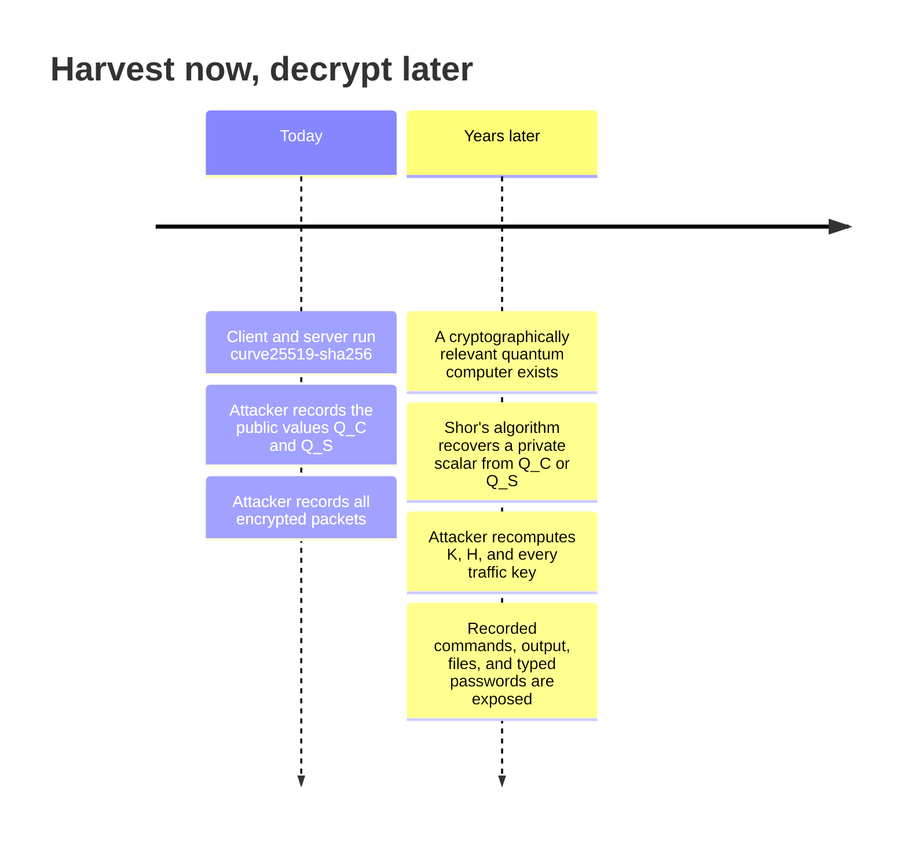
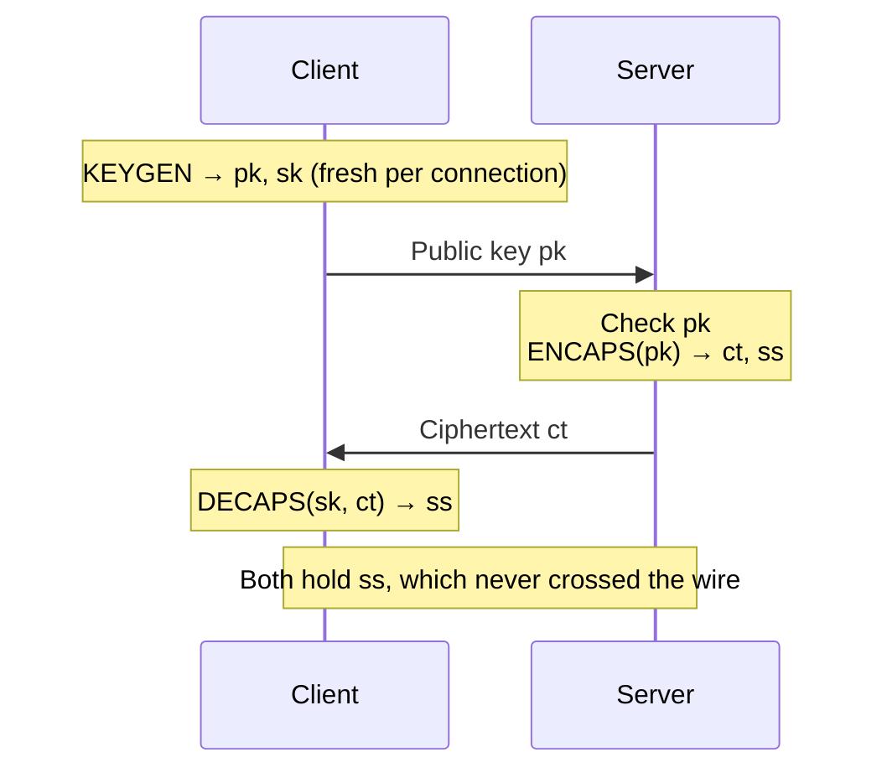
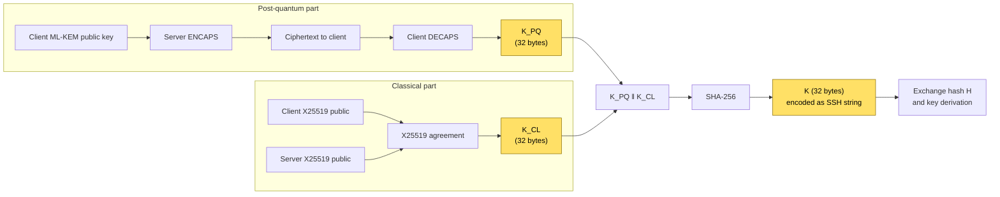
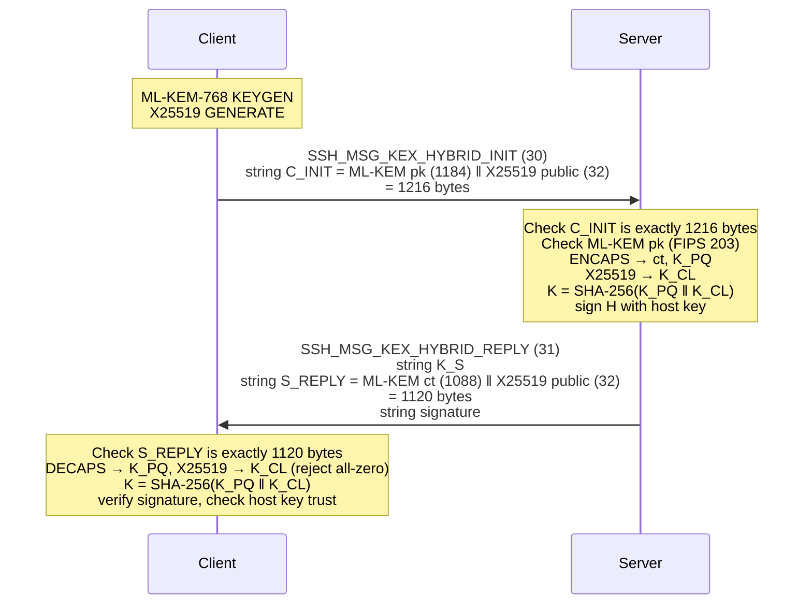
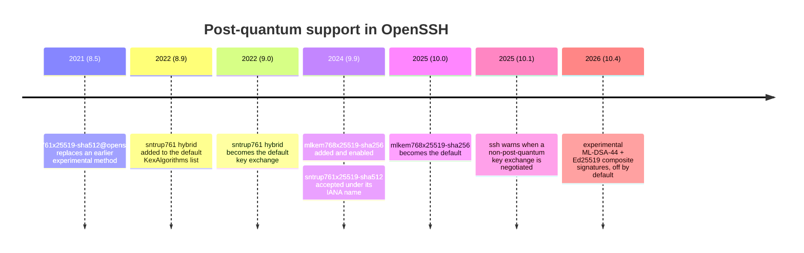

# Post-quantum key exchange

The key agreement in
[Key agreement: Diffie–Hellman and elliptic curves](./crypto-key-agreement.md)
rests on one assumption: computing discrete logarithms is infeasible. A large
enough quantum computer would remove that assumption. This chapter explains
why that threatens SSH traffic recorded *today*, how key-encapsulation
mechanisms (KEMs) replace Diffie–Hellman's role, and how SSH combines the two
in *hybrid* key exchange methods.

## Why quantum computers matter

A quantum computer is not a faster ordinary computer. It speeds up certain
specific problems dramatically and most others not at all. Two quantum
algorithms matter for SSH:

| Algorithm | What it does | Affected SSH cryptography | Effect |
| --- | --- | --- | --- |
| Shor's algorithm | Factors integers and computes discrete logarithms efficiently | RSA, finite-field DH, ECDH, X25519, ECDSA, Ed25519 | Broken outright |
| Grover's algorithm | Speeds up brute-force search quadratically | AES, ChaCha20, SHA-2, MACs | Security margin reduced, not broken |

Shor's algorithm turns problems believed to take longer than the age of the
universe into problems a large, reliable quantum computer could solve.
Increasing key sizes does not help meaningfully. Every classical SSH
key-exchange method and every classical SSH signature algorithm depends on
one of these problems.

Grover's algorithm is far weaker. Searching `2^n` keys takes about `2^(n/2)`
quantum steps, and those steps must largely run one after another: splitting
the search across many machines gains much less than it does classically.
NIST's post-quantum security categories use exhaustive key search on AES-128,
AES-192, and AES-256 as their benchmarks. Symmetric ciphers with 256-bit keys
leave a very wide margin; AES-128 is still generally considered adequate, if
with less headroom. The symmetric parts of SSH are therefore not the urgent
problem.

No computer capable of running Shor's algorithm at cryptographic sizes exists
as of this writing, and estimates of when one might exist vary widely. The
urgency comes from a different observation.

### Harvest now, decrypt later

The confidentiality of an SSH session depends entirely on the shared secret
`K`. An attacker does not need to break the key exchange while the connection
is open. It can record the handshake and the encrypted traffic now, store
them, and compute `K` later:



[Forward secrecy](./crypto-key-agreement.md#forward-secrecy) does not help
here. It protects against a *stolen key*, but Shor's algorithm does not need
a stolen key: it derives the ephemeral private value directly from the
recorded public value.

### Why SSH changed key exchange first

Authentication is different. A host-key signature or a user signature proves
something to a peer *during* the handshake. Forging one later is useless,
because the attacker cannot go back in time and impersonate the server to a
connection that has already happened.

| Protection | When an attacker must break it | Recorded traffic at risk today? |
| --- | --- | --- |
| Session confidentiality (key exchange) | Any time after recording | **Yes** |
| Server authentication (host-key signature) | While the victim's connection is being set up | No |
| User authentication (user signature) | While the victim's connection is being set up | No |

Classical signatures therefore stay safe until a capable quantum computer
exists at connection time. Long-lived host and user keys must be replaced
before then, but recorded sessions cannot be protected retroactively. That
asymmetry is why SSH implementations deployed post-quantum key exchange
first, and why post-quantum signatures are a later, separate migration.

<details>
<summary>Go deeper: what Shor's algorithm actually finds</summary>

Shor's algorithm finds the *period* of a repeating function. Classical
computers cannot do this efficiently for huge periods; a quantum computer can,
using a step called the quantum Fourier transform.

**Periods break factoring.** Take `N = 15` and the number 7. Its powers
mod 15 repeat with period 4:

```text
k             1   2   3   4   5   6   7   8
7^k mod 15    7   4  13   1   7   4  13   1
```

Since `7^4 ≡ 1`, the number `7^2 = 49 ≡ 4` satisfies `4² ≡ 1 (mod 15)`, so
`15` divides `(4 − 1)(4 + 1) = 3·5`. Taking `gcd(4 − 1, 15) = 3` and
`gcd(4 + 1, 15) = 5` recovers the factors. For a 2048-bit RSA modulus `N`,
no classical method can find such a period in any reasonable time.

**Periods break discrete logarithms.** In the earlier toy group, the powers of
5 mod 23 repeat every 22 steps. Given `A = 5^a mod 23`, the two-input function
`f(x, y) = 5^x · A^y mod 23` repeats along a direction that depends on `a`.
Finding that hidden period reveals `a`. The elliptic-curve version works the
same way with point addition in place of multiplication.

The toy numbers are, of course, trivially solvable by hand; the point is that
Shor's algorithm finds the period in time polynomial in the number of bits,
not exponential.

Learn more:
[Shor's algorithm](https://en.wikipedia.org/wiki/Shor%27s_algorithm),
[Grover's algorithm](https://en.wikipedia.org/wiki/Grover%27s_algorithm),
[Post-quantum cryptography](https://en.wikipedia.org/wiki/Post-quantum_cryptography),
[OpenSSH: Post-Quantum Cryptography](https://www.openssh.com/pq.html).

</details>

## Key encapsulation as a black box

Post-quantum key establishment is standardized as a *key-encapsulation
mechanism* (KEM) rather than as Diffie–Hellman. A KEM has three operations:

```text
KEYGEN()          -> public key pk, secret key sk
ENCAPS(pk)        -> ciphertext ct, shared secret ss
DECAPS(sk, ct)    -> shared secret ss
```

`ENCAPS` generates a fresh random secret, "locks" it with the public key, and
returns both the secret and the locked form. Only the holder of `sk` can
unlock it with `DECAPS`.

The roles are **asymmetric**. In Diffie–Hellman both sides generate a key pair
and exchange public values. With a KEM, only the client generates a key pair;
the server never does. It encapsulates to the client's public key and returns
a ciphertext:



| Property | Diffie–Hellman | KEM |
| --- | --- | --- |
| Client sends | Its public value | Its public key |
| Server sends | Its public value | A ciphertext |
| Who generates a key pair | Both sides | Client only |
| Who chooses the secret | Neither alone; it emerges from both | Server's `ENCAPS` randomness |

What the black box guarantees: an observer who sees `pk` and `ct` cannot learn
`ss`, and this is believed to hold even against quantum computers. ML-KEM is
also designed for *chosen-ciphertext* security: feeding `DECAPS` manipulated
ciphertexts reveals nothing useful about `sk`.

What it does **not** guarantee: like Diffie–Hellman, a KEM does not
authenticate anyone. An attacker in the middle can replace `pk` with its own.
SSH still relies on the host-key signature over the exchange hash and on the
client's host-key trust decision.

### ML-KEM and Streamlined NTRU Prime

Two KEMs appear in SSH:

- **ML-KEM**, standardized by NIST in
  [FIPS 203](https://csrc.nist.gov/pubs/fips/203/final) (2024), derived from
  the Kyber submission. It comes in three parameter sets. SSH's
  `mlkem768x25519-sha256` uses ML-KEM-768, which FIPS 203 places in NIST
  security category 3.
- **sntrup761**, an instance of
  [Streamlined NTRU Prime](https://ntruprime.cr.yp.to/). It was not selected
  by NIST, but it was the first post-quantum KEM deployed by default in
  OpenSSH and is used by `sntrup761x25519-sha512`.

Both are *lattice-based*: their public keys are built from secrets with
small coefficients, and recovering those secrets amounts to finding unusually
short vectors in a high-dimensional lattice (a regular grid of points). No
efficient classical or quantum algorithm for that problem is known.

ML-KEM sizes from FIPS 203, Table 3:

| Parameter set | Public key | Ciphertext | Shared secret |
| --- | --- | --- | --- |
| ML-KEM-512 | 800 bytes | 768 bytes | 32 bytes |
| ML-KEM-768 | 1184 bytes | 1088 bytes | 32 bytes |
| ML-KEM-1024 | 1568 bytes | 1568 bytes | 32 bytes |

Before running `ENCAPS`, the server must perform FIPS 203's encapsulation-key
check: correct length, and every encoded coefficient below the modulus.
[RFC 10042](https://www.rfc-editor.org/rfc/rfc10042.html#section-2.1)
requires that check.

<details>
<summary>Go deeper: learning with errors</summary>

**Linear equations are easy.** Suppose a secret vector `s` has four numbers,
and you are given equations `b = A·s (mod q)`: each row of the matrix `A`
dotted with `s` gives one entry of `b`. With four independent equations,
ordinary *Gaussian elimination* (the substitution method from school, done
mod `q`) recovers `s` quickly.

**Add a little noise, and it becomes hard.** *Learning with errors* (LWE)
publishes instead

```text
b = A·s + e   (mod q)
```

where each entry of the error vector `e` is small, such as −1, 0, or 1.
Elimination now amplifies the errors until the answer is garbage. For large
dimensions, no known classical or quantum algorithm recovers `s` efficiently.

**A toy public key.** Take `q = 97`, dimension `n = 4`, and five equations:

```text
secret  s = (3, 14, 59, 26)
errors  e = (1, −1, 0, 1, −1)

        A                     A·s mod 97    + e    = b
row 0:  (12, 71,  5, 33)          49          +1      50
row 1:  (40,  8, 91, 17)          29          −1      28
row 2:  (66, 29, 50,  2)          17           0      17
row 3:  ( 9, 83, 24, 61)          20          +1      21
row 4:  (77, 45, 13, 38)          94          −1      93
```

The public key is `(A, b)`. The secret key is `s`.

**Encrypting one bit.** To encrypt bit `m`, pick a random subset of rows, say
rows 0, 2, and 3. Add those rows of `A` to get `u`, add the matching entries
of `b`, and add `m · ⌊q/2⌋ = m · 48`:

```text
u = row0 + row2 + row3 = (87, 183, 79, 96) ≡ (87, 86, 79, 96)  (mod 97)
v = 50 + 17 + 21 + 48·m = 88 + 48·m                              (mod 97)
```

So bit 0 gives `v = 88`, and bit 1 gives `v = 136 ≡ 39`. The ciphertext is
`(u, v)`.

**Decrypting.** The secret-key holder computes `v − u·s`. Here
`u·s = 87·3 + 86·14 + 79·59 + 96·26 = 8622 ≡ 86 (mod 97)`. The `A·s` parts
cancel, leaving only the sum of the chosen errors plus the message:

```text
bit 0:  88 − 86 =  2          → close to 0  → decrypt 0
bit 1:  39 − 86 = −47 ≡ 50    → close to 48 → decrypt 1
```

The leftover 2 is `e0 + e2 + e3 = 1 + 0 + 1`. As long as the accumulated noise
stays below `q/4`, rounding to the nearer of 0 and 48 recovers the bit.

**From toy to ML-KEM.** The toy is insecure because four unknowns mod 97 can
be brute-forced instantly. ML-KEM keeps the same idea with three
refinements described in FIPS 203:

- **Module lattices.** Each entry of `A` and `s` is a polynomial with 256
  coefficients in the ring `Z_q[X]/(X^256 + 1)`, with `q = 3329`. ML-KEM-768
  uses a 3×3 matrix of such polynomials (`k = 3`). This packs many bits per
  operation and keeps keys around a kilobyte.
- **Key encapsulation.** Instead of one bit, the encryptor locks a random
  32-byte message, and both sides hash it, together with a hash of the
  public key, into the shared secret.
- **Fujisaki–Okamoto transform.** `DECAPS` decrypts, re-encrypts the result,
  and checks that it reproduces the received ciphertext exactly. If not, it
  returns a pseudorandom value derived from a secret and the ciphertext
  instead of an error. This *implicit rejection* gives an attacker who sends
  modified ciphertexts nothing to learn from. In SSH, a mismatched secret then
  simply makes the exchange hash differ, so the server's signature fails to
  verify.

Learn more:
[Learning with errors](https://en.wikipedia.org/wiki/Learning_with_errors),
[Kyber](https://en.wikipedia.org/wiki/Kyber),
[FIPS 203 — ML-KEM](https://csrc.nist.gov/pubs/fips/203/final),
[NTRU Prime](https://ntruprime.cr.yp.to/).

</details>

## Hybrid key exchange in SSH

Post-quantum KEMs are young compared with elliptic curves. A new attack, or an
implementation flaw, could weaken them. SSH therefore does not replace X25519;
it runs X25519 *and* a KEM in the same exchange and hashes both secrets
together:



The goal is that `K` stays secret as long as **either** component holds. An
attacker with a quantum computer who recovers `K_CL` still lacks `K_PQ`; an
attacker who breaks ML-KEM classically still faces X25519. RFC 10042 states
that such a hybrid "will always be at least as secure as the most secure key
exchange scheme executed as part of the exchange," citing published security
proofs.

### The wire view of `mlkem768x25519-sha256`

[RFC 10042](https://www.rfc-editor.org/rfc/rfc10042.html) keeps the familiar
two-message shape and message numbers 30 and 31, now named
`SSH_MSG_KEX_HYBRID_INIT` and `SSH_MSG_KEX_HYBRID_REPLY`. Each side's
post-quantum and classical values are concatenated into one SSH `string`,
post-quantum part first:



Three encoding details differ from `curve25519-sha256`:

- `K_CL` is the 32-byte X25519 result as a fixed-length byte array, not an
  `mpint`.
- `K` is the 32-byte hash output, encoded as an SSH `string` (a 4-byte length
  followed by 32 bytes) in the exchange hash. This avoids the
  secret-dependent length of an `mpint` described in
  [X25519](./crypto-key-agreement.md#how-the-result-becomes-k).
- The exchange hash includes `C_INIT` and `S_REPLY` in place of `Q_C` and
  `Q_S`, and `string K` in place of `mpint K`.

The other two RFC 10042 methods follow the same structure with NIST curves:
`mlkem768nistp256-sha256` and `mlkem1024nistp384-sha384`.

`sntrup761x25519-sha512`, specified in
[RFC 9941](https://www.rfc-editor.org/rfc/rfc9941.html), has the same design
with different components. It reuses the RFC 5656 message layout, puts the
KEM value first in `Q_C` and `Q_S`, and computes
`K = SHA-512(K_PQ ‖ K_CL)`, a 64-byte value encoded as a `string`. In the RFC's
test vectors, the encoded shared secret begins `00 00 00 40`: the length 64,
followed by the hash. RFC 9941 recommends also accepting the older name
`sntrup761x25519-sha512@openssh.com` as an alias.

### Size comparison

Values carried in the key-exchange `string` fields, in bytes:

| Method | Client → server | Server → client | Hash |
| --- | --- | --- | --- |
| `curve25519-sha256` | 32 | 32 | SHA-256 |
| `sntrup761x25519-sha512` | 1158 + 32 = 1190 | 1039 + 32 = 1071 | SHA-512 |
| `mlkem768x25519-sha256` | 1184 + 32 = 1216 | 1088 + 32 = 1120 | SHA-256 |
| `mlkem768nistp256-sha256` | 1184 + 65 = 1249 | 1088 + 65 = 1153 | SHA-256 |
| `mlkem1024nistp384-sha384` | 1568 + 97 = 1665 | 1568 + 97 = 1665 | SHA-384 |

The NIST-curve rows assume uncompressed points; RFC 5656 permits
compression. The extra kilobyte or so each way is small next to typical SSH
traffic, and fits easily within the packet sizes every SSH implementation
must accept. ML-KEM is also fast: OpenSSH describes `mlkem768x25519-sha256`
as "considerably faster than the previous default."

### Deployment in OpenSSH

The [OpenSSH release notes](https://www.openssh.com/releasenotes.html) record
the transition:



The OpenSSH 10.1 warning reads, in part,
`** WARNING: connection is not using a post-quantum key exchange algorithm.`
It is controlled by the `WarnWeakCrypto` option in
[ssh_config(5)](https://man.openbsd.org/ssh_config#WarnWeakCrypto);
`WarnWeakCrypto no-pq-kex` silences only this warning, ideally inside a
`Match host` block for a server that cannot yet be upgraded. See
[OpenSSH: Post-Quantum Cryptography](https://www.openssh.com/pq.html) for the
project's rationale.

A client can see which method a connection used in verbose output:

```text
debug1: kex: algorithm: mlkem768x25519-sha256
```

`ssh -Q kex` lists the methods a client supports. As always, negotiation
selects the first method in the client's list that the server also offers;
see [Algorithm negotiation](./version-and-negotiation.md).

### What post-quantum key exchange does not do

Hybrid key exchange protects the *confidentiality* of the session against a
future quantum attacker. It does not change authentication:

- The server still proves its identity with a classical host-key signature
  (`ssh-ed25519`, `ecdsa-sha2-*`, or `rsa-sha2-*`). A quantum attacker present
  at connection time could forge that signature and impersonate the server.
- Public-key user authentication still uses classical signatures, with the
  same limitation.
- Key-exchange and host-key algorithms are separate negotiation categories.
  A post-quantum `kex: algorithm:` line says nothing about the host key.

NIST has standardized post-quantum signature schemes:
ML-DSA in [FIPS 204](https://csrc.nist.gov/pubs/fips/204/final) and SLH-DSA
in [FIPS 205](https://csrc.nist.gov/pubs/fips/205/final). SSH deployment is at
an early stage. OpenSSH 10.4 added experimental support for
`ssh-mldsa44-ed25519@openssh.com`, a composite signature that combines
ML-DSA-44 with Ed25519, as described in
[draft-miller-sshm-mldsa44-ed25519-composite-sigs](https://datatracker.ietf.org/doc/draft-miller-sshm-mldsa44-ed25519-composite-sigs/).
That release does not enable it by default; it must be added to
`HostKeyAlgorithms` or `PubkeyAcceptedAlgorithms`. As explained above, the
lack of post-quantum signatures does not endanger recorded traffic; it
matters only once quantum attacks are feasible in real time.

## Check your understanding

1. Why does Grover's algorithm leave AES-256 essentially unaffected, while
   Shor's algorithm breaks X25519 completely?
2. An attacker records a `curve25519-sha256` session today. Explain why
   forward secrecy does not protect it from a future quantum computer.
3. Why was it more urgent to deploy post-quantum key exchange than
   post-quantum host-key signatures?
4. In a KEM-based exchange, which side generates a key pair, and what does the
   other side send back?
5. In the toy LWE example, what would go wrong if the errors were so large
   that their sum exceeded `q/4`?
6. For `mlkem768x25519-sha256`, how long must `C_INIT` and `S_REPLY` be, and
   what should the receiving side do if the length is wrong?
7. Why does the hybrid design hash `K_PQ ‖ K_CL` instead of using only
   `K_PQ`?
8. A connection's debug log shows `kex: algorithm: mlkem768x25519-sha256` and
   `kex: host key algorithm: ssh-ed25519`. Which parts of the connection are
   protected against a future quantum attacker?

<details>
<summary>Answers</summary>

1. Grover gives only a square-root speed-up on brute-force search, so a
   256-bit key still requires about `2^128` sequential quantum steps. Shor's
   algorithm solves the discrete logarithm problem underlying X25519 in
   polynomial time, so no practical key size is safe.
2. Forward secrecy assumes the ephemeral private values are gone. Shor's
   algorithm recomputes an ephemeral private value from the recorded public
   value, so the attacker can rebuild `K` without stealing anything.
3. Recorded traffic can be decrypted at any later time, so confidentiality is
   at risk today. A signature only needs to resist forgery during the
   handshake it authenticates; a future attacker cannot impersonate a server
   in a connection that is already over.
4. The client generates the key pair and sends the public key. The server
   runs `ENCAPS` and returns the ciphertext; it does not generate a key pair.
5. `v − u·s` could land nearer the wrong value (0 instead of 48, or the
   reverse), so decryption would return the wrong bit. Real schemes choose
   parameters that make such failures vanishingly unlikely.
6. `C_INIT` must be 1184 + 32 = 1216 bytes and `S_REPLY` 1088 + 32 = 1120
   bytes. On a mismatch, the receiver aborts with `SSH_MSG_DISCONNECT` and the
   reason `SSH_DISCONNECT_KEY_EXCHANGE_FAILED`.
7. So that `K` remains secret if either component remains secure. If ML-KEM
   were broken classically, X25519 would still protect `K`; if X25519 falls
   to a quantum computer, ML-KEM still protects it.
8. The session's confidentiality, including anything typed or transferred,
   is protected against later decryption. The server authentication is still
   classical: it is safe now, but a quantum attacker present at connection
   time could forge an Ed25519 signature.

</details>

## References

- [RFC 10042 — Post-Quantum/Traditional Hybrid Key Exchange with ML-KEM for Use in SSH](https://www.rfc-editor.org/rfc/rfc10042.html).
- [RFC 9941 — SSH Key Exchange Method Using Hybrid Streamlined NTRU Prime sntrup761 and X25519 with SHA-512](https://www.rfc-editor.org/rfc/rfc9941.html).
- [FIPS 203 — Module-Lattice-Based Key-Encapsulation Mechanism Standard](https://csrc.nist.gov/pubs/fips/203/final).
- [FIPS 204 — Module-Lattice-Based Digital Signature Standard](https://csrc.nist.gov/pubs/fips/204/final).
- [FIPS 205 — Stateless Hash-Based Digital Signature Standard](https://csrc.nist.gov/pubs/fips/205/final).
- [RFC 9958 — Post-Quantum Cryptography for Engineers](https://www.rfc-editor.org/rfc/rfc9958.html).
- [OpenSSH: Post-Quantum Cryptography](https://www.openssh.com/pq.html) and
  [OpenSSH release notes](https://www.openssh.com/releasenotes.html).
- [draft-miller-sshm-mldsa44-ed25519-composite-sigs](https://datatracker.ietf.org/doc/draft-miller-sshm-mldsa44-ed25519-composite-sigs/)
  — the experimental composite signature in OpenSSH 10.4.
- [NTRU Prime](https://ntruprime.cr.yp.to/).
- [Key-exchange method survey](./key-exchange-methods.md) — how hybrid
  methods compare with the classical ones.
