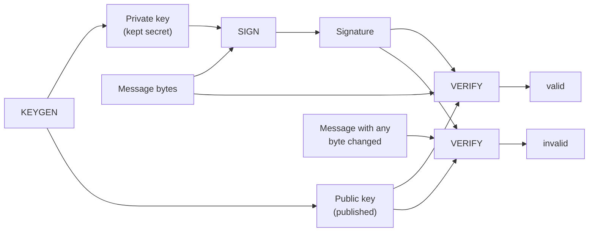
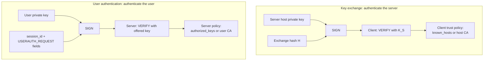
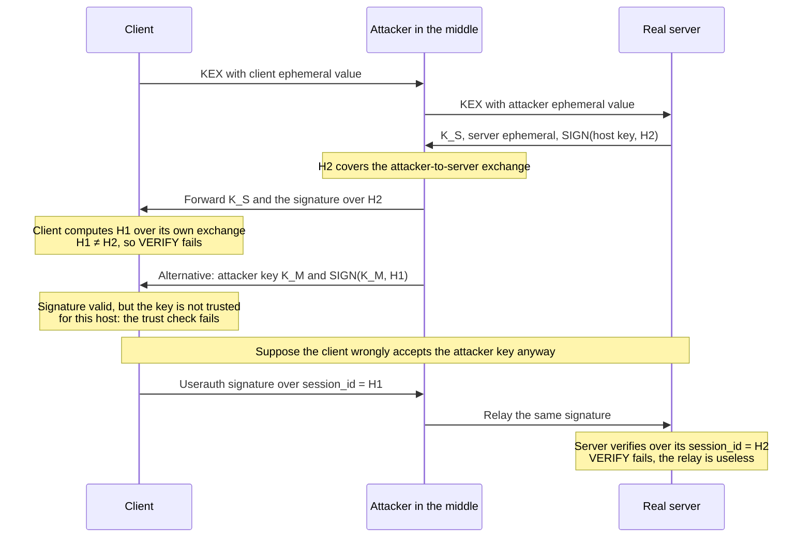
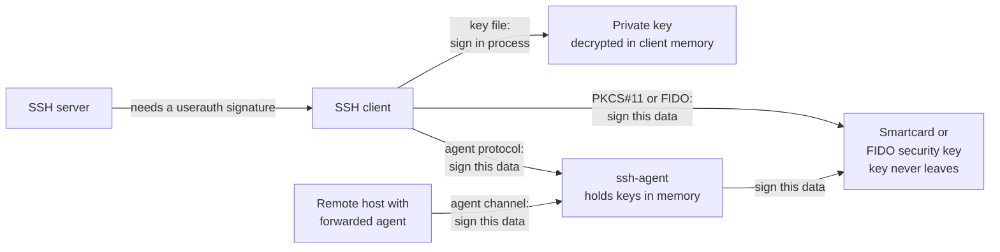
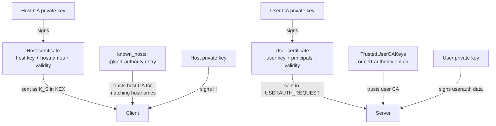

# Digital signatures

SSH authenticates both ends of a connection with digital signatures. The
server signs the key-exchange transcript with its host key; the user signs an
authentication request with a user key. The two proofs use the same kind of
primitive, but they answer different questions and are checked by different
peers under different policies.

This chapter treats signatures first as a black box, then opens the box for
the three families SSH clients meet today: RSA, ECDSA, and Ed25519. It ends
with the ways a private key can live outside the client process and with
certificates, which add a certification authority's signature on top of an
ordinary key.

## Signatures as a black box

A signature scheme has three operations:

```text
KEYGEN(randomness)                        -> private_key, public_key
SIGN(private_key, message)                -> signature
VERIFY(public_key, message, signature)    -> valid | invalid
```

The private key stays with its owner. The public key can be given to anyone.
Anyone holding the public key can check a signature, but only the holder of
the private key can produce one that verifies.



A valid signature proves two things:

- **Possession:** whoever produced it controlled the private key that matches
  this public key.
- **Approval of exact bytes:** the key holder signed exactly this message.
  Changing, adding, or removing a single byte makes verification fail.

It does not prove two things that are easy to assume:

- **Identity.** A public key is just a number. Whether it belongs to
  `git.example.com` or to user `alice` is a statement made by trust policy:
  `known_hosts`, a certification authority, or `authorized_keys`. An attacker
  can generate a key pair and make perfectly valid signatures with it.
- **Confidentiality.** A signature does not hide the message. SSH signs data
  that both sides already know; the traffic keys from
  [key agreement](./crypto-key-agreement.md) provide secrecy.

### The two places SSH signs



In [key exchange](./key-exchange.md#the-host-key-signature-and-the-trust-decision),
the server signs the exchange hash `H`, and the client checks both the
signature and whether the host key is trusted for the destination
([Server authentication](./server-authentication.md)). In
[public-key user authentication](./user-authentication.md#signed-request), the
user's key signs the session identifier followed by the request fields, and
the server checks both the signature and whether the key is authorized for
the account.

### Why signatures cannot be moved between connections

Both signed messages contain values that are unique to one connection. `H`
covers both ephemeral key-exchange values, the host key, and the shared
secret. The session identifier is the first `H` of the connection. An
attacker who sits between client and server must run two separate key
exchanges, one with each side, and those produce two different hashes.



The last part of the diagram is a useful property of public-key user
authentication: even a client that made a bad host-key decision does not hand
the attacker a reusable credential. A password sent to the attacker in the
same situation would be reusable. The attacker's remaining option is to ask
the client's key for fresh signatures, which is why
[agent forwarding](#hardware-backed-keys) needs care.

## How SSH carries a signature

On the wire, every SSH signature is a small wrapper around an
algorithm-specific blob:

```text
string    signature algorithm name
string    signature blob (format defined by that algorithm)
```

Public keys use a similar wrapper, starting with a key format name. The two
names are often identical, but not always. An RSA public key is always
encoded with the format name `ssh-rsa`, while a modern RSA signature from that
key is named `rsa-sha2-256` or `rsa-sha2-512`
([RFC 8332](https://www.rfc-editor.org/rfc/rfc8332.html)). A certificate key
blob is named `ssh-ed25519-cert-v01@openssh.com`, while signatures made with
the certified key are ordinary `ssh-ed25519` signatures. When checking a
signature, the verifier must confirm that the signature algorithm is one the
key type permits and that local policy accepts.

| Signature algorithm | Spec | Public key | Signature | Hash | Deterministic? | Notes |
| --- | --- | --- | --- | --- | --- | --- |
| `ssh-ed25519` | [RFC 8709](https://www.rfc-editor.org/rfc/rfc8709.html) | 32 bytes | 64 bytes | SHA-512 (inside Ed25519) | Yes | Common default for new keys |
| `ecdsa-sha2-nistp256` | [RFC 5656](https://www.rfc-editor.org/rfc/rfc5656.html) | 65-byte curve point | `r`, `s`: up to 32 bytes each | SHA-256 | Only with RFC 6979-style nonces | Needs a unique secret nonce per signature |
| `ecdsa-sha2-nistp384` | RFC 5656 | 97-byte curve point | up to 48 bytes each | SHA-384 | As above | |
| `ecdsa-sha2-nistp521` | RFC 5656 | 133-byte curve point | up to 66 bytes each | SHA-512 | As above | |
| `rsa-sha2-256`, `rsa-sha2-512` | [RFC 8332](https://www.rfc-editor.org/rfc/rfc8332.html) | `ssh-rsa` blob: `e` and `n` | modulus length (384 bytes for 3072-bit `n`) | SHA-256 / SHA-512 | Yes | PKCS #1 v1.5 padding |
| `ssh-rsa` | [RFC 4253](https://www.rfc-editor.org/rfc/rfc4253.html#section-6.6) | `ssh-rsa` blob | modulus length | SHA-1 | Yes | Legacy; disabled by default since OpenSSH 8.8 |
| `sk-ssh-ed25519@openssh.com` | [PROTOCOL.u2f](https://github.com/openssh/openssh-portable/blob/master/PROTOCOL.u2f) | 32 bytes + application | 64 bytes + flags + counter | SHA-256, then SHA-512 inside Ed25519 | No: the signed counter changes | FIDO security key |
| `sk-ecdsa-sha2-nistp256@openssh.com` | PROTOCOL.u2f | 65-byte point + application | `r`, `s` + flags + counter | SHA-256 | No: the signed counter changes | FIDO security key |
| `*-cert-v01@openssh.com` | [draft-miller-ssh-cert](https://datatracker.ietf.org/doc/draft-miller-ssh-cert/) | key plus signed metadata | as for the certified key | as for the key | as for the key | See [Certificates](#certificates) |

ECDSA values are encoded as SSH `mpint`s, so a leading zero byte can make one
a byte longer. DSA (`ssh-dss`) also appears in RFC 4253; OpenSSH disabled it
by default in 2015 (OpenSSH 7.0) and removed it in OpenSSH 10.0.

## RSA

RSA is the oldest signature family in SSH. Its security rests on the
difficulty of factoring a large number `n` that is the product of two secret
primes.

- **Public key:** a modulus `n` and a public exponent `e` (usually 65537).
- **Private key:** an exponent `d` computed from the prime factors of `n`.
- **Signature:** a number smaller than `n`, so a signature is as long as the
  modulus: 384 bytes for a 3072-bit key.
- **Signing** hashes the message, wraps the hash in fixed padding, and raises
  the result to the power `d` modulo `n`. **Verifying** raises the signature
  to the power `e` and checks that the padded hash comes out.

`rsa-sha2-256` and `rsa-sha2-512` use the RSASSA-PKCS1-v1_5 scheme from
[RFC 8017](https://www.rfc-editor.org/rfc/rfc8017.html). It is deterministic:
the same key and message always produce the same signature, so signing needs
no randomness.

Key size matters much more than for elliptic-curve keys. A 3072-bit modulus
is generally rated at about 128-bit security
([NIST SP 800-57 Part 1](https://csrc.nist.gov/pubs/sp/800/57/pt1/r5/final)),
and `ssh-keygen` has generated 3072-bit RSA keys by default since
OpenSSH 8.0. Use at least 3072 bits for new RSA keys. OpenSSH's
[`RequiredRSASize`](https://man.openbsd.org/ssh_config#RequiredRSASize)
option sets the minimum an OpenSSH client will accept; its default is 1024
bits. Shorter user keys are skipped, and a server that presents a shorter RSA
host key makes the client terminate the connection.

As a client, keep the RSA key format and the RSA signature algorithm apart.
Disabling `ssh-rsa` *signatures* removes SHA-1; it does not retire RSA keys.
For user authentication, the client picks a SHA-2 signature name using the
server's
[`server-sig-algs`](./user-authentication.md#discovering-acceptable-signature-algorithms)
list. For host keys, `rsa-sha2-256` and `rsa-sha2-512` are negotiated as host
key algorithm names in `KEXINIT`.

<details>
<summary>Go deeper: RSA with small numbers</summary>

RSA uses *modular arithmetic*: `a mod n` is the remainder after dividing `a`
by `n`, so all results stay between `0` and `n − 1`.

**Key generation.** Pick two primes and multiply them:

```text
p = 61, q = 53
n = p · q = 3233                        public modulus
φ(n) = (p − 1) · (q − 1) = 60 · 52 = 3120
e = 17                                   public exponent, shares no factor with 3120
d = 2753                                 private exponent
check: e · d = 17 · 2753 = 46801 = 15 · 3120 + 1, so e · d ≡ 1 (mod 3120)
```

`φ(n)` is Euler's totient: the count of numbers below `n` that share no
factor with it. Euler's theorem makes `(m^d)^e ≡ m (mod n)` whenever
`e · d ≡ 1 (mod φ(n))`, so the two exponents undo each other.

**Sign and verify** a message representative `m = 65`:

```text
sign:    s = m^d mod n = 65^2753 mod 3233 = 588
verify:  s^e mod n    = 588^17 mod 3233  = 65   matches m, so valid
```

Try it yourself: `python3 -c "print(pow(65, 2753, 3233), pow(588, 17, 3233))"`
prints `588 65`.

**Why real RSA signs a padded hash.** "Textbook" RSA as above is
*malleable*: because `(m1 · m2)^d = m1^d · m2^d`, the product of two
signatures is a signature on the product of the messages. With the toy key:

```text
signature on 5:   5^2753 mod 3233  = 385
signature on 13:  13^2753 mod 3233 = 413
385 · 413 mod 3233 = 588            a valid signature on 5 · 13 = 65
```

Someone who obtained signatures on 5 and 13 could forge one on 65 without the
private key. Real schemes never sign the message value directly. The
`rsa-sha2-*` algorithms first hash the message, then build the encoded value

```text
EM = 0x00 || 0x01 || 0xFF ... 0xFF || 0x00 || DigestInfo(hash algorithm, hash)
```

and sign `EM`. The product of two such structured values is not a correctly
structured value, and the hash makes it infeasible to pick messages whose
encodings multiply usefully. The hash also lets a message of any length be
signed with one exponentiation.

**Why factoring `n` reveals `d`.** Anyone who learns `p` and `q` can compute
`φ(n) = (p − 1)(q − 1)` and then `d` as the inverse of `e` modulo `φ(n)`,
exactly as the key owner did. Factoring 3233 is instant. Factoring a 3072-bit
modulus is far beyond known classical methods, which is the whole security
argument. (A large quantum computer would change this; see
[Post-quantum key exchange](./crypto-post-quantum.md#why-quantum-computers-matter).)

The toy is insecure because `n` is tiny and there is no padding.

Learn more:

- [RSA cryptosystem (Wikipedia)](https://en.wikipedia.org/wiki/RSA_cryptosystem)
- [Euler's totient function (Wikipedia)](https://en.wikipedia.org/wiki/Euler%27s_totient_function)
- [RFC 8017: PKCS #1 v2.2](https://www.rfc-editor.org/rfc/rfc8017.html),
  Section 8.2 (RSASSA-PKCS1-v1_5) and Section 9.2 (EMSA-PKCS1-v1_5)

</details>

## ECDSA

The Elliptic Curve Digital Signature Algorithm works in the group of points
on a named elliptic curve. SSH uses the NIST curves P-256, P-384, and P-521
([RFC 5656](https://www.rfc-editor.org/rfc/rfc5656.html)); the curve fixes
the hash (SHA-256, SHA-384, or SHA-512 respectively).

- **Private key:** a secret number `d`.
- **Public key:** the curve point `Q = d·G`, where `G` is the curve's
  standard base point. The
  [elliptic curves section](./crypto-key-agreement.md#elliptic-curves)
  explains point multiplication; recovering `d` from `Q` is the hard problem.
- **Signature:** two numbers `r` and `s`, carried in SSH as two `mpint`s.

Keys and signatures are much smaller than RSA at similar strength: a P-256
key gives roughly 128-bit security with a 65-byte public point.

ECDSA has one sharp edge. **Every signature needs a fresh secret number `k`**,
often called the nonce. `k` must be unpredictable and must never repeat for
two different messages under the same key. If it repeats, anyone who sees the
two signatures can compute the private key. Even a small bias in how `k` is
chosen can leak the key over many signatures. A signer can derive `k`
deterministically from the private key and the message hash, as
[RFC 6979](https://www.rfc-editor.org/rfc/rfc6979.html) specifies; otherwise
the signer depends on a sound random generator
([Randomness](./cryptography-primer.md#randomness)) at every signature.

For SSH this means an ECDSA host key or user key is only as safe as every
signing operation the key has ever done. A verifier cannot tell from a single
signature whether the nonce was good.

<details>
<summary>Go deeper: why an ECDSA nonce must never repeat</summary>

**The equations.** Let `n` be the number of points in the group generated by
`G`, `h` the message hash reduced to a number modulo `n`, and `k⁻¹` the
inverse of `k` modulo `n` (the number with `k · k⁻¹ ≡ 1 mod n`).

```text
sign:    pick a secret k in 1 … n−1
         r = x-coordinate of (k·G), reduced mod n
         s = k⁻¹ · (h + r·d) mod n
verify:  w = s⁻¹ mod n
         u1 = h·w mod n,  u2 = r·w mod n
         X = u1·G + u2·Q
         valid if x-coordinate of X, reduced mod n, equals r
```

Verification works because `u1·G + u2·Q = (h + r·d)·w·G`, and
`(h + r·d)·w = (h + r·d) · s⁻¹ = k`, so `X = k·G`, the same point the signer
used.

**A toy curve.** Take `y² = x³ + 2x + 2` over the integers mod 17, with base
point `G = (5, 1)`. The multiples `G, 2·G, …, 18·G` are 18 distinct points,
and `19·G` is the group's "zero" (the point at infinity), so `n = 19`. Choose the
private key `d = 7`, giving `Q = 7·G = (0, 6)`.

The signer carelessly uses the same `k = 3` for two messages whose hashes are
`h1 = 10` and `h2 = 3`:

```text
k·G = 3·G = (10, 6), so r = 10 mod 19 = 10
k⁻¹ = 3⁻¹ mod 19 = 13                     (3 · 13 = 39 = 2·19 + 1)
s1 = 13 · (10 + 10·7) mod 19 = 13 · 80 mod 19 = 14
s2 = 13 · (3 + 10·7) mod 19  = 13 · 73 mod 19 = 18
signatures: (r, s1) = (10, 14) on h1 and (r, s2) = (10, 18) on h2
```

Both verify. For the first: `w = 14⁻¹ mod 19 = 15`, `u1 = u2 = 10·15 mod 19 =
17`, and `17·G + 17·Q = 17·G + 17·7·G = 136·G = 3·G = (10, 6)` because
`136 mod 19 = 3`. Its x-coordinate is `10 = r`.

**Recovering the key.** The repeated `r` shows the nonce was reused. Write
the two signing equations as `s1·k = h1 + r·d` and `s2·k = h2 + r·d`, then
subtract to eliminate `d`:

```text
(s1 − s2) · k = h1 − h2
k = (h1 − h2) / (s1 − s2) mod n = 7 / (−4) mod 19 = 7 · 15⁻¹ = 7 · 14 mod 19 = 3
d = (s1·k − h1) / r mod n = (42 − 10) / 10 = 32 · 2 mod 19 = 7
```

Division mod 19 means multiplying by the inverse: `15⁻¹ = 14` and
`10⁻¹ = 2`. The attacker now has the private key `d = 7`.

Try it yourself:
`python3 -c "n=19; k=(10-3)*pow(14-18,-1,n)%n; print(k, (14*k-10)*pow(10,-1,n)%n)"`
prints `3 7`.

This is not only theory. In 2010 researchers showed that Sony signed
PlayStation 3 software with ECDSA using a fixed `k`, and recovered the
signing key with exactly this algebra. RFC 6979 removes the failure mode by
computing `k` from the private key and the message hash with HMAC-DRBG, so
distinct messages get distinct, secret nonces without a random generator.

The toy is insecure because 19 possible keys can be tried by hand; real
curves have about 2²⁵⁶ group elements.

Learn more:

- [Elliptic Curve Digital Signature Algorithm (Wikipedia)](https://en.wikipedia.org/wiki/Elliptic_Curve_Digital_Signature_Algorithm)
- [RFC 6979: Deterministic DSA and ECDSA](https://www.rfc-editor.org/rfc/rfc6979.html)
- [FIPS 186-5: Digital Signature Standard](https://csrc.nist.gov/pubs/fips/186-5/final)

</details>

## Ed25519

Ed25519 is an instance of EdDSA, a Schnorr-style signature scheme over the
twisted Edwards form of Curve25519
([RFC 8032](https://www.rfc-editor.org/rfc/rfc8032.html)).
[RFC 8709](https://www.rfc-editor.org/rfc/rfc8709.html) defines it for SSH as
`ssh-ed25519`.

- **Public key:** 32 bytes. **Signature:** 64 bytes. Both have fixed length.
- **Deterministic:** the per-signature secret is derived from the private key
  and the message, so signing needs no randomness and cannot suffer the
  ECDSA nonce failure.
- **Fast and simple to implement safely:** the design avoids secret-dependent
  branches and has few parameters to get wrong.
- **About 128-bit security**, similar to P-256 and RSA-3072.

These properties are why Ed25519 is the common default for new host and user
keys; `ssh-keygen` has generated Ed25519 keys by default since OpenSSH 9.5.
RFC 8709 also defines `ssh-ed448`, a larger variant with a 114-byte
signature, which is less widely deployed.

<details>
<summary>Go deeper: Schnorr-style signatures</summary>

Ed25519 works in a group of curve points with base point `B` and a prime
number of elements `ℓ` (about 2²⁵²). Point addition and multiplication by a
number work as described in the
[elliptic curves section](./crypto-key-agreement.md#elliptic-curves). From a
32-byte secret, SHA-512 derives two values: a secret scalar `a` and a secret
`prefix`. The public key is `A = a·B`.

```text
sign message M:
    r = SHA-512(prefix || M) mod ℓ        per-signature secret, deterministic
    R = r·B
    k = SHA-512(R || A || M) mod ℓ        challenge binds R, key, and message
    S = (r + k·a) mod ℓ
    signature = R || S                    32 + 32 bytes

verify:
    recompute k from R, A, M
    valid if S·B = R + k·A
```

**Why verification works.** Multiply out the left side:

```text
S·B = (r + k·a)·B = r·B + k·(a·B) = R + k·A
```

The verifier never learns `r` or `a`; it only sees `R`, `A`, and `S`.
RFC 8032 also allows a "cofactored" form of the check that multiplies both
sides by 8.

**A toy Schnorr signature.** The same algebra works in a small
multiplicative group, where "`x·B`" becomes `g^x mod p` and point addition
becomes multiplication. Use `p = 23` and `g = 4`; the powers of 4 mod 23 cycle
through `q = 11` values, so exponents work mod 11.

```text
private key a = 3        public key A = 4^3 mod 23 = 18
nonce r = 6              R = 4^6 mod 23 = 2
challenge k = 5          (pretend this came from hashing R, A, and M)
S = (r + k·a) mod 11 = (6 + 15) mod 11 = 10

verify: g^S = 4^10 mod 23 = 6
        R · A^k = 2 · 18^5 mod 23 = 2 · 3 = 6     equal, so valid
```

**Why `r` must be secret and unique.** If the same `r` is used with a
different challenge `k2 = 8`, then `S2 = (6 + 8·3) mod 11 = 8`. Subtracting
gives `S2 − S = (k2 − k)·a`, so `a = (8 − 10) / (8 − 5) mod 11 = 3`: the key
leaks, just as with ECDSA. Ed25519 avoids this by computing `r` from the
secret `prefix` and the message. The same message always gives the same `r`
and the same signature, which is harmless; a different message gives an
unrelated `r`.

Try it yourself: `python3 -c "print(pow(4,10,23), 2*pow(18,5,23)%23)"`
prints `6 6`.

The toy is insecure because a group of 11 elements lets anyone find `a` by
trying every exponent.

Learn more:

- [EdDSA (Wikipedia)](https://en.wikipedia.org/wiki/EdDSA)
- [Schnorr signature (Wikipedia)](https://en.wikipedia.org/wiki/Schnorr_signature)
- [RFC 8032: EdDSA](https://www.rfc-editor.org/rfc/rfc8032.html),
  Sections 5.1.6 and 5.1.7
- [RFC 8709: Ed25519 and Ed448 for SSH](https://www.rfc-editor.org/rfc/rfc8709.html)

</details>

## Hardware-backed keys

The SSH protocol only needs a signature. It does not care which process or
device computed it. That separation lets the private key live somewhere the
SSH client cannot read it.



Every arrow labeled "sign this data" is a signing *oracle*: the caller gets a
signature on bytes it chooses, but never the key.

**Agents and smartcards.** `ssh-agent` holds decrypted keys, or references to
tokens, and answers signing requests over a local socket. A PKCS#11 smartcard
or hardware token computes the signature itself. In both cases the server
sees an ordinary `ssh-ed25519`, `ecdsa-sha2-*`, or `rsa-sha2-*` signature;
nothing on the SSH wire changes. The agent protocol is specified in
[RFC 9987](https://www.rfc-editor.org/rfc/rfc9987.html).

**Agent forwarding delegates the oracle, not the key.** With
[agent forwarding](./forwarding.md#related-channels-are-separate-protocols),
the remote host can send signing requests back to your agent while the
forwarding channel is open. A compromised remote host cannot copy the key,
but it can use it: it can open its own connection to another server and ask
your agent to sign that connection's userauth request, which carries the
correct session identifier. The session binding stops *replay* of old
signatures, not the creation of new ones.
[Host-bound authentication](./user-authentication.md#host-bound-public-key-authentication)
and agent key constraints narrow what the agent will sign.

**FIDO security keys** are the one case that *does* change the wire format.
OpenSSH 8.2 added the key types `sk-ecdsa-sha2-nistp256@openssh.com` and
`sk-ssh-ed25519@openssh.com`
([PROTOCOL.u2f](https://github.com/openssh/openssh-portable/blob/master/PROTOCOL.u2f)).
The authenticator will not sign the SSH data directly. It signs a small
structure of its own that contains a hash of the SSH data:

```text
SHA-256(application)     application string from the public key, usually "ssh:"
flags                    "user present" and "user verified" bits
counter                  a 32-bit counter maintained by the authenticator
SHA-256(message)         the SSH data to be signed, e.g. the userauth request
```

The underlying arithmetic is still plain ECDSA on P-256 or Ed25519. The SSH
signature carries the flags and counter next to it, so the verifier can
rebuild the structure, verify, and then check the flags against policy. The
flags are what let a server demand a physical touch, or a PIN, for every
signature, which also makes a forwarded agent much less useful to an attacker.
[FIDO security keys (YubiKey)](./fido-security-keys.md) follows these keys
end to end: enrollment, what the server checks, resident keys, certificates,
agents, and setup with `ykman` and OpenSSH.

## Certificates

A plain public key must be trusted one key at a time. An OpenSSH certificate
lets a certification authority (CA) vouch for many keys. It is a public key
plus metadata, signed by the CA key:

```text
certificate = key type, nonce, public key,
              serial, role (user or host), key identifier,
              principals, valid after, valid before,
              critical options, extensions,
              CA public key,
              CA signature over all of the above
```

The certificate format is an OpenSSH extension, now described in the
[SSH certificate format Internet-Draft](https://datatracker.ietf.org/doc/draft-miller-ssh-cert/).
Deployed algorithm names end in `-cert-v01@openssh.com`, for example
`ssh-ed25519-cert-v01@openssh.com`.



A certificate adds a *second* signature; it does not replace the first. The
CA's signature was made once, when the certificate was issued, and says
"this key may act as these principals during this time". The live
signature over `H` or over the userauth request is still made by the
certified key and proves possession during this connection. The verifier
checks both, then applies the certificate rules: correct role, validity
interval, a principal matching the intended host or account, and no
unrecognized critical options. The
[certification authority section](./server-authentication.md#certification-authority)
describes the client's checks for host certificates.

Certificates expire by design, which limits how long a stolen key stays
useful. For earlier withdrawal, OpenSSH supports key revocation lists (KRLs)
that can revoke keys, certificate serial numbers, or key identifiers (see
[`ssh-keygen(1)`](https://man.openbsd.org/ssh-keygen#KEY_REVOCATION_LISTS)).
Servers load them with
[`RevokedKeys`](https://man.openbsd.org/sshd_config#RevokedKeys); clients use
`RevokedHostKeys` or `@revoked` lines in `known_hosts`.

## Choosing and reading key types as a client

When you see a key or signature algorithm in a trace or a `known_hosts` line,
a few questions place it:

- **Which family?** `ssh-ed25519` and `sk-ssh-ed25519@…` are Ed25519;
  `ecdsa-sha2-*` and `sk-ecdsa-…` are ECDSA; `ssh-rsa` and `rsa-sha2-*` are
  RSA.
- **Key format or signature algorithm?** For RSA, `ssh-rsa` in a key file is
  just the key format. On the wire, the signature algorithm is what matters,
  and only `ssh-rsa` as a signature means SHA-1.
- **Where is the private key?** A file, an agent, a smartcard, or a FIDO token
  all produce the same kind of proof, but differ in what an attacker who
  controls the client or a forwarded agent can do.
- **Who vouches for it?** A pinned key, a CA certificate, or an
  `authorized_keys` line. The signature proves possession; this answer
  provides identity.

For new keys, Ed25519 is the usual choice: small, fast, deterministic, and
widely supported. RSA with SHA-2 signatures and at least 3072 bits remains
reasonable where Ed25519 is not available. ECDSA is secure when implemented
well but depends on correct nonce generation for every signature. A FIDO
`sk-*` key adds a physical presence check and keeps the key off the
computer.

None of these signature algorithms resists a large quantum computer. SSH's
deployed post-quantum work protects key exchange, so that recorded traffic
stays confidential; post-quantum signatures are at an experimental stage. See
[What post-quantum key exchange does not do](./crypto-post-quantum.md#what-post-quantum-key-exchange-does-not-do).

## Check your understanding

1. A server presents a host key that is not in `known_hosts`, together with a
   valid signature over `H`. What has the client learned, and what has it not
   learned?
2. Why does an RSA public key blob say `ssh-rsa` even when the connection
   uses `rsa-sha2-512` signatures?
3. An attacker in the middle receives a user's public-key authentication
   signature. Why can it not use that signature to log in to the real server?
4. Two ECDSA signatures from the same key have the same `r`. What does that
   indicate, and what can an observer do with it?
5. Why does Ed25519 not need a random number generator when signing?
6. With agent forwarding enabled, what can a compromised remote host do with
   your key, and what can it not do?
7. What two signatures does a verifier check when a host presents a
   certificate?

<details>
<summary>Answers</summary>

1. That the peer controls the private key matching the presented host key and
   approved this exact exchange. It has not learned that this key belongs to
   the intended host; that requires trust policy, such as a verified
   fingerprint or a trusted host CA.
2. RFC 8332 kept the existing RSA public-key encoding and defined new
   signature algorithm names. The key format and the signature algorithm are
   named separately, so disabling SHA-1 signatures does not require new keys.
3. The signature covers the session identifier of the client's connection.
   The attacker's connection to the real server has a different exchange hash
   and therefore a different session identifier, so the server's
   verification fails.
4. The signer reused the nonce `k`. From the two signatures and message hashes,
   anyone can compute `k` and then the private key `d`.
5. Its per-signature secret is derived by hashing a secret prefix with the
   message. It is unpredictable to others and differs for different
   messages, without fresh randomness.
6. It can ask your agent to sign new data, including authentication requests
   for its own connections to other servers, while forwarding is active. It
   cannot extract the private key. Constraints, host-bound authentication,
   and touch-required FIDO keys narrow this.
7. The CA's signature over the certificate contents, checked against a
   trusted CA key, and the host key's live signature over the exchange hash
   `H`, checked against the certified public key.

</details>

## References

- [RFC 4253: SSH Transport Layer Protocol](https://www.rfc-editor.org/rfc/rfc4253.html),
  Section 6.6 (public key algorithms) and Section 8 (signed key exchange).
- [RFC 4252: SSH Authentication Protocol](https://www.rfc-editor.org/rfc/rfc4252.html),
  Section 7 (public-key signature input).
- [RFC 5656: Elliptic Curve Algorithm Integration in SSH](https://www.rfc-editor.org/rfc/rfc5656.html).
- [RFC 8332: Use of RSA Keys with SHA-256 and SHA-512 in SSH](https://www.rfc-editor.org/rfc/rfc8332.html).
- [RFC 8709: Ed25519 and Ed448 Public Key Algorithms for SSH](https://www.rfc-editor.org/rfc/rfc8709.html).
- [RFC 8017: PKCS #1: RSA Cryptography Specifications Version 2.2](https://www.rfc-editor.org/rfc/rfc8017.html).
- [RFC 8032: Edwards-Curve Digital Signature Algorithm (EdDSA)](https://www.rfc-editor.org/rfc/rfc8032.html).
- [RFC 6979: Deterministic Usage of DSA and ECDSA](https://www.rfc-editor.org/rfc/rfc6979.html).
- [FIPS 186-5: Digital Signature Standard](https://csrc.nist.gov/pubs/fips/186-5/final).
- [OpenSSH PROTOCOL.u2f: FIDO/U2F security keys](https://github.com/openssh/openssh-portable/blob/master/PROTOCOL.u2f).
- [SSH certificate format Internet-Draft](https://datatracker.ietf.org/doc/draft-miller-ssh-cert/).
- [RFC 9987: Secure Shell (SSH) Agent Protocol](https://www.rfc-editor.org/rfc/rfc9987.html).
- [OpenSSH release notes](https://www.openssh.com/releasenotes.html) (7.0 DSA
  disabled; 8.0 3072-bit RSA default; 8.2 FIDO keys; 8.8 `ssh-rsa` signatures
  disabled; 9.5 Ed25519 default; 10.0 DSA removed).
