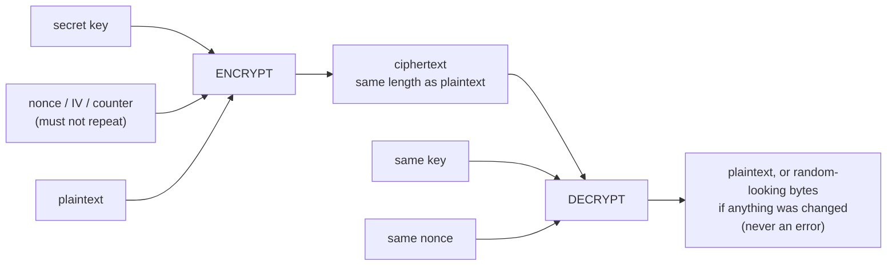
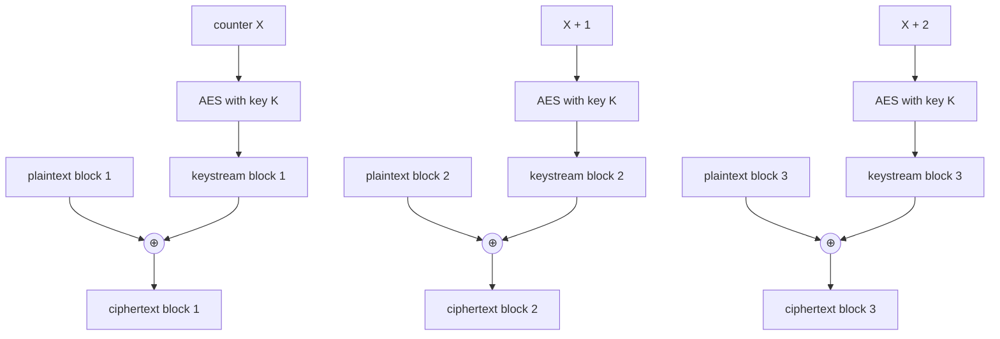
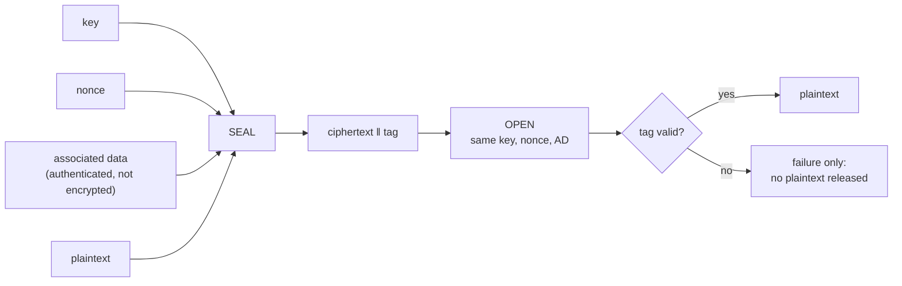
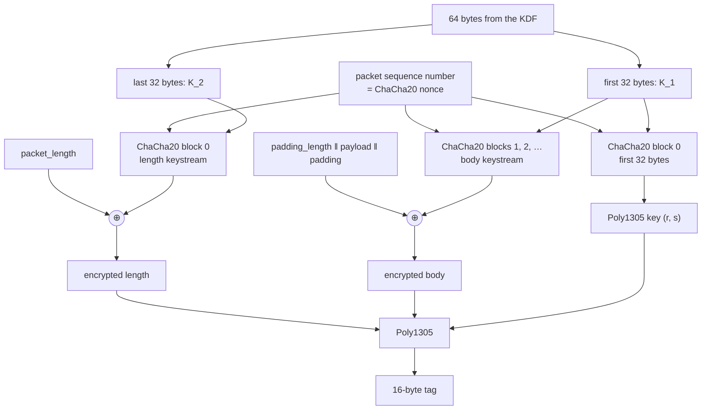
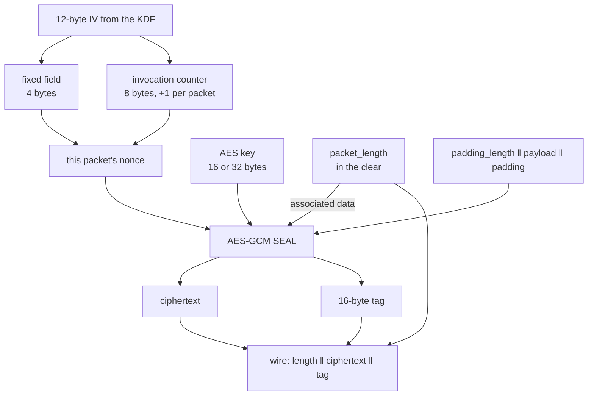
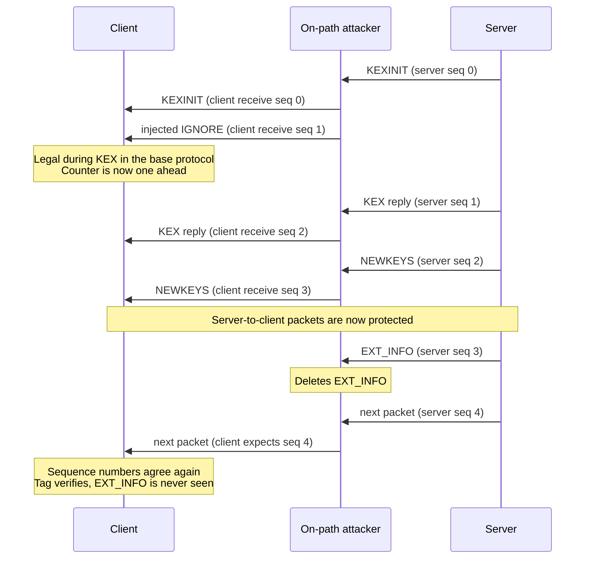

# Symmetric encryption and packet protection

After each direction's `SSH_MSG_NEWKEYS`, every packet in that direction is
protected with symmetric keys from the
[SSH key derivation](./crypto-hashes.md#key-derivation-in-ssh): letters `A`
and `B` produce initial IVs, `C` and `D` encryption keys, and `E` and `F`
integrity keys, one of each per direction. The negotiated algorithm name
defines how much of that material is used, and for what.

## Ciphers as a black box

A symmetric cipher takes a secret key, a per-message value that must not
repeat (called a nonce, IV, or counter depending on the construction), and
plaintext. It outputs ciphertext of the same length. Decryption with the same
key and nonce inverts the transformation.



Given a secret key and a never-repeated nonce, a cipher guarantees
**confidentiality**: an observer learns nothing about the plaintext beyond its
length. It does *not* provide:

- **Integrity.** Decryption has no failure output: every ciphertext decrypts
  to *something*.
- **Length hiding.** Ciphertext length tracks plaintext length; SSH padding
  blurs it only slightly.
- **Safety under nonce reuse.** Two messages encrypted with the same key and
  nonce lose confidentiality, as shown below.

The client and server choose a cipher for each direction from the
`encryption_algorithms` name-lists in
[`KEXINIT`](./version-and-negotiation.md#ssh_msg_kexinit-carries-proposals).

## Stream ciphers, block ciphers, and modes

A **stream cipher** generates a long pseudorandom *keystream* from the key and
nonce and XORs (`⊕`) it byte by byte with the plaintext. ChaCha20 is a stream
cipher.

A **block cipher** is a keyed permutation on fixed-size blocks. AES
([FIPS 197](https://csrc.nist.gov/pubs/fips/197/final)) maps a 16-byte block
to a 16-byte block under a 128-, 192-, or 256-bit key; without the key, the
mapping looks like a random shuffle of all 2¹²⁸ blocks. A block cipher alone
encrypts exactly one block. A **mode of operation** extends it to longer
messages. SSH has used two:

- **CTR (counter) mode**, names such as `aes128-ctr` and `aes256-ctr` from
  [RFC 4344](https://www.rfc-editor.org/rfc/rfc4344.html). AES encrypts
  successive counter values to make a keystream, turning the block cipher into
  a stream cipher. SSH keeps one counter per direction, starting at the
  KDF-derived IV and continuing across packets rather than restarting for each.
- **CBC (cipher block chaining)**, names such as `aes128-cbc` and `3des-cbc`
  from RFC 4253. Each plaintext block is XORed with the previous ciphertext
  block before encryption, and the chaining also continues across packets.
  CBC is legacy: current OpenSSH has no CBC cipher in its default
  [`Ciphers`](https://man.archlinux.org/man/ssh_config.5#Ciphers) list.



Because the counter never repeats under one key, no keystream block is reused.
That is the whole security argument for CTR, ChaCha20, and the CTR part of
AES-GCM.

<details>
<summary>Go deeper: XOR, keystream reuse, and malleability</summary>

**XOR as encryption.** XOR gives 1 where the input bits differ and 0 where they
agree. It is its own inverse: `x ⊕ k ⊕ k = x`. For the byte `l` (`0x6c`) and
keystream byte `0x3a`:

```text
  0110 1100   plaintext  0x6c ('l')
⊕ 0011 1010   keystream  0x3a
= 0101 0110   ciphertext 0x56
```

Encryption is `C = P ⊕ KS` and decryption `P = C ⊕ KS`. If the keystream `KS`
looks random and is never reused, `C` reveals nothing about `P` but its length.

**Keystream reuse.** Encrypt two commands with the *same* keystream:

```text
P1          6c 73 20 2d 6c 61   "ls -la"
P2          72 6d 20 2d 72 66   "rm -rf"
KS          3a 91 5c e7 08 6d   (reused!)
C1 = P1⊕KS  56 e2 7c ca 64 0c
C2 = P2⊕KS  48 fc 7c ca 7a 0b
C1 ⊕ C2     1e 1e 00 00 1e 07
P1 ⊕ P2     1e 1e 00 00 1e 07   identical
```

The keystream cancels: `C1 ⊕ C2 = P1 ⊕ P2`. An eavesdropper sees where the
plaintexts agree (the `00` bytes), and a correct guess of one plaintext yields
the other exactly. Every SSH construction therefore ties its nonce or counter
to something that cannot repeat under one key.

**Malleability.** Flipping a ciphertext bit flips the same plaintext bit, and
the cipher does not notice. An attacker who guesses that a packet carries
`ls\n`:

```text
P             6c 73 0a      "ls\n"
KS            9e 42 17
C             f2 31 1d
Δ = "ls\n" ⊕ "rm\n"  1e 1e 00
C' = C ⊕ Δ    ec 2f 1d
C' ⊕ KS       72 6d 0a      "rm\n"
```

The command changed without the key. Stream ciphers and CTR mode are
malleable by design, so the receiver needs a separate check under a key the
attacker lacks: a [MAC](./crypto-hashes.md#message-authentication-codes) or
an AEAD tag. Real keystreams come from ChaCha20 or AES, but the arithmetic of
reuse and bit-flipping is the same.

Try it yourself:
`python3 -c 'print(bytes(a^b for a,b in zip(bytes.fromhex("f2311d"),bytes.fromhex("1e1e00"))).hex())'`

Learn more:
[Block cipher mode of operation](https://en.wikipedia.org/wiki/Block_cipher_mode_of_operation),
[Stream cipher attacks](https://en.wikipedia.org/wiki/Stream_cipher_attacks),
[Malleability](https://en.wikipedia.org/wiki/Malleability_(cryptography)).

</details>

<details>
<summary>Go deeper: how CBC chains blocks</summary>

CBC encrypts and decrypts block `i` as

```text
C_i = AES_K(P_i ⊕ C_(i−1))
P_i = AES⁻¹_K(C_i) ⊕ C_(i−1)
```

where `C_0` is the IV. RFC 4253 treats all packets in one direction as one
stream, so the "previous block" for a packet's first block is the last
ciphertext block of the previous packet. Two consequences matter:

- **Predictable IVs.** The next packet's IV is already on the wire, so an
  attacker who can influence plaintext knows it in advance. RFC 4344 cites the
  resulting chosen-plaintext attack on the original SSH CBC usage.
- **Self-synchronization.** Decrypting `P_i` needs only `C_i` and `C_(i−1)`.
  A receiver that uses the wrong previous block garbles one block; the rest
  decrypt correctly. Terrapin exploits this.

Learn more:
[Cipher block chaining](https://en.wikipedia.org/wiki/Block_cipher_mode_of_operation#Cipher_block_chaining_(CBC)),
[RFC 4344 section 1](https://www.rfc-editor.org/rfc/rfc4344#section-1).

</details>

## Three ways to combine encryption and integrity

Since ciphertext can be altered undetectably, every SSH packet carries an
integrity tag. What matters is *what* the tag covers and *when* the receiver
checks it. An authenticated-encryption-with-associated-data (AEAD) algorithm
packages both jobs into one black box:



Unlike a bare cipher, `OPEN` can fail. SSH reached this shape in three steps,
the [packet-protection families](./binary-packets.md#packet-protection-families):
RFC 4253's encrypt-and-MAC, OpenSSH's encrypt-then-MAC (`*-etm@openssh.com`
MAC names, documented in
[OpenSSH `PROTOCOL`](https://github.com/openssh/openssh-portable/blob/master/PROTOCOL)),
and AEAD ciphers, for which separate MAC negotiation is
[skipped](./version-and-negotiation.md#the-selection-rule-client-preference-wins).
The table shows what each step changes for the receiver:

| Construction | How the receiver learns the length | What the tag covers | Decrypts before verifying? |
| --- | --- | --- | --- |
| Encrypt-and-MAC | Decrypts the first cipher block | `seq ‖` plaintext packet | Yes, the whole packet |
| Encrypt-then-MAC | Reads it in the clear | `seq ‖ length ‖` ciphertext | No |
| AES-GCM | Reads it in the clear, as associated data | Length and ciphertext | No |
| ChaCha20-Poly1305 | Decrypts 4 bytes with a separate length key | Encrypted length and ciphertext | Only the length |

Acting on unauthenticated bytes has been exploited. Albrecht, Paterson, and
Watson ("Plaintext Recovery Attacks Against SSH", IEEE S&P 2009) showed that
with encrypt-and-MAC in CBC mode, an attacker could place a ciphertext block
in the length position and learn plaintext bits of that block from how many
bytes the receiver waited for before failing
([CVE-2008-5161](https://nvd.nist.gov/vuln/detail/CVE-2008-5161)).
[OpenSSH 5.2](https://www.openssh.com/txt/release-5.2) responded by preferring
CTR mode and making failures look alike. Encrypt-then-MAC and AEAD remove the
underlying problem: nothing is acted on before it is authenticated, except
ChaCha20-Poly1305's separately keyed length.

## ChaCha20-Poly1305

`chacha20-poly1305@openssh.com` is OpenSSH's AEAD construction from Daniel
Bernstein's ChaCha20 stream cipher and Poly1305 one-time MAC, and the first
entry in OpenSSH's default cipher list. The
[IETF draft](https://datatracker.ietf.org/doc/draft-ietf-sshm-chacha20-poly1305/)
registers the name `chacha20-poly1305` as identical to it. It is **not** the
ChaCha20-Poly1305 AEAD of [RFC 8439](https://www.rfc-editor.org/rfc/rfc8439.html)
used in TLS: the primitives are shared, but the SSH layout differs.

Per the draft:

- **Keys.** The KDF supplies **64 bytes**, split into two 256-bit keys. The
  first half, `K_1`, encrypts the packet body and yields the Poly1305 key.
  The second half, `K_2`, encrypts only the four-byte `packet_length`. (Older
  OpenSSH documentation labels the halves the other way round; the byte
  positions are what matter.)
- **Nonce.** The packet sequence number, encoded as a 64-bit big-endian
  integer. No IV is taken from the KDF.
- **Length.** XORed with the first 4 bytes of `ChaCha20(K_2, seq, block 0)`.
- **Poly1305 key.** The first 32 bytes of `ChaCha20(K_1, seq, block 0)`.
- **Body.** `padding_length ‖ payload ‖ padding` XORed with
  `ChaCha20(K_1, seq)` starting at block 1.
- **Tag.** A 16-byte Poly1305 tag over `encrypted length ‖ encrypted body`.
  Offered MAC algorithms are ignored.



A receiver decrypts the length with `K_2` as soon as four bytes arrive, reads
the rest of the packet and the tag, verifies the tag in constant time, and
only then decrypts the body. The length is used before it is authenticated,
but because it has its own key, a length oracle reveals nothing about the
body keystream; the draft cites this as a mitigation for the CVE-2008-5161
family.

Using the sequence number as the nonce has two consequences:

- **Every packet stands alone.** Only the counter links one packet's keystream
  to the next, which is what made Terrapin possible.
- **The 32-bit sequence number must not wrap under one key.** A wrap would
  repeat a `(key, nonce)` pair, so RFC 4344's advice to rekey before 2³²
  packets becomes a hard requirement.

<details>
<summary>Go deeper: ChaCha20 as add-rotate-XOR</summary>

ChaCha20's state is a 4 × 4 grid of sixteen 32-bit words: four constants
(the ASCII string `expand 32-byte k`), eight key words, a 64-bit block counter,
and a 64-bit nonce. Twenty rounds scramble the grid, the original grid is added
back, and the 64-byte result is one keystream block.

Each round consists of **quarter-rounds** on four words `a, b, c, d`, using
only addition modulo 2³² (`+`), XOR (`⊕`), and left rotation (`<<<`). This ARX
design is fast in software and has no secret-dependent table lookups.

```text
a += b;  d ⊕= a;  d <<<= 16
c += d;  b ⊕= c;  b <<<= 12
a += b;  d ⊕= a;  d <<<= 8
c += d;  b ⊕= c;  b <<<= 7
```

The test vector from RFC 8439 section 2.1.1, in hexadecimal:

| Step | a | b | c | d |
| --- | --- | --- | --- | --- |
| input | `11111111` | `01020304` | `9b8d6f43` | `01234567` |
| after `a += b` | `12131415` | | | |
| after `d ⊕= a; d <<<= 16` | | | | `51721330` |
| after all four lines | `ea2a92f4` | `cb1cf8ce` | `4581472e` | `5881c4bb` |

Addition mixes bits upward through carries, XOR mixes without carries, and
rotation moves bits between positions; combining them makes the result hard to
analyze. Each of the eighty quarter-rounds is invertible, so the rounds alone
could be run backwards to the key. Adding the original grid at the end
prevents that.

Learn more:
[RFC 8439 section 2](https://www.rfc-editor.org/rfc/rfc8439#section-2),
[Salsa20 and ChaCha](https://en.wikipedia.org/wiki/Salsa20).

</details>

<details>
<summary>Go deeper: Poly1305 as a polynomial</summary>

Poly1305 treats the message as the coefficients of a polynomial and evaluates
it at a secret point `r` modulo the prime `p = 2¹³⁰ − 5`. Each 16-byte block,
with a `01` byte appended, is read as a little-endian number `c_1, c_2, …, c_n`:

```text
tag = ((c_1·r^n + c_2·r^(n−1) + … + c_n·r) mod p  +  s) mod 2¹²⁸
```

The one-time key is `(r, s)`, with some bits of `r` cleared. Horner's rule
computes the polynomial: start with `A = 0`, and for each block set
`A = (A + c_i)·r mod p`.

**Toy version.** With the small prime `p = 101`, `r = 37`, `s = 58`, and
message `c = (12, 34)` (skipping the final `mod 2¹²⁸`):

```text
A = (0  + 12)·37 = 444  ≡ 40  (mod 101)
A = (40 + 34)·37 = 2738 ≡ 11  (mod 101)
tag = (11 + 58) mod 101 = 69
```

Check: `12·37² + 34·37 + 58 = 17 744 ≡ 69 (mod 101)`.

**Why the key must be one-time.** For one-block messages,
`tag = (c·r + s) mod p`. If the same `(r, s)` authenticates two messages:

```text
m1 = 20  →  t1 = (20·37 + 58) mod 101 = 91
m2 = 55  →  t2 = (55·37 + 58) mod 101 = 73
t1 − t2 ≡ (m1 − m2)·r      →  18 ≡ 66·r  (mod 101)
r = 18 · 66⁻¹ = 18 · 75 ≡ 37 (mod 101)
s = t1 − m1·r ≡ 58 (mod 101)
```

Subtracting cancels `s`, modular division gives `r`, and then `s` follows. The
attacker can now tag any message, for example `90 → 55`. Real Poly1305 has the
same algebra with longer polynomials, which is why SSH derives a fresh
`(r, s)` for every packet from ChaCha20 under `K_1` with the sequence number as
nonce.

With the real prime of about 2¹³⁰, Bernstein's analysis bounds a forger who
lacks the key to success probability at most `8·⌈ℓ/16⌉ / 2¹⁰⁶` per attempt on
an `ℓ`-byte message.

Try it yourself: `python3 -c 'print(18*pow(66,-1,101)%101)'`

Learn more:
[Poly1305](https://en.wikipedia.org/wiki/Poly1305),
[RFC 8439 section 2.5](https://www.rfc-editor.org/rfc/rfc8439#section-2.5),
[ChaCha20-Poly1305](https://en.wikipedia.org/wiki/ChaCha20-Poly1305).

</details>

## AES-GCM

`aes128-gcm@openssh.com` and `aes256-gcm@openssh.com` use AES in
Galois/Counter Mode with the packet construction of
[RFC 5647](https://www.rfc-editor.org/rfc/rfc5647.html), but OpenSSH and most
other implementations negotiate them differently from that RFC: the name
appears only in the encryption list and MAC negotiation is skipped. The
[negotiation chapter](./version-and-negotiation.md#the-selection-rule-client-preference-wins)
explains the difference and links the
[draft](https://datatracker.ietf.org/doc/draft-miller-sshm-aes-gcm/) that
standardizes it.

From RFC 5647 section 7:

- **Key:** 16 bytes (`aes128-gcm`) or 32 bytes (`aes256-gcm`) of KDF
  encryption key. The KDF integrity key is unused.
- **Nonce:** the 12-byte KDF IV, split into a 4-byte fixed field and an 8-byte
  *invocation counter*, a 64-bit integer incremented after every packet.
- **Associated data:** the 4-byte `packet_length`, sent in the clear and
  authenticated but not encrypted.
- **Plaintext:** `padding_length ‖ payload ‖ padding`, a multiple of 16 bytes.
- **Tag:** the full 16 bytes; truncated tags are not allowed.



The protocol-relevant difference from ChaCha20-Poly1305 is the nonce source:
GCM's own counter, seeded by the KDF, not the SSH sequence number. In an
undisturbed connection the two advance in lockstep, but an attacker who shifts
the sequence number without shifting the invocation counter only produces
packets that fail authentication.

Sending the length in the clear lets a passive observer see exact SSH packet
boundaries; see
[Length hiding and traffic analysis](#length-hiding-and-traffic-analysis).

<details>
<summary>Go deeper: GHASH, and why GCM nonce reuse is catastrophic</summary>

GCM is **CTR mode plus a polynomial MAC** called GHASH:

1. **Hash key.** `H = AES_K(0¹²⁸)`, the encryption of an all-zero block.
2. **Encryption.** With a 12-byte nonce `N`, the first counter block is
   `J_0 = N ‖ 00 00 00 01`. CTR encryption starts at the next block,
   `N ‖ 00 00 00 02`.
3. **GHASH.** The associated data, the ciphertext, and a block holding both
   bit lengths are split into 16-byte blocks `X_1 … X_m` and evaluated as a
   polynomial at `H`: `GHASH = X_1·H^m ⊕ X_2·H^(m−1) ⊕ … ⊕ X_m·H`.
4. **Tag.** `T = GHASH ⊕ AES_K(J_0)`.

The arithmetic is in GF(2¹²⁸): 128-bit strings where addition is XOR and
multiplication is polynomial multiplication reduced by
`x¹²⁸ + x⁷ + x² + x + 1`. The structure matches Poly1305: a secret evaluation
point (`H` for `r`) and a one-time mask (`AES_K(J_0)` for `s`).

Unlike Poly1305 in SSH, `H` stays fixed for the life of the key; only the mask
depends on the nonce. Nonce reuse is therefore fatal twice over:

- **Confidentiality:** the same nonce gives the same CTR keystream, so
  `C1 ⊕ C2 = P1 ⊕ P2`.
- **Integrity:** XORing two tags under the same nonce cancels the mask and
  leaves a polynomial in `H` with coefficients known from the ciphertexts.
  Solving it, as in the Poly1305 toy, narrows `H` to a few candidates. With
  `H` and one tag, the attacker recovers that nonce's mask and can forge tags
  for altered ciphertexts.

SSH avoids this with a per-packet counter and by rekeying long before the
64-bit invocation counter could wrap.

Learn more:
[Galois/Counter Mode](https://en.wikipedia.org/wiki/Galois/Counter_Mode),
[NIST SP 800-38D](https://csrc.nist.gov/pubs/sp/800/38/d/final),
[RFC 5116](https://www.rfc-editor.org/rfc/rfc5116.html) (the AEAD interface).

</details>

## Comparing the common choices

| Name | Construction | Cipher key | Nonce or IV source | Tag | `packet_length` on the wire |
| --- | --- | --- | --- | --- | --- |
| `aes*-ctr` + `hmac-sha2-*` | CTR, encrypt-and-MAC | 16 or 32 bytes | KDF IV as initial counter, continuous across packets | HMAC | Encrypted |
| `aes*-ctr` + `hmac-sha2-*-etm@openssh.com` | CTR, encrypt-then-MAC | 16 or 32 bytes | Same as above | HMAC | Clear, covered by MAC |
| `aes*-cbc` + `*-etm@openssh.com` | CBC, encrypt-then-MAC | 16–32 bytes | KDF IV, then previous ciphertext block | MAC | Clear, covered by MAC |
| `aes*-gcm@openssh.com` | AEAD | 16 or 32 bytes | 12-byte KDF IV, invocation counter +1 per packet | 16 bytes | Clear, associated data |
| `chacha20-poly1305@openssh.com` | AEAD | 64 bytes | Packet sequence number | 16 bytes | Encrypted with a separate key, covered by tag |

HMAC key and tag sizes follow the MAC name: 32 bytes for `hmac-sha2-256`,
64 bytes for `hmac-sha2-512`.

## Terrapin: when implicit state is not authenticated

Terrapin ([CVE-2023-48795](https://nvd.nist.gov/vuln/detail/CVE-2023-48795);
Bäumer, Brinkmann, and Schwenk,
[terrapin-attack.com](https://terrapin-attack.com/)) is a *prefix-truncation*
attack: an active on-path attacker deletes the first protected packets in one
direction, and neither endpoint notices. The
[security chapter](./robustness-and-security.md#what-the-network-attacker-can-do)
places it among the network attacker's capabilities; this section shows the
mechanism. Two facts about the original protocol combine:

1. **Sequence numbers are implicit and survive `NEWKEYS`.** Each direction's
   counter starts at zero with the first *unprotected* packet and keeps
   counting into the protected phase. Every tag depends on it.
2. **The exchange hash does not cover every pre-key packet.** It covers the
   version strings, the `KEXINIT` payloads, and the key-exchange values, but
   not an `SSH_MSG_IGNORE` sent in between, nor the sequence numbers at
   `NEWKEYS`.

So an attacker can inject an unauthenticated `IGNORE` before keys are active,
advancing the receiver's counter by one, and later delete one protected packet
to bring the counters back into step:



Whether the forwarded packet is accepted depends on what state each
construction carries from one protected packet to the next:

| Construction | What happens to the packet after the deleted one | Result |
| --- | --- | --- |
| ChaCha20-Poly1305 | Nonce is the sequence number, which matches again; each packet is keyed independently | Decrypts and verifies perfectly |
| CBC + encrypt-then-MAC | MAC over ciphertext verifies; CBC's wrong previous block garbles only the first block | Exploitable when that garbled block happens to be acceptable |
| CTR + encrypt-then-MAC | MAC verifies, but the continuous keystream is out of step, so the packet decrypts to random bytes | Not practically exploitable |
| Encrypt-and-MAC (any mode) | Decryption yields at least one random block, and the MAC over plaintext fails | Not affected |
| AES-GCM | The invocation counter counts only protected packets, so the receiver's nonce is one behind and the tag fails | Not affected |

**Why a client cares.** The deleted packet is typically the server's
`SSH_MSG_EXT_INFO`, and its absence looks exactly like a server that sends no
extensions. The Terrapin authors showed this can:

- remove `server-sig-algs`, so the client may make a weaker or failing choice
  of [RSA signature algorithm](./user-authentication.md#discovering-acceptable-signature-algorithms)
  for user authentication; and
- remove `ping@openssh.com`, which the OpenSSH 9.5 client needs before sending
  the chaff packets of its
  [keystroke-timing obfuscation](#length-hiding-and-traffic-analysis),
  silently turning that defense off.

They also combined truncation with state-machine bugs in one SSH library
(AsyncSSH) for worse outcomes. Any security decision based on "the peer did
not send X" early in the protected channel is weakened when X can be deleted.

**The fix.** [Strict KEX](./version-and-negotiation.md#strict-key-exchange)
addresses both facts: it forbids unexpected messages such as `IGNORE` during
the initial exchange, and it resets each direction's sequence number to zero
at every `NEWKEYS`, so pre-key packets no longer influence protected-phase
state. The ChaCha20-Poly1305 draft requires implementations to support both
countermeasures. Strict KEX takes effect only when **both** peers support it;
a patched client talking to an unpatched server over an affected construction
is still exposed.

## Length hiding and traffic analysis

Encryption hides content, not shape. Encrypt-then-MAC and AES-GCM send
`packet_length` in the clear, so an observer sees exact SSH packet boundaries;
encrypt-and-MAC and ChaCha20-Poly1305 encrypt it (see
[Comparing the common choices](#comparing-the-common-choices)).

Hiding the length field helps less than it seems. TCP segment sizes and timing
remain visible, and one small packet in a quiet connection has an obvious size.
Random padding of up to 255 bytes blurs sizes only a little; as the
[binary-packet chapter](./binary-packets.md#the-base-packet-layout) notes,
padding is not traffic-flow confidentiality.

Timing is the larger leak for interactive sessions. Each keystroke typically
produces one small packet, and inter-keystroke intervals reveal information
about what is typed, as Song, Wagner, and Tian showed for SSH in 2001.
[OpenSSH 9.5](https://www.openssh.com/txt/release-9.5) added client-side
keystroke timing obfuscation,
[`ObscureKeystrokeTiming`](https://man.archlinux.org/man/ssh_config.5#ObscureKeystrokeTiming),
on by default with a 20 ms interval: the client sends interactive traffic at
fixed intervals and keeps sending fake keystroke packets for a while after
typing stops. As the Terrapin section shows, this defense depends on an
extension learned from `EXT_INFO`.

## Usage limits and rekeying

Security bounds for every construction degrade with the amount of data
processed under one key, even if the key never leaks. SSH has three separate
limits:

- **Sequence-number space.** RFC 4344 section 3.1 recommends rekeying at least
  once every 2³² packets; beyond that, the 32-bit sequence number wraps and
  MACed packets could be replayed or reordered. For ChaCha20-Poly1305, where
  the sequence number *is* the nonce, a wrap would reuse a nonce.
- **Block-cipher birthday bound.** RFC 4344 section 3.2 says that for a block
  length `L ≥ 128` bits, an implementation should not encrypt more than
  2^(L/4) blocks before rekeying. For AES that is 2³² blocks of 16 bytes:
  **64 GiB**. For 64-bit block ciphers such as 3DES and Blowfish, the RFC
  falls back to RFC 4253's once-per-gigabyte advice.
- **ChaCha20's stream limit.** The ChaCha20-Poly1305 draft notes a 2⁷⁰-byte
  limit per `(key, nonce)`, far beyond any SSH packet, and defers to RFC 4253's
  1 GB recommendation.

OpenSSH's [`RekeyLimit`](https://man.archlinux.org/man/ssh_config.5#RekeyLimit) sets a
data volume and an optional time interval; by default the volume depends on
the cipher and there is no time limit. Current source follows RFC 4344: rekey
after 2³¹ packets in either direction, after 2³² blocks (64 GiB) with AES, and
after 1 GiB with ciphers it treats as having 8-byte blocks, which include 3DES
and `chacha20-poly1305@openssh.com`. A rekey renews the keys without
disturbing the session; see
[Rekeying a live connection](./key-exchange.md#rekeying-a-live-connection).

<details>
<summary>Go deeper: birthday bounds for 64-bit and 128-bit blocks</summary>

The [hashes chapter](./crypto-hashes.md#the-exchange-hash-commits-to-the-transcript)
explains the birthday paradox. Drawing `n` random values from `N` equally
likely possibilities, the chance that two coincide is

```text
P(collision) ≈ 1 − e^(−n²/2N)  ≈  n² / (2N)   when that is small
```

so collisions become likely around `n ≈ √N`.

A block cipher is a permutation: under one key, distinct inputs give distinct
outputs. In CBC mode the cipher inputs behave like random blocks, so after
about 2^(L/2) blocks two inputs collide, and the matching outputs reveal the
XOR of two plaintext blocks. CTR mode never repeats an input, but its keystream
therefore never repeats a block either, which is itself a detectable deviation
from randomness at the same scale.

With `N = 2^L` for block size `L` bits:

| Block size | Data under one key | Blocks `n` | Collision probability |
| ---: | ---: | ---: | ---: |
| 64 bits | 1 GiB | 2²⁷ | ≈ 2⁻¹¹ (1 in 2048) |
| 64 bits | 32 GiB | 2³² | ≈ 0.39 |
| 128 bits | 64 GiB | 2³² | ≈ 2⁻⁶⁵ |

For a 64-bit cipher, 32 GiB is enough to expect a collision. The
[Sweet32](https://sweet32.info/) attack turned this into practical plaintext
recovery against 3DES in TLS with about 785 GB of captured traffic. SSH's
`3des-cbc` and Blowfish ciphers share the 64-bit block, one reason they left
modern defaults. For AES, RFC 4344's 2^(L/4) limit keeps the probability near
2⁻⁶⁵; the birthday bound itself, 2⁶⁴ blocks, is 256 EiB.

Try it yourself: `python3 -c 'n=2**27; print(n*n/2**65)'`

Learn more:
[Birthday problem](https://en.wikipedia.org/wiki/Birthday_problem),
[RFC 4344 section 6.1](https://www.rfc-editor.org/rfc/rfc4344#section-6.1).

</details>

## Check your understanding

1. A receiver decrypts a CTR-mode packet and gets bytes that parse as a valid
   SSH message. Why is that not evidence that the packet is authentic?
2. Two packets were accidentally encrypted with the same keystream. What does
   an eavesdropper learn without the key?
3. Why does encrypt-and-MAC force the receiver to act on data before checking
   its integrity, and how does encrypt-then-MAC avoid that?
4. In `chacha20-poly1305@openssh.com`, which half of the 64-byte key material
   encrypts `packet_length`, and why is it a separate key?
5. Why must the Poly1305 key change for every packet, and what input makes it
   change?
6. An attacker injects one `IGNORE` before `NEWKEYS` and deletes the first
   protected server packet. Why does the next packet verify under
   ChaCha20-Poly1305 but fail under AES-GCM?
7. How much data may be encrypted under one `aes128-ctr` key according to
   RFC 4344, and why is the advice for `3des-cbc` so different?

<details>
<summary>Answers</summary>

1. Decryption has no failure result: any ciphertext decrypts to some bytes,
   and CTR is malleable, so a targeted bit flip yields a different
   valid-looking message. Only a verified MAC or AEAD tag establishes
   integrity.
2. The XOR of the two plaintexts. That reveals where they are equal, and if
   either plaintext is known or guessed, it reveals the other.
3. The length is encrypted with the packet and the MAC covers plaintext, so the
   receiver must decrypt the first block and use the unauthenticated length to
   find the packet's end. Encrypt-then-MAC sends the length in the clear and
   verifies a MAC over the ciphertext before decrypting anything.
4. The second 32 bytes (the draft's `K_2`). An independent key means anything
   learned by manipulating the length reveals nothing about the body
   keystream.
5. Two tags under the same Poly1305 key `(r, s)` let an attacker solve for the
   key and forge tags. The key comes from ChaCha20 block 0 with the packet
   sequence number as nonce, so it differs for every packet.
6. ChaCha20-Poly1305 derives the nonce from the sequence number, which the
   injection and deletion have brought back into agreement. AES-GCM uses its
   own invocation counter, which counts only protected packets and is not
   moved by the unprotected `IGNORE`; after the deletion the receiver's nonce
   is one packet behind the sender's, so the tag fails.
7. At most 2³² blocks, 64 GiB, for a 128-bit block cipher. `3des-cbc` has
   64-bit blocks, so birthday collisions become likely after about 32 GiB;
   RFC 4344 falls back to rekeying at least every gigabyte.

</details>

## References

- [RFC 4253 — SSH Transport Layer Protocol](https://www.rfc-editor.org/rfc/rfc4253.html),
  sections 6.3–6.4 (encryption, MAC, sequence numbers).
- [RFC 4344 — SSH Transport Layer Encryption Modes](https://www.rfc-editor.org/rfc/rfc4344.html)
  (CTR mode and rekeying limits).
- [RFC 5647 — AES Galois Counter Mode for the Secure Shell Transport Layer Protocol](https://www.rfc-editor.org/rfc/rfc5647.html)
  and the [revised AES-GCM negotiation draft](https://datatracker.ietf.org/doc/draft-miller-sshm-aes-gcm/).
- [SSH chacha20-poly1305 Internet-Draft](https://datatracker.ietf.org/doc/draft-ietf-sshm-chacha20-poly1305/),
  including its worked example in Appendix A.
- [SSH Strict KEX Internet-Draft](https://datatracker.ietf.org/doc/draft-ietf-sshm-strict-kex/).
- [OpenSSH `PROTOCOL`](https://github.com/openssh/openssh-portable/blob/master/PROTOCOL),
  section 1.5 (encrypt-then-MAC).
- [RFC 8439 — ChaCha20 and Poly1305](https://www.rfc-editor.org/rfc/rfc8439.html).
- [FIPS 197 — Advanced Encryption Standard](https://csrc.nist.gov/pubs/fips/197/final)
  and [NIST SP 800-38D — GCM](https://csrc.nist.gov/pubs/sp/800/38/d/final).
- Bäumer, Brinkmann, Schwenk, [Terrapin Attack: Breaking SSH Channel Integrity
  By Sequence Number Manipulation](https://arxiv.org/abs/2312.12422), and
  [terrapin-attack.com](https://terrapin-attack.com/).
- Albrecht, Paterson, Watson, "Plaintext Recovery Attacks Against SSH", IEEE
  Symposium on Security and Privacy 2009.
- [Sweet32: Birthday attacks on 64-bit block ciphers](https://sweet32.info/).
