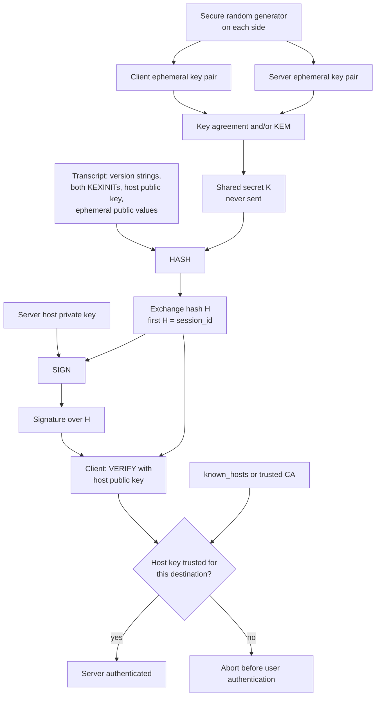
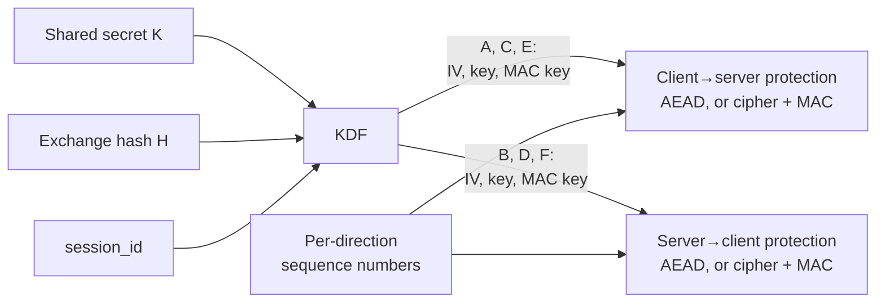
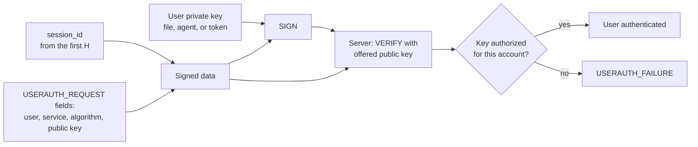
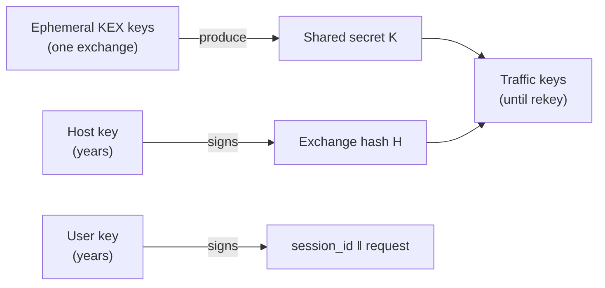
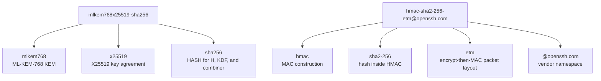

# Cryptography as protocol building blocks

So far, algorithm names have been labels that the peers negotiate. Before
key exchange puts them to work, this part opens them. SSH invents no
primitives; it *composes* standard ones, deciding which bytes are hashed,
which key signs what, how one shared secret becomes several keys, and when
those keys start protecting traffic.

This chapter treats each primitive as a **black box** with typed inputs,
outputs, and failure results, which is all the rest of the guide needs. Each
subchapter opens one box, with optional *Go deeper* sections that explain
why it works. They are not implementation recipes: real SSH software relies
on reviewed libraries for the arithmetic, public-value validation, and
constant-time operation.

## Security goals and who supplies them

A client wants several properties from a connection. Each comes from a
different primitive, and no primitive supplies all of them.

| Goal | Plain meaning | Supplied by |
| --- | --- | --- |
| Confidentiality | Only the two endpoints can read channel data. | Key agreement or KEM → key derivation → cipher or AEAD |
| Integrity | Modified, reordered, replayed, or deleted packets are detected. | MAC or AEAD tag, keyed per direction, covering a sequence number |
| Server authenticity | The peer is the server the user meant to reach. | Host-key signature over the exchange hash **plus** the client's trust policy |
| User authenticity | The server knows which user is connecting. | User-key signature over the session identifier (or a password sent inside the protected transport) **plus** server policy |
| Transcript integrity | Nobody altered the negotiation or key-exchange values. | Hash of the transcript (the exchange hash), signed by the host key |
| Forward secrecy | Stealing a long-term key later does not expose old traffic. | Fresh ephemeral key-agreement secrets that are erased after use |

Both authenticity goals rest partly on *policy*, not cryptography. A
signature proves possession of a private key; only a trust decision says
whether that key should represent the host or the user.

## The toolbox at a glance

Each box has a narrow contract, and SSH's security arguments are stated in
terms of these contracts. Substituting one box for another—a hash where a
MAC is needed, a signature where encryption is needed—is usually a security
bug.

| Primitive | Black-box contract | Where SSH uses it | What it does **not** do | Details |
| --- | --- | --- | --- | --- |
| Secure random generator | `RANDOM(n) → n unpredictable bytes` | `KEXINIT` cookie, ephemeral keys, KEM encapsulation, padding, some signature nonces | Repair a badly seeded generator | [Randomness](#randomness) |
| Hash function | `HASH(bytes) → fixed-size digest` | Exchange hash `H`, key derivation, fingerprints, inside signatures and HMAC, hybrid combiners | Use a secret; prove who produced the bytes | [Hashes](./crypto-hashes.md) |
| MAC | `MAC(key, data) → tag`, `VERIFY → valid \| invalid` | Per-packet integrity with non-AEAD ciphers | Hide data; prove anything to a third party | [MACs](./crypto-hashes.md#message-authentication-codes) |
| Key derivation | `KDF(K, H, letter, session_id) → key bytes` | Six directional values after every key exchange | Add entropy that `K` lacks | [Key derivation](./crypto-hashes.md#key-derivation-in-ssh) |
| Cipher | `ENCRYPT(key, iv, plaintext) → ciphertext` | Packet confidentiality | Detect modification | [Symmetric encryption](./crypto-symmetric.md) |
| AEAD | `SEAL(key, nonce, plaintext, ad) → ciphertext ‖ tag`, `OPEN → plaintext \| failure` | `chacha20-poly1305@openssh.com`, AES-GCM | Hide lengths or timing; survive nonce reuse | [Three ways to combine encryption and integrity](./crypto-symmetric.md#three-ways-to-combine-encryption-and-integrity) |
| Key agreement | `GENERATE() → (private, public)`, `AGREE(private, peer_public) → secret \| failure` | DH, ECDH, and X25519 key exchange | Authenticate either peer | [Key agreement](./crypto-key-agreement.md) |
| KEM | `KEYGEN`, `ENCAPS(pk) → (ct, secret)`, `DECAPS(sk, ct) → secret \| failure` | Post-quantum hybrid key exchange | Authenticate either peer | [Post-quantum](./crypto-post-quantum.md#key-encapsulation-as-a-black-box) |
| Signature | `SIGN(private, msg) → sig`, `VERIFY(public, msg, sig) → valid \| invalid` | Host key signs `H`; user key signs the session identifier and request; CAs sign certificates | Encrypt anything; decide whom to trust | [Signatures](./crypto-signatures.md) |

To reason about the protocol, a client needs to know which box is used
where and which failure result must stop the connection, not the internal
mathematics.

## Randomness

Every secret in SSH starts as output from a cryptographically secure
pseudo-random number generator (CSPRNG), usually provided by the operating
system and seeded from hardware events and other entropy sources:

```text
RANDOM(n) -> n bytes that an attacker cannot predict,
             even after seeing all earlier outputs
```

Long-term host and user keys come from it, and so does much of each
connection:

- The **`KEXINIT` cookie** is 16 random bytes. RFC 4253 says it makes it
  impossible for either side to fully determine the keys and the session
  identifier: both cookies enter the exchange hash, so each peer contributes
  randomness to `H`.
- **Ephemeral private values** are the root of the shared secret. If they
  are predictable, a passive observer can compute `K` and read everything.
- **KEM encapsulation** draws randomness to choose the encapsulated secret.
- **Padding** should be random so that it does not leak structure.
- **ECDSA signatures** need a fresh secret nonce each time; reusing one
  reveals the private key. Ed25519 derives its nonce from the key and
  message instead; see [ECDSA](./crypto-signatures.md#ecdsa).

A bad generator produces no errors, only keys that look normal and are
silently guessable. The protocol cannot detect this from the outside, which
is why [RFC 4251, section 9.1](https://www.rfc-editor.org/rfc/rfc4251#section-9.1)
singles out random-number quality.

<details>
<summary>Go deeper: when randomness fails</summary>

A key is only as strong as the number of states its generator could have
been in. If the generator could start in only 2ˢ states, an attacker
enumerates them and regenerates every possible key: the security level is s
bits, whatever the key length.

**Debian OpenSSL, 2008.** A change to Debian's OpenSSL package left the
generator seeded essentially by the process ID alone. Each architecture, key
type, and key size could produce only 32,767 distinct key pairs—about 15
bits of security—and attackers generated all of them. Every affected SSH
host and user key had to be regenerated. Because DSA signatures also consume
per-signature randomness, even a well-generated DSA key counted as
compromised if it had been *used* on an affected machine. See
[Debian Security Advisory DSA-1571](https://www.debian.org/security/2008/dsa-1571)
and the [Debian wiki summary](https://wiki.debian.org/SSLkeys).

Learn more:

- [RFC 4086 — Randomness Requirements for Security](https://www.rfc-editor.org/rfc/rfc4086)
- [Wikipedia: Cryptographically secure pseudorandom number generator](https://en.wikipedia.org/wiki/Cryptographically_secure_pseudorandom_number_generator)
- [Wikipedia: Random number generator attack](https://en.wikipedia.org/wiki/Random_number_generator_attack)

</details>

## One connection's cryptography

Three diagrams follow one connection from its first random byte to
protected channel data. They correspond to the jobs of
[key exchange](./key-exchange.md) and to
[public-key user authentication](./user-authentication.md#signed-request).

### Establish: agree on a secret and authenticate the server



### Protect: derive keys and seal packets



The letters `A`–`F` label six separately derived values; see
[Key derivation in SSH](./crypto-hashes.md#key-derivation-in-ssh).

### Authenticate the user: sign the session identifier



The session identifier feeds both the key derivation and the user's
signature. That single value ties the user's proof to the key exchange that
the server's signature authenticated.

## Four kinds of key to keep separate

The word "key" appears everywhere in SSH. Four kinds have different
lifetimes, owners, and jobs:

| Material | Lifetime | Main purpose |
| --- | --- | --- |
| Server host key | long-lived | identify the server and sign key exchange |
| User authentication key | long-lived | prove the user's identity to the server |
| Ephemeral KEX key/value | one exchange | establish a fresh shared secret |
| Traffic key and IV | until rekey | protect packets in exactly one direction |



The host key only *signs* the exchange; it never encrypts the secret. Once
the ephemeral secrets are erased, later theft of the host key therefore does
not reveal old traffic. This
[forward secrecy](./crypto-key-agreement.md#forward-secrecy) does not help
if an endpoint, its random generator, or the plaintext was already
compromised.

## Reading an algorithm name

Many algorithm names hint at the primitives inside, which helps when
reading negotiation output and debug logs.



| Name | Category | Read it as |
| --- | --- | --- |
| `curve25519-sha256` | KEX | X25519 key agreement; SHA-256 for the exchange hash and key derivation ([RFC 8731](https://www.rfc-editor.org/rfc/rfc8731)) |
| `mlkem768x25519-sha256` | KEX | ML-KEM-768 KEM plus X25519, combined with SHA-256 ([RFC 10042](https://www.rfc-editor.org/rfc/rfc10042)) |
| `sntrup761x25519-sha512` | KEX | Streamlined NTRU Prime sntrup761 KEM plus X25519, combined with SHA-512 ([RFC 9941](https://www.rfc-editor.org/rfc/rfc9941)) |
| `ecdh-sha2-nistp256` | KEX | ECDH on the NIST P-256 curve; SHA-256 ([RFC 5656](https://www.rfc-editor.org/rfc/rfc5656)) |
| `diffie-hellman-group14-sha256` | KEX | Finite-field DH in the 2048-bit MODP group 14; SHA-256 ([RFC 8268](https://www.rfc-editor.org/rfc/rfc8268)) |
| `ssh-ed25519` | Host or user key | Ed25519 key and signature ([RFC 8709](https://www.rfc-editor.org/rfc/rfc8709)) |
| `rsa-sha2-512` | Signature | An RSA key (blob type `ssh-rsa`) with a PKCS #1 v1.5 signature over SHA-512 ([RFC 8332](https://www.rfc-editor.org/rfc/rfc8332)) |
| `ecdsa-sha2-nistp256` | Host or user key | ECDSA on P-256 with SHA-256 ([RFC 5656](https://www.rfc-editor.org/rfc/rfc5656)) |
| `chacha20-poly1305@openssh.com` | Cipher (AEAD) | ChaCha20 stream cipher with a Poly1305 tag; no separate MAC |
| `aes256-gcm@openssh.com` | Cipher (AEAD) | AES with a 256-bit key in Galois/Counter Mode; no separate MAC |
| `aes128-ctr` + `hmac-sha2-256-etm@openssh.com` | Cipher + MAC | AES-128 in counter mode for confidentiality; HMAC-SHA-256 over the ciphertext for integrity |
| `ssh-ed25519-cert-v01@openssh.com` | Host or user key | An OpenSSH certificate wrapping an Ed25519 key, signed by a CA |
| `sk-ssh-ed25519@openssh.com` | User key | An Ed25519 key held in a FIDO security key; the token signs a structure that also carries flags and a counter |

A name ending in `@domain` is a local extension defined by the owner of that
domain rather than an IETF-registered name
([RFC 4251, section 6](https://www.rfc-editor.org/rfc/rfc4251#section-6)).

> **Names are opaque identifiers.** The decomposition is a reading aid, not
> a grammar. Each name's specification defines the whole construction, so
> two methods that share a word such as `sha256` may use it in different
> places.

## What "secure" means for a black box

An attacker can always guess a key. *Computational security* means every
known attack costs infeasibly much work, summarized as a **security level**:
an *n*-bit level means breaking the primitive takes about 2ⁿ operations.
The table follows the classical (pre-quantum) comparable-strength guidance
in [NIST SP 800-57 Part 1](https://csrc.nist.gov/pubs/sp/800/57/pt1/r5/final);
X25519, Ed25519, and ChaCha20 appear at their conventional ratings.

| Security level | Symmetric key | Hash (collision resistance) | Elliptic curve | RSA or finite-field DH |
| --- | --- | --- | --- | --- |
| ≈ 112 bits | — | SHA-224 | P-224 | 2048-bit (e.g. `diffie-hellman-group14-*`, RSA-2048) |
| ≈ 128 bits | AES-128 | SHA-256 | P-256, X25519, Ed25519 | 3072-bit |
| ≈ 192 bits | AES-192 | SHA-384 | P-384 | 7680-bit |
| ≈ 256 bits | AES-256, ChaCha20 | SHA-512 | P-521 | 15360-bit |

A connection is only as strong as its weakest necessary component: AES-256
with a 2048-bit DH group gives roughly 112-bit key establishment, not
256-bit security. A large quantum computer would break the RSA, DH, and
elliptic-curve columns outright, while symmetric keys and hashes mostly keep
their strength; see
[Why quantum computers matter](./crypto-post-quantum.md#why-quantum-computers-matter).

<details>
<summary>Go deeper: what "128-bit security" means</summary>

**Scale.** 2¹²⁸ ≈ 3.4 × 10³⁸. A machine performing 10¹⁸ operations per
second—roughly an exascale supercomputer—would need about 1.08 × 10¹³
years, some 780 times the age of the universe. A 128-bit level is chosen to
be out of reach for any foreseeable classical attacker.

**Why hash outputs are twice as long.** A collision in an n-bit digest
takes only about 2^(n/2) tries (the
[birthday bound](./crypto-hashes.md#the-exchange-hash-commits-to-the-transcript)),
so SHA-256 gives about 128-bit collision resistance.

**Why RSA needs so many more bits than elliptic curves.** The best generic
attack on an elliptic-curve group of size about 2ᵇ, Pollard's rho, needs
about 2^(b/2) steps, so a 256-bit curve gives about 128-bit security. RSA
and finite-field DH fall to the *number field sieve*, whose cost grows
sub-exponentially in the key size. Its heuristic cost, ignoring lower-order
terms, is

```text
L(N) = exp( (64/9)^(1/3) · (ln N)^(1/3) · (ln ln N)^(2/3) )
```

| Modulus bits | log₂ L(N) | NIST rating |
| ---: | ---: | ---: |
| 1024 | ≈ 87 | 80 |
| 2048 | ≈ 117 | 112 |
| 3072 | ≈ 139 | 128 |
| 7680 | ≈ 203 | 192 |
| 15360 | ≈ 269 | 256 |

The formula ignores constant factors and overestimates; NIST's ratings are
calibrated. The shape is the lesson: from 128-bit to 192-bit security, an
RSA modulus grows from 3072 to 7680 bits but an elliptic curve only from 256
to 384 bits.

Learn more:

- [Wikipedia: Security level](https://en.wikipedia.org/wiki/Security_level)
- [Wikipedia: Key size](https://en.wikipedia.org/wiki/Key_size)
- [NIST SP 800-57 Part 1 Rev. 5](https://csrc.nist.gov/pubs/sp/800/57/pt1/r5/final),
  section 5.6, comparable security strengths

</details>

## Check your understanding

1. Which two components together supply server authenticity, and which of
   them is not cryptography?
2. A design uses a plain hash of each packet to detect tampering. Which box
   should it use instead, and why?
3. Why can a predictable random generator break SSH even when every
   algorithm is strong and every check passes?
4. After a rekey, which of these change: host key, `session_id`, traffic
   keys?
5. What does the `sha256` in `curve25519-sha256` select, and why can you not
   infer the same role for `sha256` in another name?
6. A connection uses `aes256-gcm@openssh.com` and
   `diffie-hellman-group14-sha256`. Roughly what security level does it
   offer, and why?

<details>
<summary>Answers</summary>

1. The host-key signature over the exchange hash, and the client's trust
   policy (known hosts or a trusted CA). The trust policy is a local
   decision, not a cryptographic computation.
2. A MAC (or an AEAD tag), keyed per direction. A hash has no secret, so an
   attacker who modifies a packet can recompute its hash.
3. Ephemeral private values, and therefore `K`, become guessable. An observer
   can recompute the traffic keys. Every verification still succeeds because
   the protocol runs correctly with guessable inputs.
4. Only the traffic keys. The host key is long-lived, and `session_id` stays
   equal to the first exchange hash for the whole connection.
5. It selects SHA-256 as the method's `HASH`, used for the exchange hash and
   key derivation. Names are opaque identifiers; each specification defines
   what its parts mean, so the same word can play a different role
   elsewhere.
6. About 112 bits. The 2048-bit group establishes the key, and it is the
   weakest necessary component.

</details>

## References

- [RFC 4253 — SSH Transport Layer Protocol](https://www.rfc-editor.org/rfc/rfc4253),
  section 7 (key exchange and key derivation).
- [RFC 4251 — SSH Protocol Architecture](https://www.rfc-editor.org/rfc/rfc4251),
  sections 6 (algorithm naming) and 9 (security considerations).
- [RFC 5116 — An Interface and Algorithms for Authenticated Encryption](https://www.rfc-editor.org/rfc/rfc5116).
- [RFC 9142 — Key Exchange (KEX) Method Updates and Recommendations for SSH](https://www.rfc-editor.org/rfc/rfc9142).
- [RFC 4086 — Randomness Requirements for Security](https://www.rfc-editor.org/rfc/rfc4086).
- [NIST SP 800-57 Part 1 Rev. 5 — Recommendation for Key Management](https://csrc.nist.gov/pubs/sp/800/57/pt1/r5/final).
- Dan Boneh and Victor Shoup,
  [A Graduate Course in Applied Cryptography](https://toc.cryptobook.us/)
  (free online textbook).
- Mike Rosulek, [The Joy of Cryptography](https://joyofcryptography.com/)
  (free undergraduate textbook).
