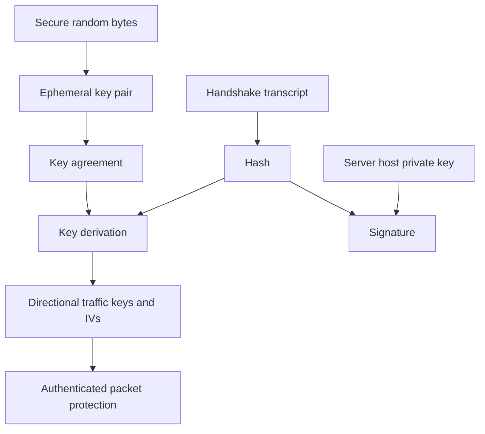
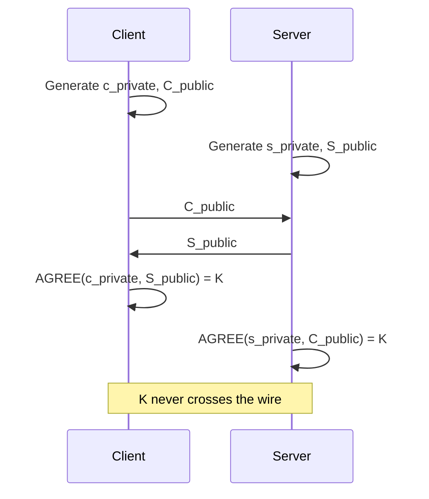
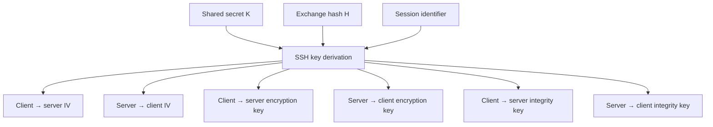

# Cryptography as protocol building blocks

An SSH client composes cryptographic primitives; it should not invent them.
For this guide, treat each primitive as a black box with typed inputs,
outputs, and failure conditions.

## The toolbox



These boxes solve different problems. Substituting one for another is usually
a security bug.

## Hash function

```text
HASH(message bytes) -> fixed-size digest
```

A cryptographic hash gives a short commitment to bytes. Changing the message
should unpredictably change the digest. SSH hashes an exact encoding of the
key-exchange transcript to produce the exchange hash `H`.

Hashing does **not** prove who created a message. Anyone can hash public bytes.
A signature or a keyed message authentication code supplies authentication.

## Message authentication and authenticated encryption

A message authentication code (MAC) uses a secret key to detect modification.

```text
MAC(key, packet context, bytes) -> authentication tag
VERIFY(key, packet context, bytes, tag) -> valid | invalid
```

Encryption hides content; a MAC protects integrity. Older SSH constructions
negotiate these separately. Authenticated encryption with associated data
(AEAD) deliberately combines both jobs:

```text
SEAL(key, nonce, plaintext, associated_data) -> ciphertext, tag
OPEN(key, nonce, ciphertext, associated_data, tag) -> plaintext | failure
```

Never release unauthenticated plaintext. Never reuse a nonce with the same key
when the algorithm forbids it. [RFC 5116](https://www.rfc-editor.org/rfc/rfc5116)
defines the general AEAD interface; individual SSH cipher specifications define
how it is mapped onto SSH packets. AES-GCM's SSH mapping is described by
[RFC 5647](https://www.rfc-editor.org/rfc/rfc5647).

## Key agreement

Key agreement lets two peers independently compute the same secret without
sending that secret over the network.

```text
GENERATE(randomness) -> private_value, public_value
AGREE(our_private_value, peer_public_value) -> shared_secret | failure
```



The public values are not identities. An active attacker could replace both
and create two secrets. SSH prevents that by including the exchange in a
transcript which the server signs with its long-term host key.

Modern finite-field and elliptic-curve Diffie–Hellman methods fit this
interface. [RFC 8731](https://www.rfc-editor.org/rfc/rfc8731) specifies
Curve25519 and Curve448 key exchange for SSH. Public-value validation and
all-zero/shared-secret failure checks belong inside a reviewed library.

## Key encapsulation and hybrid exchange

A key-encapsulation mechanism (KEM) has a slightly different shape:

```text
KEYGEN(randomness) -> public_key, private_key
ENCAPSULATE(public_key, randomness) -> ciphertext, shared_secret
DECAPSULATE(private_key, ciphertext) -> shared_secret | failure
```

Post-quantum/traditional hybrid SSH exchanges combine a post-quantum KEM secret
with a traditional key-agreement secret. The goal is that the result remains
secure if at least one component remains secure.

[RFC 10042](https://www.rfc-editor.org/rfc/rfc10042) specifies ML-KEM hybrid
methods for SSH. A method name selects the entire construction, including
encodings and combination rules; do not assemble a custom hybrid from primitive
names.

## Digital signatures

A signature proves possession of a private key without revealing it.

```text
SIGN(private_key, message) -> signature
VERIFY(public_key, message, signature) -> valid | invalid
```

SSH uses signatures in two places with different identities:

A public key algorithm name may describe the key format, the signature scheme,
or both. Keep the negotiated name, encoded key blob, and signature wrapper
conceptually distinct. Ed25519's SSH encoding is specified by
[RFC 8709](https://www.rfc-editor.org/rfc/rfc8709); RSA/SHA-2 signatures are
specified by [RFC 8332](https://www.rfc-editor.org/rfc/rfc8332).

## Key derivation

The raw shared secret is not used directly as a packet key. SSH combines the
shared secret `K`, exchange hash `H`, a purpose label, and the session identifier
to derive separate material for each purpose and direction.



The letters and expansion rules are exact protocol inputs, not descriptive
labels that can be re-encoded freely. See
[RFC 4253 section 7.2](https://www.rfc-editor.org/rfc/rfc4253#section-7.2).

## Four kinds of key to keep separate

| Material | Lifetime | Main purpose |
| --- | --- | --- |
| Server host key | long-lived | identify the server and sign key exchange |
| User authentication key | long-lived | prove the user's identity to the server |
| Ephemeral KEX key/value | one exchange | establish a fresh shared secret |
| Traffic key and IV | until rekey | protect packets in exactly one direction |

Forward secrecy comes from key exchange with fresh ephemeral secrets. Those
secrets must also be erased after key derivation. Later theft of the host
private key should then not reveal old traffic. This property does not help if
an endpoint, random generator, or plaintext was already compromised.

## Protocol boundary

SSH specifies how these primitives are composed: which transcript is hashed,
which identity signs it, how keys are separated by purpose and direction, and
when those keys become active. The primitive's internal mathematics remains a
separate concern. Real SSH software relies on reviewed cryptographic
implementations for scalar arithmetic, signature details, constant-time
operations, and primitive-level validation.
