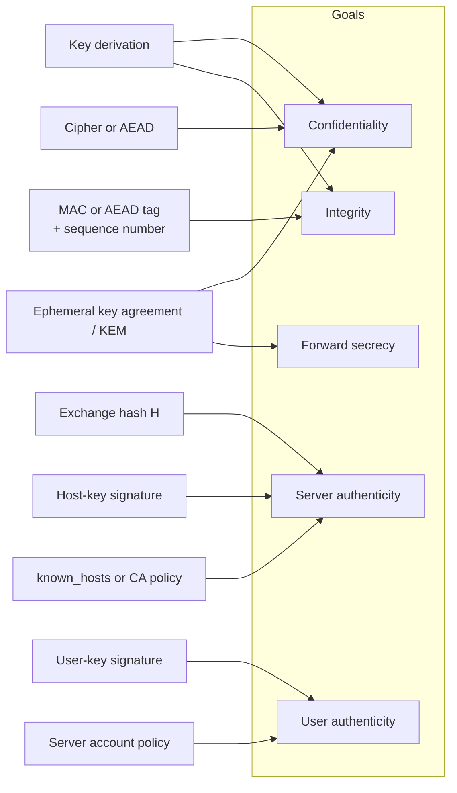
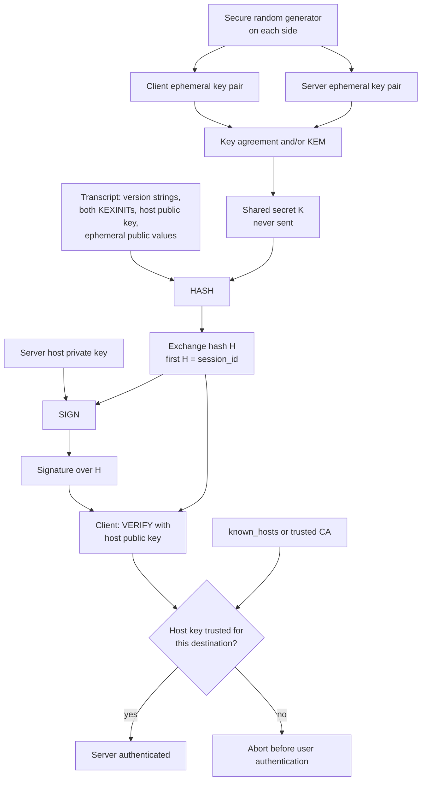
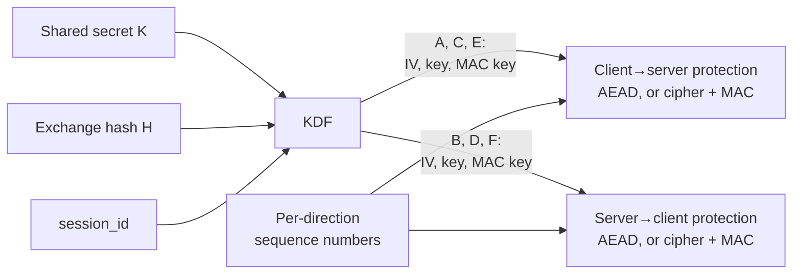
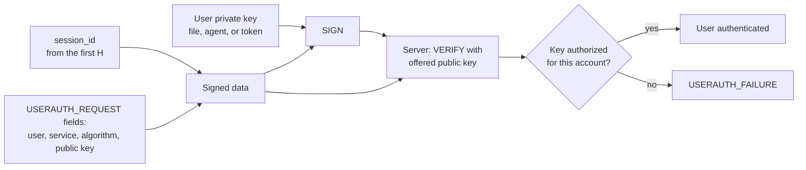
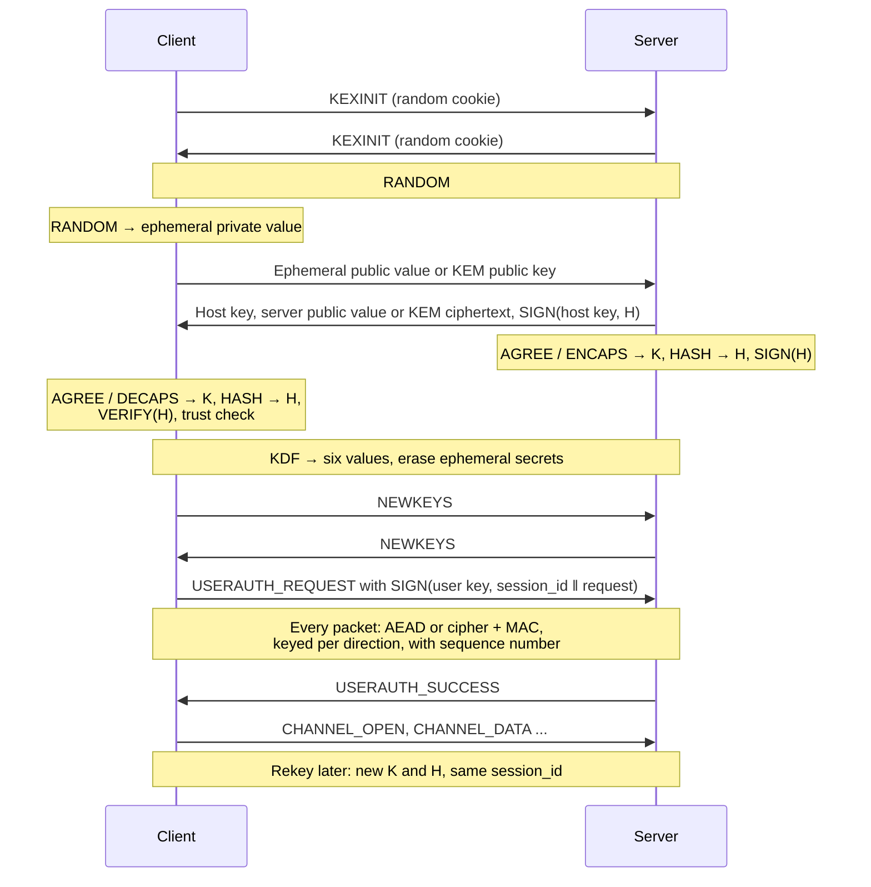
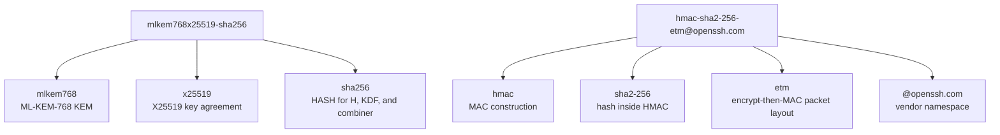
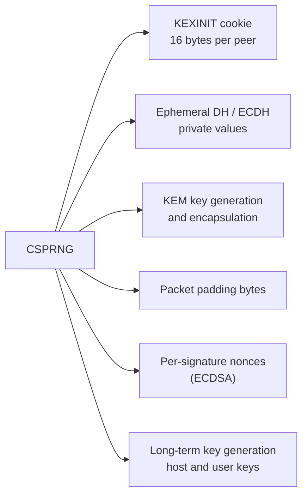
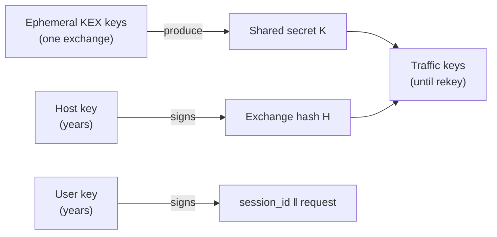

# Cryptography as protocol building blocks

An SSH connection is built from a small number of cryptographic primitives:
a random generator, hash functions, key agreement, signatures, key
derivation, and packet protection. SSH does not invent any of them. Its job
is to *compose* them: to decide which bytes are hashed, which key signs what,
how one shared secret becomes several independent keys, and when those keys
start protecting traffic.

This chapter treats every primitive as a **black box** with typed inputs,
typed outputs, and explicit failure results. That view is all the main
narrative of the guide needs. The subchapters each open one box:

- [Hashes, MACs, and key derivation](./crypto-hashes.md)
- [Symmetric encryption and packet protection](./crypto-symmetric.md)
- [Key agreement: Diffie–Hellman and elliptic curves](./crypto-key-agreement.md)
- [Digital signatures](./crypto-signatures.md)
- [Post-quantum key exchange](./crypto-post-quantum.md)

They follow the same pattern: the black box and its role in SSH first, then
collapsible *Go deeper* sections with the basic mathematics, a toy example,
and links for further study. You can skip every *Go deeper* section and still
follow the protocol.

## Security goals and who supplies them

Before looking at boxes, name the properties a client wants from a
connection. Each is supplied by a different primitive, and none of the
primitives supplies all of them.

| Goal | Plain meaning | Supplied by |
| --- | --- | --- |
| Confidentiality | Only the two endpoints can read channel data. | Key agreement or KEM → key derivation → cipher or AEAD |
| Integrity | Modified, reordered, replayed, or deleted packets are detected. | MAC or AEAD tag, keyed per direction, covering a sequence number |
| Server authenticity | The peer is the server the user meant to reach. | Host-key signature over the exchange hash **plus** the client's trust policy |
| User authenticity | The server knows which user is connecting. | User-key signature over the session identifier (or a password sent inside the protected transport) **plus** server policy |
| Transcript integrity | Nobody altered the negotiation or key-exchange values. | Hash of the transcript (the exchange hash), signed by the host key |
| Forward secrecy | Stealing a long-term key later does not expose old traffic. | Fresh ephemeral key-agreement secrets that are erased after use |



Two arrows in that diagram lead from *policy*, not cryptography. A
signature proves possession of a private key; only a trust decision says
whether that key should represent the host or the user.

## The toolbox at a glance

Each box has a narrow contract. Substituting one box for another—using a
hash where a MAC is needed, or a signature where encryption is needed—is
usually a security bug.

| Primitive | Black-box contract | Where SSH uses it | What it does **not** do | Details |
| --- | --- | --- | --- | --- |
| Secure random generator | `RANDOM(n) → n unpredictable bytes` | `KEXINIT` cookie, ephemeral keys, KEM encapsulation, padding, some signature nonces | Repair a badly seeded generator | [Randomness](#randomness) |
| Hash function | `HASH(bytes) → fixed-size digest` | Exchange hash `H`, key derivation, fingerprints, inside signatures and HMAC, hybrid combiners | Use a secret; prove who produced the bytes | [Hashes](./crypto-hashes.md) |
| MAC | `MAC(key, data) → tag`, `VERIFY → valid \| invalid` | Per-packet integrity with non-AEAD ciphers | Hide data; prove anything to a third party | [MACs](./crypto-hashes.md#message-authentication-codes) |
| Key derivation | `KDF(K, H, letter, session_id) → key bytes` | Six directional values after every key exchange | Add entropy that `K` lacks | [Key derivation](./crypto-hashes.md#key-derivation-in-ssh) |
| Cipher | `ENCRYPT(key, iv, plaintext) → ciphertext` | Packet confidentiality | Detect modification | [Symmetric encryption](./crypto-symmetric.md) |
| AEAD | `SEAL(key, nonce, plaintext, ad) → ciphertext ‖ tag`, `OPEN → plaintext \| failure` | `chacha20-poly1305@openssh.com`, AES-GCM | Hide lengths or timing; survive nonce reuse | [Three ways to combine encryption and integrity](./crypto-symmetric.md#three-ways-to-combine-encryption-and-integrity) |
| Key agreement | `GENERATE() → (private, public)`, `AGREE(private, peer_public) → secret \| failure` | DH, ECDH, and X25519 key exchange | Authenticate either peer | [Key agreement](./crypto-key-agreement.md) |
| KEM | `KEYGEN`, `ENCAPS(pk) → (ct, secret)`, `DECAPS(sk, ct) → secret \| failure` | Post-quantum hybrid key exchange | Authenticate either peer | [Post-quantum](./crypto-post-quantum.md#key-encapsulation-as-a-black-box) |
| Signature | `SIGN(private, msg) → sig`, `VERIFY(public, msg, sig) → valid \| invalid` | Host key signs `H`; user key signs the session identifier and request; CAs sign certificates | Encrypt anything; decide whom to trust | [Signatures](./crypto-signatures.md) |

The black-box interfaces matter because SSH's security arguments are
stated in terms of them. The exchange hash is safe to sign because the hash
is collision resistant. Traffic keys are independent because the key
derivation separates them. A client does not need the internal mathematics
to reason about the protocol; it needs to know which box is used where and
which failure result must stop the connection.

## One connection's cryptography

The following three diagrams follow one connection from its first random
byte to protected channel data. They correspond to the three jobs of
[key exchange](./key-exchange.md) and to
[public-key user authentication](./user-authentication.md#signed-request).

### Establish: agree on a secret and authenticate the server



### Protect: derive keys and seal packets



The letters `A`–`F` label six separately derived values;
[Key derivation in SSH](./crypto-hashes.md#key-derivation-in-ssh) shows
exactly how.

### Authenticate the user: sign the session identifier



The session identifier appears in both the key derivation and the user's
signature. That single value ties the user's proof to the exact key exchange
that the server's signature authenticated.

### The same primitives on the protocol timeline



## Reading an algorithm name

SSH negotiates algorithms by name. Many names hint at the primitives they
contain, and learning to read them makes negotiation output and debug logs
far more informative.



| Name | Category | Read it as |
| --- | --- | --- |
| `curve25519-sha256` | KEX | X25519 key agreement; SHA-256 for the exchange hash and key derivation ([RFC 8731](https://www.rfc-editor.org/rfc/rfc8731)) |
| `mlkem768x25519-sha256` | KEX | ML-KEM-768 KEM plus X25519, combined with SHA-256 ([RFC 10042](https://www.rfc-editor.org/rfc/rfc10042)) |
| `sntrup761x25519-sha512` | KEX | Streamlined NTRU Prime sntrup761 KEM plus X25519, combined with SHA-512 ([RFC 9941](https://www.rfc-editor.org/rfc/rfc9941)) |
| `ecdh-sha2-nistp256` | KEX | ECDH on the NIST P-256 curve; SHA-256 ([RFC 5656](https://www.rfc-editor.org/rfc/rfc5656)) |
| `diffie-hellman-group14-sha256` | KEX | Finite-field DH in the 2048-bit MODP group 14; SHA-256 ([RFC 8268](https://www.rfc-editor.org/rfc/rfc8268)) |
| `ssh-ed25519` | Host or user key | Ed25519 key and signature ([RFC 8709](https://www.rfc-editor.org/rfc/rfc8709)) |
| `rsa-sha2-512` | Signature | An RSA key (blob type `ssh-rsa`) with a PKCS #1 v1.5 signature over SHA-512 ([RFC 8332](https://www.rfc-editor.org/rfc/rfc8332)) |
| `ecdsa-sha2-nistp256` | Host or user key | ECDSA on P-256 with SHA-256 ([RFC 5656](https://www.rfc-editor.org/rfc/rfc5656)) |
| `chacha20-poly1305@openssh.com` | Cipher (AEAD) | ChaCha20 stream cipher with a Poly1305 tag; no separate MAC |
| `aes256-gcm@openssh.com` | Cipher (AEAD) | AES with a 256-bit key in Galois/Counter Mode; no separate MAC |
| `aes128-ctr` + `hmac-sha2-256-etm@openssh.com` | Cipher + MAC | AES-128 in counter mode for confidentiality; HMAC-SHA-256 over the ciphertext for integrity |
| `ssh-ed25519-cert-v01@openssh.com` | Host or user key | An OpenSSH certificate wrapping an Ed25519 key, signed by a CA |
| `sk-ssh-ed25519@openssh.com` | User key | An Ed25519 key held in a FIDO security key; the token signs a structure that also carries flags and a counter |

A name ending in `@domain` is a local extension defined by the owner of that
domain rather than an IETF-registered name
([RFC 4251, section 6](https://www.rfc-editor.org/rfc/rfc4251#section-6)).

> **Names are opaque identifiers.** The decomposition above is a reading
> aid, not a grammar. Each name's specification defines the *whole*
> construction: message formats, encodings, validation rules, and how the
> components are combined. Two methods that share a word—say, `sha256`—may
> use it in entirely different places. An implementation never assembles
> behavior from name fragments, and `rsa-sha2-512` is not "RSA plus
> whatever `sha2-512` means elsewhere".

The subchapters explain each family:
[AEAD and cipher modes](./crypto-symmetric.md),
[X25519 and ECDH](./crypto-key-agreement.md#x25519),
[hybrid KEMs](./crypto-post-quantum.md#hybrid-key-exchange-in-ssh),
[RSA](./crypto-signatures.md#rsa), [ECDSA](./crypto-signatures.md#ecdsa),
[Ed25519](./crypto-signatures.md#ed25519),
[certificates](./crypto-signatures.md#certificates), and
[hardware-backed keys](./crypto-signatures.md#hardware-backed-keys).

## What "secure" means for a black box

No practical primitive is unbreakable in principle. An attacker can always
guess a key. *Computational security* means that every known attack costs
so much work that it is infeasible, and the cost is summarized as a
**security level** in bits: roughly, an *n*-bit level means that breaking
the primitive takes about 2ⁿ basic operations.

Primitives with very different key sizes can therefore offer comparable
strength. The table follows the comparable-strength guidance in
[NIST SP 800-57 Part 1](https://csrc.nist.gov/pubs/sp/800/57/pt1/r5/final);
the figures are classical (pre-quantum) estimates. NIST does not rate
X25519, Ed25519, or ChaCha20; they appear at their conventional ratings.

| Security level | Symmetric key | Hash (collision resistance) | Elliptic curve | RSA or finite-field DH |
| --- | --- | --- | --- | --- |
| ≈ 112 bits | — | SHA-224 | P-224 | 2048-bit (e.g. `diffie-hellman-group14-*`, RSA-2048) |
| ≈ 128 bits | AES-128 | SHA-256 | P-256, X25519, Ed25519 | 3072-bit |
| ≈ 192 bits | AES-192 | SHA-384 | P-384 | 7680-bit |
| ≈ 256 bits | AES-256, ChaCha20 | SHA-512 | P-521 | 15360-bit |

A connection is only as strong as its weakest necessary component. Pairing
AES-256 with a 2048-bit DH group gives roughly 112-bit key establishment,
not 256-bit security. Post-quantum changes the table: a large quantum
computer would break the RSA, DH, and elliptic-curve columns outright,
while symmetric keys and hashes mostly keep their strength. See
[Why quantum computers matter](./crypto-post-quantum.md#why-quantum-computers-matter).

<details>
<summary>Go deeper: what "128-bit security" means</summary>

**Scale.** 2¹²⁸ ≈ 3.4 × 10³⁸. A machine performing 10¹⁸ operations per
second—roughly an exascale supercomputer—would need about 1.08 × 10¹³
years, some 780 times the age of the universe, to perform that many
operations. A 128-bit level is not "barely safe"; it is chosen so that the
attack cost is out of reach for any foreseeable classical attacker.

**Why hash outputs are twice as long.** Finding *any* two inputs with the
same n-bit digest (a collision) does not need 2ⁿ work. By the birthday
paradox, after trying about 2^(n/2) random inputs a repeat becomes likely.
So SHA-256 (n = 256) gives about 128-bit collision resistance, which is why
it appears in the 128-bit row. The
[hashes chapter](./crypto-hashes.md) works through the birthday bound.

**Why RSA needs so many more bits than elliptic curves.** The best generic
attack on an elliptic-curve group of size about 2ᵇ, Pollard's rho, needs
about √(2ᵇ) = 2^(b/2) steps. A 256-bit curve therefore gives about 128-bit
security. RSA and finite-field DH fall to the *number field sieve*, whose
cost grows sub-exponentially in the key size. Its heuristic cost,
ignoring lower-order terms, is

```text
L(N) = exp( (64/9)^(1/3) · (ln N)^(1/3) · (ln ln N)^(2/3) )
```

Evaluating that formula for a few modulus sizes gives:

| Modulus bits | log₂ L(N) | NIST rating |
| ---: | ---: | ---: |
| 1024 | ≈ 87 | 80 |
| 2048 | ≈ 117 | 112 |
| 3072 | ≈ 139 | 128 |
| 7680 | ≈ 203 | 192 |
| 15360 | ≈ 269 | 256 |

The formula hides constant factors, so it overestimates; NIST's ratings are
the calibrated values. The shape is the lesson: moving from 128-bit to
192-bit security takes an RSA modulus from 3072 to 7680 bits, but an
elliptic curve only from 256 to 384 bits, because every two extra curve bits
add one bit of security.

Learn more:

- [Wikipedia: Security level](https://en.wikipedia.org/wiki/Security_level)
- [Wikipedia: Key size](https://en.wikipedia.org/wiki/Key_size)
- [NIST SP 800-57 Part 1 Rev. 5](https://csrc.nist.gov/pubs/sp/800/57/pt1/r5/final),
  section 5.6, comparable security strengths

</details>

## Randomness

Every secret in SSH starts as output from a cryptographically secure
pseudo-random number generator (CSPRNG). As a black box:

```text
RANDOM(n) -> n bytes that an attacker cannot predict,
             even after seeing all earlier outputs
```

The operating system usually provides this generator, seeded from hardware
events and other entropy sources. SSH consumes its output in several places:



- The **`KEXINIT` cookie** is 16 random bytes. RFC 4253 states that its
  purpose is to make it impossible for either side to fully determine the
  keys and the session identifier; because both cookies enter the exchange
  hash, each peer contributes randomness to `H`.
- **Ephemeral private values** are the root of the shared secret. If they
  are predictable, a passive observer can compute `K` and read everything.
- **KEM encapsulation** draws randomness to choose the encapsulated secret.
- **Padding** should be random so that it does not leak structure.
- **ECDSA signatures** need a fresh secret nonce for every signature. Ed25519
  derives its nonce deterministically from the key and message, which removes
  that particular dependency. See [ECDSA](./crypto-signatures.md#ecdsa).

A bad generator does not produce errors. It produces keys that look normal
and are silently guessable. Nothing in the protocol can detect this from
the outside, which is why [RFC 4251, section 9.1](https://www.rfc-editor.org/rfc/rfc4251#section-9.1)
singles out random-number quality.

<details>
<summary>Go deeper: when randomness fails</summary>

**Counting the real entropy.** A 256-bit key is only as strong as the
number of states the generator could have been in when it produced the key.
If the generator could only start in 2ˢ distinct states, an attacker
enumerates those states and regenerates every possible key: the security
level is s bits, whatever the key length.

**Debian OpenSSL, 2008.** A change to Debian's OpenSSL package left the
generator seeded essentially by the process ID alone. With process IDs from
1 to 32,767, each architecture, key type, and key size could produce only
32,767 distinct key pairs—about 2¹⁵, or 15 bits of security. Attackers
simply generated all of them. Every affected SSH host and user key had to be
regenerated, and because DSA signatures also consume per-signature
randomness, even a well-generated DSA key was considered compromised if it
had been *used* on an affected machine. See
[Debian Security Advisory DSA-1571](https://www.debian.org/security/2008/dsa-1571)
and the [Debian wiki summary](https://wiki.debian.org/SSLkeys).

**Nonce reuse in ECDSA.** An ECDSA signature involves a secret per-signature
number k. Two signatures made with the same k and different messages give
two linear equations in two unknowns—k and the private key—so anyone
holding the signatures can solve for the private key. A slightly biased k
leaks the key more slowly across many signatures. The
[signatures chapter](./crypto-signatures.md#ecdsa) shows the algebra.

Learn more:

- [RFC 4086 — Randomness Requirements for Security](https://www.rfc-editor.org/rfc/rfc4086)
- [Wikipedia: Cryptographically secure pseudorandom number generator](https://en.wikipedia.org/wiki/Cryptographically_secure_pseudorandom_number_generator)
- [Wikipedia: Random number generator attack](https://en.wikipedia.org/wiki/Random_number_generator_attack)

</details>

## Four kinds of key to keep separate

The word "key" appears everywhere in SSH. Four kinds have different
lifetimes, owners, and jobs:

| Material | Lifetime | Main purpose |
| --- | --- | --- |
| Server host key | long-lived | identify the server and sign key exchange |
| User authentication key | long-lived | prove the user's identity to the server |
| Ephemeral KEX key/value | one exchange | establish a fresh shared secret |
| Traffic key and IV | until rekey | protect packets in exactly one direction |



Forward secrecy comes from key exchange with fresh ephemeral secrets. Those
secrets must also be erased after key derivation. Later theft of the host
private key should then not reveal old traffic, because the host key only
*signed* the exchange; it never encrypted the secret. This property does not
help if an endpoint, random generator, or plaintext was already compromised.
See [Forward secrecy](./crypto-key-agreement.md#forward-secrecy).

## Protocol boundary

SSH specifies how these primitives are composed: which transcript is hashed,
which identity signs it, how keys are separated by purpose and direction, and
when those keys become active. The primitive's internal mathematics remains a
separate concern.

Real SSH software relies on reviewed cryptographic implementations for
scalar arithmetic, signature details, public-value validation, and
constant-time operation—code whose running time and memory access do not
depend on secret values. These properties are easy to lose in a
hand-written implementation and hard to test for. The *Go deeper* sections
in this part of the guide explain why the primitives work; they are not
recipes for implementing them.

## Check your understanding

1. Which two components together supply server authenticity, and which of
   them is not cryptography?
2. Why is a hash alone not enough to authenticate the exchange transcript?
3. What does the `sha256` in `curve25519-sha256` select, and why can you not
   infer the same role for `sha256` in another name?
4. A connection uses `aes256-gcm@openssh.com` and
   `diffie-hellman-group14-sha256`. Roughly what security level does it
   offer, and why?
5. Why can a predictable random generator break SSH even when every
   algorithm is strong and every check passes?
6. After a rekey, which of these change: host key, `session_id`, traffic
   keys?

<details>
<summary>Answers</summary>

1. The host-key signature over the exchange hash, and the client's trust
   policy (known hosts or a trusted CA). The trust policy is a local
   decision, not a cryptographic computation.
2. Anyone can compute a hash of public bytes. An attacker who rewrites the
   transcript can recompute its hash. A signature by a trusted host key over
   that hash is what an attacker cannot forge.
3. It selects SHA-256 as the method's `HASH`, used for the exchange hash and
   key derivation. Names are opaque identifiers; each specification defines
   what its components mean, so the same word can play a different role
   elsewhere.
4. About 112 bits. The 2048-bit group establishes the key, and it is the
   weakest necessary component.
5. Ephemeral private values, and therefore `K`, become guessable. An observer
   can recompute the traffic keys. Every verification still succeeds because
   the protocol runs correctly with guessable inputs.
6. Only the traffic keys. The host key is long-lived and `session_id` stays
   equal to the first exchange hash for the whole connection.

</details>

## References

- [RFC 4253 — SSH Transport Layer Protocol](https://www.rfc-editor.org/rfc/rfc4253),
  section 7 (key exchange and key derivation).
- [RFC 4251 — SSH Protocol Architecture](https://www.rfc-editor.org/rfc/rfc4251),
  section 9 (security considerations).
- [RFC 5116 — An Interface and Algorithms for Authenticated Encryption](https://www.rfc-editor.org/rfc/rfc5116).
- [RFC 9142 — Key Exchange (KEX) Method Updates and Recommendations for SSH](https://www.rfc-editor.org/rfc/rfc9142).
- [NIST SP 800-57 Part 1 Rev. 5 — Recommendation for Key Management](https://csrc.nist.gov/pubs/sp/800/57/pt1/r5/final).
- Dan Boneh and Victor Shoup,
  [A Graduate Course in Applied Cryptography](https://toc.cryptobook.us/)
  (free online textbook).
- Mike Rosulek, [The Joy of Cryptography](https://joyofcryptography.com/)
  (free undergraduate textbook).
