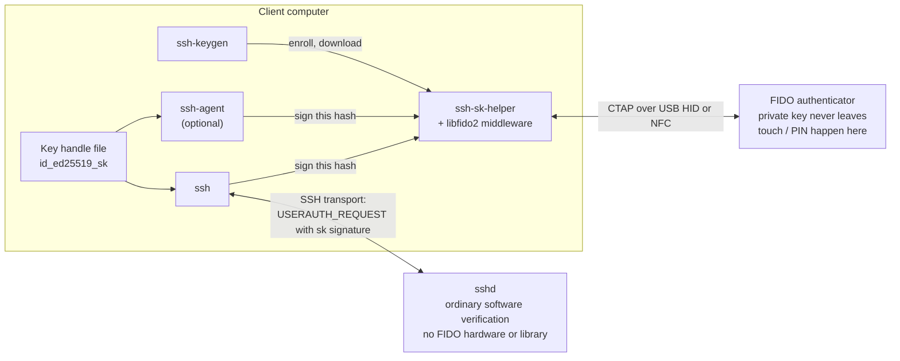
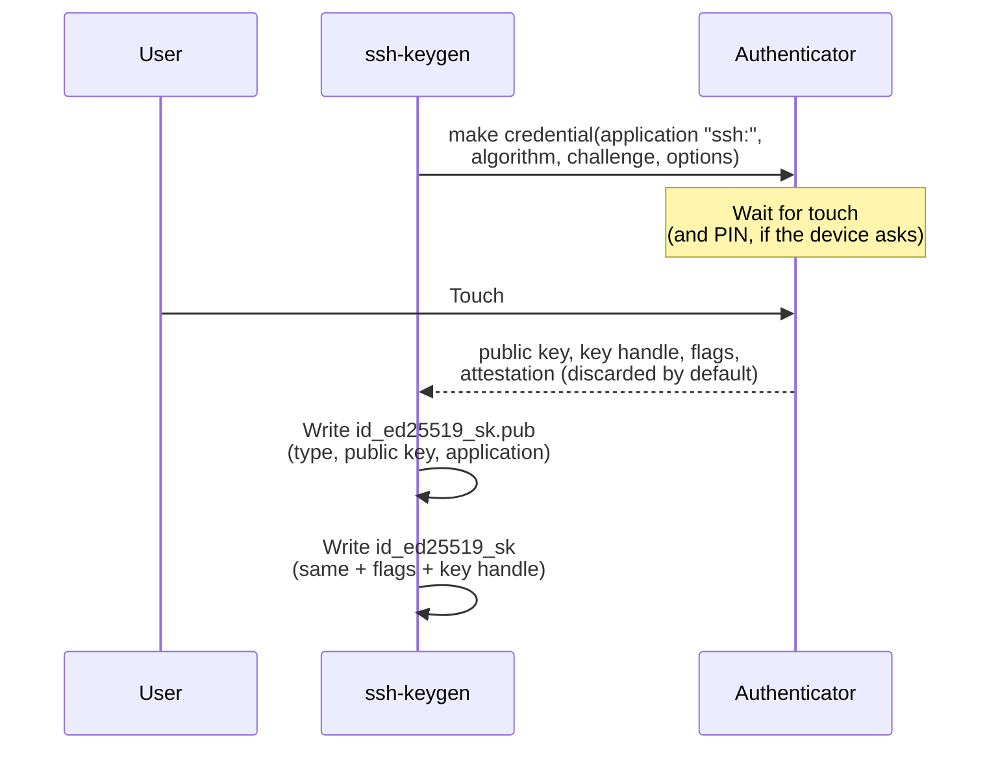
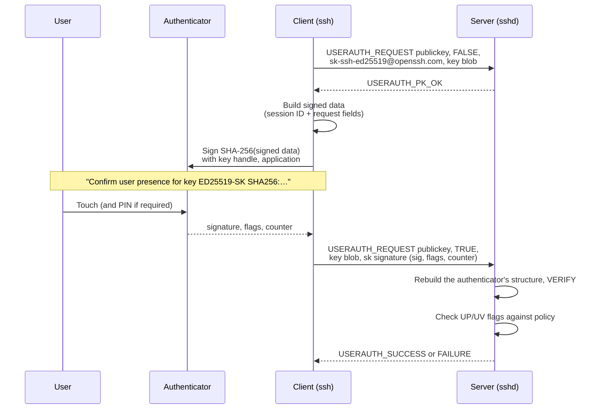
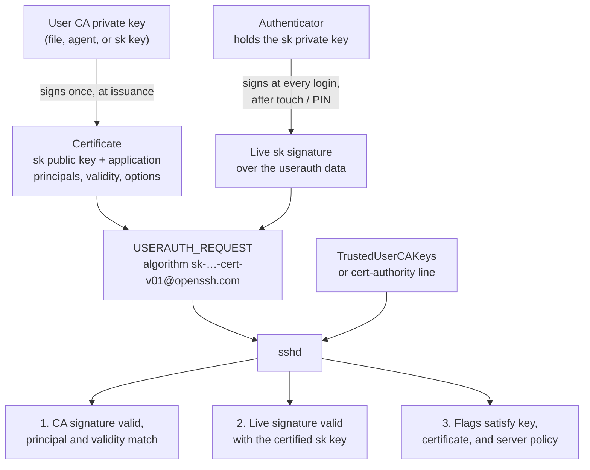
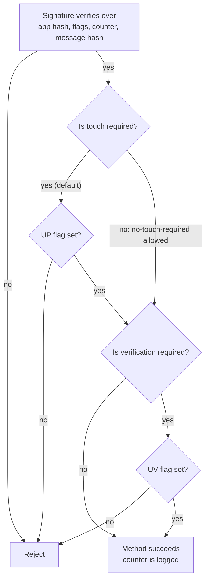
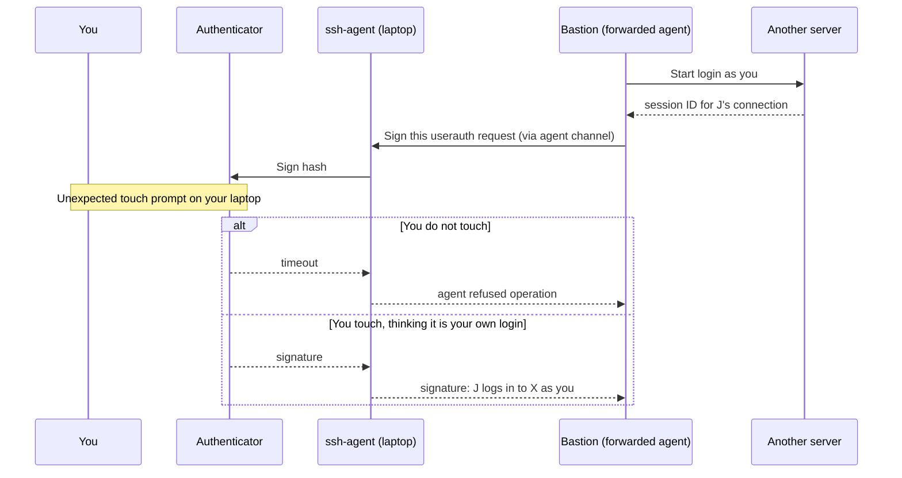

# FIDO security keys (YubiKey)

A FIDO security key, such as a YubiKey, is a small device that holds private
keys and signs only when a person touches it. OpenSSH uses such devices for
[public-key authentication](./user-authentication.md#public-key-authentication)
through two key types, `ecdsa-sk` and `ed25519-sk` ("sk" for *security key*),
and their certificate forms.

The userauth exchange is unchanged: the client still sends a public key and a
signature over the [signed request](./user-authentication.md#signed-request).
What changes is *who* computes the signature, *what* exactly is signed, and
which extra facts the signature carries for the server to check. The
signature math is the same as for ordinary keys; see
[ECDSA](./crypto-signatures.md#ecdsa), [Ed25519](./crypto-signatures.md#ed25519),
and [Hardware-backed keys](./crypto-signatures.md#hardware-backed-keys).

## FIDO authenticators as a black box

FIDO is a family of open standards, from the FIDO Alliance and the W3C, for
logging in to websites with hardware *authenticators*. OpenSSH borrows the
authenticator and its protocol but not the web parts. To SSH, an
authenticator does three things:

- **It creates key pairs and never exports the private half.** Enrollment
  returns a public key and a *key handle* (FIDO's *credential ID*) that names
  the new credential.
- **It signs only after a local gesture.** *User presence* (UP) means someone
  touched the device for this operation. *User verification* (UV) means the
  device also checked who that person is, with a PIN or fingerprint.
- **It reports what happened.** Each signature comes with flag bits saying
  whether presence and verification took place, and a signature counter.
  The signature covers both, so the host computer cannot alter them.

It has no display, so a touch approves *a* signature, not a particular
server or command. It knows nothing about SSH sessions; it signs a hash the
client hands it.

Two generations of the device protocol exist:

- **U2F**, now called CTAP1, is the original second-factor protocol: ECDSA on
  NIST P-256 only, no per-credential storage on the device, and no PIN.
- **FIDO2**, with the device protocol CTAP2, adds a PIN and other user
  verification methods, *discoverable* credentials stored on the device
  (OpenSSH's *resident keys*), and more algorithms, including Ed25519.

OpenSSH does not speak USB itself. It reaches the device through
*middleware*: by default an internal one built on Yubico's
[libfido2](https://developers.yubico.com/libfido2/), or a library named by
`SecurityKeyProvider`. The middleware runs in a small separate program,
`ssh-sk-helper`, so USB and CBOR parsing stay out of the address space of
`ssh`, `ssh-agent`, and `ssh-keygen`.



The server needs no FIDO support beyond the key and signature formats:
verification is ordinary ECDSA or Ed25519 arithmetic.

### Why the file on disk is not the secret

`ssh-keygen` writes a "private key" file for an sk key, but it contains no
private scalar: only the public key, the key handle, and some flags. Many
authenticators store nothing for non-resident credentials; they combine the
key handle with a secret that never leaves the device to recover the real
private key while signing. The
[`ssh-keygen(1)` FIDO section](https://man.archlinux.org/man/ssh-keygen.1#FIDO_AUTHENTICATOR)
describes this two-part split.

Consequences:

- A stolen handle file is useless without the device.
- A stolen device is useless for a non-resident key without the handle file.
- File plus device is enough to sign, so the file can still carry a
  passphrase and deserves protection.
- [Resident keys](#resident-and-non-resident-keys) change the second point.

## How an sk key works

### Enrollment

`ssh-keygen -t ed25519-sk` or `-t ecdsa-sk` asks the authenticator to create a
credential for an *application* string, FIDO's relying party (RP) ID, which on
the web is a domain name. OpenSSH uses `ssh:` by default, and any value set
with `-O application=` must also start with `ssh:`.



[PROTOCOL.u2f](https://github.com/openssh/openssh-portable/blob/master/PROTOCOL.u2f)
defines the public key blob. For Ed25519:

```text
string    "sk-ssh-ed25519@openssh.com"
string    public key                 32-byte Ed25519 point
string    application                usually "ssh:"
```

The ECDSA form carries a curve name (`nistp256`) and the point `Q` instead,
then the same application string. The private key file repeats these fields
and appends a flags byte, the key handle, and a reserved string.

Because the application string is inside the blob, it is part of the key's
identity: it appears in `authorized_keys` and is covered by the fingerprint.
The server learns the application from the key it authorized, never from the
client at signing time.

### Signing a login

The client builds the signed data exactly as for any public key, but the
authenticator will not sign those bytes directly. It signs a structure of its
own that contains a hash of them:

```text
byte[32]   SHA-256(application)
byte       flags        bit 0x01 user present, bit 0x04 user verified
uint32     counter
byte[]     extensions   empty for SSH today
byte[32]   SHA-256(message)     message = the SSH signed data
```

The authenticator returns the signature with the flags and counter it used,
and the SSH signature carries all three so the server can rebuild the
structure. For `sk-ssh-ed25519@openssh.com`:

```text
string    "sk-ssh-ed25519@openssh.com"
string    signature                  64-byte Ed25519 signature
byte      flags
uint32    counter
```

The ECDSA form puts `mpint r, mpint s` in the signature string, as
[RFC 5656](https://www.rfc-editor.org/rfc/rfc5656.html) does for ordinary
ECDSA, followed by the same flags and counter. This layout spares the server
from parsing the ASN.1 signatures that U2F hardware returns, keeping that
parser out of the pre-authentication attack surface.



The [optional key query](./user-authentication.md#optional-key-query) matters
more here than for file-based keys: without it, every key the client tries,
including ones the server will reject, costs a touch.

<details>
<summary>Go deeper: what the authenticator signs, and why</summary>

The layout above is FIDO's own assertion format. A FIDO authenticator signs

```text
authenticatorData || clientDataHash
authenticatorData = SHA-256(RP ID) || flags || signCount || [extensions]
```

On the web, the RP ID is the site's domain and `clientDataHash` is the hash of
a JSON structure built by the browser. OpenSSH puts the application string in
the RP ID slot and SHA-256 of the SSH signed data in the `clientDataHash`
slot, which holds exactly 32 bytes; that is why the message is hashed first.
Without extensions the signed structure is 32 + 1 + 4 + 32 = 69 bytes.
Ed25519 signs those bytes directly; ECDSA hashes them with SHA-256 and signs
the hash, as it always does.

Each field has a job:

- **SHA-256(application)** binds the signature to a purpose. An authenticator
  uses a credential only for the RP ID it was created for, and browsers let a
  page request only RP IDs matching its own domain, so no web page can ask
  for `ssh:`. A phishing site therefore cannot make your SSH credential sign
  anything. The server needs no special check: it hashes the application from
  the authorized key, so a signature made for any other application fails.
- **flags** tell the verifier what the device checked. The device sets and
  signs them; the client cannot flip a bit without breaking the signature.
- **counter** increases with use. If a key were ever copied out of the
  hardware, original and copy would produce overlapping counter values, which
  a verifier that tracks counters could notice.
- **SHA-256(message)** carries the SSH data, including the session identifier
  that prevents replay on another connection.

The first field for the default application:

```text
python3 -c 'import hashlib; print(hashlib.sha256(b"ssh:").hexdigest())'
e30610e8a162115960fe1ec223e6529c9f4b6e80200dcb5e5c321c8af1e2b1bf
```

Every signature by a default-application sk key begins its signed structure
with these 32 bytes.

Learn more:

- [OpenSSH PROTOCOL.u2f](https://github.com/openssh/openssh-portable/blob/master/PROTOCOL.u2f)
- [W3C Web Authentication, Level 2](https://www.w3.org/TR/webauthn-2/)
  (authenticator data and signature counter)
- [FIDO CTAP 2.1 specification](https://fidoalliance.org/specs/fido-v2.1-ps-20210615/fido-client-to-authenticator-protocol-v2.1-ps-20210615.html)

</details>

## Key types and certificate types

OpenSSH 8.2 introduced two sk key types, each with a certificate type. Both
are in the server's default `PubkeyAcceptedAlgorithms`; `ssh -Q key` lists
the types your client knows.

| `ssh-keygen -t` | Public key algorithm | Certificate algorithm | Notes |
| --- | --- | --- | --- |
| `ecdsa-sk` | `sk-ecdsa-sha2-nistp256@openssh.com` | `sk-ecdsa-sha2-nistp256-cert-v01@openssh.com` | P-256 only; every FIDO authenticator supports it |
| `ed25519-sk` | `sk-ssh-ed25519@openssh.com` | `sk-ssh-ed25519-cert-v01@openssh.com` | Needs a FIDO2 authenticator with Ed25519 support |

`ecdsa-sk` is the safe choice for old or unknown hardware, because U2F only
defined P-256 and Ed25519 is optional in FIDO2. Yubico documents `ed25519-sk`
as requiring YubiKey firmware 5.2.3 or newer.

A signature-only algorithm, `webauthn-sk-ecdsa-sha2-nistp256@openssh.com`,
covers `ecdsa-sk` signatures made through a browser's WebAuthn API; its
signature adds the web origin and the browser's client data. OpenSSH clients
do not produce it. `sshd` gained support in 8.4 and accepts it by default
since 10.3.

### Certificates for sk keys

An sk certificate is an ordinary
[OpenSSH certificate](./crypto-signatures.md#certificates) whose certified
key is an sk public key, including its application string, so it certifies
one credential on one authenticator. The format is in the
[SSH certificate format Internet-Draft](https://datatracker.ietf.org/doc/draft-miller-ssh-cert/).
The CA needs only the public key, not the authenticator:

```console
ssh-keygen -s user_ca -I alice@example.com -n alice -V +52w id_ed25519_sk.pub
```

This writes `id_ed25519_sk-cert.pub` with type
`sk-ssh-ed25519-cert-v01@openssh.com`. Two certificate options apply to sk
keys:

- `-O verify-required` adds a **critical option**: the server must see the
  user-verified flag. `ssh-keygen` implements it since 9.1.
- `-O no-touch-required` adds an **extension** that permits signatures
  without user presence, if server policy also allows it.

The CA key can be a key file, a key in an agent (`-U`), or itself an sk key,
in which case each issuance needs a touch on the CA's authenticator. The
server's default `CASignatureAlgorithms` accepts sk CA signatures.



The certificate supplies identity and expiry without editing
`authorized_keys` everywhere; the authenticator supplies an uncopyable key
and a physical gesture at each login.

<details>
<summary>Go deeper: attestation, proving a key is in hardware</summary>

A public key alone cannot prove where its private key lives; anyone can
generate an sk-format key in software. When a CA must know that a key is
hardware-backed, FIDO *attestation* can help.

At enrollment the authenticator signs the new credential's authenticator
data, including the public key, together with the hash of a challenge. It
uses a separate *attestation key* certified by the manufacturer. `ssh-keygen`
discards this by default; with `-O write-attestation=path` it saves it in the
`ssh-sk-attest-v01` format from PROTOCOL.u2f:

```text
string    "ssh-sk-attest-v01"
string    attestation certificate
string    enrollment signature
string    authenticator data (CBOR encoded)
uint32    reserved flags
string    reserved string
```

An enrollment workflow: the CA sends a fresh random challenge; the user
enrolls with `-O challenge=path -O write-attestation=path` and returns the
public key and attestation; the CA checks that

1. the attestation certificate chains to a vendor root it trusts;
2. the enrollment signature is valid over the authenticator data and the
   challenge hash; and
3. the public key in the authenticator data matches the submitted key.

OpenSSH treats the attestation fields as opaque and does not verify them.
OpenSSH 10.0 added an experimental verifier under
`regress/misc/ssh-verify-attestation` in the source tree; it is not
installed. Attestation is off by default because attestation certificates can
identify a device down to its manufacturer and batch, which would harm
privacy if published.

Learn more:

- [OpenSSH PROTOCOL.u2f](https://github.com/openssh/openssh-portable/blob/master/PROTOCOL.u2f)
  (attestation format)
- [W3C Web Authentication, Level 2](https://www.w3.org/TR/webauthn-2/)
  (attestation statement formats)

</details>

## What the server verifies

For an sk key, `sshd` does everything it does for any public key, then checks
the flags:

1. The algorithm is in `PubkeyAcceptedAlgorithms`, and the key or its
   certificate is authorized for the user.
2. It rebuilds the authenticator's structure from `SHA-256(application)` of
   the *authorized public key*, the signature's flags and counter, and
   `SHA-256` of the SSH signed data, then verifies the signature.
3. It checks user presence and user verification against policy.



The policy knobs, from [`sshd(8)`](https://man.archlinux.org/man/sshd.8#AUTHORIZED_KEYS_FILE_FORMAT)
and [`sshd_config(5)`](https://man.archlinux.org/man/sshd_config.5#PubkeyAuthOptions):

| Requirement | Default | Relaxed by | Tightened by |
| --- | --- | --- | --- |
| User presence (touch) | Required | `no-touch-required` on the `authorized_keys` line, or the certificate extension | `PubkeyAuthOptions touch-required` removes the relaxation for everyone |
| User verification (PIN) | Not required | — | `verify-required` on the `authorized_keys` line, the certificate critical option, or `PubkeyAuthOptions verify-required` |

For certificates trusted through a `cert-authority` line, a permissive option
such as `no-touch-required` must appear in *both* the line and the
certificate; `sshd(8)` gives `cert-authority,no-touch-required,principals="user_a"`
as the example. A restrictive option such as `verify-required` applies if
either side sets it. With `TrustedUserCAKeys` and no
`AuthorizedPrincipalsFile` there is no per-key line, so the certificate's own
options apply.

Three details are easy to get wrong:

- **The server cannot see how a key was generated.** For a key made with
  `-O verify-required`, the client asks for a PIN, and OpenSSH marks the
  credential with the FIDO *credProtect* extension so the device itself
  refuses to sign without one. That protects the key holder, but the public
  key records none of it. The server learns only what each signature's flags
  say; to *require* a PIN it needs `verify-required` in `authorized_keys`,
  the certificate, or `sshd_config`.
- **The counter is logged, not enforced.** `sshd` records it but does not
  reject a counter that goes backwards. PROTOCOL.u2f calls the counter useful
  for detecting cloned keys "at scale", by a system that collects counters
  over time.
- **A security key is one factor.** PROTOCOL.u2f states that `sshd` treats an
  sk key as a single factor even when a PIN or fingerprint was checked. To
  demand a second method, use `AuthenticationMethods`, which produces the
  [`partial success` flow](./user-authentication.md#the-server-drives-policy).

## Resident and non-resident keys

The two kinds differ only in where the key handle lives; the private key is
in the authenticator either way.

| | Non-resident (default) | Resident (`-O resident`) |
| --- | --- | --- |
| Key handle stored in | The handle file on each computer | The authenticator, and optionally files |
| A signature needs | Handle file + device + touch | Device + touch; the PIN retrieves the handle |
| New computer | Copy the handle file | `ssh-keygen -K` or `ssh-add -K` |
| Device requirements | Any FIDO device, including U2F-only | FIDO2 device with a PIN set |
| Device storage | None, so unlimited keys | Limited slots; check the model's specifications |
| Stolen device alone | Not enough to sign | Enough, if the PIN is known or guessed |
| What the device reveals | Nothing about your keys | With the PIN, each credential's application and user strings |

`ssh-keygen(1)` states the trade: storing both parts on the device "increases
the likelihood of an attacker being able to use a stolen authenticator
device". The PIN stands in the way. Since OpenSSH 8.4, `ssh-keygen` creates
resident keys with the FIDO 2.1 credProtect extension, so the device will not
release them without the PIN. Choose a PIN that is hard to guess, and add
`verify-required` if the device may travel.

Resident credentials are indexed by application and user. A second resident
key with the same `application` and `user` replaces the first (since 9.1
`ssh-keygen` asks before doing so). Use distinct `-O application=ssh:…` or
`-O user=` values to keep several keys.

## Agents, forwarding, and jump hosts

`ssh-agent` holds sk keys like any others; what it holds is the key handle
and public key, never a private key:

```console
ssh-add ~/.ssh/id_ed25519_sk
```

To sign, the agent runs `ssh-sk-helper`, so the touch and any PIN happen **on
the machine running the agent**. For `verify-required` keys the agent asks for
the PIN through `SSH_ASKPASS` at signing time, supported since OpenSSH 8.9.
If nobody touches the device in time, the agent refuses the operation.

This changes the risk of [agent forwarding](./other-channels.md#agent-forwarding),
which gives the remote host a signing oracle: with an sk key, each use of the
oracle needs a physical touch at your desk.



This limits abuse to one signature per touch and makes misuse visible, but
does not remove it: the device cannot show which server it signs for, and a
compromised host can time its request for when you expect a prompt.

Better options, strongest first:

- **Do not forward.** Use `ProxyJump`
  ([SSH through a jump host](./forwarding.md#ssh-through-a-jump-host)); the
  client authenticates to each hop itself and the bastion only relays
  encrypted bytes.
- **Constrain destinations.** `ssh-add -h` restricts a key to named hosts and
  hops, enforced through
  [host-bound authentication](./user-authentication.md#host-bound-public-key-authentication).
- **Rely on the agent's FIDO safeguards.** Since OpenSSH 8.4, `ssh-agent`
  refuses to use FIDO keys whose application does not start with `ssh:` for
  anything but SSH authentication requests and `ssh-keygen` signatures, so a
  forwarded agent cannot answer web login challenges with keys made for
  websites. `ssh-agent -O websafe-allow=` (OpenSSH 10.0) changes the allowed
  applications. By default, forwarded clients also cannot load PKCS#11 or FIDO
  middleware libraries into the agent (see `allow-remote-pkcs11` in
  [`ssh-agent(1)`](https://man.archlinux.org/man/ssh-agent.1)).

## Limits and failure modes

**Lost, broken, or reset device.** The private key cannot be recovered, and
`ykman fido reset` is equivalent to losing the device. Enroll at least two
authenticators, or keep another way in.

**No touch in time.** The device times out. Through an agent this appears as
`agent refused operation`, as it does when the agent cannot ask for a PIN
because no `SSH_ASKPASS` program is available.

**Too many prompts.** Every sk key that `ssh` offers and the server accepts
can cause a touch prompt. `IdentitiesOnly` and explicit `IdentityFile` lines
keep this predictable.

**No FIDO support in the client.** `internal security key support not enabled`
or `No FIDO SecurityKeyProvider specified` mean the build has no middleware,
or `SecurityKeyProvider` (for `ssh`) or `SSH_SK_PROVIDER` (for `ssh-keygen`
and `ssh-add`) is empty or wrong. `ssh-sk-helper` must also be installed
where OpenSSH expects it.

**Device does not support the request.** `ed25519-sk` fails on authenticators
without Ed25519; use `ecdsa-sk`. `-O resident` and `-O verify-required` need a
FIDO2 device with a PIN. Not all devices honor `-O no-touch-required`.

**Old, restricted, or stricter server.** Servers older than OpenSSH 8.2,
other implementations, and servers whose `PubkeyAcceptedAlgorithms` excludes
`sk-*` reject sk keys. So does a default server for a `no-touch-required`
key, or a `verify-required` server for a key used without a PIN. The client
sees only ordinary `USERAUTH_FAILURE` replies; the server log names the
reason.

**PIN lockout.** After three wrong PINs in a row the device must be removed
and reinserted. After at most 8 wrong PINs in total (the CTAP 2.1 limit), the
PIN is blocked, and only a reset, which erases all FIDO credentials, makes
the device usable again.

**What sk keys do not protect.** A touch proves someone was at the device,
not what was signed, and nothing protects the session after login. Client
malware can ride along with a legitimate connection or request a signature
just when you expect to touch.

## Lab: set up a YubiKey with ykman and OpenSSH

This lab uses the YubiKey Manager CLI `ykman` for device management and
OpenSSH for everything else. Commands follow the
[`ykman` FIDO command reference](https://docs.yubico.com/software/yubikey/tools/ykman/FIDO_Commands.html),
the OpenSSH manual pages, and Yubico's
[Securing SSH with FIDO2](https://developers.yubico.com/SSH/Securing_SSH_with_FIDO2.html).

### 1. Check the client and the device

```console
ssh -V
ssh -Q key | grep '^sk-'
ykman info
ykman fido info
```

`ykman info` shows the model, firmware, and enabled applications;
`ykman fido info` shows whether a FIDO2 PIN is set. The OpenSSH client must
be built with FIDO support (since 9.1, portable OpenSSH enables it when
libfido2 is found at build time). Apple's bundled OpenSSH lacks it, so Yubico
suggests Homebrew's; the Windows OpenSSH client supports FIDO from 8.9, and
`ykman fido` there needs an administrator prompt.

### 2. Set a FIDO2 PIN

```console
ykman fido access change-pin
```

This sets a PIN if none exists, otherwise changes it. The FIDO2 PIN has at
least 4 characters and is separate from the PIV and OpenPGP PINs on the same
YubiKey. Resident keys and `verify-required` need it.

### 3. Generate a key

A resident key that requires a PIN at every use, with its own application
string:

```console
ssh-keygen -t ed25519-sk -O resident -O verify-required \
    -O application=ssh:work -C "alice work key" -f ~/.ssh/id_ed25519_sk_work
```

`ssh-keygen` asks for the PIN and a touch, then offers a passphrase for the
handle file. It writes `id_ed25519_sk_work` (handle) and
`id_ed25519_sk_work.pub`.

A non-resident key that needs only a touch:

```console
ssh-keygen -t ed25519-sk -C "alice laptop key"
```

This writes `~/.ssh/id_ed25519_sk` and `~/.ssh/id_ed25519_sk.pub`, default
names that `ssh` tries automatically. Use `-t ecdsa-sk` if the device rejects
Ed25519.

Other [FIDO options](https://man.archlinux.org/man/ssh-keygen.1#FIDO_AUTHENTICATOR):
`-O user=name` (several resident keys under one application),
`-O no-touch-required` (the server must allow it in `authorized_keys`),
`-O device=path` (choose among attached authenticators), and
`-O write-attestation=path` with `-O challenge=path` (see the attestation
deep dive under [Certificates for sk keys](#certificates-for-sk-keys)).

### 4. Authorize the public key on the server

Append the `.pub` line to `~/.ssh/authorized_keys` on the server, for example
with `ssh-copy-id -i ~/.ssh/id_ed25519_sk_work.pub alice@server.example`. To
make the server enforce the PIN, prefix the line:

```text
verify-required sk-ssh-ed25519@openssh.com AAAAGnNrLXNzaC1lZDI1NTE5QG9wZW5zc2guY29t... alice work key
```

The server needs OpenSSH 8.2 or newer with the sk algorithms in
`PubkeyAcceptedAlgorithms` (the default; `sshd -T` prints the effective
list). An administrator can require a PIN for every sk key with
`PubkeyAuthOptions verify-required`.

### 5. Log in

```console
ssh -i ~/.ssh/id_ed25519_sk_work alice@server.example
```

After the server accepts the key query, `ssh` prints
`Confirm user presence for key ED25519-SK SHA256:…`, asks for the PIN if
needed, and waits for the touch. With `-v` you can watch the
[key query and signed request](#signing-a-login).

### 6. Enroll a second authenticator

Private keys cannot be backed up. Generate a key on a second device the same
way, authorize (or certify) both public keys, and keep the spare safe.

### 7. Use a resident key on a new computer

With the YubiKey inserted:

```console
cd ~/.ssh
ssh-keygen -K
```

`-K` asks for the PIN and writes handle and public key files for every
resident key to the current directory. Names start with `id_ed25519_sk_rk` or
`id_ecdsa_sk_rk`, followed by the application (minus `ssh:`) and user when
these are not the defaults, so the key above becomes `id_ed25519_sk_rk_work`;
point `IdentityFile` at it or rename the pair.

To load resident keys straight into a running agent without writing files:

```console
ssh-add -K
```

### 8. Optional: issue and use a certificate

On the CA host, with `ssh-keygen` 9.1 or newer (earlier versions reject
`-O verify-required` as a certificate option):

```console
ssh-keygen -s user_ca -I alice@example.com -n alice -V +52w \
    -O verify-required id_ed25519_sk_work.pub
```

Trust the CA on the servers with `TrustedUserCAKeys`. On the client:

```text
Host *.work.example
    IdentityFile ~/.ssh/id_ed25519_sk_work
    CertificateFile ~/.ssh/id_ed25519_sk_work-cert.pub
    IdentitiesOnly yes
```

`CertificateFile` is optional here, since `ssh` looks for the identity file
name with `-cert.pub` appended. `IdentitiesOnly` stops `ssh` from offering
other agent keys first.

### 9. Manage and remove credentials

```console
ykman fido credentials list
ykman fido credentials delete CREDENTIAL_ID
```

`list` needs the PIN and shows the resident credentials; `delete` takes a
unique part of a credential ID from that list. Deleting a credential makes
its key unusable everywhere but does not remove it from servers; also remove
the `authorized_keys` lines or revoke the certificate.

```console
ykman fido reset
```

**Reset erases everything FIDO on the device**: all FIDO2 and U2F
credentials and the PIN. Every sk key and website login made with the device
stops working. Reset works only shortly after insertion and needs a touch.

## Check your understanding

1. An attacker copies `~/.ssh/id_ed25519_sk` from your laptop but does not have
   your YubiKey. What can they do with it? What changes if the key were
   resident and they had stolen the YubiKey instead?
2. Why does the server not need a FIDO library or USB access to verify an sk
   signature?
3. Which four fields does the authenticator's signed structure contain for an
   SSH login, and which of them carries the SSH session identifier?
4. You generated a key with `-O verify-required`. Does the server require a
   PIN for it? What would make it do so?
5. How does the application string stop a phishing website from using your
   SSH credential?
6. A certificate for an sk key contains the `no-touch-required` extension, and
   the server trusts the CA through a `cert-authority` line with no other
   options. Will a signature without the user-presence flag be accepted?
7. You forward your agent to a bastion, and your sk key is in the agent. What
   must happen for the bastion to log in elsewhere as you? What would prevent
   it?

<details>
<summary>Answers</summary>

1. Nothing on its own: the file holds a public key and a key handle, and only
   your authenticator can turn the handle into a signature. A resident key's
   handle is on the device, so a thief who knows or guesses the PIN can
   download it with `ssh-keygen -K` and sign with a touch.
2. The authenticator produces an ordinary ECDSA P-256 or Ed25519 signature
   over a structure the server rebuilds from the request, the session
   identifier, the application in the authorized key, and the flags and
   counter sent with the signature. Verification is pure software.
3. SHA-256 of the application, the flags, the counter, and SHA-256 of the SSH
   signed data. The session identifier is inside the signed data, so the last
   field covers it.
4. No. The option makes the client and device demand a PIN, but the public
   key does not record it. The server requires a PIN only with
   `verify-required` in `authorized_keys`, in the certificate, or in
   `PubkeyAuthOptions`.
5. The authenticator uses a credential only for its own RP ID, and browsers
   let a site request only RP IDs matching its domain, so no website can
   request `ssh:`. A signature made under another application would also fail
   verification, because the server hashes the authorized key's application.
6. No. With a `cert-authority` line, permissive options must appear in both
   the certificate and the line. `PubkeyAuthOptions touch-required` would
   reject the signature even then.
7. The bastion must send a signing request through the forwarded agent, and
   someone must touch your authenticator (and enter the PIN for
   `verify-required` keys) while it is pending. Using `ProxyJump` instead,
   destination constraints with `ssh-add -h`, or not touching an unexpected
   prompt prevents it.

</details>

## References

- [OpenSSH PROTOCOL.u2f: FIDO/U2F security keys](https://github.com/openssh/openssh-portable/blob/master/PROTOCOL.u2f)
  (key, certificate, signature, attestation, and agent formats).
- [OpenSSH PROTOCOL](https://github.com/openssh/openssh-portable/blob/master/PROTOCOL)
  (`publickey-hostbound-v00@openssh.com`) and
  [PROTOCOL.agent](https://github.com/openssh/openssh-portable/blob/master/PROTOCOL.agent)
  (session binding and destination constraints).
- [RFC 9987: Secure Shell (SSH) Agent Protocol](https://www.rfc-editor.org/rfc/rfc9987.html).
- [SSH certificate format Internet-Draft](https://datatracker.ietf.org/doc/draft-miller-ssh-cert/).
- [RFC 5656: Elliptic Curve Algorithm Integration in SSH](https://www.rfc-editor.org/rfc/rfc5656.html).
- [`ssh-keygen(1)`](https://man.archlinux.org/man/ssh-keygen.1#FIDO_AUTHENTICATOR),
  [`ssh-add(1)`](https://man.archlinux.org/man/ssh-add.1),
  [`ssh-agent(1)`](https://man.archlinux.org/man/ssh-agent.1),
  [`ssh-sk-helper(8)`](https://man.archlinux.org/man/ssh-sk-helper.8),
  [`ssh_config(5)`](https://man.archlinux.org/man/ssh_config.5#SecurityKeyProvider),
  [`sshd(8)`](https://man.archlinux.org/man/sshd.8#AUTHORIZED_KEYS_FILE_FORMAT), and
  [`sshd_config(5)`](https://man.archlinux.org/man/sshd_config.5#PubkeyAuthOptions).
- OpenSSH release notes:
  [8.2](https://www.openssh.com/txt/release-8.2) (FIDO/U2F support, resident
  keys, `ssh-sk-helper`),
  [8.4](https://www.openssh.com/txt/release-8.4) (`verify-required`,
  credProtect, agent web-challenge restriction, WebAuthn signatures),
  [8.9](https://www.openssh.com/txt/release-8.9) (PIN-required keys in the
  agent, destination constraints),
  [9.1](https://www.openssh.com/txt/release-9.1) (`verify-required`
  certificate option, resident-key overwrite prompt),
  [10.0](https://www.openssh.com/txt/release-10.0) (`websafe-allow`), and
  [10.3](https://www.openssh.com/txt/release-10.3) (WebAuthn signatures
  accepted by default).
- [YubiKey Manager CLI: FIDO commands](https://docs.yubico.com/software/yubikey/tools/ykman/FIDO_Commands.html)
  and [base commands](https://docs.yubico.com/software/yubikey/tools/ykman/Base_Commands.html).
- [Yubico: Securing SSH with FIDO2](https://developers.yubico.com/SSH/Securing_SSH_with_FIDO2.html).
- [libfido2](https://developers.yubico.com/libfido2/).
- [W3C Web Authentication, Level 2](https://www.w3.org/TR/webauthn-2/).
- [FIDO Client to Authenticator Protocol (CTAP) 2.1](https://fidoalliance.org/specs/fido-v2.1-ps-20210615/fido-client-to-authenticator-protocol-v2.1-ps-20210615.html).
