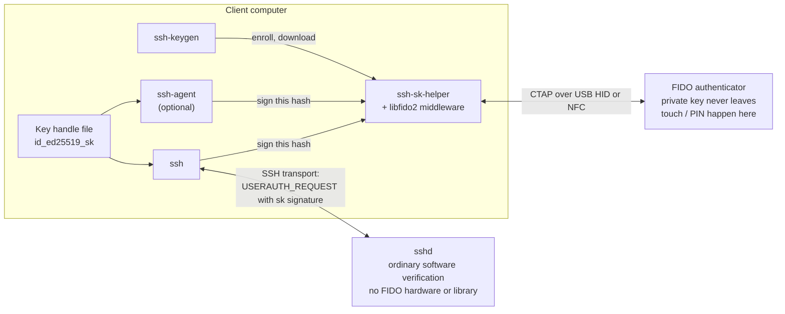
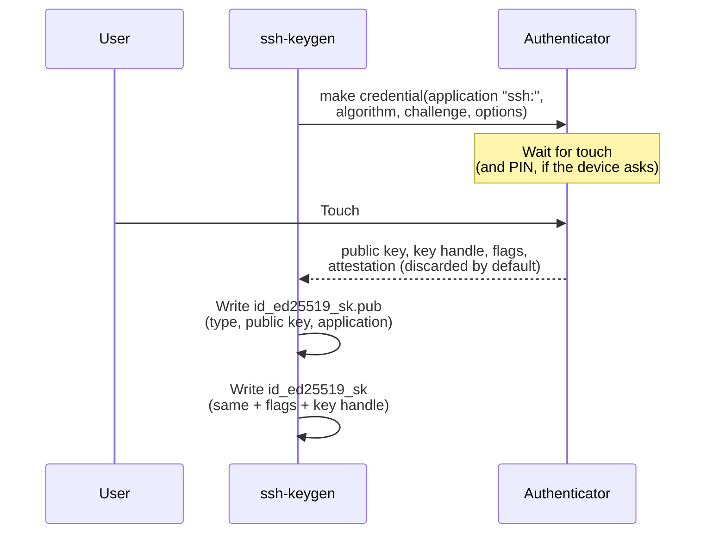
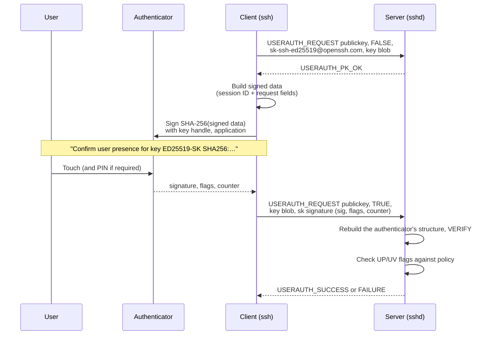
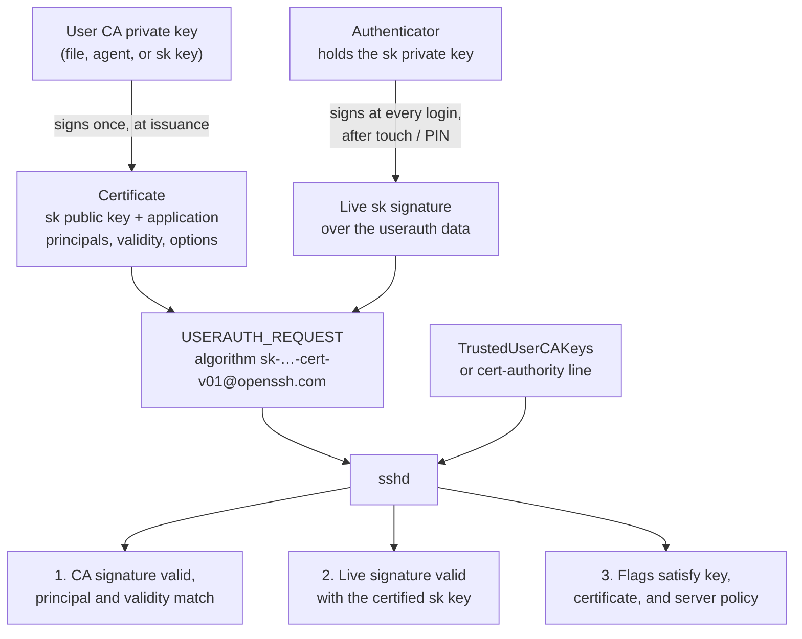
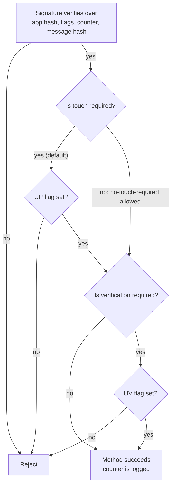
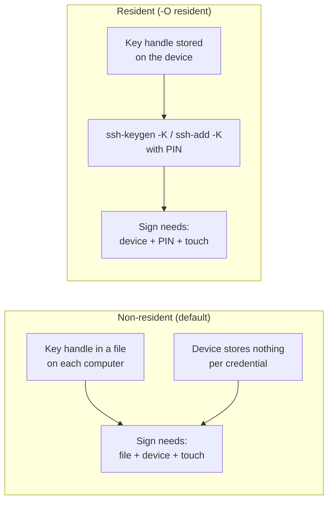
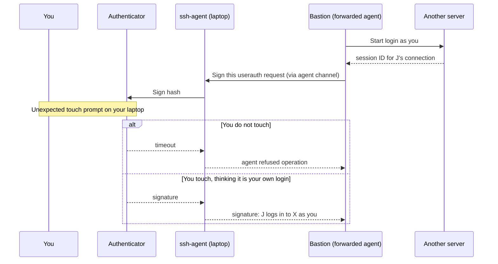

# FIDO security keys (YubiKey)

A FIDO security key, such as a YubiKey, is a small device that holds private
keys and signs with them only when a person touches it. OpenSSH can use such a
device for [public-key authentication](./user-authentication.md#public-key-authentication)
through two key types, `ecdsa-sk` and `ed25519-sk` ("sk" for *security key*),
and their certificate forms.

Nothing about the userauth exchange changes: the client still sends a public
key and a signature over the
[signed request](./user-authentication.md#signed-request). What changes is
*who* computes the signature, *what* exactly is signed, and which extra facts
the signature carries for the server to check. This chapter follows those
changes from the device to the server, then shows how to set up a YubiKey with
`ykman` and OpenSSH.

The signature math itself is the same as for ordinary keys and is covered in
[ECDSA](./crypto-signatures.md#ecdsa) and
[Ed25519](./crypto-signatures.md#ed25519);
[Hardware-backed keys](./crypto-signatures.md#hardware-backed-keys) places
security keys next to agents and smartcards.

## FIDO authenticators as a black box

FIDO is a family of open standards, from the FIDO Alliance and the W3C, for
logging in to websites with hardware *authenticators*. OpenSSH borrows the
authenticator and its protocol, but not the web parts. From SSH's point of
view an authenticator does three things:

- **It creates key pairs and never exports the private half.** Enrollment
  returns a public key and a *key handle* (in FIDO terms, a *credential ID*)
  that names the new credential.
- **It signs only after a local gesture.** *User presence* (UP) means someone
  touched the device for this operation. *User verification* (UV) means the
  device also checked who that person is, with a PIN or a fingerprint.
- **It reports what happened.** Each signature comes with flag bits saying
  whether presence and verification took place, and a signature counter.
  Both are covered by the signature, so the host computer cannot alter them.

It also has limits worth stating early. The device has no display, so a touch
approves *a* signature, not a particular server or command. And the device
knows nothing about SSH sessions; it signs a hash that the SSH client gives
it.

Two generations of the device protocol exist:

- **U2F**, now called CTAP1, is the original second-factor protocol. It
  supports only ECDSA on the NIST P-256 curve, stores nothing on the device
  per credential, and has no PIN.
- **FIDO2**, whose device protocol is CTAP2, adds a PIN and other user
  verification methods, *discoverable* credentials stored on the device
  (OpenSSH calls these *resident keys*), and more algorithms, including
  Ed25519.

OpenSSH does not speak USB itself. It talks to the device through
*middleware*: by default an internal one built on Yubico's
[libfido2](https://developers.yubico.com/libfido2/), or a library named by
`SecurityKeyProvider`. The middleware runs inside a small separate program,
`ssh-sk-helper`, so that USB and CBOR parsing happen outside the address
space of `ssh`, `ssh-agent`, or `ssh-keygen`.



The server needs no FIDO support at all beyond knowing the key and signature
formats. Verification is ordinary ECDSA or Ed25519 arithmetic on bytes that
arrived in the userauth request.

### Why the file on disk is not the secret

`ssh-keygen` writes a "private key" file for an sk key, but that file contains
no private scalar. It holds the public key, the key handle, and some flags.
Many authenticators do not store non-resident credentials at all: they
combine the key handle with a secret that never leaves the device, and so
derive or unwrap the real private key only while signing. The
[`ssh-keygen(1)` FIDO section](https://man.openbsd.org/ssh-keygen#FIDO_AUTHENTICATOR)
describes exactly this two-part split.

Consequences for the client:

- A stolen key handle file is useless without the physical device.
- A stolen device is useless for a non-resident key without the handle file.
- The handle file can still carry a passphrase, and it is worth protecting,
  because file plus device is enough to sign.
- Resident keys change the second point; see
  [Resident and non-resident keys](#resident-and-non-resident-keys).

## How an sk key works

### Enrollment

`ssh-keygen -t ed25519-sk` or `-t ecdsa-sk` asks the authenticator to create a
new credential for an *application* string. FIDO calls this the relying party
ID; on the web it is a domain name. OpenSSH uses `ssh:` by default, and any
value chosen with `-O application=` must also start with `ssh:`.



The [PROTOCOL.u2f](https://github.com/openssh/openssh-portable/blob/master/PROTOCOL.u2f)
file defines the resulting public key blob. For Ed25519 it is:

```text
string    "sk-ssh-ed25519@openssh.com"
string    public key                 32-byte Ed25519 point
string    application                usually "ssh:"
```

The ECDSA form carries a curve name (`nistp256`) and the point `Q` instead of
the 32-byte key, followed by the same application string. The private key
file repeats these fields and appends a flags byte, the key handle, and a
reserved string.

Because the application string is inside the public key blob, it is part of
the key's identity: it appears in `authorized_keys` and is covered by the
key's fingerprint. The server always learns the application from the key it
authorized, never from the client at signing time.

### Signing a login

During authentication the client builds the signed data exactly as for any
public key. The difference is that the authenticator will not sign those
bytes directly. It signs a structure of its own, with the SSH data reduced to
a hash:

```text
byte[32]   SHA-256(application)
byte       flags        bit 0x01 user present, bit 0x04 user verified
uint32     counter
byte[]     extensions   empty for SSH today
byte[32]   SHA-256(message)     message = the SSH signed data
```

The authenticator returns the signature along with the flags and counter it
used. The SSH signature then carries all three, so the server can rebuild the
structure. For `sk-ssh-ed25519@openssh.com` the wire encoding is:

```text
string    "sk-ssh-ed25519@openssh.com"
string    signature                  64-byte Ed25519 signature
byte      flags
uint32    counter
```

The ECDSA form places an `mpint r, mpint s` pair in the signature string, as
[RFC 5656](https://www.rfc-editor.org/rfc/rfc5656.html) does for ordinary
ECDSA, and then the same flags and counter. OpenSSH chose this layout so the
server never parses the ASN.1 signature format that U2F hardware returns,
keeping that parser out of the pre-authentication attack surface.



The [optional key query](./user-authentication.md#optional-key-query) matters
more here than for file-based keys. Without it, the client would ask for a
touch for every key it tries, including keys the server will reject.

<details>
<summary>Go deeper: what the authenticator signs, and why</summary>

The layout above is not an OpenSSH invention. It is FIDO's own assertion
format. A FIDO authenticator signs

```text
authenticatorData || clientDataHash
authenticatorData = SHA-256(RP ID) || flags || signCount || [extensions]
```

On the web, the RP ID is the site's domain and `clientDataHash` is the hash
of a JSON structure built by the browser. OpenSSH puts the application string
in the RP ID slot and the SHA-256 of the SSH signed data in the
`clientDataHash` slot. That is why the message is hashed first: the slot
holds exactly 32 bytes. Without extensions, the signed structure is always
32 + 1 + 4 + 32 = 69 bytes.

Ed25519 signs those 69 bytes directly. ECDSA hashes them with SHA-256 and
signs the hash, as ECDSA always does
(see [ECDSA](./crypto-signatures.md#ecdsa) and
[Ed25519](./crypto-signatures.md#ed25519)).

Each field has a job:

- **SHA-256(application)** binds the signature to a purpose. An authenticator
  uses a credential only for the RP ID it was created for. A web page cannot
  ask for the RP ID `ssh:`, because browsers accept only RP IDs that match the
  page's own domain. So a phishing site cannot make your SSH credential sign
  anything. The server needs no special check for this: it hashes the
  application from the authorized public key, so a signature made for any
  other application fails verification.
- **flags** let the verifier learn what the device checked. The device sets
  them and signs them; the client cannot flip a bit without breaking the
  signature.
- **counter** increases with use. If a key were ever copied out of the
  hardware, the original and the copy would produce overlapping counter
  values, which a verifier that tracks counters could notice.
- **SHA-256(message)** carries the SSH data, and with it the session
  identifier that prevents replay on another connection.

You can compute the first field for the default application yourself:

```text
python3 -c 'import hashlib; print(hashlib.sha256(b"ssh:").hexdigest())'
e30610e8a162115960fe1ec223e6529c9f4b6e80200dcb5e5c321c8af1e2b1bf
```

Every signature by a default-application sk key begins its signed structure
with these 32 bytes.

Learn more:

- [OpenSSH PROTOCOL.u2f](https://github.com/openssh/openssh-portable/blob/master/PROTOCOL.u2f)
- [W3C Web Authentication, Level 2](https://www.w3.org/TR/webauthn-2/)
  (authenticator data and signature counter)
- [FIDO CTAP 2.1 specification](https://fidoalliance.org/specs/fido-v2.1-ps-20210615/fido-client-to-authenticator-protocol-v2.1-ps-20210615.html)

</details>

## Key types and certificate types

OpenSSH defines two sk key types and a certificate type for each:

| `ssh-keygen -t` | Public key algorithm | Certificate algorithm | Notes |
| --- | --- | --- | --- |
| `ecdsa-sk` | `sk-ecdsa-sha2-nistp256@openssh.com` | `sk-ecdsa-sha2-nistp256-cert-v01@openssh.com` | P-256 only; every FIDO authenticator supports it |
| `ed25519-sk` | `sk-ssh-ed25519@openssh.com` | `sk-ssh-ed25519-cert-v01@openssh.com` | Needs a FIDO2 authenticator with Ed25519 support |

`ecdsa-sk` is the safe choice for old or unknown hardware, because U2F only
ever defined P-256. Ed25519 support is optional in FIDO2. Yubico documents
`ed25519-sk` as requiring YubiKey firmware 5.2.3 or newer.

There is also a signature-only algorithm,
`webauthn-sk-ecdsa-sha2-nistp256@openssh.com`, for `ecdsa-sk` signatures made
through a web browser's WebAuthn API. Its signature adds the web origin and
the browser's client data. Ordinary OpenSSH clients do not produce it, but
`sshd` accepts it by default since OpenSSH 10.3.

The key types were introduced in OpenSSH 8.2 and appear in the server's
default `PubkeyAcceptedAlgorithms` list. Run `ssh -Q key` to see which types
your client knows.

### Certificates for sk keys

An sk certificate is an ordinary
[OpenSSH certificate](./crypto-signatures.md#certificates) whose certified
key is an sk public key. The certificate body contains the application string
next to the public key, so a certificate certifies one specific credential on
one specific authenticator. The certificate format is described in the
[SSH certificate format Internet-Draft](https://datatracker.ietf.org/doc/draft-miller-ssh-cert/).

A CA signs an sk public key exactly like any other:

```console
ssh-keygen -s user_ca -I alice@example.com -n alice -V +52w id_ed25519_sk.pub
```

This writes `id_ed25519_sk-cert.pub`, with the type
`sk-ssh-ed25519-cert-v01@openssh.com`. The CA does not need the
authenticator; it only reads the public key.

Two certificate options exist for sk keys:

- `-O verify-required` adds a **critical option** of that name: the server must
  see the user-verified flag.
- `-O no-touch-required` adds an **extension** that permits signatures without
  user presence, if server policy also allows it.

The CA key can be an ordinary key file, a key in an agent (`-U`), or itself an
sk key. With an sk CA key, every certificate issued needs a touch on the CA's
authenticator. The server's default `CASignatureAlgorithms` accepts sk CA
signatures.



The combination is useful. The certificate supplies identity and expiry
without editing `authorized_keys` on every server. The authenticator supplies
a key that cannot be copied, and a physical gesture at each login.

<details>
<summary>Go deeper: attestation, proving a key is in hardware</summary>

A public key alone cannot prove where its private key lives. Someone could
generate an sk-format key in software. When a CA or an administrator must
know that a key is hardware-backed, FIDO *attestation* can help.

At enrollment the authenticator signs the new credential's authenticator
data, including the public key, together with the hash of a challenge. It
signs with a separate *attestation key* whose certificate is issued by the
manufacturer. `ssh-keygen` discards this by default. With
`-O write-attestation=path` it saves the data in the `ssh-sk-attest-v01`
format from PROTOCOL.u2f:

```text
string    "ssh-sk-attest-v01"
string    attestation certificate
string    enrollment signature
string    authenticator data (CBOR encoded)
uint32    reserved flags
string    reserved string
```

An enrollment workflow can then run like this. The CA sends a fresh random
challenge. The user enrolls with `-O challenge=path -O write-attestation=path`
and returns the public key and attestation. The CA checks the following before
issuing a certificate:

1. the attestation certificate chains to a vendor root it trusts;
2. the enrollment signature is valid over the authenticator data and the
   challenge hash;
3. the public key in the authenticator data matches the submitted key.

OpenSSH treats the attestation fields as opaque and does not verify them.
OpenSSH 10.0 added an experimental verifier under
`regress/misc/ssh-verify-attestation` in the source tree, which is not
installed.

PROTOCOL.u2f gives the reason attestation is off by default: attestation
certificates can identify a device down to its manufacturer and batch, so
publishing them would harm privacy.

Learn more:

- [OpenSSH PROTOCOL.u2f](https://github.com/openssh/openssh-portable/blob/master/PROTOCOL.u2f)
  (attestation format)
- [W3C Web Authentication, Level 2](https://www.w3.org/TR/webauthn-2/)
  (attestation statement formats)

</details>

## What the server verifies

For an sk key, `sshd` does everything it does for any public key, then checks
the flags. In order:

1. The algorithm is in `PubkeyAcceptedAlgorithms`, and the key or its
   certificate is authorized for the user.
2. It rebuilds the SSH signed data from the request and the session
   identifier, and hashes it: `SHA-256(message)`.
3. It hashes the application string taken from the *authorized public key*:
   `SHA-256(application)`.
4. It reassembles the authenticator's structure with the flags and counter
   from the signature, and verifies the ECDSA or Ed25519 signature.
5. It checks user presence and user verification against policy.



The policy knobs, from [`sshd(8)`](https://man.openbsd.org/sshd#AUTHORIZED_KEYS_FILE_FORMAT)
and [`sshd_config(5)`](https://man.openbsd.org/sshd_config#PubkeyAuthOptions):

| Requirement | Default | Relaxed by | Tightened by |
| --- | --- | --- | --- |
| User presence (touch) | Required | `no-touch-required` on the `authorized_keys` line, or the certificate extension | `PubkeyAuthOptions touch-required` removes the relaxation for everyone |
| User verification (PIN) | Not required | — | `verify-required` on the `authorized_keys` line, the certificate critical option, or `PubkeyAuthOptions verify-required` |

For certificates trusted through a `cert-authority` line, OpenSSH requires
permissive options such as `no-touch-required` to appear in *both* the line and
the certificate. The `sshd(8)` example shows
`cert-authority,no-touch-required,principals="user_a"` for this case.
Restrictive options such as `verify-required` take effect if either side sets
them. With `TrustedUserCAKeys` and no `AuthorizedPrincipalsFile`, there is no
per-key line, so the certificate's own options apply directly.

Three details are easy to get wrong:

- **The server cannot see how a key was generated.** For a key made with
  `-O verify-required`, the client asks for a PIN, and OpenSSH also marks
  the credential (with the FIDO *credProtect* extension) so the device itself
  refuses to sign without one. That protects the key holder. The public key
  does not record any of it, though, so the server learns only what the flags
  in each signature say. To *require* a PIN, the server needs
  `verify-required` in `authorized_keys`, in the certificate, or in
  `sshd_config`.
- **The counter is logged, not enforced.** `sshd` records the signature count
  with the authentication but does not reject a counter that goes backwards.
  PROTOCOL.u2f describes the counter as useful for detecting a cloned key
  "at scale", that is, by a system that collects counters over time.
- **A security key is one factor.** PROTOCOL.u2f states that `sshd` treats an
  sk key as a single authentication factor, even when a PIN or fingerprint was
  checked. To demand a second method, use `AuthenticationMethods`, which
  produces the `partial success` flow described in
  [User authentication](./user-authentication.md#the-server-drives-policy).

## Resident and non-resident keys

The two kinds differ only in where the key handle lives. The private key is
in the authenticator either way.



| | Non-resident | Resident |
| --- | --- | --- |
| Key handle stored in | The handle file on each computer | The authenticator, and optionally files |
| New computer | Copy the handle file | `ssh-keygen -K` or `ssh-add -K` |
| Device requirements | Any FIDO device, including U2F-only | FIDO2 device with a PIN set |
| Device storage | None, so unlimited keys | Limited slots; check the model's specifications |
| Stolen device alone | Not enough to sign | Enough, if the PIN is known or guessed |
| What the device reveals | Nothing about your keys | With the PIN, the application and user strings of each credential |

Resident keys are convenient, and the trade is spelled out in the
`ssh-keygen(1)` manual page. Storing both parts on the device "increases the
likelihood of an attacker being able to use a stolen authenticator device".
The PIN is what stands in the way. Since OpenSSH 8.4, `ssh-keygen` creates
resident keys with the FIDO 2.1 *credProtect* extension, so the device will
not release them without the PIN. Choose a PIN that is not easy to guess, and
pair resident keys with `verify-required` if the device may travel.

Resident credentials are indexed by application and user. Creating a second
resident key with the same `application` and `user` replaces the first, and
since 9.1 `ssh-keygen` asks before it does. Use distinct
`-O application=ssh:…` or `-O user=` values to keep several keys.

## Agents, forwarding, and jump hosts

`ssh-agent` can hold sk keys like any others. What it holds is the key handle
and public key, never a private key:

```console
ssh-add ~/.ssh/id_ed25519_sk
```

When a client asks the agent to sign, the agent runs `ssh-sk-helper`, which
talks to the authenticator. The touch, and any PIN, happen **on the machine
running the agent**. For `verify-required` keys the agent asks for the PIN
through `SSH_ASKPASS` at signing time; support for this arrived in OpenSSH
8.9. The agent refuses the operation if nobody touches the device in time.

That property changes the risk of agent forwarding. As
[Digital signatures](./crypto-signatures.md#hardware-backed-keys) explains, a
forwarded agent gives the remote host a signing oracle. With an sk key, each
use of that oracle needs a physical touch at your desk:



So forwarding an sk key limits abuse to one signature per touch, and turns
silent misuse into a visible prompt. It does not remove the risk. The device
cannot show which server it is signing for, and a compromised host can time
its request to arrive just as you expect a prompt.

Better options, strongest first:

- **Do not forward.** Use `ProxyJump` (see
  [SSH through a jump host](./forwarding.md#ssh-through-a-jump-host)). The
  client authenticates to each hop itself, and the bastion only relays
  encrypted bytes.
- **Constrain destinations.** `ssh-add -h` restricts a key to named hosts and
  hops. With
  [host-bound authentication](./user-authentication.md#host-bound-public-key-authentication),
  the agent can see which server a request is for and refuse the others.
- **Rely on the agent's FIDO safeguards.** Since OpenSSH 8.4, `ssh-agent`
  refuses to use FIDO keys whose application does not start with `ssh:` to
  sign anything other than SSH authentication requests or `ssh-keygen`
  signatures. A forwarded agent therefore cannot be used to answer web login
  challenges with keys that were made for websites. `ssh-agent -O websafe-allow=`
  changes the list of allowed applications. By default, forwarded agent
  clients also cannot load FIDO middleware libraries into your agent
  (the `allow-remote-pkcs11` option in
  [`ssh-agent(1)`](https://man.openbsd.org/ssh-agent)).

## Setting up a YubiKey with ykman and OpenSSH

This section is a lab that puts the pieces above together. It uses the
YubiKey Manager command-line tool `ykman` for device management and OpenSSH
for everything SSH. Commands are checked
against the [`ykman` FIDO command reference](https://docs.yubico.com/software/yubikey/tools/ykman/FIDO_Commands.html),
the OpenSSH manual pages, and Yubico's
[Securing SSH with FIDO2](https://developers.yubico.com/SSH/Securing_SSH_with_FIDO2.html)
guide.

### 1. Check the client and the device

```console
ssh -V
ssh -Q key | grep '^sk-'
ykman info
ykman fido info
```

You need an OpenSSH client built with FIDO support. OpenSSH 8.2 added it.
Since 9.1, portable OpenSSH enables it automatically when libfido2 is found at
build time. If the build lacks it, `ssh-keygen` reports
`internal security key support not enabled`.

Yubico's guide notes two platform points. Apple's bundled OpenSSH on macOS is
built without libfido2, so it cannot use sk keys; Yubico suggests Homebrew's
OpenSSH. The Windows OpenSSH client supports FIDO from version 8.9. The
`ykman` documentation adds that on Windows, `ykman fido` commands need an
administrator prompt.

`ykman info` shows the model, firmware version, and which applications are
enabled. `ykman fido info` shows the state of the FIDO2 application, including
whether a PIN is set.

### 2. Set a FIDO2 PIN

```console
ykman fido access change-pin
```

With no PIN set, this sets one; otherwise it changes it. The FIDO2 PIN is at
least 4 characters and is separate from the PIV and OpenPGP PINs on the same
YubiKey. A PIN is needed for resident keys and for `verify-required`. The
CTAP 2.1 specification allows at most 8 wrong PINs before the PIN is blocked,
and requires re-inserting the device after 3 wrong attempts in a row.

### 3. Generate a key

A resident key that requires a PIN at every use, with its own application
string:

```console
ssh-keygen -t ed25519-sk -O resident -O verify-required \
    -O application=ssh:work -C "alice work key" -f ~/.ssh/id_ed25519_sk_work
```

`ssh-keygen` asks for the PIN and a touch. It then offers a passphrase for the
key handle file. It writes `id_ed25519_sk_work` (handle) and
`id_ed25519_sk_work.pub` (public key).

A non-resident key that needs only a touch:

```console
ssh-keygen -t ed25519-sk -C "alice laptop key"
```

This writes the default names `~/.ssh/id_ed25519_sk` and
`~/.ssh/id_ed25519_sk.pub`, which `ssh` tries automatically. Use
`-t ecdsa-sk` instead if the device rejects Ed25519.

Other options from the
[`ssh-keygen(1)` FIDO section](https://man.openbsd.org/ssh-keygen#FIDO_AUTHENTICATOR):

- `-O user=name` sets the FIDO user name, so that several resident keys can
  share one application string.
- `-O no-touch-required` asks for signatures without touch. The server
  rejects them unless `authorized_keys` allows it.
- `-O device=path` picks one of several attached authenticators.
- `-O write-attestation=path` and `-O challenge=path` save enrollment
  attestation data; see the attestation deep dive under
  [Certificates for sk keys](#certificates-for-sk-keys).

### 4. Authorize the public key on the server

Append the `.pub` line to `~/.ssh/authorized_keys` on the server, for example
with `ssh-copy-id -i ~/.ssh/id_ed25519_sk_work.pub alice@server.example`. To
make the server enforce the PIN rather than trusting the client's request,
prefix the line:

```text
verify-required sk-ssh-ed25519@openssh.com AAAAGnNrLXNzaC1lZDI1NTE5QG9wZW5zc2guY29t... alice work key
```

Server requirements are modest: OpenSSH 8.2 or newer with the sk algorithms
in `PubkeyAcceptedAlgorithms` (the default). On the server, `sshd -T` prints
the effective list. A server administrator can require a PIN for every sk key
with:

```text
PubkeyAuthOptions verify-required
```

### 5. Log in

```console
ssh -i ~/.ssh/id_ed25519_sk_work alice@server.example
```

After the server accepts the key query, `ssh` prints
`Confirm user presence for key ED25519-SK SHA256:…`, prompts for the PIN if
needed, and waits for the touch. With `-v` you can watch the
[key query and signed request](#signing-a-login) happen.

### 6. Enroll a second authenticator

A security key can be lost or broken, and its private key cannot be backed
up. Generate a key on a second device the same way and authorize both
public keys (or have both certified). Keep the spare somewhere safe.

### 7. Use a resident key on a new computer

On a new machine, with the YubiKey inserted:

```console
cd ~/.ssh
ssh-keygen -K
```

`-K` asks for the PIN, downloads every resident key, and writes handle and
public key files to the current directory. The names start with
`id_ed25519_sk_rk` or `id_ecdsa_sk_rk`, with the application (minus `ssh:`)
and user name appended when they are not the defaults. The key above becomes
`id_ed25519_sk_rk_work`, so point `IdentityFile` at that name (or rename the
pair). The files hold only handles, so writing them on a new machine
reveals nothing that the device does not already hold.

To load resident keys straight into a running agent without writing files:

```console
ssh-add -K
```

### 8. Optional: issue and use a certificate

On the CA host, with `ssh-keygen` 9.1 or newer (earlier versions reject
`-O verify-required` as an unsupported certificate option):

```console
ssh-keygen -s user_ca -I alice@example.com -n alice -V +52w \
    -O verify-required id_ed25519_sk_work.pub
```

On the servers, trust the CA with `TrustedUserCAKeys` in `sshd_config`. On the
client, point `ssh` at the key and certificate:

```text
Host *.work.example
    IdentityFile ~/.ssh/id_ed25519_sk_work
    CertificateFile ~/.ssh/id_ed25519_sk_work-cert.pub
    IdentitiesOnly yes
```

`ssh` would also find the certificate without `CertificateFile`, because it
looks for the identity file's name with `-cert.pub` appended.
`IdentitiesOnly` keeps `ssh` from offering other agent keys first.

### 9. Manage and remove credentials

```console
ykman fido credentials list
ykman fido credentials delete CREDENTIAL_ID
```

`list` needs the PIN and shows the resident credentials on the device.
`delete` takes a unique part of a credential ID from that list. Deleting a
credential makes its key unusable everywhere, but it does not remove the
public key from servers; remove the `authorized_keys` lines or revoke the
certificate as well.

```console
ykman fido reset
```

**Reset erases everything FIDO on the device.** It deletes all FIDO2 and U2F
credentials, resident or not, and removes the PIN. Every sk key made with the
device stops working, as do its website logins. The reset works only shortly
after the YubiKey is inserted, and it needs a touch.

## Limits and failure modes

**Lost, broken, or reset device.** The private key cannot be recovered. Enroll
at least two authenticators, or keep another way in, before relying on one.
`ykman fido reset` has the same effect as losing the device.

**No touch in time.** The device waits for a touch for a limited time and then
fails the operation. Through an agent this shows up as
`agent refused operation`. The same error appears when the agent cannot ask
for a PIN, for example because no `SSH_ASKPASS` program is available.

**Too many prompts.** Every sk key that `ssh` offers and the server accepts
can cause a touch prompt. `IdentitiesOnly` and explicit `IdentityFile` lines
keep this predictable.

**No FIDO support in the client.** Messages such as
`internal security key support not enabled` or
`No FIDO SecurityKeyProvider specified` mean the OpenSSH build has no
middleware, or `SecurityKeyProvider` (for `ssh`) or `SSH_SK_PROVIDER` (for
`ssh-keygen` and `ssh-add`) is empty or wrong. `ssh-sk-helper` must also be
installed where OpenSSH expects it.

**Device does not support the request.** `ed25519-sk` fails on authenticators
without Ed25519; use `ecdsa-sk`. `-O resident` and `-O verify-required` need a
FIDO2 device with a PIN. Not all devices honor `-O no-touch-required`.

**Old or restricted server.** Servers older than OpenSSH 8.2, other SSH
implementations without these OpenSSH extensions, and servers whose
`PubkeyAcceptedAlgorithms` excludes `sk-*` do not accept sk keys. The client
sees ordinary `USERAUTH_FAILURE` replies; no special error exists.

**Policy mismatch.** A key generated with `-O no-touch-required` fails against
a default server, and a key without a PIN fails against a `verify-required`
server. The server log names the unmet requirement. The client only sees a
failure.

**PIN lockout.** After three wrong PINs in a row the device must be removed
and reinserted. After the retry counter runs out, at most 8 wrong PINs by the
CTAP 2.1 rules, the PIN is blocked and only a reset, which erases all FIDO
credentials, makes the device usable again.

**What sk keys do not protect.** A touch proves that someone was present at
the device. It does not show what was signed, and it does not protect a
session after login. Malware on the client can ride along with a legitimate
connection, or ask for a signature at the moment you expect to touch.

## Check your understanding

1. An attacker copies `~/.ssh/id_ed25519_sk` from your laptop but does not have
   your YubiKey. What can they do with it? What changes if the key were
   resident and they had stolen the YubiKey instead?
2. Why does the server not need a FIDO library or USB access to verify an sk
   signature?
3. Which four fields does the authenticator's signed structure contain for an
   SSH login, and which of them carries the SSH session identifier?
4. You generated a key with `-O verify-required`. Does the server require a
   PIN for it? What would make it do so?
5. How does the application string stop a phishing website from using your
   SSH credential?
6. A certificate for an sk key contains the `no-touch-required` extension, and
   the server trusts the CA through a `cert-authority` line with no other
   options. Will a signature without the user-presence flag be accepted?
7. You forward your agent to a bastion, and your sk key is in the agent. What
   must happen for the bastion to log in elsewhere as you? What would prevent
   it?

<details>
<summary>Answers</summary>

1. Nothing on its own. The file holds a public key and a key handle, and only
   your authenticator can turn that handle into a signature. With a resident
   key, the stolen device holds the handle too. An attacker who knows or
   guesses the PIN can download it with `ssh-keygen -K` and sign, with a touch.
2. The authenticator produces an ordinary ECDSA P-256 or Ed25519 signature over
   a structure the server can rebuild from the request, the session
   identifier, the application string in the public key, and the flags and
   counter sent with the signature. Verification is pure software.
3. SHA-256 of the application, the flags, the counter, and SHA-256 of the SSH
   signed data (with no extensions defined for SSH). The session identifier
   is inside the SSH signed data, so it is covered by the last field.
4. No. That option makes the client ask the device for a PIN, but the public
   key does not record it. The server enforces a PIN only with
   `verify-required` in `authorized_keys`, a `verify-required` critical option
   in a certificate, or `PubkeyAuthOptions verify-required`.
5. The authenticator uses a credential only for the application (RP ID) it was
   created for, and browsers let a site ask only for RP IDs that match its own
   domain. No website can request `ssh:`. Even if a signature were made under
   another application, the server's rebuilt structure would contain
   SHA-256 of the authorized key's application, and verification would fail.
6. No. For `cert-authority` lines, OpenSSH requires permissive options in both
   the certificate and the line, so the line also needs `no-touch-required`.
   `PubkeyAuthOptions touch-required` on the server would reject the
   signature even then.
7. The bastion must send a signing request through the forwarded agent, and
   someone must touch your authenticator (and enter the PIN for
   `verify-required` keys) while that request is pending. Not forwarding
   (using `ProxyJump`), destination constraints with `ssh-add -h`, or simply
   not touching an unexpected prompt would prevent it.

</details>

## References

- [OpenSSH PROTOCOL.u2f: FIDO/U2F security keys](https://github.com/openssh/openssh-portable/blob/master/PROTOCOL.u2f)
  (key, certificate, signature, attestation, and agent formats).
- [OpenSSH PROTOCOL](https://github.com/openssh/openssh-portable/blob/master/PROTOCOL)
  (`publickey-hostbound-v00@openssh.com`) and
  [PROTOCOL.agent](https://github.com/openssh/openssh-portable/blob/master/PROTOCOL.agent)
  (session binding and destination constraints).
- [RFC 9987: Secure Shell (SSH) Agent Protocol](https://www.rfc-editor.org/rfc/rfc9987.html).
- [SSH certificate format Internet-Draft](https://datatracker.ietf.org/doc/draft-miller-ssh-cert/).
- [`ssh-keygen(1)`](https://man.openbsd.org/ssh-keygen#FIDO_AUTHENTICATOR),
  [`ssh-add(1)`](https://man.openbsd.org/ssh-add),
  [`ssh-agent(1)`](https://man.openbsd.org/ssh-agent),
  [`ssh-sk-helper(8)`](https://man.openbsd.org/ssh-sk-helper),
  [`ssh_config(5)`](https://man.openbsd.org/ssh_config#SecurityKeyProvider),
  [`sshd(8)`](https://man.openbsd.org/sshd#AUTHORIZED_KEYS_FILE_FORMAT), and
  [`sshd_config(5)`](https://man.openbsd.org/sshd_config#PubkeyAuthOptions).
- [OpenSSH 8.2 release notes](https://www.openssh.com/txt/release-8.2)
  (FIDO/U2F support and resident keys) and
  [OpenSSH 8.4 release notes](https://www.openssh.com/txt/release-8.4)
  (`verify-required`, credProtect, agent web-challenge restriction).
- [YubiKey Manager CLI: FIDO commands](https://docs.yubico.com/software/yubikey/tools/ykman/FIDO_Commands.html)
  and [base commands](https://docs.yubico.com/software/yubikey/tools/ykman/Base_Commands.html).
- [Yubico: Securing SSH with FIDO2](https://developers.yubico.com/SSH/Securing_SSH_with_FIDO2.html).
- [libfido2](https://developers.yubico.com/libfido2/).
- [W3C Web Authentication, Level 2](https://www.w3.org/TR/webauthn-2/).
- [FIDO Client to Authenticator Protocol (CTAP) 2.1](https://fidoalliance.org/specs/fido-v2.1-ps-20210615/fido-client-to-authenticator-protocol-v2.1-ps-20210615.html).
