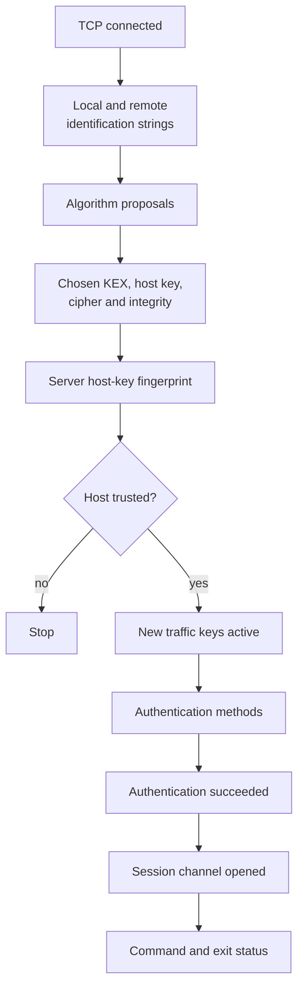
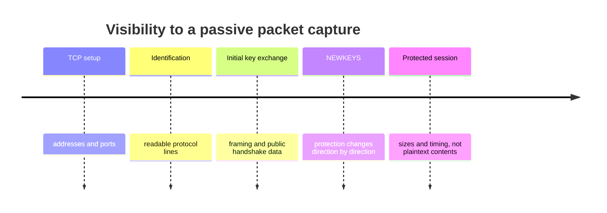

# Observe a connection

Before studying the packet format, watch a mature client perform the protocol. OpenSSH's
debug log uses implementation terminology, but its order closely follows the
wire exchange.

## A safe observation lab

Use a test server whose host-key fingerprint you can verify independently. The
commands below do not weaken host verification and do not put a password on the
command line.

First inspect the effective configuration without connecting:

```console
ssh -G example.test | less
```

Then connect with verbose logging and run a harmless command:

```console
ssh -vvv -S none user@example.test 'printf "hello from the server\n"'
```

`-S none` disables OpenSSH connection sharing for this invocation. Otherwise,
an existing `ControlMaster` connection could carry the command without a new
identification exchange, key exchange, or user authentication. That would hide
the very phases this lab is meant to observe. If the effective configuration
uses a jump host, distinguish its connection from the final server's; see
[SSH through a jump host](./forwarding.md#ssh-through-a-jump-host).

The options are documented by the
[OpenBSD `ssh(1)` manual](https://man.openbsd.org/ssh.1). Debug output can
contain hostnames, usernames, paths, key fingerprints, and command text. Review
it before sharing it.

> If the client asks whether to trust a new host key, pause. Compare the shown
> fingerprint with a value obtained through a separate trusted channel. The
> prompt is a security decision, not connection boilerplate.

## Turn the log into phases

Exact messages vary by client version and server configuration. Instead of
matching every log line, classify the evidence.



Build a small table from your own log:

| Question | Evidence to find |
| --- | --- |
| Which protocol/software versions met? | local and remote version strings |
| Which key exchange was selected? | negotiated KEX name |
| Which long-term server key signed it? | host-key algorithm and fingerprint |
| How are packets protected each way? | cipher and MAC, or an AEAD cipher |
| How was the user authenticated? | offered and accepted method |
| What application stream was opened? | session channel and `exec` request |
| How did the result finish? | EOF, exit status, and channel close |

Do not expect debug lines to be protocol packets one-for-one. A client may log
one decision after processing several packets, and one SSH packet may trigger
several log entries.

### A compact annotated trace

The following excerpt is abridged from an OpenSSH 10 client talking to an
OpenSSH server with default settings. The `debug1:` prefixes, fingerprints,
and many lines are removed. It is not a literal wire dump, and other versions
word things differently.

```text
Connection established.
Local version string SSH-2.0-OpenSSH_X
Remote protocol version 2.0, remote software version OpenSSH_Y
SSH2_MSG_KEXINIT sent
SSH2_MSG_KEXINIT received
kex: algorithm: mlkem768x25519-sha256
kex: host key algorithm: ssh-ed25519
kex: server->client cipher: chacha20-poly1305@openssh.com MAC: <implicit> compression: none
kex: client->server cipher: chacha20-poly1305@openssh.com MAC: <implicit> compression: none
expecting SSH2_MSG_KEX_ECDH_REPLY
SSH2_MSG_KEX_ECDH_REPLY received
Server host key: ssh-ed25519 SHA256:example
Host 'example.test' is known and matches the ED25519 host key.
ssh_packet_send2_wrapped: resetting send seqnr 3
rekey out after 134217728 blocks
SSH2_MSG_NEWKEYS sent
SSH2_MSG_NEWKEYS received
SSH2_MSG_EXT_INFO received
kex_ext_info_client_parse: server-sig-algs=<ssh-ed25519,...>
Authentications that can continue: publickey,password
Offering public key: ...
Server accepts key: ...
Authenticated to example.test using "publickey".
Entering interactive session.
Sending command: printf "hello from the server\n"
client_input_channel_req: channel 0 rtype exit-status reply 0
Exit status 0
```

Read it as evidence, not as a packet list:

| Log evidence | Protocol conclusion |
| --- | --- |
| Both version strings | Identification exchange completed. |
| `KEXINIT` sent and received | Both proposals were exchanged in cleartext. |
| KEX and host-key names | Both `KEXINIT` proposals had a usable match. |
| Directional cipher lines | Packet protection was selected separately for each direction. |
| `KEX_ECDH_REPLY` received | The server's key-exchange reply arrived; it carries the host key and signature. |
| Host key matches | The presented key matched a local trust entry; this line alone does not prove the exchange signature was verified. |
| `resetting ... seqnr` | Strict KEX is active, so sequence numbers restart at `NEWKEYS`. |
| `rekey out after ... blocks` | The client's usage limit for the new keys. |
| `NEWKEYS` sent and received | Each direction switched to the new keys. |
| `server-sig-algs` | The server sent extension information after its `NEWKEYS`. |
| Methods can continue | The server rejected or answered an authentication request and supplied current policy choices. |
| Server accepts key | The server answered a public-key query with `PK_OK`; this is not yet success. |
| Authenticated | The client received `SSH_MSG_USERAUTH_SUCCESS`. |
| Sending command | The client attempted an `exec` request; look for its success reply to confirm acceptance. |
| Exit status 0 | The server sent an `exit-status` channel request carrying status 0. |

Three details reward a closer look. `MAC: <implicit>` means the selected
cipher is an AEAD mode: ChaCha20-Poly1305 authenticates each packet itself, so
no separate MAC algorithm was negotiated for that direction; see
[ChaCha20-Poly1305](./crypto-symmetric.md#chacha20-poly1305). The reply
is logged as `KEX_ECDH_REPLY` even though the method is a post-quantum hybrid:
key-exchange message numbers are method-specific, and this hybrid reuses the
numbers of the ECDH messages (see the
[method survey](./key-exchange-methods.md#hybrid-post-quantum-exchange)). And
the sequence-number resets are the visible trace of
[strict key exchange](./version-and-negotiation.md#strict-key-exchange).

The excerpt omits the service request, channel open, window adjustments, EOF,
and CLOSE, and lower verbosity levels omit much more. Absence from a log is not
absence from the protocol.

## Inspect supported algorithms

OpenSSH can list locally supported algorithm names without connecting:

```console
ssh -Q kex
ssh -Q key
ssh -Q sig
ssh -Q cipher
ssh -Q mac
```

`key` lists public-key formats, while `sig` lists signature algorithm names;
the two differ for RSA, where one `ssh-rsa` key format can produce
`rsa-sha2-256` or `rsa-sha2-512` signatures. `ssh -G` shows which of these
names are enabled, in preference order, for a particular destination.

“Supported” is not the same as “enabled by default,” “negotiated,” or “safe for
new deployments.” This distinction becomes central during KEXINIT negotiation.
The names themselves follow a pattern explained in
[Reading an algorithm name](./cryptography-primer.md#reading-an-algorithm-name).

Keep four sets distinct: supported, enabled by policy, offered to the peer,
and selected for this connection.

## What a packet capture can show

A capture can show the TCP connection, both textual identification lines, the
initial unencrypted SSH packets, traffic sizes, timings, and connection closure.
After `SSH_MSG_NEWKEYS`, it cannot reveal protected message contents without
the traffic keys.

Exact SSH packet boundaries may also be hidden when the negotiated cipher
encrypts packet lengths. TCP segment sizes remain visible, but they are not
SSH message sizes. Possession of the server's long-term host private key is
insufficient to decrypt a recording of an ephemeral key exchange; that is the
point of [forward secrecy](./crypto-key-agreement.md#forward-secrecy).



The remaining metadata is still sensitive. Packet lengths and timing can leak
behavioral clues, which is one reason the transport includes random padding.
Padding reduces some obvious structure; it does not make all traffic patterns
invisible. See the traffic-analysis discussion in
[RFC 4251 section 9.3.9](https://www.rfc-editor.org/rfc/rfc4251#section-9.3.9).

## Checkpoint

Given an `ssh -vvv` log, you should now be able to mark these boundaries:

1. the reliable stream exists;
2. algorithm negotiation begins;
3. the server's identity is accepted;
4. packet protection becomes active;
5. the user is authenticated; and
6. a connection-protocol channel carries the command.

If a connection fails, name the last boundary crossed. That single habit turns
“SSH is broken” into a much smaller investigation.
