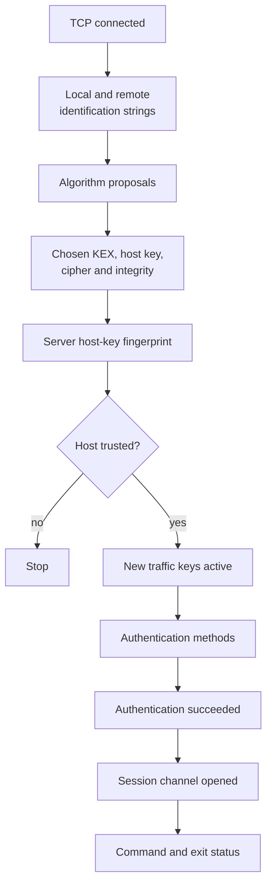
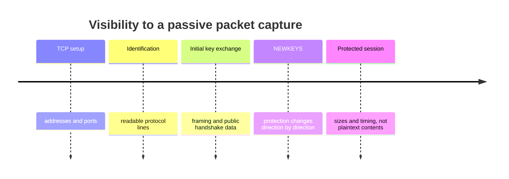

# Observe a connection

Before studying the packet format, watch a mature client perform the protocol.
OpenSSH's debug log uses implementation terminology, but its order closely
follows the wire exchange.

## A safe observation lab

Use a test server whose host-key fingerprint you can verify independently. The
commands below do not weaken host verification or put a password on the
command line.

First inspect the effective configuration without connecting:

```console
ssh -G example.test | less
```

Then connect with verbose logging and run a harmless command:

```console
ssh -vvv -S none user@example.test 'printf "hello from the server\n"'
```

`-S none` disables connection sharing for this invocation. Otherwise an
existing `ControlMaster` connection could carry the command without a new
identification exchange, key exchange, or user authentication, hiding the
phases this lab is meant to observe. If the configuration uses a jump host,
separate its connection from the final server's; see
[SSH through a jump host](./forwarding.md#ssh-through-a-jump-host).

The options are documented in
[`ssh(1)`](https://man.openbsd.org/ssh.1). Debug output can contain hostnames,
usernames, paths, key fingerprints, and command text; review it before sharing.

> If the client asks whether to trust a new host key, pause. Compare the shown
> fingerprint with a value obtained through a separate trusted channel. The
> prompt is a security decision, not connection boilerplate.

## Turn the log into phases

Exact messages vary by client version and server configuration, so classify
the evidence instead of matching every line.



Build a small table from your own log:

| Question | Evidence to find |
| --- | --- |
| Which protocol/software versions met? | local and remote version strings |
| Which key exchange was selected? | negotiated KEX name |
| Which long-term server key signed it? | host-key algorithm and fingerprint |
| How are packets protected each way? | cipher and MAC, or an AEAD cipher |
| How was the user authenticated? | offered and accepted method |
| What application stream was opened? | session channel and `exec` request |
| How did the result finish? | EOF, exit status, and channel close |

When a connection fails, name the last phase it completed. That habit turns
“SSH is broken” into a much smaller investigation.

Debug lines do not map one-to-one onto packets. A client may log one decision
after processing several packets, and one packet may trigger several log
entries.

### A compact annotated trace

The following excerpt comes from an OpenSSH 10.5 client talking to an OpenSSH
10.2 server with default settings. It is abridged: the `debug1:` prefixes,
fingerprints, and most lines are removed, and other versions word things
differently.

```text
Connection established.
Local version string SSH-2.0-OpenSSH_10.5
Remote protocol version 2.0, remote software version OpenSSH_10.2p1 Ubuntu-2ubuntu3.6
SSH2_MSG_KEXINIT sent
SSH2_MSG_KEXINIT received
kex: algorithm: mlkem768x25519-sha256
kex: host key algorithm: ssh-ed25519
kex: server->client cipher: chacha20-poly1305@openssh.com MAC: <implicit> compression: none
kex: client->server cipher: chacha20-poly1305@openssh.com MAC: <implicit> compression: none
expecting SSH2_MSG_KEX_ECDH_REPLY
SSH2_MSG_KEX_ECDH_REPLY received
Server host key: ssh-ed25519 SHA256:...
Host 'example.test' is known and matches the ED25519 host key.
ssh_packet_send2_wrapped: resetting send seqnr 3
rekey out after 134217728 blocks
SSH2_MSG_NEWKEYS sent
ssh_packet_read_poll2: resetting read seqnr 3
SSH2_MSG_NEWKEYS received
SSH2_MSG_EXT_INFO received
kex_ext_info_client_parse: server-sig-algs=<ssh-ed25519,...>
SSH2_MSG_SERVICE_ACCEPT received
Authentications that can continue: publickey,password
Offering public key: /home/user/.ssh/id_ed25519 ED25519 SHA256:...
Server accepts key: /home/user/.ssh/id_ed25519 ED25519 SHA256:...
Authenticated to example.test ([192.0.2.10]:22) using "publickey".
Entering interactive session.
Sending command: printf "hello from the server\n"
client_input_channel_req: channel 0 rtype exit-status reply 0
Exit status 0
```

Read it as evidence, not as a packet list:

| Log evidence | Protocol conclusion |
| --- | --- |
| Both version strings | Identification exchange completed. |
| `KEXINIT` sent and received | Both proposals were exchanged in cleartext. |
| KEX and host-key names | Both `KEXINIT` proposals had a usable match. |
| Directional cipher lines | Packet protection was selected separately for each direction. |
| `KEX_ECDH_REPLY` received | The server's key-exchange reply arrived; it carries the host key and signature. |
| Host key matches | The presented key matched a local trust entry; this line alone does not prove the exchange signature was verified. |
| `resetting ... seqnr` | Strict KEX is active, so each direction's sequence number restarts at `NEWKEYS`. |
| `rekey out after ... blocks` | The client's usage limit for its new sending keys. |
| `NEWKEYS` sent and received | Each direction switched to the new keys. |
| `server-sig-algs` | The server sent extension information after its `NEWKEYS`. |
| `SERVICE_ACCEPT` | The server agreed to run `ssh-userauth`. |
| Methods can continue | The server rejected or answered an authentication request and listed the methods still acceptable. |
| Server accepts key | The server answered a public-key query with `PK_OK`; this is not yet success. |
| Authenticated | The client received `SSH_MSG_USERAUTH_SUCCESS`. |
| Sending command | The client sent an `exec` request; look for its success reply to confirm acceptance. |
| Exit status 0 | The server sent an `exit-status` channel request carrying status 0. |

Three details reward a closer look:

- `MAC: <implicit>` means the cipher is an AEAD mode: ChaCha20-Poly1305
  authenticates each packet itself, so no separate MAC was negotiated; see
  [ChaCha20-Poly1305](./crypto-symmetric.md#chacha20-poly1305).
- The reply is logged as `KEX_ECDH_REPLY` although the method is a
  post-quantum hybrid. Key-exchange message numbers are method-specific, and
  this hybrid reuses the ECDH message numbers; see the
  [method survey](./key-exchange-methods.md#hybrid-post-quantum-exchange).
- The sequence-number resets are the visible trace of
  [strict key exchange](./version-and-negotiation.md#strict-key-exchange).

The excerpt omits the channel open, window adjustments, EOF, and CLOSE, and
lower verbosity levels omit much more. Absence from a log is not absence from
the protocol.

## Inspect supported algorithms

OpenSSH lists the algorithm names it supports without connecting:

```console
ssh -Q kex
ssh -Q key
ssh -Q sig
ssh -Q cipher
ssh -Q mac
```

`ssh -Q help` lists the other queries. `key` lists public-key formats and
`sig` lists signature algorithms; they differ for RSA, where one `ssh-rsa` key
format can produce `rsa-sha2-256` or `rsa-sha2-512` signatures. To see which
names are enabled for a destination, in preference order, filter `ssh -G`:

```console
ssh -G example.test | grep -E '^(kexalgorithms|hostkeyalgorithms|ciphers|macs) '
```

Keep four sets distinct: supported, enabled by policy, offered to the peer,
and selected for this connection. None of them means “safe for new
deployments.” The distinction becomes central in
[algorithm negotiation](./version-and-negotiation.md), and the names follow a
pattern explained in
[Reading an algorithm name](./cryptography-primer.md#reading-an-algorithm-name).

## What a packet capture can show

A capture shows the TCP connection, both identification lines, the initial
unencrypted SSH packets, traffic sizes, timing, and connection closure. After
`SSH_MSG_NEWKEYS`, it cannot reveal message contents without the traffic keys.

When the negotiated cipher encrypts packet lengths, even SSH packet boundaries
are hidden; TCP segment sizes remain visible but are not SSH message sizes.
The server's long-term host private key cannot decrypt a recording of an
ephemeral key exchange; that is the point of
[forward secrecy](./crypto-key-agreement.md#forward-secrecy).



The remaining metadata is still sensitive. Packet lengths and timing can leak
behavioral clues, such as individual keystrokes in an interactive session.
Random padding hides some structure but not all traffic patterns; see
[RFC 4251, section 9.3.9](https://www.rfc-editor.org/rfc/rfc4251#section-9.3.9).

## Check your understanding

1. Why does the lab pass `-S none`, and what would a shared connection hide?
2. The log says `Host 'example.test' is known and matches the ED25519 host
   key.` What has the client established, and what does that line alone not
   show?
3. Why does a post-quantum hybrid exchange log `SSH2_MSG_KEX_ECDH_REPLY`?
4. What does `MAC: <implicit>` tell you about the negotiated cipher?
5. `ssh -Q cipher` lists an algorithm. Does that mean the next connection will
   use it?
6. A connection fails right after `SSH2_MSG_NEWKEYS received`. Which
   boundaries has it crossed, and which has it not?

<details>
<summary>Answers</summary>

1. `-S none` stops the command from riding an existing `ControlMaster`
   connection. A shared connection would open a new channel on an already
   authenticated transport, so no identification, key exchange, or user
   authentication would appear in the log.
2. The server's host key matches a `known_hosts` entry for that name. The
   line does not by itself show that the key-exchange signature was verified;
   both checks are needed before the server is authenticated.
3. Key-exchange message numbers 30–49 are defined per method. The hybrid
   method reuses the numbers, and so the names, of the ECDH messages.
4. It is an AEAD cipher that authenticates packets itself, so no separate
   MAC algorithm was negotiated for that direction.
5. No. It is supported by this client; it must also be enabled by
   configuration, offered in `KEXINIT`, and selected by negotiation.
6. It has a reliable stream, completed identification and negotiation,
   accepted the server's host key, and activated packet protection in both
   directions. User authentication and the channel have not yet happened.

</details>

## References

- [OpenBSD `ssh(1)` manual](https://man.openbsd.org/ssh.1): `-v`, `-G`,
  `-Q`, and `-S`.
- [OpenBSD `ssh_config(5)` manual](https://man.openbsd.org/ssh_config.5):
  `ControlMaster`, `KexAlgorithms`, `Ciphers`, and related options.
- [RFC 4251, section 9.3.9: Traffic analysis](https://www.rfc-editor.org/rfc/rfc4251#section-9.3.9)
- [RFC 4253: SSH Transport Layer Protocol](https://www.rfc-editor.org/rfc/rfc4253)
- [Strict key exchange (draft-ietf-sshm-strict-kex)](https://datatracker.ietf.org/doc/draft-ietf-sshm-strict-kex/)
