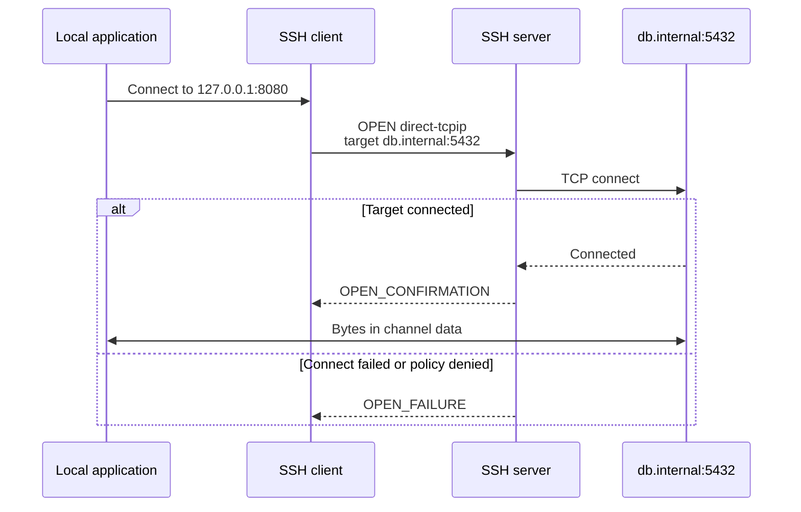
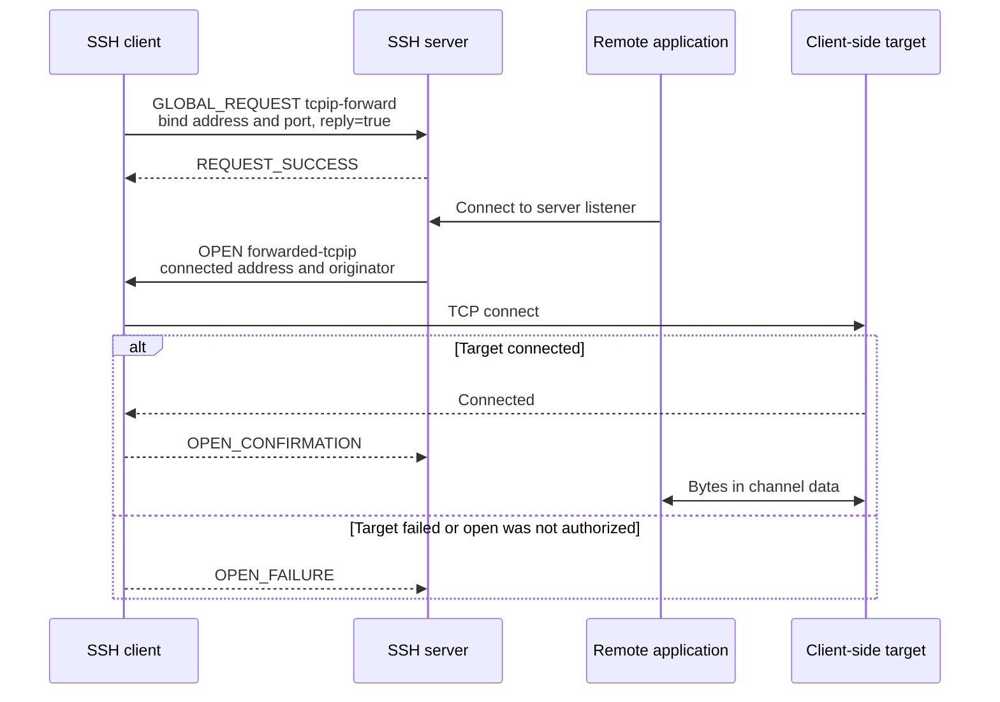
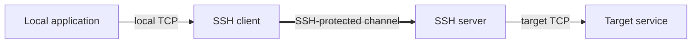
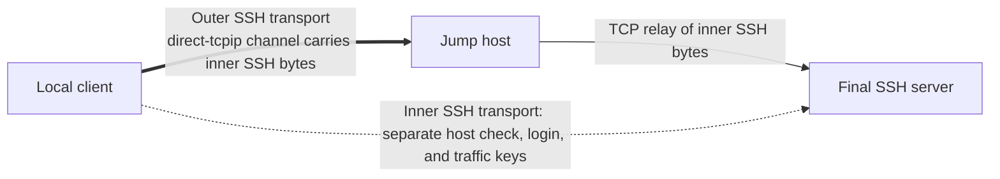

# TCP forwarding

TCP forwarding uses SSH channels as byte relays: one endpoint asks for a
connection made from the other endpoint's network position. Channel
identifiers, windows, and close behavior follow
[Channels and flow control](./channels.md).

The labels *local*, *dynamic*, and *remote* describe client behavior. On the
wire there are two mechanisms: `direct-tcpip` channels, and `tcpip-forward`
requests followed by `forwarded-tcpip` channels.

| User-facing mode | Listener | SSH action for each connection | Peer that connects to target |
| --- | --- | --- | --- |
| Local forwarding | Client | Client opens `direct-tcpip` | Server |
| Local dynamic forwarding (`-D`) | Client | Client translates SOCKS, then opens `direct-tcpip` | Server |
| Remote forwarding | Server | Server opens `forwarded-tcpip` | Client |

## Direct TCP channels

A `direct-tcpip` open asks the SSH peer to make an outbound TCP connection:

```text
string    "direct-tcpip"
uint32    sender channel
uint32    initial window size
uint32    maximum packet size
string    host to connect
uint32    port to connect
string    originator IP address
uint32    originator port
```

The client normally sends this open; RFC 4254 recommends that clients reject
server-initiated `direct-tcpip` opens.

For a local forward `-L 127.0.0.1:8080:db.internal:5432`, the client listens
locally, and each accepted connection creates a new channel:



The server resolves the target name and connects, so the target need only be
reachable from the server's network. The originator address is peer-supplied
context, not an authenticated identity.

Local dynamic forwarding (`-D`) differs only before the channel opens. The
client accepts a SOCKS request, extracts its destination, and opens a
`direct-tcpip` channel to it. SOCKS negotiation ends at the client and never
crosses the SSH connection. A numeric destination needs no resolution at the
server; a hostname is resolved there.

## Requesting a remote listener

Remote forwarding has two levels of state:

1. A `tcpip-forward` global request creates a server-side listener.
2. Each accepted TCP connection creates a `forwarded-tcpip` channel.



The `forwarded-tcpip` open carries the server address that accepted the
connection and the reported originator, not the client-side target. The client
keeps that target in its own state for the forwarding request.

If the requested port is zero, the server allocates one and returns it as a
`uint32` in `REQUEST_SUCCESS`. The client needs it to report where the
listener is.

OpenSSH also supports *remote dynamic forwarding*: an `-R` listener with no
fixed target. The server relays each accepted stream in a `forwarded-tcpip`
channel, and the client interprets SOCKS inside that stream to choose and
connect to the target. Unlike local `-D`, SOCKS negotiation crosses SSH, but
the server needs only ordinary remote-forwarding support. See the
[`ssh(1)` description of `-R`](https://man.archlinux.org/man/ssh.1#R).

## Cancellation and races

The client cancels a listener with `cancel-tcpip-forward`, giving the same
bind address and the actual port (the allocated one, not zero, if it asked for
port zero). It should request a reply when it needs a clear end boundary.

Cancellation races with new connections: a `forwarded-tcpip` open already in
flight may arrive before the cancellation reply. The client matches each open
to forwarding state that was authorized when the server accepted the
connection, and rejects unsolicited opens.

Cancellation stops new connections only; channels already open keep their own
EOF and CLOSE lifecycle. Closing a shell channel neither cancels a listener nor
closes forwarded channels, because they are independent objects. Ending the
transport ends all of them.

## Where protection ends

SSH protects channel data only between the SSH client and server. For a local
forward:



The server-to-target leg needs its own application security if that network
is untrusted; SSH does not verify the target's identity.

The application-to-client leg is also outside SSH. A loopback listener limits
it to the local host but does not authenticate which local process connected;
a wildcard bind can admit other machines, subject to reachability and policy.
For remote forwarding, the server-side bind works the same way: loopback
normally limits who can connect, and a wildcard bind can expose the
client-side target to any host that reaches the server.

Forwarding therefore changes reachability. A direct channel may reach an
internal server-side service; a remote listener may expose a private
client-side one. Client and server policy can restrict bind addresses, ports,
and targets before granting either.

## SSH through a jump host

A forwarded byte stream can carry another SSH transport. With a single
OpenSSH `ProxyJump`, the client authenticates to the jump host, opens a
`direct-tcpip` channel to the final server's SSH port, and runs a second SSH
handshake through it.



The two transports have separate host identities, session identifiers, and
rekey state. The jump host relays inner ciphertext and never sees the final
login credentials or command plaintext. It can still observe the inner
handshake and traffic metadata, interrupt delivery, or attempt interference
that the final host-key check must detect. No agent forwarding and no private
key on the jump host are needed. See
[`ProxyJump` in `ssh_config(5)`](https://man.archlinux.org/man/ssh_config.5#ProxyJump).

## Related channels are separate protocols

Agent forwarding, X11 forwarding, and Unix-domain-socket forwarding use their
own channel types and requests; they are not variants of TCP forwarding. When
`-L` or `-R` names a socket path instead of a port, OpenSSH uses the
Unix-socket variants. See
[Agent, X11, and Unix-socket forwarding](./other-channels.md), in particular
[agent forwarding](./other-channels.md#agent-forwarding), whose remote end
gains a signing service rather than key bytes.

## Check your understanding

1. Who resolves a `direct-tcpip` target name?
2. Where is SOCKS interpreted during local dynamic forwarding (`-D`)?
3. What persistent state links a `forwarded-tcpip` open to its client-side
   target?
4. Does closing a session channel cancel a remote-forwarding listener?
5. Which links in a local forward are protected by SSH?
6. Does trusting a jump host also authenticate the final server?

<details>
<summary>Answers</summary>

1. The server resolves a hostname carried in the open request. If the client
   sends a numeric address, no target-name resolution is needed there.
2. At the SSH client, before it opens a `direct-tcpip` channel.
3. The client's authorized listener state maps the reported server address
   and port to the configured target.
4. No. The listener belongs to the connection, independently of session
   channels.
5. Only the SSH client-to-server leg. The other TCP legs need any required
   protection from the application protocol.
6. No. The inner SSH transport needs its own final-server host verification.

</details>

## References

- [RFC 4254, Section 4 — Global Requests](https://www.rfc-editor.org/rfc/rfc4254.html#section-4)
- [RFC 4254, Section 7 — TCP/IP Port Forwarding](https://www.rfc-editor.org/rfc/rfc4254.html#section-7)
- [OpenSSH protocol extensions](https://github.com/openssh/openssh-portable/blob/master/PROTOCOL)
