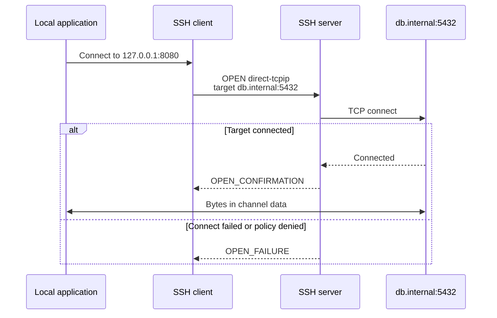
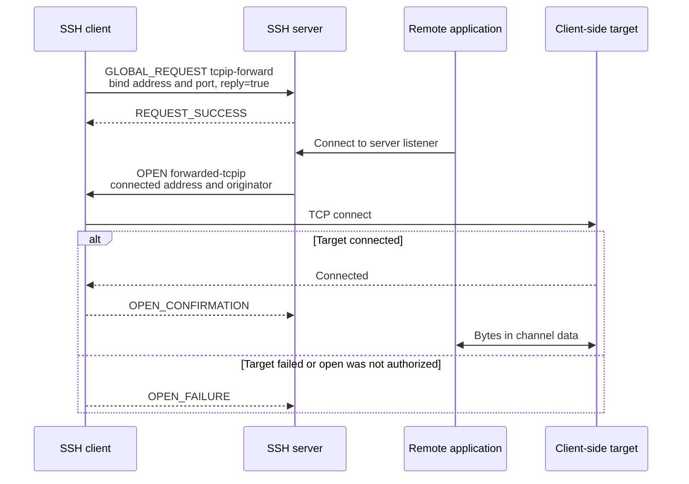
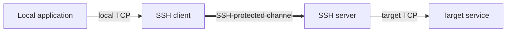
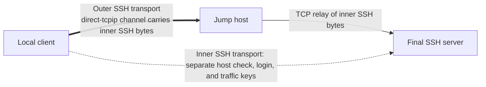

# TCP forwarding

TCP forwarding uses SSH channels as byte relays. It lets one endpoint request
a connection from the other endpoint's network position. Channel identifiers,
windows, and close behavior follow
[Channels and flow control](./channels.md).

The familiar labels *local*, *dynamic*, and *remote* forwarding describe local
client behavior. On the SSH wire, the core mechanisms are `direct-tcpip`
channels and a combination of `tcpip-forward` requests with
`forwarded-tcpip` channels.

| User-facing mode | Listener | SSH action for each connection | Peer that connects to target |
| --- | --- | --- | --- |
| Local forwarding | Client | Client opens `direct-tcpip` | Server |
| Local dynamic forwarding (`-D`) | Client | Client translates SOCKS, then opens `direct-tcpip` | Server |
| Remote forwarding | Server | Server opens `forwarded-tcpip` | Client |

## Direct TCP channels

A `direct-tcpip` open asks the SSH peer to make an outbound TCP connection:

```text
string    "direct-tcpip"
uint32    sender channel
uint32    initial window size
uint32    maximum packet size
string    host to connect
uint32    port to connect
string    originator IP address
uint32    originator port
```

The client normally sends this open to the server. RFC 4254 recommends that
clients reject server-initiated `direct-tcpip` opens.

For a conceptual local forward
`-L 127.0.0.1:8080:db.internal:5432`, the client listens locally. Each accepted
connection creates a new channel:



The server resolves the target name and makes the connection. The target may
be visible from the server's network but not from the client. The originator
address is peer-supplied context; it is not an authenticated user identity.

Local dynamic forwarding (`-D`) differs before the channel opens. The SSH
client accepts a SOCKS request, extracts its destination, and opens a
`direct-tcpip` channel for that destination. In this mode, SOCKS negotiation
terminates at the client and does not cross the SSH connection. If the
application supplies a numeric address, no name resolution is needed at the
server; if it supplies a hostname, the server can resolve it.

## Requesting a remote listener

Remote forwarding has two levels of state:

1. A `tcpip-forward` global request creates a server-side listener.
2. Each accepted TCP connection creates a `forwarded-tcpip` channel.



The forwarded-channel fields contain the server address that received the
connection and the reported originator. They do not contain the client-side
target. The client remembers that target as part of the forwarding request's
local state.

If the requested port is zero, the server allocates a port. A successful reply
then carries the allocated port as a `uint32`. The client needs that value
before it can report where the listener exists.

OpenSSH also supports *remote dynamic forwarding*: an `-R` listener with no
fixed target. Here the server relays each accepted stream in a
`forwarded-tcpip` channel, and the client interprets SOCKS inside that stream
to choose and connect to the target. Unlike local `-D`, this carries SOCKS
negotiation through SSH. The server needs ordinary remote-forwarding support;
it does not interpret SOCKS. See the
[`ssh(1)` description of `-R`](https://man.openbsd.org/ssh#R).

## Cancellation and races

The client cancels a listener with `cancel-tcpip-forward`, using the same bind
address and actual listener port. If the request used port zero, this means the
allocated port returned in `REQUEST_SUCCESS`, not zero. The client should wait
for a reply when it needs a clear end boundary.

A forwarded connection can race with cancellation. A channel open that was
already in flight may arrive before the cancellation result. The client must
match each `forwarded-tcpip` open to forwarding state that was authorized when
the server accepted the connection; it must reject unsolicited opens.

Cancellation stops new connections to the listener; it does not close channels
for connections already accepted. Those keep their own EOF and CLOSE lifecycle.

Closing a shell channel does not cancel a listener or close existing forwarded
channels. They are independent connection-protocol objects. Ending the SSH
transport ends all of them.

## Where protection ends

SSH protects channel data only between the SSH client and SSH server.

For a local forward, the path is:



For local or dynamic forwarding, the server-to-target connection needs its own
application security if the target network is untrusted. SSH does not verify
the target's identity.

The application-to-client leg is also outside SSH protection. Binding the
client's listener to loopback restricts that leg to the local host; it does
not authenticate which local process connected. A wildcard local bind can
give other machines access to the forward, subject to network reachability
and policy.

For remote forwarding, listener scope controls exposure. A loopback bind
normally limits who can connect on the server. A wildcard bind can expose the
client-side target to other hosts that can reach the server.

Forwarding also changes reachability. A direct channel may reach an internal
server-side service. A remote listener may expose a private client-side
service. Server and client policy can restrict bind addresses, ports, and
targets before granting these capabilities.

## SSH through a jump host

A forwarded byte stream can itself carry another SSH transport. With a single
OpenSSH `ProxyJump`, the local client authenticates to the jump host and opens
a `direct-tcpip` channel to the final server's SSH port. It then runs a second
SSH handshake with the final server through that channel.



The two transports have separate host identities, session identifiers, and
rekey state. Once the inner transport is protected, the jump host relays its
ciphertext; it does not receive the final login credentials or command
plaintext. It can still observe the inner handshake and traffic metadata,
interrupt delivery, or attempt interference that the final host check must
detect. This arrangement does not require agent forwarding or placing a user
private key on the jump host. See
[`ProxyJump` in `ssh_config(5)`](https://man.openbsd.org/ssh_config#ProxyJump).

## Related channels are separate protocols

X11 forwarding, agent forwarding, and Unix-domain-socket forwarding use
additional channel types or requests. They are not alternative spellings of
TCP forwarding.

Agent forwarding has a particularly sharp boundary: the remote host receives
access to a signing service, not the private-key bytes. A compromised remote
host may still ask that service to sign while the forwarding channel is open.
Key constraints and host-bound authentication can narrow this delegated
capability, but ordinary SSH transport protection does not remove it.

## Check the viewpoint

1. Who resolves a `direct-tcpip` target name?
2. Where is SOCKS interpreted during local dynamic forwarding (`-D`)?
3. What persistent state links a `forwarded-tcpip` open to its client-side
   target?
4. Does closing a session channel cancel a remote-forwarding listener?
5. Which links in a local forward are protected by SSH?
6. Does trusting a jump host also authenticate the final server?

<details>
<summary>Answers</summary>

1. The server resolves a hostname carried in the open request. If the client
   sends a numeric address, no target-name resolution is needed there.
2. At the SSH client, before it opens a `direct-tcpip` channel.
3. The client's authorized listener state maps the reported server address
   and port to the configured target.
4. No. The listener belongs to the connection, independently of session
   channels.
5. Only the SSH client-to-server leg. The other TCP legs need any required
   protection from the application protocol.
6. No. The inner SSH transport needs its own final-server host verification.

</details>

## References

- [RFC 4254, Section 4 — Global Requests](https://www.rfc-editor.org/rfc/rfc4254.html#section-4)
- [RFC 4254, Section 7 — TCP/IP Port Forwarding](https://www.rfc-editor.org/rfc/rfc4254.html#section-7)
- [OpenSSH protocol extensions](https://github.com/openssh/openssh-portable/blob/master/PROTOCOL)
