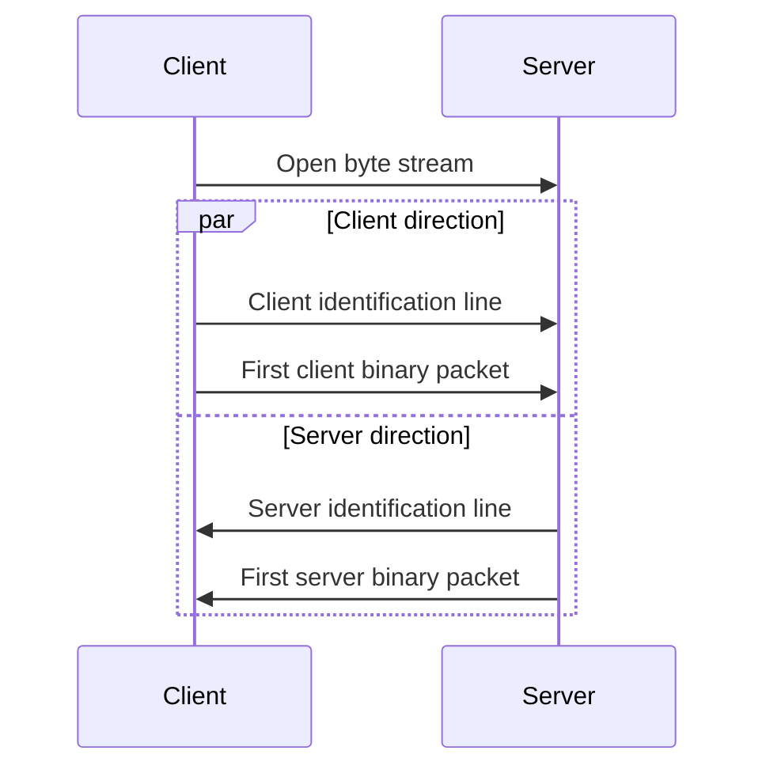

# Identification exchange

SSH starts with one line of text in each direction. After an endpoint sends
its identification line, it may begin sending binary packets without waiting
for the peer's line. The text-to-binary boundary is therefore directional.

The exchange answers a narrow question: can the endpoints continue with SSH
version 2? It also records implementation identifiers that later become part
of the authenticated key-exchange transcript.

## The identification line

The line has this form:

```text
SSH-protoversion-softwareversion SP comments CR LF
```

For example:

```text
SSH-2.0-CourseClient_0.1<CR><LF>
SSH-2.0-ExampleServer_4.2 staging<CR><LF>
```

The comment and its preceding space are optional. The complete line is at
most 255 characters including CRLF and must not contain NUL. Version `2.0`
selects the protocol described by the SSH version 2 RFCs. The historical
value `1.99` also advertises version 2 compatibility; it is not a separate
protocol version.

The peers may send their lines without waiting for each other. The exchange
has no request-response order.



This course uses two related terms:

- **identification line**: the transmitted bytes, including the line ending;
- **identification string**: the value placed in the exchange hash, without
  the line ending.

Keeping the distinction avoids hashing a reconstructed or normalized value.

## Server lines before SSH

A server may send other lines before its SSH identification line. This was
designed for notices from wrappers and gateways. A conforming client accepts
these lines until it finds a line beginning with `SSH-`.

```text
This system is restricted to authorized users.<CR><LF>
Maintenance window: Sunday 02:00 UTC.<CR><LF>
SSH-2.0-ExampleServer_4.2<CR><LF>
```

Pre-identification lines must not begin with `SSH-`. They are not included in
the exchange hash. If a client displays them, it should filter terminal
control characters. They are peer-controlled text.

This allowance is asymmetric. The client's identification line is its first
line on the connection.

## The boundary to binary packets

There is no content-type marker between the line exchange and binary SSH.
After the LF that terminates an endpoint's identification line, that endpoint's
next byte starts its first binary packet.

```text
... ExampleServer_4.2 CR LF | 00 00 04 ec ...
                             ^ first binary-packet byte
```

The first packet is normally `SSH_MSG_KEXINIT`. TCP may deliver the line and
part of this packet in one read. Read boundaries do not change the protocol
boundary.

## Cleartext authenticated later

Identification lines are cleartext. A network observer can read them, and an
active attacker can change bytes before key exchange has authenticated the
connection.

Key exchange later hashes the exact client and server identification strings
into the exchange hash. The server signs that hash. A simple in-transit change
makes the client and server compute different hashes, so signature verification
fails. A full man-in-the-middle can instead conduct two self-consistent
exchanges and sign one with a substituted host key; the client's host-key trust
check rejects that case.

This is retrospective authentication, not confidentiality. A successful
handshake detects modification of the identification strings but never hides
them.

## Check the boundary

1. Can the server send a notice before its identification line? Can the
   client?
2. Does CRLF enter the exchange hash?
3. If one TCP read contains the server line and 20 more bytes, what are those
   20 bytes?
4. Why can a passive observer read an identification string even though the
   string is authenticated later?

## References

- [RFC 4253, Section 4 — Connection Setup](https://www.rfc-editor.org/rfc/rfc4253.html#section-4)
- [RFC 4253, Section 8 — Diffie-Hellman Key Exchange](https://www.rfc-editor.org/rfc/rfc4253.html#section-8)
