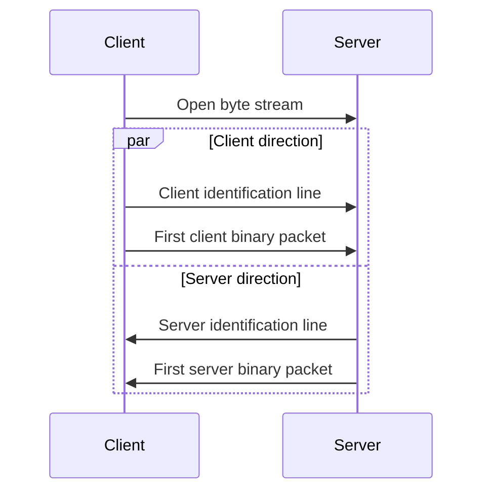

# Identification exchange

SSH starts with one line of text in each direction. The exchange answers a
narrow question: can the endpoints continue with SSH version 2? It also
records implementation identifiers that later become part of the
authenticated key-exchange transcript.

## The identification line

The line has this form, where square brackets mark the optional comment and
its preceding space:

```text
SSH-protoversion-softwareversion [SP comments] CR LF
```

An OpenSSH client might send:

```text
SSH-2.0-OpenSSH_10.5<CR><LF>
```

An Ubuntu-packaged OpenSSH server might send:

```text
SSH-2.0-OpenSSH_10.2p1 Ubuntu-2ubuntu3.6<CR><LF>
```

Here `OpenSSH_10.2p1` is the software version and `Ubuntu-2ubuntu3.6` is the
comment.

The rules from
[RFC 4253, section 4.2](https://www.rfc-editor.org/rfc/rfc4253#section-4.2):

- The complete line is at most 255 characters including CR LF and must not
  contain NUL.
- `protoversion` and `softwareversion` are printable US-ASCII without spaces
  or `-`.
- `protoversion` is `2.0`. The historical value `1.99` means a server that
  also accepts SSH version 1; for a version 2 client it is equivalent to
  `2.0`, not a separate protocol.
- The line must end in CR LF, although implementations that want to talk to
  very old peers may also accept a bare LF.

`softwareversion` is not decoration. Implementations match it against known
peers to enable workarounds for their bugs; OpenSSH logs this as
`compat_banner: match: ...` in verbose mode. The client cannot trust the value
before key exchange authenticates it, and even then it only reports what the
server chose to claim.

The peers may send their lines without waiting for each other; there is no
request-response order.



This guide distinguishes two terms:

- **identification line**: the transmitted bytes, including the line ending;
- **identification string**: the value placed in the exchange hash, without
  the line ending.

The exchange hash uses the exact received bytes of the string, never a
reconstructed or normalized value.

## Server lines before identification

A server may send other lines before its identification line, originally so
that TCP wrappers could explain why they were about to disconnect. A client
must accept such lines until it finds one beginning with `SSH-`.

```text
This system is restricted to authorized users.<CR><LF>
Maintenance window: Sunday 02:00 UTC.<CR><LF>
SSH-2.0-ExampleServer_4.2<CR><LF>
```

These lines must not begin with `SSH-` and are not part of the exchange hash.
They are unauthenticated, peer-controlled text: a client that displays them
should filter terminal control characters. The OpenSSH client shows them only
in verbose mode, as `banner line` debug messages. This is not the
authentication banner (`SSH_MSG_USERAUTH_BANNER`), which arrives later over
the protected transport.

The allowance is asymmetric: the client's identification line is its first
line on the connection.

## The boundary to binary packets

No marker separates the line exchange from binary SSH. After the LF that ends
an endpoint's identification line, that endpoint's next byte starts its first
binary packet.

```text
... ExampleServer_4.2 CR LF | 00 00 04 ec ...
                             ^ first binary-packet byte
```

The first packet is normally `SSH_MSG_KEXINIT`. One TCP read may return the
line and part of this packet together; read boundaries do not move the
protocol boundary.

## Cleartext, authenticated later

Identification lines are cleartext. A network observer can read them, and an
active attacker can change them before key exchange has authenticated the
connection.

Key exchange later hashes both identification strings into the
[exchange hash](./key-exchange.md#the-exchange-hash-authenticate-the-whole-decision),
which the server signs. A simple in-transit change makes the client and server
compute different hashes, so the exchange fails. A full machine-in-the-middle
can instead run two self-consistent exchanges and sign one with its own host
key; the client's host-key trust check rejects that case.

This is retrospective authentication, not confidentiality: a successful
handshake proves the strings were not modified but never hides them.

## Check your understanding

1. Can the server send a notice before its identification line? Can the
   client?
2. Does CR LF enter the exchange hash?
3. If one TCP read contains the server line and 20 more bytes, what are those
   20 bytes?
4. Why can a passive observer read an identification string even though the
   string is authenticated later?
5. An attacker rewrites the server's line from `OpenSSH_10.2p1` to
   `OpenSSH_7.4` to trigger old compatibility workarounds. What happens when
   key exchange completes?

<details>
<summary>Answers</summary>

1. The server can send other lines first, as long as none begins with `SSH-`.
   The client cannot: its identification line is its first line.
2. No. The exchange hash uses the identification string, which excludes CR
   and LF.
3. The first 20 bytes of the server's first binary packet, normally its
   `SSH_MSG_KEXINIT`.
4. Authentication detects modification after the fact; it does not encrypt.
   The lines are sent before any keys exist and are never encrypted.
5. The client hashes the string it received and the server hashes the one it
   sent, so the exchange hashes differ and the server's signature does not
   verify. The client aborts, although it may already have acted on the
   forged version while negotiating.

</details>

## References

- [RFC 4253, section 4: Connection setup](https://www.rfc-editor.org/rfc/rfc4253#section-4)
- [RFC 4253, section 5: Compatibility with old SSH versions](https://www.rfc-editor.org/rfc/rfc4253#section-5)
- [RFC 4253, section 8: Diffie-Hellman key exchange](https://www.rfc-editor.org/rfc/rfc4253#section-8)
