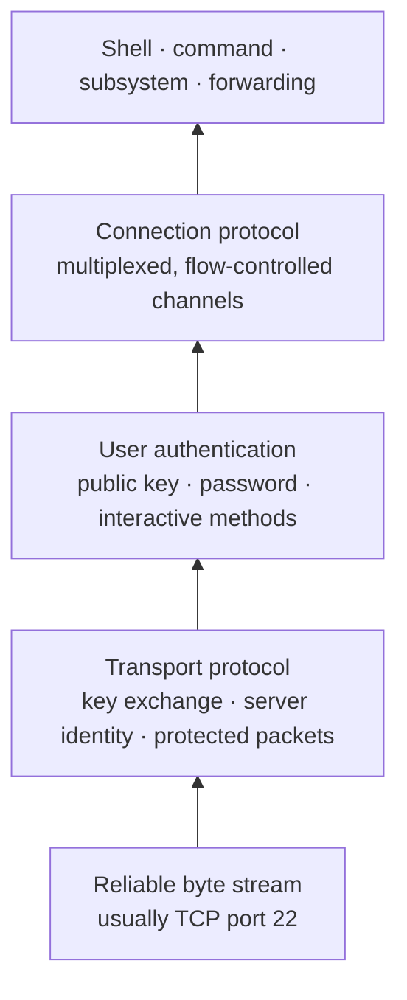
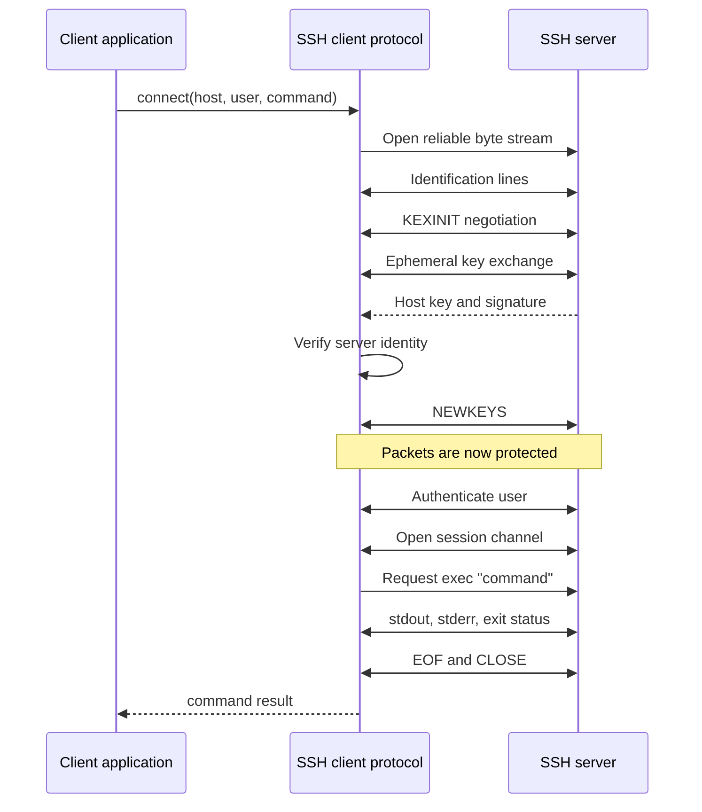

# Introduction

SSH is both an everyday command and a family of protocols. This guide takes
the second view. It follows an SSH client from a newly opened byte stream to an
authenticated, multiplexed connection that runs a command, and asks at each
step what the client and server say, why the exchange exists, and where the
protocol's security claims begin and end. It does not design new cryptography
or teach how to build a client.

## The three protocol layers

SSH builds upward from a reliable, ordered byte stream. Each layer gives the
next one a narrower and safer abstraction.

The separation matters. Encrypting bytes does not prove which server received
them. Proving the server's identity does not prove which user is connecting.
Authenticating a user does not explain how several terminal and forwarding
streams share one connection. SSH assigns each job to a different layer.

[RFC 4251](https://www.rfc-editor.org/rfc/rfc4251) describes the architecture;
its companions define the
[transport](https://www.rfc-editor.org/rfc/rfc4253),
[user authentication](https://www.rfc-editor.org/rfc/rfc4252), and
[connection](https://www.rfc-editor.org/rfc/rfc4254) protocols.

## One connection at a glance

Key exchange delivers a host-key signature. The client combines it with a
local check that this key belongs to the intended destination, and only then
sends user credentials. The first exchange also fixes a *session identifier*.
Public-key user authentication signs data containing that identifier, binding
the login proof to this connection.

## What you will learn

By the end of the guide, you should be able to:

- trace identification, negotiation, key exchange, user authentication, and
  channel traffic in order, reading packet framing where it matters;
- distinguish host keys, user keys, ephemeral key-exchange values, and derived
  traffic keys, and explain what the client must verify before trusting a
  server;
- describe the hashes, MACs, ciphers, key agreement, key encapsulation, and
  signatures SSH composes by what each guarantees and what it does not;
- reason about per-channel flow control and the limits of sharing one
  transport; and
- diagnose failures by protocol phase instead of guessing from a final error.

You should be comfortable with bytes, hexadecimal notation, and network
sockets. No cryptography background is assumed.

## How the guide is organized

The core narrative is deliberately narrow: a direct connection that verifies a
host key, authenticates with a public key, runs one command, and closes.
Terminals, agents, and forwarding build on that exchange.

1. **Orientation**: a real OpenSSH connection and the client's model of
   protocol state.
2. **The transport layer**: identification lines, binary packets, and
   algorithm negotiation.
3. **Cryptographic building blocks**: the primitives SSH composes. Protocol
   chapters link to what they need, so read this part first or on demand.
4. **Key exchange and server authentication**: deriving session keys and
   deciding whether the server is the intended one.
5. **User authentication**: login methods, including FIDO security keys.
6. **The connection protocol**: channels, sessions, and TCP, agent, X11, and
   Unix-socket forwarding.
7. **Security and analysis**: what SSH does and does not protect, and how to
   diagnose failures from traces.

Each chapter ends with review questions and its primary references. A
[glossary](./glossary.md) and a [reference map](./reference-map.md) close the
book.

## Conventions

Diagrams omit fields irrelevant to the point at hand; the linked
specifications remain authoritative. Names such as `string` and `uint32` are
SSH wire types, not programming-language types.

Each cryptographic primitive appears first as a black box: inputs, outputs,
failure results, guarantees, and its place in an SSH connection. The protocol
chapters rely only on that view. Collapsible **Go deeper** sections add the
math:

Go deeper: what these sections contain

Modular arithmetic, exponentiation, XOR, and small polynomial examples, worked
with toy numbers far too small to be secure, plus links for further study.
Skipping every Go deeper section loses nothing a later chapter depends on.

*Protected transport* means that the negotiated algorithms provide
confidentiality and integrity. SSH also registers `none` cipher and MAC
algorithms; this guide never treats them as safe for credentials or sensitive
channel data.

> **Security boundary:** The sketches and toy examples explain the protocol;
> they are not recipes for implementing cryptography. Before accepting an
> unknown or changed host key, establish why it represents the intended
> server. A connection error is not evidence that a replacement key is
> trustworthy.

## Old RFCs, current algorithms

The 2006 core RFCs still define SSH version 2, but their algorithm advice has
aged; do not copy their original mandatory algorithm set into a new client.
[RFC 9142](https://www.rfc-editor.org/rfc/rfc9142) updates key-exchange
recommendations, and the
[IANA SSH protocol registries](https://www.iana.org/assignments/ssh-parameters/ssh-parameters.xhtml)
record assigned names. Current OpenSSH releases prefer a
[hybrid post-quantum key exchange](./crypto-post-quantum.md) by default. Later
chapters point out extensions and newer algorithms where they change the
protocol model.

## References

- [RFC 4251: The Secure Shell (SSH) Protocol Architecture](https://www.rfc-editor.org/rfc/rfc4251)
- [RFC 4252: The Secure Shell (SSH) Authentication Protocol](https://www.rfc-editor.org/rfc/rfc4252)
- [RFC 4253: The Secure Shell (SSH) Transport Layer Protocol](https://www.rfc-editor.org/rfc/rfc4253)
- [RFC 4254: The Secure Shell (SSH) Connection Protocol](https://www.rfc-editor.org/rfc/rfc4254)
- [RFC 9142: Key Exchange (KEX) Method Updates and Recommendations for SSH](https://www.rfc-editor.org/rfc/rfc9142)
- [IANA Secure Shell (SSH) Protocol Parameters](https://www.iana.org/assignments/ssh-parameters/ssh-parameters.xhtml)
