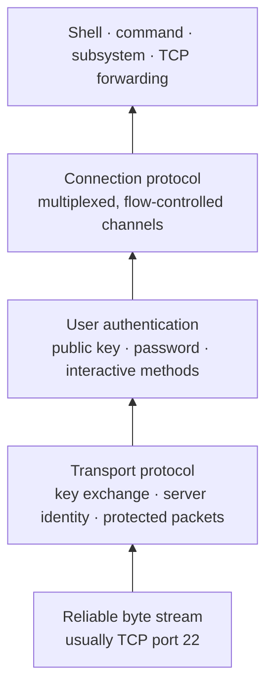
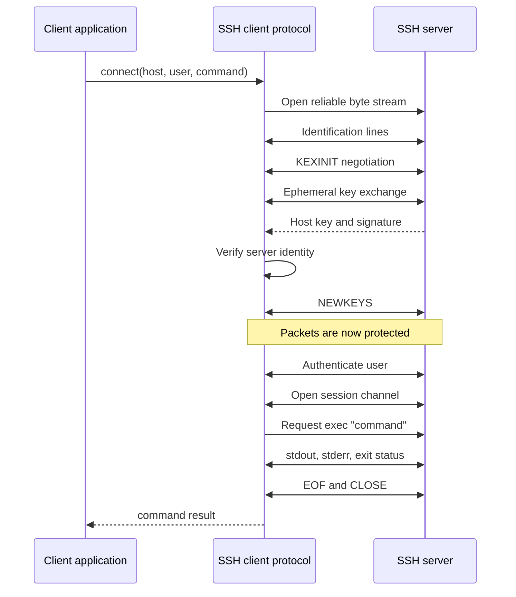

# Introduction

SSH is both an everyday command and a family of protocols. This guide takes
the second view: we will follow an SSH client from a newly opened byte stream
to an authenticated, multiplexed connection capable of running a command.

The goal is not to design new cryptography or build a client from scratch. It
is to understand what the client and server say, why each exchange exists, and
where the protocol's security claims begin and end.

## The three protocol layers

SSH builds upward from a reliable, ordered byte stream. Each layer gives the
next one a narrower and safer abstraction.

The separation matters. Encrypting bytes does not prove which server received
them. Proving the server's identity does not prove which user is connecting.
Authenticating a user does not explain how several terminal and forwarding
streams share one connection. SSH assigns each job to a different layer.

The foundational specification is
[RFC 4251, the SSH protocol architecture](https://www.rfc-editor.org/rfc/rfc4251).
Its companion documents define the
[transport](https://www.rfc-editor.org/rfc/rfc4253),
[user authentication](https://www.rfc-editor.org/rfc/rfc4252), and
[connection](https://www.rfc-editor.org/rfc/rfc4254) protocols.

## One connection at a glance

Key exchange supplies a signed host-key proof. The client combines that proof
with a destination-to-key trust check before it sends user credentials. The
first exchange also creates a stable *session identifier*. Later public-key
user authentication signs data containing that identifier, binding the login
proof to this SSH connection.

## What you will learn

By the end of the guide, you should be able to:

- trace identification, negotiation, key exchange, user authentication, and
  channel traffic in order;
- distinguish host keys, user keys, ephemeral key-exchange values, and derived
  traffic keys;
- read SSH's binary types and packet framing at the level needed to follow a
  protocol trace;
- explain what the client must verify before accepting a server;
- describe the cryptographic building blocks SSH composes—hashes, MACs,
  symmetric ciphers, key agreement, key encapsulation, and signatures—by what
  each one guarantees and what it does not;
- reason about per-channel flow control and the limits of sharing one transport;
  and
- diagnose failures by protocol phase instead of guessing from a final error.

## How to use the guide

The chapters alternate between the wire view and the client's view of the
conversation. Diagrams omit fields that do not matter to the point being
explained; the linked specification remains authoritative. Names such as
`string` and `uint32` refer to SSH wire types, not necessarily to types in a
programming language.

You should be comfortable with bytes, hexadecimal notation, network sockets,
and basic client/server programming. No cryptography background is assumed.

The cryptography chapters, starting with
[Cryptography as protocol building blocks](./cryptography-primer.md), follow
one convention. Each primitive is first presented as a black box: its inputs,
outputs, failure results, guarantees, and the place it occupies in an SSH
connection. That view is all the protocol chapters rely on. For readers who
want more, collapsible sections titled **Go deeper** explain the underlying
math with high-school algebra, a small worked example, and links for further
study. They look like this:

Go deeper: what these sections contain

Modular arithmetic, exponentiation, XOR, and small polynomial examples,
worked with toy numbers that are far too small to be secure. Skipping every
Go deeper section loses nothing that a later protocol chapter depends on.

On a first reading, skip the Go deeper sections. If you prefer to start with
the protocol, you can also read the cryptography chapters later: protocol
chapters link to the black-box explanation each step needs. The
[Glossary](./glossary.md) gives short definitions of recurring terms.

> **Security boundary:** The sketches and toy examples in this guide explain
> the protocol; they are not recipes for implementing cryptography. Before accepting an unknown
> or changed host key, establish why it represents the intended server. A
> connection error is not evidence that a replacement key is trustworthy.

Unless a chapter says otherwise, *protected transport* means that safe client
policy selected confidentiality and integrity. SSH also registers `none`
algorithms for unusual configurations; this guide does not treat them as safe
for credentials or sensitive channel data.

## The learning path

We first trace a deliberately narrow case: a direct connection which verifies
a host key, authenticates with a public key, executes one command, receives its
output and exit status, and closes. Interactive terminals, agents, proxies,
SFTP, and forwarding become easier to understand once that core exchange is
clear.

## A note on old and new SSH

The 2006 core RFCs describe SSH version 2, but algorithm advice evolves.
Do not copy their original mandatory algorithm set into a new client.
[RFC 9142](https://www.rfc-editor.org/rfc/rfc9142) updates key-exchange
recommendations, while the
[IANA SSH protocol registries](https://www.iana.org/assignments/ssh-parameters/ssh-parameters.xhtml)
record assigned names. Current OpenSSH releases, for example, prefer a
[hybrid post-quantum key exchange](./crypto-post-quantum.md) by default. Later
chapters call out extensions and newer algorithms where they change the
protocol model.
