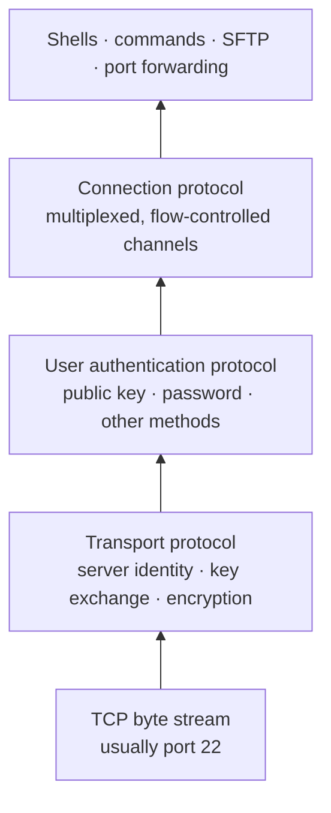

# Introduction

SSH is both an everyday tool and a layered network protocol. This course will teach both views together: the commands an operator uses and the protocol messages those commands produce.

At a high level, SSH builds upward from a reliable byte stream. Each protocol layer gives the next one a narrower, safer abstraction:



The major phases of a typical connection happen in this order. The authentication and connection-protocol messages are carried inside the encrypted transport established by key exchange.

```mermaid
sequenceDiagram
    participant C as SSH client
    participant S as SSH server
    C->>S: TCP connection
    C->>S: Client identification (SSH-2.0-...)
    S->>C: Server identification (SSH-2.0-...)
    C->>S: Client KEXINIT algorithm lists
    S->>C: Server KEXINIT algorithm lists
    C->>S: Client ephemeral key value
    S-->>C: Host key and signature
    Note over C,S: Verify server; derive keys; exchange NEWKEYS
    C->>S: Request ssh-userauth service
    C->>S: Prove user identity
    S-->>C: Authentication success
    C->>S: Open a session channel
    C->>S: Request a shell or command
    C<<->>S: Encrypted channel data
```

## What you will learn

- Connect to remote systems and verify their identities.
- Create and manage keys, configuration, agents, and jump hosts.
- Transfer files and forward network connections safely.
- Follow version exchange, algorithm negotiation, key exchange, authentication, and channels at the byte and message level.
- Harden and troubleshoot real SSH clients and servers.

The course is under construction. Future chapters will pair practical labs with references to the relevant protocol specifications.
