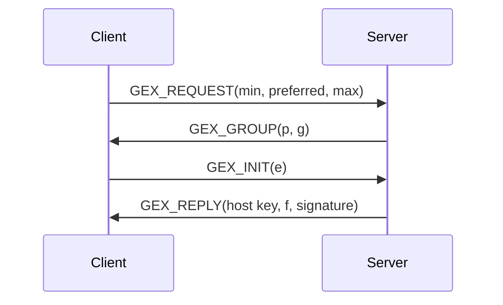

# Key-exchange method survey

This optional chapter compares key-exchange families at the protocol level:
which messages they send, how they encode public values, what they reject, and
what they feed into the exchange hash. The main
[Key exchange](./key-exchange.md) chapter covers the state transitions that
all of them share. The mathematics behind each family lives in
[Key agreement](./crypto-key-agreement.md) and
[Post-quantum key exchange](./crypto-post-quantum.md).

A method specification must define more than a cryptographic primitive. It
also defines the messages, public-value encodings, validation rules, shared
secret `K`, and exact exchange-hash inputs. Those details are part of the SSH
wire protocol.

## Common methods at a glance

Every method name fixes both the key-agreement construction and the hash used
for `H` and key derivation. Message numbers 30–49 are reused by every method,
so the same number means different messages under different methods.

| Method name | Key agreement | Hash | Messages (numbers) | `K` encoding |
| --- | --- | --- | --- | --- |
| `diffie-hellman-group14-sha256` | Fixed 2048-bit MODP group | SHA-256 | `KEXDH_INIT`, `KEXDH_REPLY` (30, 31) | `mpint` |
| `diffie-hellman-group16-sha512` | Fixed 4096-bit MODP group | SHA-512 | `KEXDH_INIT`, `KEXDH_REPLY` (30, 31) | `mpint` |
| `diffie-hellman-group-exchange-sha256` | Server-chosen MODP group | SHA-256 | `GEX_REQUEST`, `GEX_GROUP`, `GEX_INIT`, `GEX_REPLY` (34, 31, 32, 33) | `mpint` |
| `ecdh-sha2-nistp256` | ECDH on NIST P-256 | SHA-256 | `KEX_ECDH_INIT`, `KEX_ECDH_REPLY` (30, 31) | `mpint` |
| `curve25519-sha256` | X25519 | SHA-256 | `KEX_ECDH_INIT`, `KEX_ECDH_REPLY` (30, 31) | `mpint` |
| `sntrup761x25519-sha512` | Streamlined NTRU Prime KEM + X25519 | SHA-512 | `KEX_ECDH_INIT`, `KEX_ECDH_REPLY` (30, 31) | `string` |
| `mlkem768x25519-sha256` | ML-KEM-768 + X25519 | SHA-256 | `KEX_HYBRID_INIT`, `KEX_HYBRID_REPLY` (30, 31) | `string` |

The table is a map, not a recommendation list. For the names it covers,
[RFC 9142](https://www.rfc-editor.org/rfc/rfc9142.html) assigns
implementation guidance: `diffie-hellman-group14-sha256` is MUST;
`curve25519-sha256`, the three `ecdh-sha2-nistp*` methods, and
`diffie-hellman-group16-sha512` are SHOULD; group exchange with SHA-256 is
MAY. The SHA-1 methods `diffie-hellman-group1-sha1` and
`diffie-hellman-group-exchange-sha1` are SHOULD NOT, while
`diffie-hellman-group14-sha1` is kept as MAY for legacy interoperability and
should be placed last. The hybrid methods were specified later, in
[RFC 9941](https://www.rfc-editor.org/rfc/rfc9941.html) and
[RFC 10042](https://www.rfc-editor.org/rfc/rfc10042.html).

## Finite-field Diffie–Hellman

Classic Diffie–Hellman works in a group described by a large prime `p` and a
generator `g`. Each side sends one public number and keeps one private
exponent; both arrive at the same `K`, while an observer who sees only the
public numbers cannot feasibly compute it.
[Diffie–Hellman as a black box](./crypto-key-agreement.md#diffiehellman-as-a-black-box)
explains why, with a worked toy example.

[RFC 4253, Section 8](https://www.rfc-editor.org/rfc/rfc4253.html#section-8)
defines the original fixed-group flow:

```text
client → server  KEXDH_INIT   mpint e
server → client  KEXDH_REPLY  string K_S, mpint f, string signature of H
```

The group belongs to the algorithm definition, so selecting the method also
selects the group. Named groups such as group 14 (2048 bits) and group 16
(4096 bits) come from
[RFC 3526](https://www.rfc-editor.org/rfc/rfc3526.html), with the SHA-2 method
names defined in [RFC 8268](https://www.rfc-editor.org/rfc/rfc8268.html).
RFC 4253 requires both sides to reject `e` or `f` outside the range
`[1, p − 1]`. OpenSSH, for example, also rejects the degenerate values `1` and
`p − 1`.

Diffie–Hellman group exchange instead lets the client request a size range and
the server choose parameters:



The requested sizes, selected group, and public values enter the exchange
hash, so an attacker cannot substitute a weaker group without breaking the
signature. [RFC 4419](https://www.rfc-editor.org/rfc/rfc4419.html) defines the
wire flow. RFC 9142, following
[RFC 8270](https://www.rfc-editor.org/rfc/rfc8270.html), says that generated
groups smaller than 2048 bits MUST NOT be used, and that the SHA-1 variant
SHOULD NOT be used. The client should still check the size of the group it
receives: signing `H` proves the server chose it, not that it is large enough.

## Elliptic-curve Diffie–Hellman

ECDH has the same protocol role as finite-field DH but uses points in an
[elliptic-curve group](./crypto-key-agreement.md#elliptic-curves). Each
endpoint combines its private scalar with the peer's public point to obtain
the shared result. The public values are much shorter than finite-field ones
for comparable strength.

[RFC 5656](https://www.rfc-editor.org/rfc/rfc5656.html) integrates NIST-curve
ECDH into SSH:

```text
client → server  KEX_ECDH_INIT   string Q_C
server → client  KEX_ECDH_REPLY  string K_S, string Q_S, string signature of H
```

Every received public point must be validated as a point on the selected
curve; an invalid point makes key exchange fail. The shared x-coordinate is
converted to an integer and hashed as an `mpint` `K`.

`curve25519-sha256` uses [X25519](./crypto-key-agreement.md#x25519) with the
same two messages. [RFC 8731](https://www.rfc-editor.org/rfc/rfc8731.html)
changes the encodings and checks:

- `Q_C` and `Q_S` are 32-byte strings, and any other length aborts the
  exchange;
- an all-zero X25519 result aborts the exchange; and
- the 32-byte result is read as an unsigned big-endian integer and hashed as
  an `mpint` `K`.

These checks are specific to X25519. Another method can have different
encoding and validation rules. RFC 8731 also defines `curve448-sha512`, and
`curve25519-sha256@libssh.org` is an older name for the same method.

## Hybrid post-quantum exchange

A sufficiently capable quantum computer would break traditional DH and ECDH.
This creates a harvest-now, decrypt-later risk for traffic that must remain
secret for many years; see
[Why quantum computers matter](./crypto-post-quantum.md#why-quantum-computers-matter).

A post-quantum/traditional hybrid runs two exchanges side by side and combines
their secrets:

1. a traditional ECDH or X25519 exchange, for confidence in established
   cryptography; and
2. a post-quantum key-encapsulation mechanism (KEM), for resistance to known
   quantum attacks.

With the specified combiner, the goal is to remain secure if either component
remains secure. A KEM is not quite key agreement: the client generates a key
pair and sends the public key, and the server *encapsulates* a fresh secret
to it and returns a ciphertext that only the client can *decapsulate*.
[Key encapsulation as a black box](./crypto-post-quantum.md#key-encapsulation-as-a-black-box)
describes the three operations, and
[Hybrid key exchange in SSH](./crypto-post-quantum.md#hybrid-key-exchange-in-ssh)
shows how the secrets are combined.

### ML-KEM hybrids

[RFC 10042](https://www.rfc-editor.org/rfc/rfc10042.html) defines three
ML-KEM hybrid methods:

- `mlkem768nistp256-sha256`;
- `mlkem1024nistp384-sha384`; and
- `mlkem768x25519-sha256`.

Each side sends one string that concatenates both components:

```text
client → server  KEX_HYBRID_INIT   string C_INIT  = ML-KEM public key || ECDH public key
server → client  KEX_HYBRID_REPLY  string K_S,
                                   string S_REPLY = ML-KEM ciphertext || ECDH public key,
                                   string signature of H
```

For `mlkem768x25519-sha256`, `C_INIT` is 1,184 + 32 = 1,216 bytes and
`S_REPLY` is 1,088 + 32 = 1,120 bytes. The server checks the length of
`C_INIT` and the ML-KEM public-key checks from
[FIPS 203](https://csrc.nist.gov/pubs/fips/203/final) before encapsulating;
the client checks the length of `S_REPLY` before decapsulating. The classical
component keeps the validation rules of RFC 5656 or RFC 8731. Any failure,
including failed decapsulation, ends the exchange.

The SSH shared secret is:

```text
K = HASH(K_PQ || K_CL)
```

`K_PQ` is the ML-KEM secret and `K_CL` is the classical secret, re-encoded as
a fixed-length big-endian byte string rather than an `mpint`. The exchange
hash then uses `C_INIT` and `S_REPLY` where ECDH uses `Q_C` and `Q_S`.

### Streamlined NTRU Prime hybrid

[RFC 9941](https://www.rfc-editor.org/rfc/rfc9941.html) defines the deployed
`sntrup761x25519-sha512` method. It has the same broad role but reuses the
`KEX_ECDH_INIT` and `KEX_ECDH_REPLY` messages, with a 1,190-byte `Q_C` (an
sntrup761 public key followed by an X25519 value) and a 1,071-byte `Q_S` (an
sntrup761 ciphertext followed by an X25519 value). `K` is the SHA-512 hash of
the KEM secret concatenated with the X25519 secret. Its older
`sntrup761x25519-sha512@openssh.com` name is an alias for the same wire
method; the peers still need a name in common during negotiation.

### Why `K` becomes a string

Both RFCs encode the combined secret `K` as an SSH `string` when computing
the exchange hash and deriving keys. They preserve the hash output's fixed
length, rather than converting it to the `mpint` used by traditional methods.
Besides changing the transcript bytes, this avoids secret-dependent length
changes from integer sign padding or removal of leading zeros.

> A post-quantum key exchange protects session-secret establishment. If the
> host signature is traditional, server authentication is not thereby
> post-quantum. KEX and host-key algorithms are separate negotiation
> categories.

The hybrid messages are over a kilobyte in each direction, still well within
the packet sizes every implementation must accept; the
[size comparison](./crypto-post-quantum.md#size-comparison) lists them for
each method.

## What varies by method

The stable SSH pattern is: exchange public material, derive `K`, compute `H`,
and verify the server's signature. Method specifications vary at four points:

| Question | Examples of method-specific detail |
| --- | --- |
| Which messages are sent? | Fixed DH, group exchange, ECDH, and ML-KEM hybrids use different message sequences, even where numbers coincide. |
| How are public values encoded? | DH uses `mpint`; X25519 uses a 32-byte SSH string; hybrids concatenate two components in one string. |
| What must be rejected? | Out-of-range DH values, small groups, invalid points, wrong lengths, all-zero results, or failed decapsulation. |
| What enters `H`? | Group parameters and hybrid components add method-specific transcript fields; hybrids also encode `K` as a `string`. |

When reading a method RFC, find those four answers before comparing performance
or algorithm status. A value valid for one method must not be accepted under a
different method's rules.

## References

- [RFC 4253 — SSH Transport Layer Protocol](https://www.rfc-editor.org/rfc/rfc4253.html), Section 8.
- [RFC 4419 — Diffie–Hellman Group Exchange for SSH](https://www.rfc-editor.org/rfc/rfc4419.html).
- [RFC 5656 — Elliptic Curve Algorithm Integration in SSH](https://www.rfc-editor.org/rfc/rfc5656.html).
- [RFC 8268 — More MODP Diffie–Hellman Groups for SSH](https://www.rfc-editor.org/rfc/rfc8268.html).
- [RFC 8270 — Increase the SSH Minimum Recommended DH Modulus Size to 2048 Bits](https://www.rfc-editor.org/rfc/rfc8270.html).
- [RFC 8731 — SSH KEX Using Curve25519 and Curve448](https://www.rfc-editor.org/rfc/rfc8731.html).
- [RFC 9142 — SSH KEX Method Updates and Recommendations](https://www.rfc-editor.org/rfc/rfc9142.html).
- [RFC 9941 — Hybrid sntrup761/X25519 Key Exchange](https://www.rfc-editor.org/rfc/rfc9941.html).
- [RFC 10042 — ML-KEM PQ/T Hybrid Key Exchange for SSH](https://www.rfc-editor.org/rfc/rfc10042.html).
- [FIPS 203 — Module-Lattice-Based Key-Encapsulation Mechanism Standard](https://csrc.nist.gov/pubs/fips/203/final).
