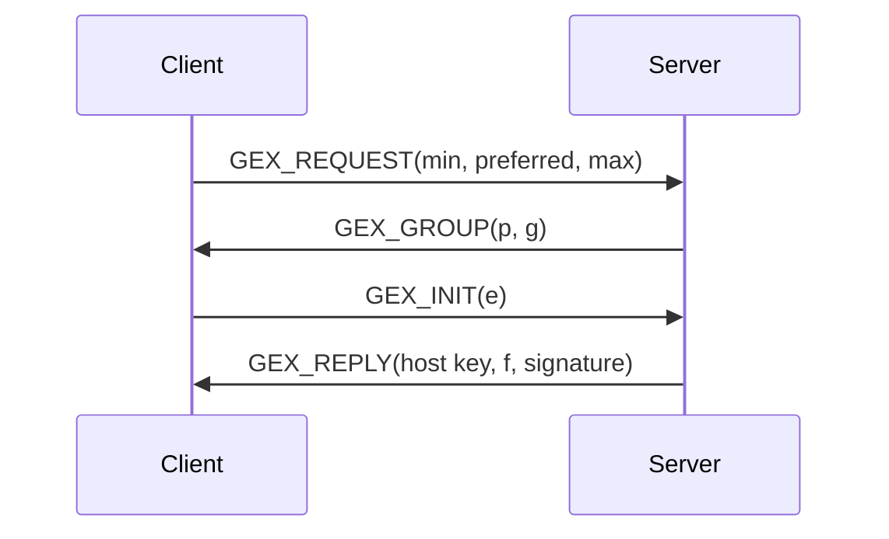

# Key-exchange method survey

This optional chapter compares key-exchange families at the protocol level.
[Key exchange](./key-exchange.md) covers the state transitions they all
share; [Key agreement](./crypto-key-agreement.md) and
[Post-quantum key exchange](./crypto-post-quantum.md) explain the
mathematics.

## What varies by method

Every method follows the same pattern: exchange public material, derive the
shared secret `K`, compute the exchange hash `H`, and verify the server's
signature over it. A method specification fills in four details, all of them
part of the wire protocol:

| Question | Examples of method-specific detail |
| --- | --- |
| Which messages are sent? | Fixed DH, group exchange, ECDH, and ML-KEM hybrids use different message sequences, even where numbers coincide. |
| How are public values encoded? | DH uses `mpint`; X25519 uses a 32-byte SSH string; hybrids concatenate two components in one string. |
| What must be rejected? | Out-of-range DH values, small groups, invalid points, wrong lengths, all-zero results, or failed decapsulation. |
| What enters `H`? | Group parameters and hybrid components add method-specific transcript fields; hybrids also encode `K` as a `string`. |

Find those four answers in a method RFC before comparing performance or
algorithm status. A value valid under one method must never be accepted under
another method's rules.

## Common methods at a glance

Each method name fixes both the key-agreement construction and the hash used
for `H` and key derivation. Message numbers 30–49 are reused by every method,
so the same number means different messages under different methods.

| Method name | Key agreement | Hash | Messages (numbers) | `K` encoding |
| --- | --- | --- | --- | --- |
| `diffie-hellman-group14-sha256` | Fixed 2048-bit MODP group | SHA-256 | `KEXDH_INIT`, `KEXDH_REPLY` (30, 31) | `mpint` |
| `diffie-hellman-group16-sha512` | Fixed 4096-bit MODP group | SHA-512 | `KEXDH_INIT`, `KEXDH_REPLY` (30, 31) | `mpint` |
| `diffie-hellman-group-exchange-sha256` | Server-chosen MODP group | SHA-256 | `GEX_REQUEST`, `GEX_GROUP`, `GEX_INIT`, `GEX_REPLY` (34, 31, 32, 33) | `mpint` |
| `ecdh-sha2-nistp256` | ECDH on NIST P-256 | SHA-256 | `KEX_ECDH_INIT`, `KEX_ECDH_REPLY` (30, 31) | `mpint` |
| `curve25519-sha256` | X25519 | SHA-256 | `KEX_ECDH_INIT`, `KEX_ECDH_REPLY` (30, 31) | `mpint` |
| `sntrup761x25519-sha512` | Streamlined NTRU Prime KEM + X25519 | SHA-512 | `KEX_ECDH_INIT`, `KEX_ECDH_REPLY` (30, 31) | `string` |
| `mlkem768x25519-sha256` | ML-KEM-768 + X25519 | SHA-256 | `KEX_HYBRID_INIT`, `KEX_HYBRID_REPLY` (30, 31) | `string` |

The table is a map, not a recommendation list.
[RFC 9142](https://www.rfc-editor.org/rfc/rfc9142.html) grades the
non-hybrid names: `diffie-hellman-group14-sha256` is MUST;
`curve25519-sha256`, the three `ecdh-sha2-nistp*` methods, and
`diffie-hellman-group16-sha512` are SHOULD; group exchange with SHA-256 is
MAY. Of the SHA-1 methods, `diffie-hellman-group1-sha1` and
`diffie-hellman-group-exchange-sha1` are SHOULD NOT, and
`diffie-hellman-group14-sha1` is MAY, for legacy interoperability only and
listed last. The hybrids came later, in
[RFC 9941](https://www.rfc-editor.org/rfc/rfc9941.html) and
[RFC 10042](https://www.rfc-editor.org/rfc/rfc10042.html).

## Finite-field Diffie–Hellman

Classic Diffie–Hellman works in a group defined by a large prime `p` and a
generator `g`. Each side sends one public number and keeps one private
exponent; both arrive at the same `K`, which an observer of the public
numbers cannot feasibly compute.
[Diffie–Hellman as a black box](./crypto-key-agreement.md#diffiehellman-as-a-black-box)
explains why, with a worked toy example.

[RFC 4253, Section 8](https://www.rfc-editor.org/rfc/rfc4253.html#section-8)
defines the fixed-group flow:

```text
client → server  KEXDH_INIT   mpint e
server → client  KEXDH_REPLY  string K_S, mpint f, string signature of H
```

The group is part of the method definition: group 14 (2048 bits) and group 16
(4096 bits) come from [RFC 3526](https://www.rfc-editor.org/rfc/rfc3526.html),
and [RFC 8268](https://www.rfc-editor.org/rfc/rfc8268.html) defines the SHA-2
method names. RFC 4253 requires both sides to reject `e` or `f` outside
`[1, p − 1]`; OpenSSH also rejects the degenerate values `1` and `p − 1`.

Group exchange instead lets the client request a size range and the server
choose the group:



[RFC 4419](https://www.rfc-editor.org/rfc/rfc4419.html) defines the flow. The
requested sizes, the group, and the public values all enter the exchange hash,
so an attacker cannot substitute a weaker group without breaking the
signature. RFC 9142, following
[RFC 8270](https://www.rfc-editor.org/rfc/rfc8270.html), forbids generated
groups smaller than 2048 bits. The client should still check the size of the
group it receives: the signature proves the server chose it, not that it is
large enough.

## Elliptic-curve Diffie–Hellman

ECDH plays the same protocol role using points in an
[elliptic-curve group](./crypto-key-agreement.md#elliptic-curves): each
endpoint combines its private scalar with the peer's public point. Public
values are much shorter than finite-field ones of comparable strength.

[RFC 5656](https://www.rfc-editor.org/rfc/rfc5656.html) defines ECDH on the
NIST curves:

```text
client → server  KEX_ECDH_INIT   string Q_C
server → client  KEX_ECDH_REPLY  string K_S, string Q_S, string signature of H
```

Each received point must be validated as lying on the selected curve, or the
exchange fails. The shared x-coordinate becomes `K`, encoded as an `mpint`.

`curve25519-sha256` uses [X25519](./crypto-key-agreement.md#x25519) with the
same two messages, but [RFC 8731](https://www.rfc-editor.org/rfc/rfc8731.html)
changes the encodings and checks:

- `Q_C` and `Q_S` must be 32-byte strings; any other length aborts the
  exchange;
- an all-zero X25519 result aborts the exchange;
- the 32-byte result is read as an unsigned big-endian integer and encoded as
  an `mpint` `K`.

RFC 8731 also defines `curve448-sha512`; `curve25519-sha256@libssh.org` is an
older name for `curve25519-sha256`.

## Hybrid post-quantum exchange

A sufficiently capable quantum computer would break DH and ECDH, which creates
a harvest-now, decrypt-later risk for traffic that must stay secret for years;
see
[Why quantum computers matter](./crypto-post-quantum.md#why-quantum-computers-matter).
A post-quantum/traditional hybrid runs a traditional ECDH or X25519 exchange
alongside a post-quantum key-encapsulation mechanism (KEM) and hashes the two
secrets together, `K = HASH(K_PQ || K_CL)`, so that `K` stays secret as long
as either component holds.
[Key encapsulation as a black box](./crypto-post-quantum.md#key-encapsulation-as-a-black-box)
and [Hybrid key exchange in SSH](./crypto-post-quantum.md#hybrid-key-exchange-in-ssh)
explain the design, and
[The wire view of `mlkem768x25519-sha256`](./crypto-post-quantum.md#the-wire-view-of-mlkem768x25519-sha256)
walks through the messages and checks.

### ML-KEM hybrids

[RFC 10042](https://www.rfc-editor.org/rfc/rfc10042.html) defines
`mlkem768x25519-sha256`, `mlkem768nistp256-sha256`, and
`mlkem1024nistp384-sha384`. They use new message names, `KEX_HYBRID_INIT` and
`KEX_HYBRID_REPLY`, each carrying one string that concatenates the ML-KEM
value and the ECDH public key. For `mlkem768x25519-sha256` these are exactly
1,216 bytes (client public keys) and 1,120 bytes (server ciphertext and
public key). The ML-KEM half follows
[FIPS 203](https://csrc.nist.gov/pubs/fips/203/final); the classical half
keeps the checks of RFC 5656 or RFC 8731; any failed check or decapsulation
ends the exchange.

### Streamlined NTRU Prime hybrid

[RFC 9941](https://www.rfc-editor.org/rfc/rfc9941.html) defines
`sntrup761x25519-sha512`, the first post-quantum default in OpenSSH. It reuses
the `KEX_ECDH_INIT` and `KEX_ECDH_REPLY` messages, with a 1,190-byte `Q_C` and
a 1,071-byte `Q_S`, and hashes with SHA-512. The older name
`sntrup761x25519-sha512@openssh.com` denotes the same wire method, but
negotiation still needs a name both peers list.

Both RFCs encode the combined `K` as an SSH `string` rather than an `mpint`,
which keeps its length fixed and changes the exchange-hash and key-derivation
inputs accordingly. The messages exceed a kilobyte in each direction, well
within the packet size every implementation must accept; the
[size comparison](./crypto-post-quantum.md#size-comparison) lists each method.

> A post-quantum key exchange protects session-secret establishment. If the
> host signature is traditional, server authentication is not post-quantum.
> KEX and host-key algorithms are separate negotiation categories.

## Check your understanding

1. Message number 30 arrives. What does it mean?
2. Why must a client check the size of a group-exchange group even though the
   group is covered by the signed exchange hash?
3. A peer sends a 31-byte `Q_C` for `curve25519-sha256`. What happens?
4. Why do the hybrid methods encode `K` as a `string`?
5. Does `mlkem768x25519-sha256` with an `ssh-ed25519` host key give
   post-quantum server authentication?

<details>
<summary>Answers</summary>

1. It depends on the negotiated method: `KEXDH_INIT`, `KEX_ECDH_INIT`,
   `KEX_HYBRID_INIT`, or the obsolete group-exchange request all use 30.
2. The signature proves the server chose the group, not that the group is
   strong. A malicious or misconfigured server could sign a small group.
3. The exchange aborts: RFC 8731 requires exactly 32 bytes.
4. The combined secret is a fixed-length hash output. Encoding it as a
   `string` keeps its length fixed and avoids secret-dependent `mpint` length
   changes.
5. No. The KEX protects the session secrets against a future quantum
   attacker, but the Ed25519 host signature is still a traditional signature.

</details>

## References

- [RFC 4253 — SSH Transport Layer Protocol](https://www.rfc-editor.org/rfc/rfc4253.html), Section 8.
- [RFC 4419 — Diffie–Hellman Group Exchange for SSH](https://www.rfc-editor.org/rfc/rfc4419.html).
- [RFC 5656 — Elliptic Curve Algorithm Integration in SSH](https://www.rfc-editor.org/rfc/rfc5656.html).
- [RFC 8268 — More MODP Diffie–Hellman Groups for SSH](https://www.rfc-editor.org/rfc/rfc8268.html).
- [RFC 8270 — Increase the SSH Minimum Recommended DH Modulus Size to 2048 Bits](https://www.rfc-editor.org/rfc/rfc8270.html).
- [RFC 8731 — SSH KEX Using Curve25519 and Curve448](https://www.rfc-editor.org/rfc/rfc8731.html).
- [RFC 9142 — SSH KEX Method Updates and Recommendations](https://www.rfc-editor.org/rfc/rfc9142.html).
- [RFC 9941 — Secure Shell (SSH) Key Exchange Method Using Hybrid Streamlined NTRU Prime sntrup761 and X25519 with SHA-512: sntrup761x25519-sha512](https://www.rfc-editor.org/rfc/rfc9941.html).
- [RFC 10042 — Post-Quantum/Traditional Hybrid Key Exchange with the Module-Lattice-Based Key-Encapsulation Mechanism for Use in SSH](https://www.rfc-editor.org/rfc/rfc10042.html).
- [FIPS 203 — Module-Lattice-Based Key-Encapsulation Mechanism Standard](https://csrc.nist.gov/pubs/fips/203/final).
