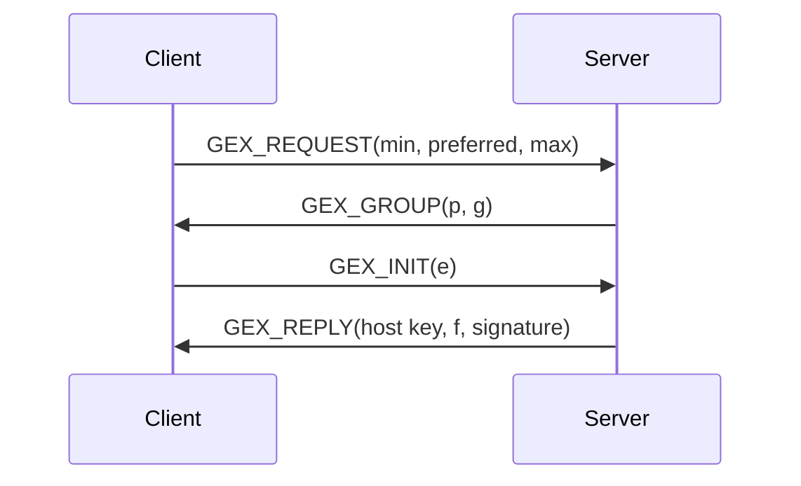

# Key-exchange method survey

This optional chapter compares key-exchange families. The main
[Key exchange](./key-exchange.md) chapter covers the state transitions that
all of them share.

A method specification must define more than a cryptographic primitive. It
also defines the messages, public-value encodings, validation rules, shared
secret `K`, and exact exchange-hash inputs. Those details are part of the SSH
wire protocol.

## Finite-field Diffie–Hellman

Classic Diffie–Hellman works in a group described by a large prime `p` and a
generator `g`. The client and server generate fresh private values and
exchange the corresponding public values:

```text
client public e = g^x mod p
server public f = g^y mod p
shared secret K = f^x mod p = e^y mod p
```

An observer sees `p`, `g`, `e`, and `f` but cannot feasibly recover `K`. This
claim depends on suitable parameters, unpredictable private values, and
validation of received public values.

[RFC 4253, Section 8](https://www.rfc-editor.org/rfc/rfc4253.html#section-8)
defines the original fixed-group flow. The group belongs to the algorithm
definition, so selecting the method also selects the group. The original SHA-1
methods are obsolete for new deployments; RFC 9142 gives current status
guidance.

Diffie–Hellman group exchange instead lets the client request a size range and
the server choose parameters:



The requested sizes, selected group, and public values enter the exchange
hash. [RFC 4419](https://www.rfc-editor.org/rfc/rfc4419.html) defines the wire
flow. RFC 9142 prohibits generated MODP groups below 2048 bits and deprecates
the SHA-1 variant.

## Elliptic-curve Diffie–Hellman

ECDH has the same protocol role as finite-field DH but uses points in an
elliptic-curve group. Each endpoint combines its private scalar with the
peer's public point to obtain the shared result.

[RFC 5656](https://www.rfc-editor.org/rfc/rfc5656.html) integrates NIST-curve
ECDH into SSH. A received public point must be valid for the selected group.
An invalid point makes key exchange fail.

`curve25519-sha256` uses X25519 and fixed-size byte strings:

```text
X25519(local 32-byte private scalar, peer 32-byte public value)
    -> 32-byte shared result
```

The peer value must have the expected length, and an all-zero result must make
the exchange fail. These checks are specific to X25519; another method can
have different encoding and validation rules. RFC 8731 defines the Curve25519
and Curve448 SSH methods.

## Hybrid post-quantum exchange

A sufficiently capable quantum computer would break traditional DH and ECDH.
This creates a harvest-now, decrypt-later risk for traffic that must remain
secret for many years.

A post-quantum/traditional hybrid combines two secrets:

1. a traditional ECDH secret, for confidence in established cryptography; and
2. a post-quantum KEM secret, for resistance to known quantum attacks.

With the specified combiner, the goal is to remain secure if either component
remains secure.

A key-encapsulation mechanism has three operations:

```text
KeyGen()       -> public key pk, secret key sk
Encaps(pk)     -> ciphertext ct, shared secret ss
Decaps(sk, ct) -> the same shared secret ss, or failure
```

In the SSH hybrid flow, the client creates the KEM key pair and sends its
public key. The server encapsulates a secret and returns the ciphertext. The
traditional ECDH exchange runs alongside it.

[RFC 10042](https://www.rfc-editor.org/rfc/rfc10042.html) defines three ML-KEM
hybrid methods:

- `mlkem768nistp256-sha256`;
- `mlkem1024nistp384-sha384`; and
- `mlkem768x25519-sha256`.

For these methods, the SSH shared secret is:

```text
K = HASH(K_PQ || K_CL)
```

`K_PQ` is the ML-KEM secret and `K_CL` is the classical ECDH secret. Exact
component lengths are checked before processing; an invalid input or failed
decapsulation ends the exchange.

[RFC 9941](https://www.rfc-editor.org/rfc/rfc9941.html) defines the deployed
`sntrup761x25519-sha512` method. It has the same broad role but different
KEM components and message lengths. It also hashes the concatenated secrets,
using SHA-512. Its older
`sntrup761x25519-sha512@openssh.com` name is an alias for the same wire method;
the peers still need a name in common during negotiation.

Both RFCs encode the combined secret `K` as an SSH `string` when computing
the exchange hash and deriving keys. They preserve the hash output's fixed
length, rather than converting it to the `mpint` used by traditional methods.
Besides changing the transcript bytes, this avoids secret-dependent length
changes from integer sign padding or removal of leading zeros.

> A post-quantum key exchange protects session-secret establishment. If the
> host signature is traditional, server authentication is not thereby
> post-quantum. KEX and host-key algorithms are separate negotiation
> categories.

## What varies by method

The stable SSH pattern is: exchange public material, derive `K`, compute `H`,
and verify the server's signature. Method specifications vary at four points:

| Question | Examples of method-specific detail |
| --- | --- |
| Which messages are sent? | Fixed DH, group exchange, and ECDH use different message sequences. |
| How are public values encoded? | DH uses `mpint`; X25519 uses a fixed-size SSH string. |
| What must be rejected? | Invalid groups, points, lengths, special values, or KEM ciphertexts. |
| What enters `H`? | Group parameters and hybrid components add method-specific transcript fields. |

When reading a method RFC, find those four answers before comparing performance
or algorithm status. A value valid for one method must not be accepted under a
different method's rules.

## References

- [RFC 4253 — SSH Transport Layer Protocol](https://www.rfc-editor.org/rfc/rfc4253.html), Section 8.
- [RFC 4419 — Diffie–Hellman Group Exchange for SSH](https://www.rfc-editor.org/rfc/rfc4419.html).
- [RFC 5656 — Elliptic Curve Algorithm Integration in SSH](https://www.rfc-editor.org/rfc/rfc5656.html).
- [RFC 8731 — SSH KEX Using Curve25519 and Curve448](https://www.rfc-editor.org/rfc/rfc8731.html).
- [RFC 9142 — SSH KEX Method Updates and Recommendations](https://www.rfc-editor.org/rfc/rfc9142.html).
- [RFC 9941 — Hybrid sntrup761/X25519 Key Exchange](https://www.rfc-editor.org/rfc/rfc9941.html).
- [RFC 10042 — ML-KEM PQ/T Hybrid Key Exchange for SSH](https://www.rfc-editor.org/rfc/rfc10042.html).
