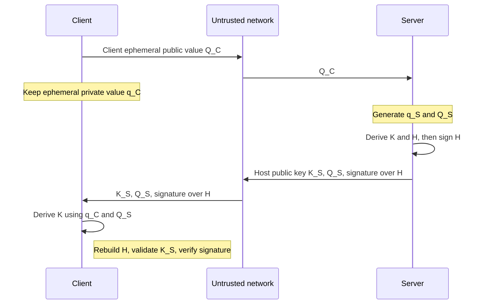
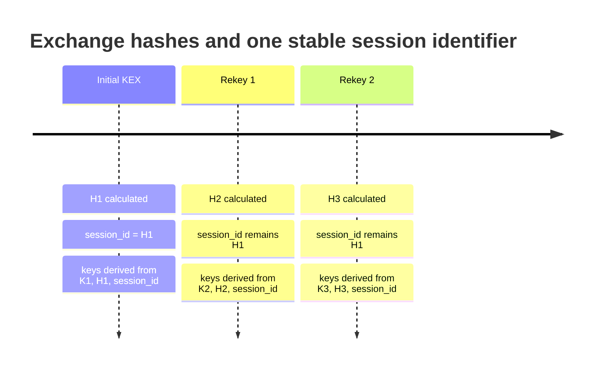
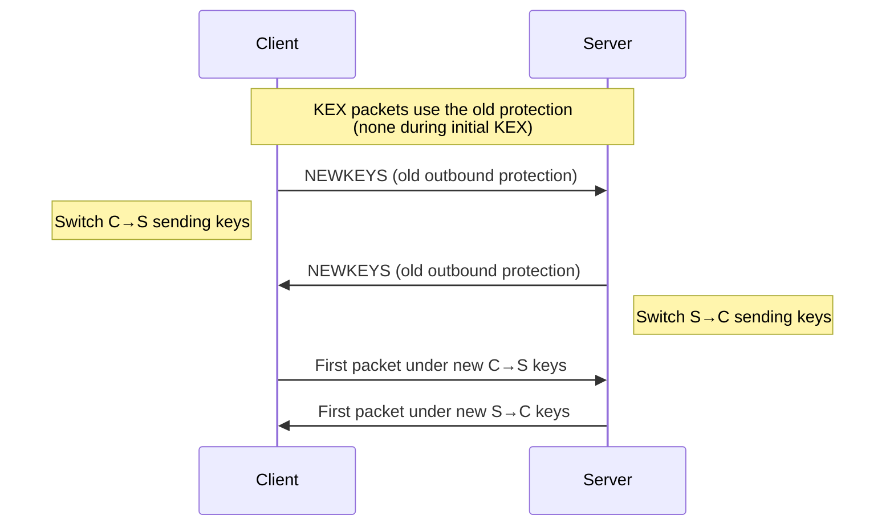
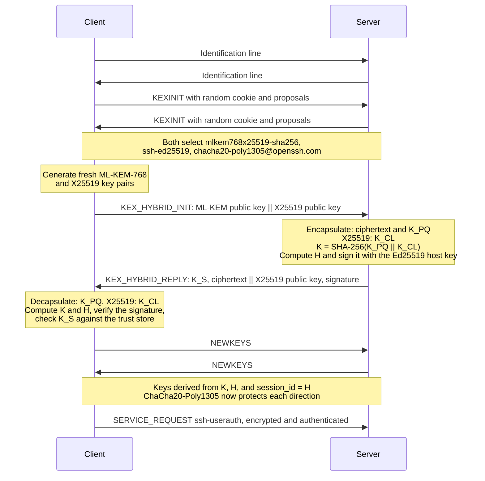
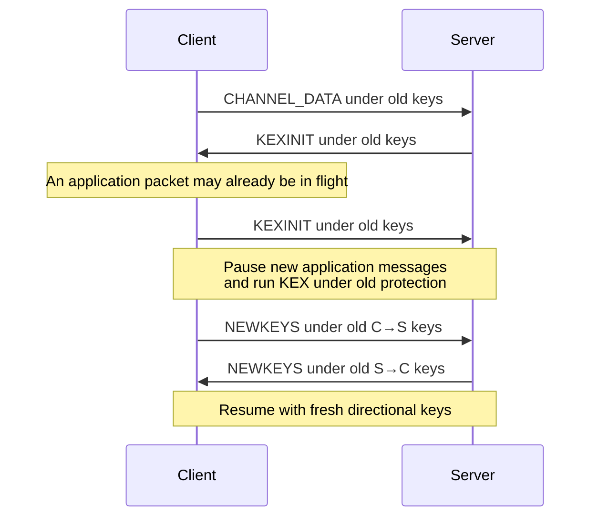

# Key exchange: from public values to protected traffic

Once negotiation has chosen a method, key exchange must do three things:
establish fresh shared secrets over an observable network, authenticate the
server and the handshake transcript, and derive independent keys for each
direction. It does **not** authenticate the login user; that is the job of the
[user-authentication protocol](./user-authentication.md) running over the
protected transport.

The cryptographic primitives appear here as black boxes, each linked to the
chapter that opens it.

## Three mechanisms, three questions

| Mechanism | Question it answers |
| --- | --- |
| Ephemeral [key agreement](./crypto-key-agreement.md) | Can both endpoints derive secret material that a passive observer cannot? |
| Host-key [signature](./crypto-signatures.md) | Did the holder of this host key approve this exact handshake? |
| Host-key [trust policy](./server-authentication.md#trust-models) | Is this key authorized to represent the host the user intended to reach? |

The first two are not enough if the client accepts any host key: an active
attacker can run its own key exchange and sign its own transcript with its
own key. The client's known-hosts or certificate policy supplies the missing
binding to an identity.

## The basic signed key-exchange flow

Many SSH KEX methods share the same two-message shape after `KEXINIT`:



The public values are safe to expose; the ephemeral private values and the
shared secret `K` never leave the endpoints.
[Key agreement](./crypto-key-agreement.md#diffiehellman-as-a-black-box) and
[key encapsulation](./crypto-post-quantum.md#key-encapsulation-as-a-black-box)
explain why. "Ephemeral" means generated for this exchange and then
discarded, so a later compromise of the server's long-term host key does not
reveal past traffic: this is
[*forward secrecy*](./crypto-key-agreement.md#forward-secrecy).

The host key has a different lifetime and purpose. It persists so clients can
recognize the server across connections, and its private half signs the
exchange hash.

## Key agreement is method-specific

Each method defines its own messages, public-value encodings, validation
rules, and derivation of `K`. Finite-field Diffie–Hellman, ECDH, and
post-quantum hybrids differ in all four, but they feed the same later stages:
compute the exchange hash, verify the host-key signature, derive traffic
keys. Each endpoint must follow the selected method's encodings and reject
invalid public values by that method's rules, never by those of a
similar-looking method. The optional
[Key-exchange method survey](./key-exchange-methods.md) compares the
families.

## The exchange hash: authenticate the whole decision

Agreeing on a secret is not enough. The client must also know that nobody
altered the version strings, proposals, host key, or ephemeral values on the
way. SSH serializes those values, together with `K`, and hashes them into the
exchange hash `H`, using the [hash](./crypto-hashes.md) named by the KEX
method (SHA-256 for `curve25519-sha256`).
[The exchange hash commits to the transcript](./crypto-hashes.md#the-exchange-hash-commits-to-the-transcript)
explains why signing a hash covers the whole transcript.

For classic DH
([RFC 4253, Section 8](https://www.rfc-editor.org/rfc/rfc4253.html#section-8))
and ECDH
([RFC 5656, Section 4](https://www.rfc-editor.org/rfc/rfc5656.html#section-4),
reused for X25519 by [RFC 8731](https://www.rfc-editor.org/rfc/rfc8731.html)),
the inputs are:

```text
Classic DH:  H = HASH(V_C || V_S || I_C || I_S || K_S || e   || f   || K)
ECDH:        H = HASH(V_C || V_S || I_C || I_S || K_S || Q_C || Q_S || K)
```

- `V_C`, `V_S`: the identification lines without CRLF;
- `I_C`, `I_S`: the exact `KEXINIT` payloads, starting with the message number;
- `K_S`: the encoded server public host key;
- `e`, `f`: the DH public values, encoded as `mpint`;
- `Q_C`, `Q_S`: the ephemeral public keys, encoded as `string`;
- `K`: the shared secret, encoded as `mpint`.

Each item is serialized with its SSH wire type before hashing; `||` is not raw
byte concatenation. Group exchange adds the requested sizes and the chosen
group, and hybrid post-quantum methods hash their combined messages and encode
`K` as a `string` (see
[What varies by method](./key-exchange-methods.md#what-varies-by-method)). The
security role of `H` is the same for all of them.

Because both proposals are hashed, an attacker cannot delete a stronger shared
algorithm from the lists to force a weaker choice: client and server would
hash different `KEXINIT` payloads, and signature verification would fail.

### The host-key signature and the trust decision

The server signs `H` with its host private key, and the client verifies the
signature with `K_S` from the reply. This proves that one entity produced the
KEX reply and holds the private key matching `K_S`. The negotiated host-key
algorithm, such as `ssh-ed25519` or `rsa-sha2-256`, fixes the
[signature scheme](./crypto-signatures.md#signatures-as-a-black-box) and its
encoding.

Separately, the client must decide that `K_S` is acceptable for the intended
host: a pinned `known_hosts` entry, a host certificate from a trusted CA, a
DNSSEC-validated SSHFP record, or a fingerprint checked through an
independent channel. [Server authentication](./server-authentication.md)
covers these. The two checks may happen in either order, but both are
required. A valid signature made with an attacker's key is still a valid
signature; it says nothing about whose key it is.

## From `K` and `H` to traffic keys

The SSH key derivation hashes `K` and `H` with the session identifier and a
one-letter label, `A` through `F`, producing an initial IV, an encryption key,
and an integrity key for each direction
([RFC 4253, Section 7.2](https://www.rfc-editor.org/rfc/rfc4253.html#section-7.2)).
[Key derivation in SSH](./crypto-hashes.md#key-derivation-in-ssh) gives the
exact construction, including how it produces more bytes than one hash output.

The negotiated algorithms decide which of the six values they use and how many
bytes they take. An AEAD cipher leaves both integrity keys unused, and
`chacha20-poly1305@openssh.com` also ignores the IVs. Separate keys per
direction keep each direction's cipher state independent and stop a packet
from being reflected back as if it came from the other side.

### Session identifier versus exchange hash

The first exchange hash becomes the session identifier:

```text
session_id = H_first
```

A rekey produces fresh `K` and `H`, but `session_id` stays `H_first` for the
whole connection.



The stable identifier binds later protocol steps to this connection even as
the transport keys change. Public-key user authentication signs it, and
OpenSSH's [host-key rotation](./server-authentication.md#host-key-rotation)
proofs cover it.

## Activating keys with `SSH_MSG_NEWKEYS`

Derived keys need a defined switch-over point. `SSH_MSG_NEWKEYS` marks it,
independently for each direction:

- after *sending* `NEWKEYS`, an endpoint protects its outbound packets with
  the new keys;
- after *receiving* `NEWKEYS`, it expects its inbound packets under the new
  keys.



The two messages may cross, so for a moment one direction uses new keys while
the other still uses old ones. Under
[strict KEX](./version-and-negotiation.md#strict-key-exchange), each
direction's sequence number also resets at its `NEWKEYS`. Extension
information and the `ssh-userauth` service request follow under the new keys
([RFC 4253, Section 7.3](https://www.rfc-editor.org/rfc/rfc4253.html#section-7.3);
[RFC 8308](https://www.rfc-editor.org/rfc/rfc8308.html)).

## Putting it together: one modern connection

The following initial exchange uses the algorithms a current OpenSSH client
and server select by default: `mlkem768x25519-sha256` key exchange, an
`ssh-ed25519` host key, and `chacha20-poly1305@openssh.com` in both
directions.



Each step has one cryptographic job:

| Step | Primitive | Explained in |
| --- | --- | --- |
| Cookies and ephemeral private values | Secure random generation | [Randomness](./cryptography-primer.md#randomness) |
| `KEX_HYBRID_INIT` and `KEX_HYBRID_REPLY` | ML-KEM-768 encapsulation plus X25519 agreement | [Hybrid key exchange in SSH](./crypto-post-quantum.md#hybrid-key-exchange-in-ssh), [X25519](./crypto-key-agreement.md#x25519) |
| Combining secrets and computing `H` | SHA-256 | [Hashes, MACs, and key derivation](./crypto-hashes.md) |
| Host-key proof | Ed25519 signature over `H` | [Ed25519](./crypto-signatures.md#ed25519) |
| Traffic keys | SSH key derivation with SHA-256 | [Key derivation in SSH](./crypto-hashes.md#key-derivation-in-ssh) |
| Packet protection | ChaCha20-Poly1305 AEAD | [ChaCha20-Poly1305](./crypto-symmetric.md#chacha20-poly1305) |

The trust decision about `K_S` has no primitive of its own: it is local
policy, covered in [Server authentication](./server-authentication.md).

## Rekeying a live connection

Either endpoint can run a new key exchange at any time by sending a fresh
`SSH_MSG_KEXINIT`, without a new TCP connection or new user authentication.
Reasons include limiting how much traffic one set of keys protects, refreshing
long-lived connections, and moving to an algorithm both peers now prefer. RFC
4253 recommends rekeying after each gigabyte or hour, whichever comes first;
endpoints may be stricter, and some ciphers impose tighter
[usage limits](./crypto-symmetric.md#usage-limits-and-rekeying).

During a rekey:

- KEX packets are protected by the *old* keys until each direction's
  `NEWKEYS`;
- client and server roles stay the same;
- fresh `K` and `H` are produced, but the session identifier does not change;
- from sending its own `KEXINIT` until sending its own `NEWKEYS`, a peer sends
  only transport, negotiation, and KEX messages, pausing authentication and
  connection traffic
  ([RFC 4253, Section 7.1](https://www.rfc-editor.org/rfc/rfc4253.html#section-7.1)).

The pause applies to what a peer *sends*, not what it receives. Application
packets the peer sent before its `KEXINIT` may still be in flight, so after
sending `KEXINIT` the client must keep accepting channel data until the
server's `KEXINIT` arrives; the ordered stream guarantees nothing older
follows it. After sending its `NEWKEYS`, a peer may resume higher-layer
traffic under its new outbound keys without waiting for the other direction.



## Security invariants

Across the initial exchange and every rekey:

- ephemeral private values are unpredictable and never sent;
- received public values pass the encoding, length, group-membership, and
  special-value checks of the selected method;
- the exchange hash uses the exact on-wire values and type encodings;
- host signature validity and host identity trust are checked separately;
- each direction gets independent keys and switches at its own `NEWKEYS`;
- the session identifier is set once, from the first `H`;
- a rekey keeps roles and the session identifier but replaces traffic keys.

## Check your understanding

1. Which key is usually persistent: an ephemeral ECDH key or a server host
   key?
2. What does a valid signature over `H` prove, and what does it not prove by
   itself?
3. Why are both `KEXINIT` payloads included in `H`?
4. Why must public-value validation follow the selected method's rules?
5. The client has sent `NEWKEYS` but has not received the server's `NEWKEYS`.
   Which new keys are active?
6. Does the session identifier change after rekeying?

<details>
<summary>Answers</summary>

1. The server host key. Ephemeral ECDH keys are generated for one KEX.
2. It proves that the holder of the private key matching `K_S` approved that
   exchange hash. A separate trust check decides whether `K_S` represents the
   intended host.
3. To bind algorithm negotiation into the authenticated transcript, so that
   tampering or a downgrade makes signature verification fail.
4. Methods use different encodings, groups, and invalid-value checks. A value
   acceptable under another method's rules may be unsafe or malformed here.
5. Only the client's outbound keys. Its inbound direction uses the old keys
   until the server's `NEWKEYS` arrives.
6. No. It remains the first exchange hash for the life of the connection.

</details>

## References

- [RFC 4253 — SSH Transport Layer Protocol](https://www.rfc-editor.org/rfc/rfc4253.html), Sections 7–9.
- [RFC 5656 — Elliptic Curve Algorithm Integration in SSH](https://www.rfc-editor.org/rfc/rfc5656.html), Section 4.
- [RFC 8731 — SSH KEX Using Curve25519 and Curve448](https://www.rfc-editor.org/rfc/rfc8731.html).
- [RFC 8308 — Extension Negotiation in SSH](https://www.rfc-editor.org/rfc/rfc8308.html).
- [RFC 10042 — Post-Quantum/Traditional Hybrid Key Exchange with the Module-Lattice-Based Key-Encapsulation Mechanism for Use in SSH](https://www.rfc-editor.org/rfc/rfc10042.html).
- [Key-exchange method survey](./key-exchange-methods.md) for the other method RFCs.
