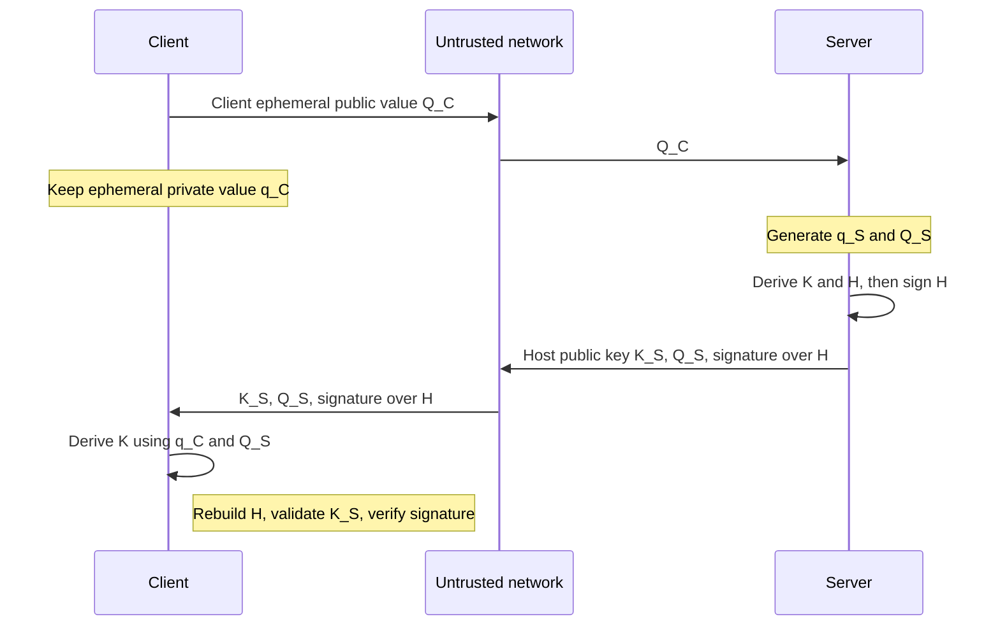
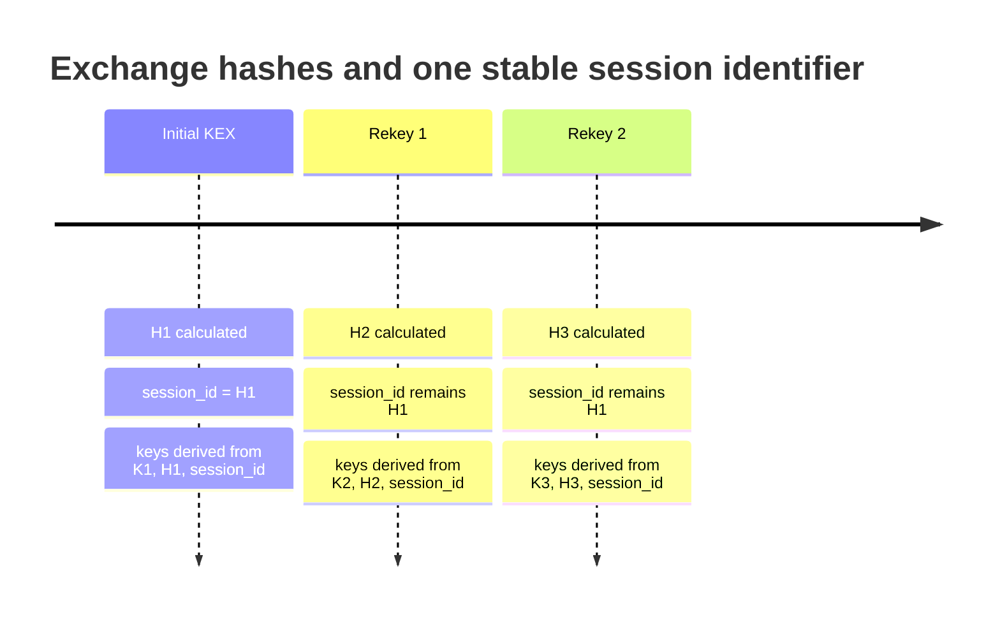
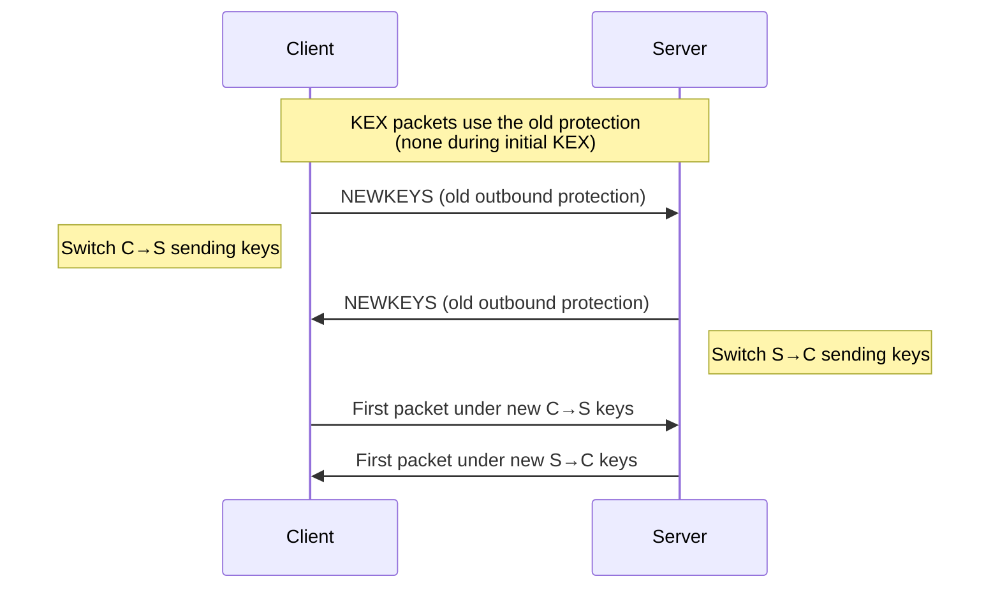
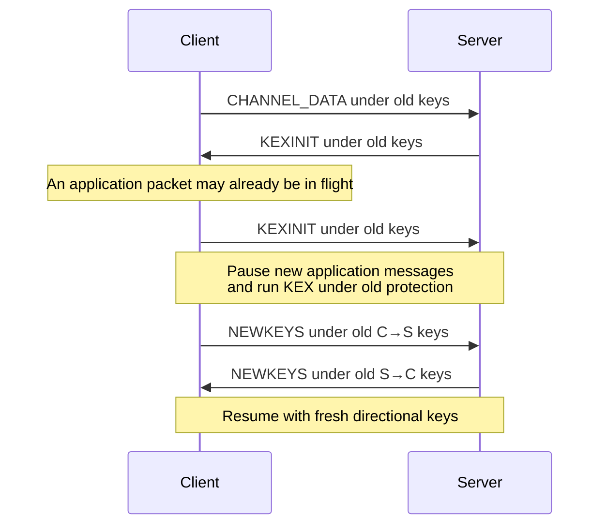
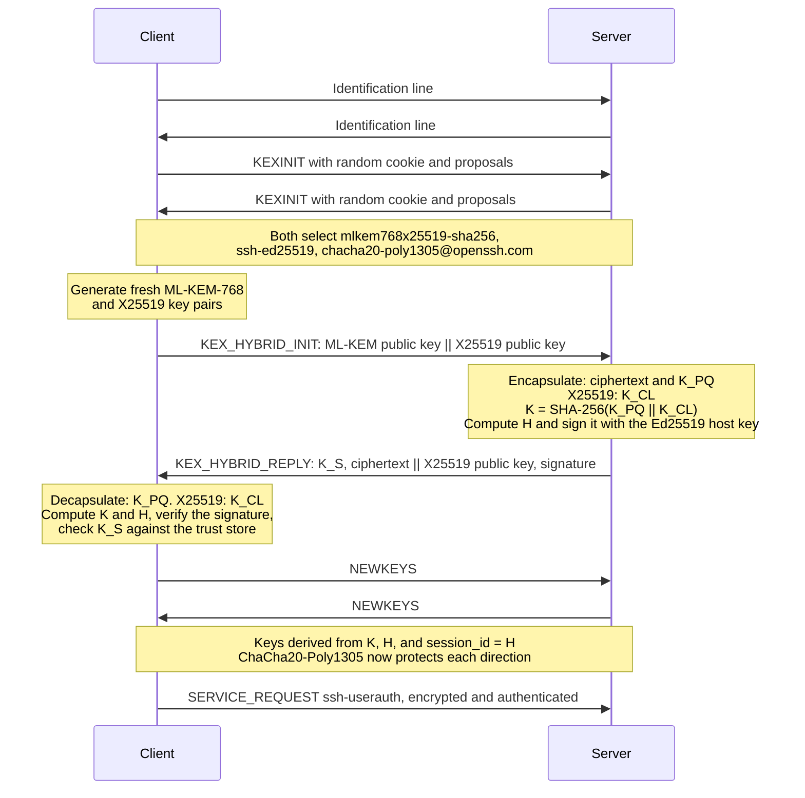

# Key exchange: from public values to protected traffic

Algorithm negotiation chooses a key-exchange method. Running that method must
then accomplish three different jobs:

- establish fresh secret material over an observable network;
- authenticate the server and the handshake transcript; and
- derive independent keys for protecting packets in both directions.

It does **not** authenticate the login user. User authentication is a later
SSH protocol layered over this protected transport.

This chapter treats cryptographic primitives as black boxes: what goes in,
what comes out, and what security role the output plays. Each box links to
the cryptography chapter that opens it, and the linked standards contain the
exact encodings.

## Three mechanisms, three questions

Key exchange has three separate jobs.

| Mechanism | Question it answers |
| --- | --- |
| Ephemeral [key agreement](./crypto-key-agreement.md) | Can both endpoints derive secret material that a passive observer cannot? |
| Host-key [signature](./crypto-signatures.md) | Did the holder of this host key approve this exact handshake? |
| Host-key [trust policy](./server-authentication.md#trust-models) | Is this key authorized to represent the host the user intended to reach? |

Passing the first two checks is not enough if the client accepts any host key.
An active attacker can run its own key exchange and sign its own transcript
with its own key. The client's known-hosts or certificate policy supplies the
missing identity binding.

## The basic signed key-exchange flow

Many SSH KEX methods fit the same two-message shape after `KEXINIT`:



The public values are safe to expose. The ephemeral private values and the
resulting shared secret are not transmitted. “Ephemeral” means freshly
generated for this exchange and discarded afterwards. Compromise of the
server's long-term host private key at a later date should therefore not reveal
old traffic secrets; this property is called
[*forward secrecy*](./crypto-key-agreement.md#forward-secrecy).

The server host key serves a different lifetime and purpose. It is normally
persistent so clients can recognize the server across connections, and its
private half signs the exchange hash.

## Key agreement is method-specific

The negotiated method defines how the endpoints exchange public material,
validate peer inputs, and derive the shared secret `K`. Finite-field
Diffie–Hellman, ECDH, and post-quantum hybrid methods use different messages
and checks, but they feed the same later SSH stages: compute the exchange hash,
verify the host-key signature, and derive traffic keys.
[Key agreement](./crypto-key-agreement.md#diffiehellman-as-a-black-box) and
[key encapsulation](./crypto-post-quantum.md#key-encapsulation-as-a-black-box)
explain why the public values can be exposed while `K` stays secret.

The protocol invariant is exactness. Each endpoint must follow the selected
method's wire encodings and reject invalid public values. It must not import
validation rules from a similar-looking method.

The optional [Key-exchange method survey](./key-exchange-methods.md) compares
fixed-group DH, group exchange, ECDH, X25519, and standardized hybrid methods.

## The exchange hash: authenticate the whole decision

Deriving the same secret is not enough. The client must know that an attacker
did not alter the version strings, proposals, host key, or ephemeral values.
SSH serializes those values and hashes them into the exchange hash `H`. The
[hash function](./crypto-hashes.md) is the one named by the KEX method, such
as SHA-256 for `curve25519-sha256`.

For the classic DH flow in
[RFC 4253, Section 8](https://www.rfc-editor.org/rfc/rfc4253.html#section-8),
and for the ECDH flow in
[RFC 5656, Section 4](https://www.rfc-editor.org/rfc/rfc5656.html#section-4),
which [RFC 8731](https://www.rfc-editor.org/rfc/rfc8731.html) reuses for
X25519, the inputs are:

```text
Classic DH:  H = HASH(V_C || V_S || I_C || I_S || K_S || e   || f   || K)
ECDH:        H = HASH(V_C || V_S || I_C || I_S || K_S || Q_C || Q_S || K)
```

Where:

- `V_C`, `V_S` are the identification lines without CRLF;
- `I_C`, `I_S` are the exact `KEXINIT` payloads, starting with their message
  number;
- `K_S` is the encoded server public host key;
- `e`, `f` are the client and server DH public values, encoded as `mpint`;
- `Q_C`, `Q_S` are the client and server ephemeral public keys, encoded as
  `string`; and
- `K` is the shared secret, encoded as `mpint` in both forms.

This is conceptual notation rather than raw byte-array concatenation: each item
is serialized with its SSH wire type before hashing. The two forms differ only
in the ephemeral values. Group exchange also hashes the requested sizes and
the chosen group, and hybrid post-quantum methods hash their combined
messages and encode `K` as a `string`; see the
[method survey](./key-exchange-methods.md#what-varies-by-method). Each method
therefore has its own wire definition of `H`, even though its security role is
the same.

Because the proposals are included, an attacker cannot silently delete a
stronger shared algorithm from the lists to force a weaker mutual choice. The
server and client would hash different `KEXINIT` payloads and signature
verification would fail.

### The host-key signature and the trust decision

The server signs `H` with its host private key. The client verifies the
signature using `K_S`, the public host key carried in the reply. This proves
that one entity controlled both the KEX response and the private key matching
`K_S`. The negotiated host-key algorithm, such as `ssh-ed25519` or
`rsa-sha2-256`, fixes the
[signature scheme](./crypto-signatures.md#signatures-as-a-black-box) and its
encoding.

The client must then establish that `K_S` is acceptable for the intended host,
for example by:

- matching a previously pinned key in a known-hosts database;
- validating an SSH host certificate under a trusted certification key; or
- asking a user to verify a fingerprint through an independent channel.

Skipping or merging these two gates causes security bugs. A valid signature
made by an attacker's own key is still a valid signature; it is not evidence
that the key belongs to the requested server. The two checks may occur in
either order, but both properties are required for an authenticated KEX.

## From `K` and `H` to traffic keys

The KEX method outputs the shared secret `K` and exchange hash `H`. The SSH
key derivation hashes them together with the session identifier and a
one-letter label, `A` through `F`, to produce six values: an initial IV, an
encryption key, and an integrity key for each direction
([RFC 4253, Section 7.2](https://www.rfc-editor.org/rfc/rfc4253.html#section-7.2)).
[Key derivation in SSH](./crypto-hashes.md#key-derivation-in-ssh) shows the
construction, including how it extends a value that needs more bytes than one
hash output.

All six values are derived after every exchange, but the negotiated
algorithms decide which ones they use and how many bytes they take. An AEAD
cipher, for example, leaves both integrity keys unused, and
`chacha20-poly1305@openssh.com` also ignores the IVs.

Independent directional keys prevent a packet sent in one direction from
being replayed as if it came from the other and keep each direction's cipher
state separate.

### Session identifier versus exchange hash

On the first KEX:

```text
session_id = H_first
```

On a rekey, a new exchange produces fresh `K` and a new `H`, but
`session_id` remains `H_first` for the entire SSH connection.



The stable identifier binds later protocols—most notably public-key user
authentication—to this SSH connection even as its transport keys change. The
latest `H` never replaces it.

## Activating keys with `SSH_MSG_NEWKEYS`

Key derivation alone does not define the byte at which an endpoint should
switch algorithms. `SSH_MSG_NEWKEYS` is the boundary marker, independently for
each direction.

- Immediately after sending `NEWKEYS`, use the new algorithms and keys for
  subsequent outbound packets.
- When receiving `NEWKEYS`, use the new algorithms and keys for subsequent
  inbound packets.



The messages may cross on the network, creating a brief interval in which one
direction uses new keys while the other still uses old keys. Under strict KEX,
each direction's packet sequence number is also reset just after its
corresponding `NEWKEYS` boundary.

Only after key activation can extension information and higher-layer service
requests proceed in the newly protected transport. See [RFC 4253, Section
7.3](https://www.rfc-editor.org/rfc/rfc4253.html#section-7.3) and [RFC
8308](https://www.rfc-editor.org/rfc/rfc8308.html) for the post-KEX extension
exchange.

## Rekeying a live connection

SSH can repeat key exchange without opening a new TCP connection or repeating
user authentication. Either endpoint starts a rekey by sending a new
`SSH_MSG_KEXINIT`; the other responds with its proposal.

Why rekey?

- limit how much traffic is protected by one set of keys;
- replace keys after an endpoint-defined time or byte count;
- negotiate a new algorithm policy that both endpoints now offer; or
- refresh the cryptographic state of a long-lived connection.

RFC 4253 recommends rekeying after one gigabyte or one hour, whichever comes
first. This is a default recommendation, not a universal limit. Endpoints may
use stricter policy, and selected algorithms can impose stricter limits; see
[Usage limits and rekeying](./crypto-symmetric.md#usage-limits-and-rekeying).

During rekey:

- the KEX packets are protected by the *old* algorithms until each directional
  `NEWKEYS` transition;
- client and server roles do not change;
- fresh `K` and `H` values are produced;
- the original session identifier does not change; and
- each sender pauses new authentication and connection messages from its own
  `KEXINIT` until it sends its own `NEWKEYS`.

A peer can receive an arbitrary number of application packets that were
already in flight before it sees the other side's `KEXINIT`. This is why the
rekey transition is not an instantaneous, connection-wide boundary.

For example, after sending `KEXINIT`, the client must still accept channel
data sent before the server's `KEXINIT`. Once the server's `KEXINIT` arrives,
that earlier data is finished because the underlying stream preserves order.
After sending `NEWKEYS`, a peer can resume higher-layer messages under its new
outbound keys without waiting for the other direction to switch. The exact
send restriction is in
[RFC 4253 section 7.1](https://www.rfc-editor.org/rfc/rfc4253#section-7.1).



Crossed `NEWKEYS` messages, simultaneous KEX initiation, and application data
already in flight all follow from the two independent directions shown above.

## Putting it together: one modern connection

The following sequence shows an initial exchange with algorithms that a
current OpenSSH client and server select by default: the hybrid
`mlkem768x25519-sha256` key exchange, an `ssh-ed25519` host key, and
`chacha20-poly1305@openssh.com` packet protection in both directions.



Every box in that picture has one cryptographic job:

| Step | Primitive | Explained in |
| --- | --- | --- |
| Cookies and ephemeral private values | Secure random generation | [Randomness](./cryptography-primer.md#randomness) |
| `KEX_HYBRID_INIT` and `KEX_HYBRID_REPLY` | ML-KEM-768 encapsulation plus X25519 agreement | [Hybrid key exchange in SSH](./crypto-post-quantum.md#hybrid-key-exchange-in-ssh), [X25519](./crypto-key-agreement.md#x25519) |
| Combining secrets and computing `H` | SHA-256 | [Hashes, MACs, and key derivation](./crypto-hashes.md) |
| Host-key proof | Ed25519 signature over `H` | [Ed25519](./crypto-signatures.md#ed25519) |
| Traffic keys | SSH key derivation with SHA-256 | [Key derivation in SSH](./crypto-hashes.md#key-derivation-in-ssh) |
| Packet protection | ChaCha20-Poly1305 AEAD | [ChaCha20-Poly1305](./crypto-symmetric.md#chacha20-poly1305) |

The trust decision about `K_S` is the one step with no cryptographic
primitive of its own: it is local policy, covered in
[Server authentication](./server-authentication.md).

## Security invariants

The essential invariants across initial KEX and rekey are:

- ephemeral private values are unpredictable and are never sent;
- received public values have the exact encoding, length, group membership,
  and special-value checks required by the selected method;
- the exchange hash uses exact on-wire transcript values and type encodings;
- host signature validity and host identity trust are distinct properties;
- key derivation produces independent material for both directions;
- sending and receiving switch keys at their own `NEWKEYS` boundaries;
- the session identifier is assigned once, from the first `H`;
- a rekey retains roles and the session identifier but replaces traffic keys.

## Check your understanding

1. Which key is usually persistent: an ephemeral ECDH key or a server host
   key?
2. What does a valid signature over `H` prove, and what does it not prove by
   itself?
3. Why are both `KEXINIT` payloads included in `H`?
4. Why must public-value validation follow the selected method's rules?
5. The client has sent `NEWKEYS` but has not received the server's `NEWKEYS`.
   Which new keys are active?
6. Does the session identifier change after rekeying?

<details>
<summary>Answers</summary>

1. The server host key. Ephemeral ECDH keys are freshly generated for a KEX.
2. It proves that the holder of the private key corresponding to `K_S`
   approved that exchange hash. A separate trust check establishes whether
   `K_S` represents the intended host.
3. To bind algorithm negotiation into the authenticated transcript and detect
   modification or downgrade.
4. Methods use different encodings, groups, and invalid-value checks. A value
   accepted under another method's rules may be unsafe or malformed here.
5. New keys are active for the client's outbound direction. Its inbound
   direction still uses the old keys until it receives server `NEWKEYS`.
6. No. It remains the first exchange hash for the life of the connection.

</details>

## Primary references

- [RFC 4253 — SSH Transport Layer Protocol](https://www.rfc-editor.org/rfc/rfc4253.html), Sections 7–9.
- [RFC 8308 — Extension Negotiation in SSH](https://www.rfc-editor.org/rfc/rfc8308.html).
- [Key-exchange method survey](./key-exchange-methods.md) — optional details and method RFCs.
