# Key exchange: from public values to protected traffic

Algorithm negotiation chooses a key-exchange method. Running that method must
then accomplish three different jobs:

- establish fresh secret material over an observable network;
- authenticate the server and the handshake transcript; and
- derive independent keys for protecting packets in both directions.

It does **not** authenticate the login user. User authentication is a later
SSH protocol layered over this protected transport.

This chapter treats cryptographic primitives as black boxes: what goes in,
what comes out, and what security role the output plays. The linked standards
contain the mathematical and encoding details for deeper study.

## Learning objectives

By the end of this chapter, you should be able to:

- distinguish an ephemeral KEX key from a persistent server host key;
- describe finite-field DH, ECDH/X25519, and hybrid post-quantum exchange in
  terms of their inputs and outputs;
- explain how the exchange hash binds negotiation to the key exchange;
- separate host-key signature verification from host-key trust;
- follow the directional `NEWKEYS` transition; and
- explain what changes, and what stays fixed, during a rekey.

## Three mechanisms, three questions

Key exchange is easier to reason about when its jobs are kept separate.

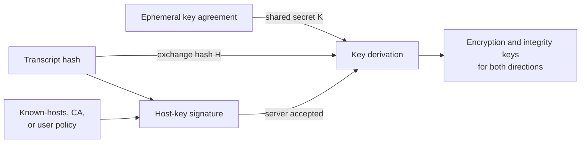

| Mechanism | Question it answers |
| --- | --- |
| Ephemeral key agreement | Can both endpoints derive secret material that a passive observer cannot? |
| Host-key signature | Did the holder of this host key approve this exact handshake? |
| Host-key trust policy | Is this key authorised to represent the host the user intended to reach? |

Passing the first two checks is not enough if the client accepts any host key.
An active attacker can run its own key exchange and sign its own transcript
with its own key. The client's known-hosts or certificate policy supplies the
missing identity binding.

## The basic signed key-exchange flow

Many SSH KEX methods fit the same two-message shape after `KEXINIT`:

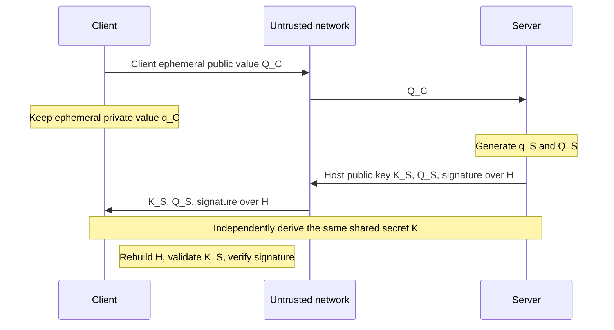

The public values are safe to expose. The ephemeral private values and the
resulting shared secret are not transmitted. “Ephemeral” means freshly
generated for this exchange and discarded afterwards. Compromise of the
server's long-term host private key at a later date should therefore not reveal
old session secrets; this property is called *forward secrecy*.

The server host key serves a different lifetime and purpose. It is normally
persistent so clients can recognise the server across connections, and its
private half signs the exchange hash.

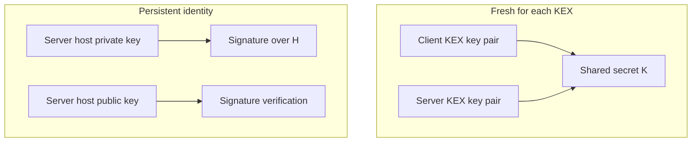

## Key agreement as a black box

### Finite-field Diffie–Hellman

Classic Diffie–Hellman works in a mathematical group described by a large
prime `p` and generator `g`.

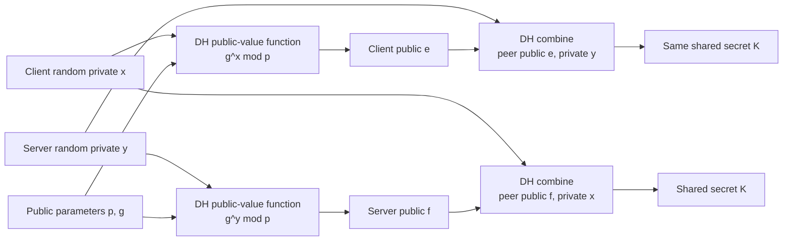

Black-box interface:

```text
generate_private()                         -> private value
make_public(parameters, private)           -> public value
combine(parameters, private, peer_public)  -> shared secret K
```

The useful property is that both sides get the same `K`, while an observer who
only sees `p`, `g`, `e`, and `f` cannot feasibly recover it. The security claim
also depends on fresh, unpredictable private values and validation of received
public values.

[RFC 4253, Section 8](https://www.rfc-editor.org/rfc/rfc4253.html#section-8)
defines the original fixed-group flow. Its historical SHA-1 methods should not
be copied into a new design; [RFC 9142](https://www.rfc-editor.org/rfc/rfc9142.html)
updates algorithm-status guidance, including `diffie-hellman-group14-sha256`
as a mandatory-to-implement replacement in that algorithm family.

#### Fixed group versus group exchange

A fixed-group method puts the group in the algorithm definition. With
Diffie–Hellman group exchange, the client requests a size range and the server
selects suitable parameters. The selected sizes and group are added to the
exchange hash.

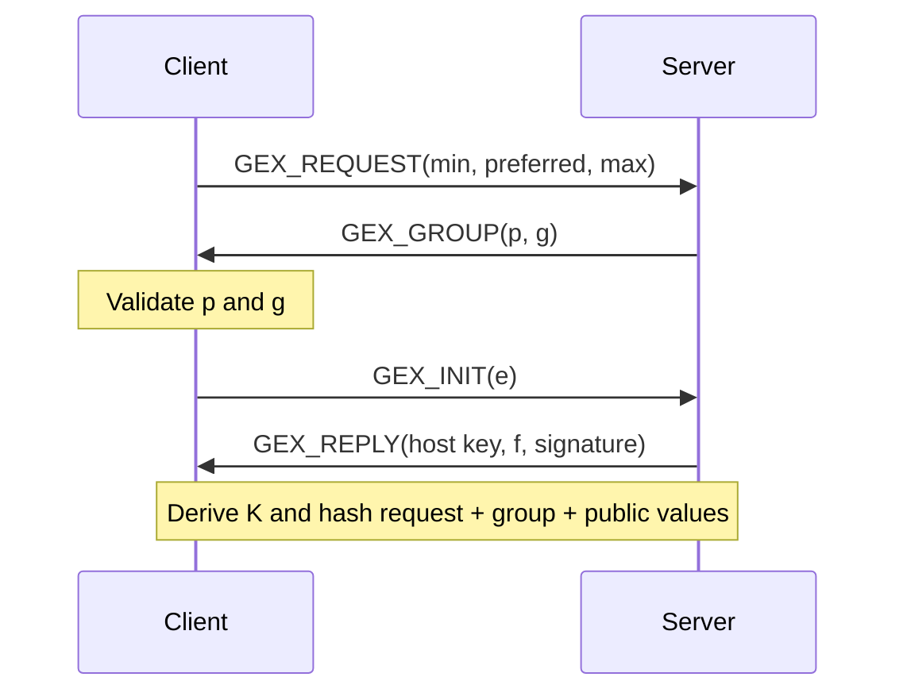

The message formats are specified by [RFC
4419](https://www.rfc-editor.org/rfc/rfc4419.html). RFC 9142 says generated MODP
groups below 2048 bits must not be used and deprecates the SHA-1 variant. Those
requirements matter because weak or malformed group parameters undermine the
hard problem on which DH relies.

### Elliptic-curve Diffie–Hellman

ECDH has the same *shape* as DH but uses points on an elliptic-curve group. A
private scalar and public curve parameters produce a public point; the local
private scalar and peer public point produce the shared result.

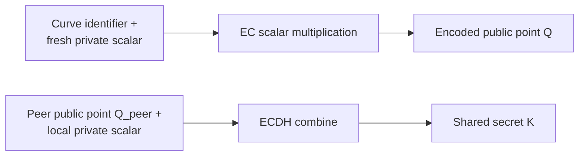

[RFC 5656](https://www.rfc-editor.org/rfc/rfc5656.html) integrates ECDH and the
NIST curves into SSH. Its exchange uses `SSH_MSG_KEX_ECDH_INIT` and
`SSH_MSG_KEX_ECDH_REPLY`. The client must validate that a received point is a
valid point in the selected group before using it.

Compared with finite-field DH, ECDH normally uses much smaller public values
for a comparable security level. The selected method still requires invalid
curve points to make the exchange fail.

### Curve25519 and X25519

`curve25519-sha256` instantiates the ECDH-shaped SSH flow with the X25519
function and fixed-size byte strings:

```text
X25519(local 32-byte private scalar, peer 32-byte public value)
    -> 32-byte shared secret
```

It reuses the ECDH message flow but has its own encoding and checks. In
particular, the received public value must have the expected length and an
all-zero shared result must cause the exchange to fail. [RFC
8731](https://www.rfc-editor.org/rfc/rfc8731.html) specifies
`curve25519-sha256` and `curve448-sha512`; [RFC
9142, Section 3.1](https://www.rfc-editor.org/rfc/rfc9142.html#section-3.1)
provides current algorithm-status guidance.

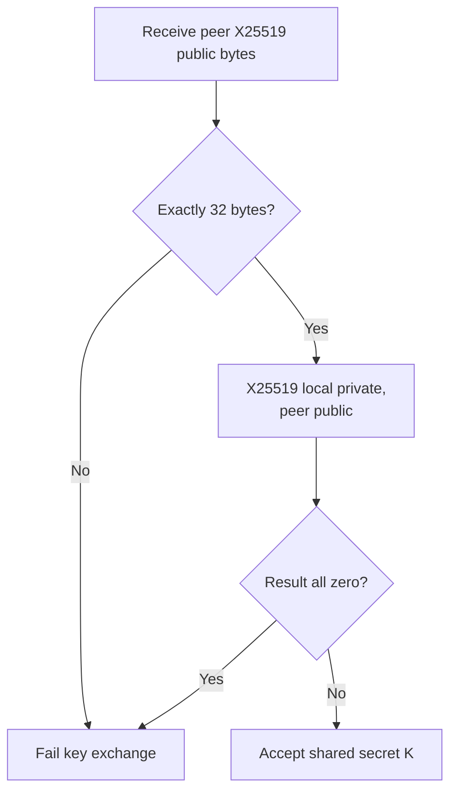

X25519's compact validation rule is specific to that function. Each KEX method
defines its own encodings and validation requirements.

## Hybrid post-quantum key exchange

Traditional DH and ECDH security would be broken by a sufficiently capable
cryptographically relevant quantum computer. A long-lived secret can therefore
face a “harvest now, decrypt later” threat: record today's encrypted traffic and
attempt to recover its session keys in the future.

A post-quantum/traditional (PQ/T) hybrid runs two schemes and combines their
secrets:

1. a traditional ECDH exchange, for confidence in established cryptography;
2. a post-quantum key-encapsulation mechanism (KEM), for resistance to known
   quantum attacks.

The goal is defense in depth: with the specified combiner, the combined
exchange remains secure if at least one component remains secure.

### KEM black boxes

A KEM has three operations:

```text
KeyGen()          -> public key pk, secret key sk
Encaps(pk)        -> ciphertext ct, shared secret ss
Decaps(sk, ct)    -> the same shared secret ss (or failure)
```

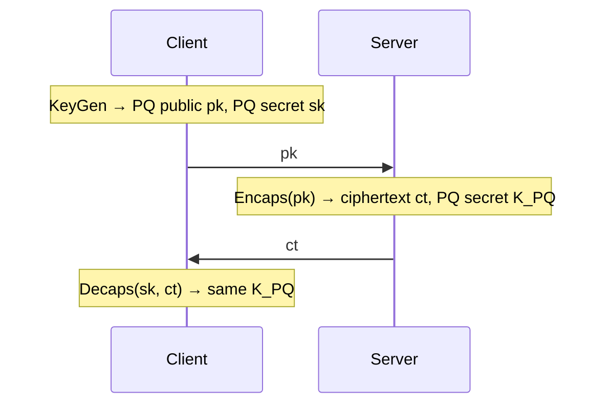

This direction differs from the symmetric-looking DH exchange: the client
creates the KEM key pair, and the server encapsulates a secret to its public
key.

### Combining ML-KEM with ECDH

[RFC 10042](https://www.rfc-editor.org/rfc/rfc10042.html) defines hybrid SSH
methods using ML-KEM together with P-256, P-384, or X25519:

- `mlkem768nistp256-sha256`;
- `mlkem1024nistp384-sha384`; and
- `mlkem768x25519-sha256`.

The client sends its ephemeral traditional public key together with its
ML-KEM public key. The server replies with its traditional public key, an
ML-KEM ciphertext, its host key, and a signature over the resulting exchange
hash. Both components produce secrets, which the method combines as:

```text
K = HASH(K_PQ || K_CL)
```

Here `K_PQ` is the ML-KEM shared secret and `K_CL` is the classical ECDH shared
secret. The result `K` enters the ordinary SSH exchange-hash and key-derivation
machinery.

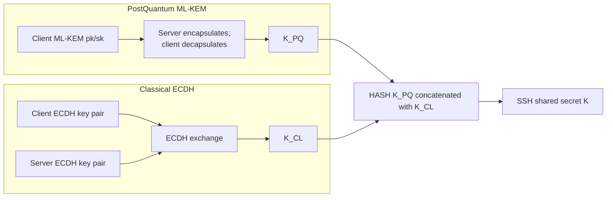

Hybrid packets are larger, and RFC 10042 requires exact component lengths to be
checked before the components are processed. Invalid inputs or decapsulation
failure terminate the exchange.

> **Security boundary**
>
> A post-quantum *key exchange* protects session-secret establishment. If the
> host signature algorithm is traditional, it does not by itself make server
> authentication post-quantum. KEX and host-key algorithms are separate
> negotiation categories.

The standards landscape evolves. RFC 10042 is the primary reference for these
ML-KEM hybrids. The IANA naming registries and their registration process are
described separately; [RFC 9519](https://www.rfc-editor.org/rfc/rfc9519.html)
updates that registry policy but does not define a hybrid exchange.

## The exchange hash: authenticate the whole decision

Deriving the same secret is not enough. The client must know that an attacker
did not alter the version strings, proposals, host key, or ephemeral values.
SSH serializes those values and hashes them into the exchange hash `H`.

For the classic DH flow in RFC 4253, the conceptual inputs are:

```text
H = HASH(
    V_C || V_S ||
    I_C || I_S ||
    K_S ||
    e || f ||
    K
)
```

Where:

- `V_C`, `V_S` are the identification lines without CRLF;
- `I_C`, `I_S` are the exact `KEXINIT` payloads, starting with their message
  number;
- `K_S` is the encoded server public host key;
- `e`, `f` are the client and server ephemeral public values; and
- `K` is the shared secret.

This is conceptual notation rather than raw byte-array concatenation. Each item
uses the SSH wire type required by that KEX specification. ECDH,
group-exchange, and hybrid methods adjust the method-specific fields, so `H`
has a method-specific wire definition even though its security role is stable.

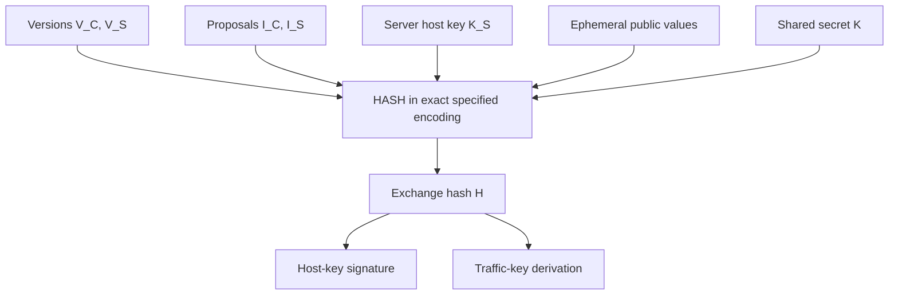

Because the proposals are included, an attacker cannot silently delete a
stronger shared algorithm from the lists to force a weaker mutual choice. The
server and client would hash different `KEXINIT` payloads and signature
verification would fail.

### The host-key signature and the trust decision

The server signs `H` with its host private key. The client verifies the
signature using `K_S`, the public host key carried in the reply. This proves
that one entity controlled both the KEX response and the private key matching
`K_S`.

The client must then establish that `K_S` is acceptable for the intended host,
for example by:

- matching a previously pinned key in a known-hosts database;
- validating an SSH host certificate under a trusted certification key; or
- asking a user to verify a fingerprint through an independent channel.

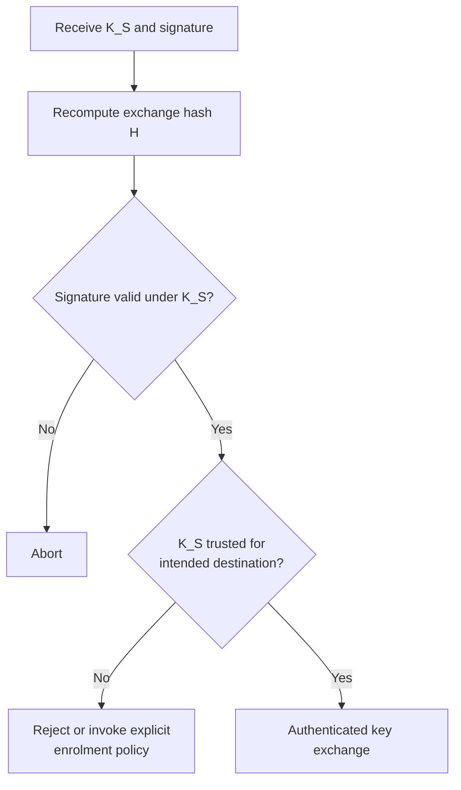

Skipping or merging these two gates causes security bugs. A valid signature
made by an attacker's own key is still a valid signature; it is not evidence
that the key belongs to the requested server. The two checks may occur in
either order, but both properties are required for an authenticated KEX.

## From `K` and `H` to traffic keys

The KEX method outputs the shared secret `K` and exchange hash `H`. The base
SSH key schedule combines them with a one-byte purpose label and the session
identifier to produce separate key material:

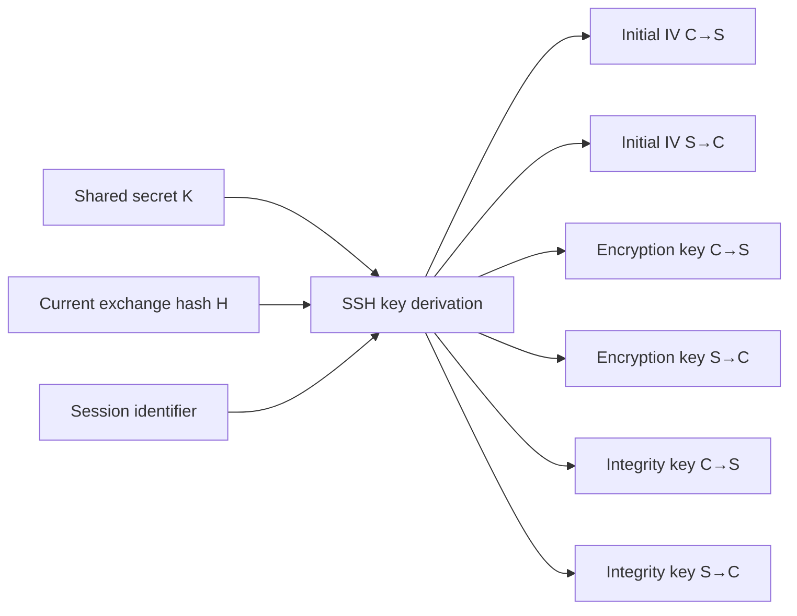

In [RFC 4253, Section
7.2](https://www.rfc-editor.org/rfc/rfc4253.html#section-7.2), labels `A` through
`F` distinguish those outputs. If a cipher needs more key bytes than one hash
produces, the specified expansion procedure produces more. Modern combined
cipher-and-integrity constructions may consume the categories differently;
the negotiated method defines that mapping.

Independent directional keys prevent a packet sent in one direction from
being replayed as if it came from the other and keep each direction's cipher
state separate.

### Session identifier versus exchange hash

On the first KEX:

```text
session_id = H_first
```

On a rekey, a new exchange produces fresh `K` and a new `H`, but
`session_id` remains `H_first` for the entire SSH connection.

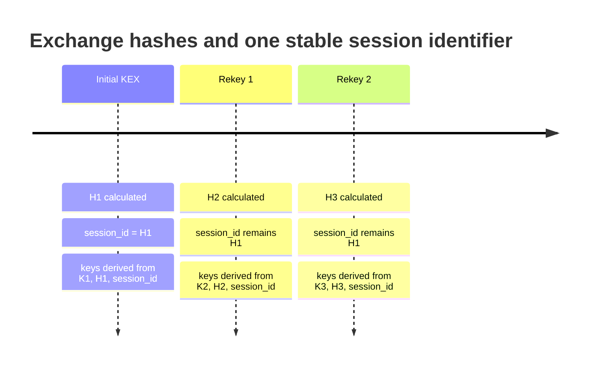

The stable identifier binds later protocols—most notably public-key user
authentication—to this SSH connection even as its transport keys change. The
latest `H` never replaces it.

## Activating keys with `SSH_MSG_NEWKEYS`

Key derivation alone does not define the byte at which an endpoint should
switch algorithms. `SSH_MSG_NEWKEYS` is the boundary marker, independently for
each direction.

- Immediately after sending `NEWKEYS`, use the new algorithms and keys for
  subsequent outbound packets.
- When receiving `NEWKEYS`, use the new algorithms and keys for subsequent
  inbound packets.

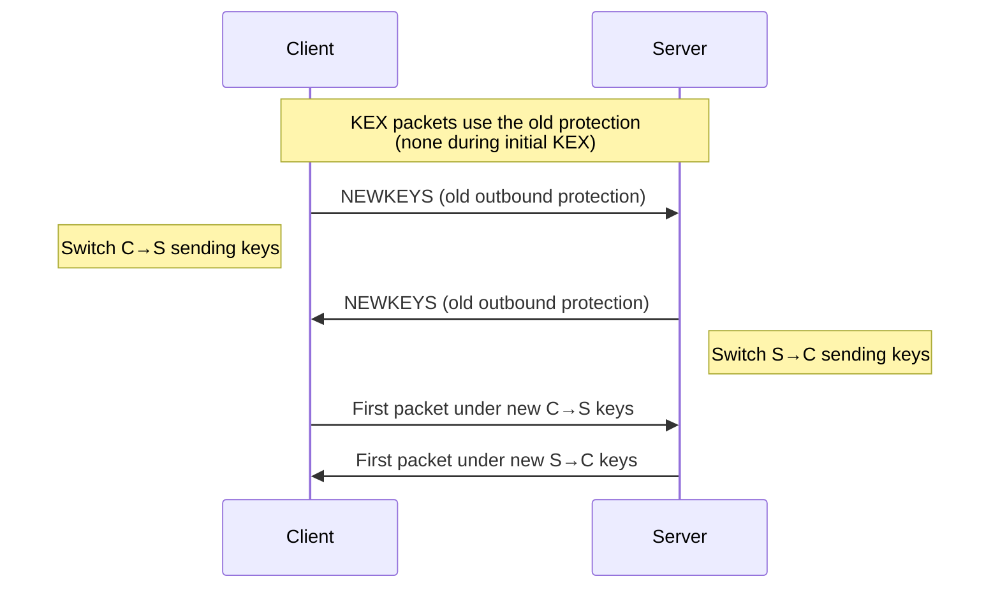

The messages may cross on the network, creating a brief interval in which one
direction uses new keys while the other still uses old keys. Under strict KEX,
each direction's packet sequence number is also reset just after its
corresponding `NEWKEYS` boundary.

Only after key activation can extension information and higher-layer service
requests proceed in the newly protected transport. See [RFC 4253, Section
7.3](https://www.rfc-editor.org/rfc/rfc4253.html#section-7.3) and [RFC
8308](https://www.rfc-editor.org/rfc/rfc8308.html) for the post-KEX extension
exchange.

## Rekeying a live connection

SSH can repeat key exchange without opening a new TCP connection or repeating
user authentication. Either endpoint starts a rekey by sending a new
`SSH_MSG_KEXINIT`; the other responds with its proposal.

Why rekey?

- limit how much traffic is protected by one set of keys;
- replace keys after an endpoint-defined time or byte count;
- negotiate a new algorithm policy that both endpoints now offer; or
- refresh the cryptographic state of a long-lived connection.

RFC 4253 intentionally does not prescribe one universal time or byte
threshold. The endpoints choose policy while respecting any limits of the
selected algorithms.

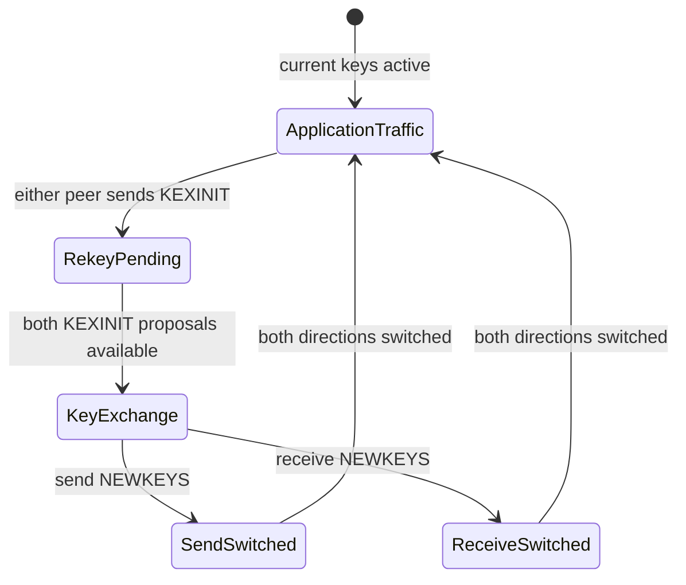

During rekey:

- the KEX packets are protected by the *old* algorithms until each directional
  `NEWKEYS` transition;
- client and server roles do not change;
- fresh `K` and `H` values are produced;
- the original session identifier does not change; and
- higher-layer application traffic pauses once KEX is in progress, apart from
  already in-flight packets allowed by the protocol state machine.

A peer can receive an arbitrary number of application packets that were
already in flight before it sees the other side's `KEXINIT`. This is why the
rekey transition is not an instantaneous, connection-wide boundary.

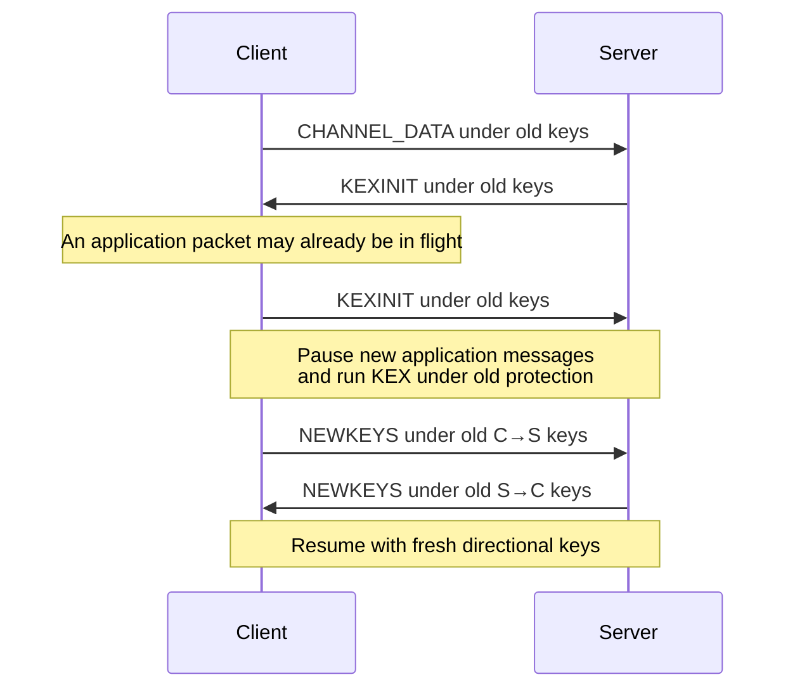

Crossed `NEWKEYS` messages, simultaneous KEX initiation, and application data
already in flight all follow from the two independent directions shown above.

## Security invariants

The essential invariants across initial KEX and rekey are:

- ephemeral private values are unpredictable and are never sent;
- received public values have the exact encoding, length, group membership,
  and special-value checks required by the selected method;
- the exchange hash uses exact on-wire transcript values and type encodings;
- host signature validity and host identity trust are distinct properties;
- key derivation produces independent material for both directions;
- sending and receiving switch keys at their own `NEWKEYS` boundaries;
- the session identifier is assigned once, from the first `H`;
- a rekey retains roles and the session identifier but replaces traffic keys.

## Check your understanding

1. Which key is usually persistent: an ephemeral ECDH key or a server host
   key?
2. What does a valid signature over `H` prove, and what does it not prove by
   itself?
3. Why are both `KEXINIT` payloads included in `H`?
4. In a hybrid exchange, what are the two inputs combined to form SSH's `K`?
5. The client has sent `NEWKEYS` but has not received the server's `NEWKEYS`.
   Which new keys are active?
6. Does the session identifier change after rekeying?

<details>
<summary>Answers</summary>

1. The server host key. Ephemeral ECDH keys are freshly generated for a KEX.
2. It proves that the holder of the private key corresponding to `K_S`
   approved that exchange hash. A separate trust check establishes whether
   `K_S` represents the intended host.
3. To bind algorithm negotiation into the authenticated transcript and detect
   modification or downgrade.
4. The post-quantum KEM secret `K_PQ` and classical ECDH secret `K_CL`, combined
   exactly as the selected hybrid method specifies.
5. New keys are active for the client's outbound direction. Its inbound
   direction still uses the old keys until it receives server `NEWKEYS`.
6. No. It remains the first exchange hash for the life of the connection.

</details>

## Primary references

- [RFC 4253 — SSH Transport Layer Protocol](https://www.rfc-editor.org/rfc/rfc4253.html), Sections 7–9.
- [RFC 4419 — Diffie–Hellman Group Exchange for SSH](https://www.rfc-editor.org/rfc/rfc4419.html).
- [RFC 5656 — Elliptic Curve Algorithm Integration in SSH](https://www.rfc-editor.org/rfc/rfc5656.html).
- [RFC 8308 — Extension Negotiation in SSH](https://www.rfc-editor.org/rfc/rfc8308.html).
- [RFC 8731 — SSH KEX Using Curve25519 and Curve448](https://www.rfc-editor.org/rfc/rfc8731.html).
- [RFC 9142 — SSH KEX Method Updates and Recommendations](https://www.rfc-editor.org/rfc/rfc9142.html).
- [RFC 10042 — ML-KEM PQ/T Hybrid Key Exchange for SSH](https://www.rfc-editor.org/rfc/rfc10042.html).
- [RFC 9519 — SSH Protocol Parameter Registry Policy](https://www.rfc-editor.org/rfc/rfc9519.html).
cipher-and-integrity constructions may consume the categories differently,
and the negotiated method defines that mapping.
