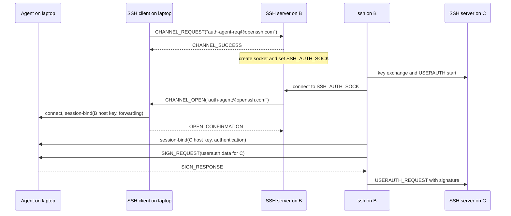
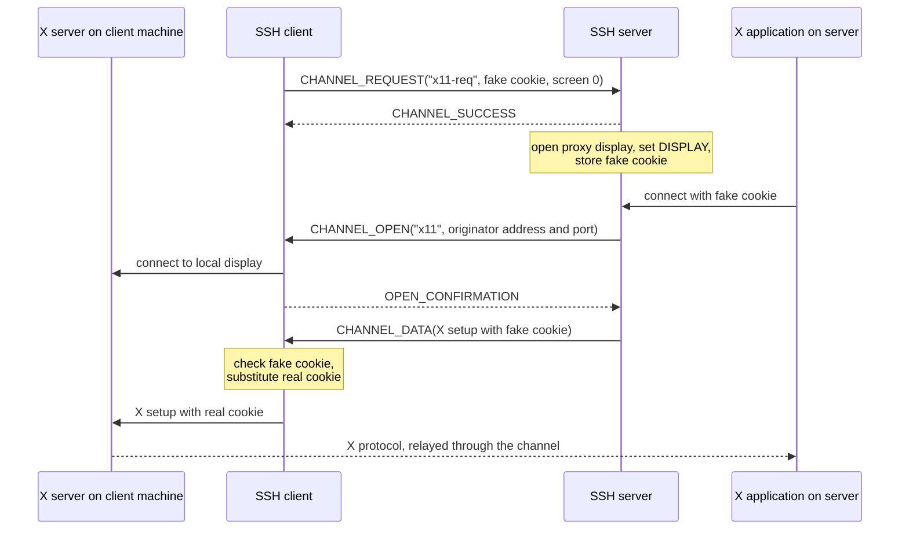

# Agent, X11, and Unix-socket forwarding

TCP forwarding relays generic byte streams. Three other features use their own
channel types to extend a *local* resource to the remote host: the client's key
agent, its X11 display, or any Unix-domain socket. They reuse the channel
mechanics from [Channels and flow control](./channels.md), but they reverse the
usual trust direction: the server, and programs running there, reach back into
the client's machine.

## One pattern, reversed direction

Agent forwarding, X11 forwarding, and remote socket forwarding follow the same
three steps as remote TCP forwarding:

1. The client sends a request that enables the feature: a session-channel
   request for agents and X11, a global request for remote sockets.
2. The server creates a listener on the remote host and advertises it to the
   session (`SSH_AUTH_SOCK`, `DISPLAY`) or to the user.
3. Each connection to that listener makes the server open a new channel to the
   client, which connects it to the local resource and relays bytes.

The client must reject channel opens of these types that it never requested
([RFC 4254, Section 6.3.2](https://www.rfc-editor.org/rfc/rfc4254.html#section-6.3.2);
[RFC 9987, Section 7.3](https://www.rfc-editor.org/rfc/rfc9987.html#section-7.3)).
Otherwise a malicious server could reach the agent or display uninvited.

## Agent forwarding

### The agent protocol

An SSH agent (`ssh-agent` in OpenSSH) holds private keys and performs
operations with them for local clients. It listens on a Unix-domain socket
named by `SSH_AUTH_SOCK`.
[RFC 9987, *Secure Shell (SSH) Agent Protocol*](https://www.rfc-editor.org/rfc/rfc9987.html)
standardizes the long-deployed protocol it speaks: length-prefixed messages,
each request answered in order, driven entirely by the client.

| Request | Reply | Purpose |
| --- | --- | --- |
| `SSH_AGENTC_REQUEST_IDENTITIES` | `SSH_AGENT_IDENTITIES_ANSWER` | List public keys and comments. |
| `SSH_AGENTC_SIGN_REQUEST` (key blob, data, flags) | `SSH_AGENT_SIGN_RESPONSE` | Sign caller-chosen data. |
| `SSH_AGENTC_ADD_ID_CONSTRAINED` | `SSH_AGENT_SUCCESS` or `FAILURE` | Load a key with constraints. |
| `SSH_AGENTC_REMOVE_IDENTITY`, `REMOVE_ALL_IDENTITIES` | `SSH_AGENT_SUCCESS` or `FAILURE` | Unload keys. |
| `SSH_AGENTC_LOCK`, `UNLOCK` | `SSH_AGENT_SUCCESS` or `FAILURE` | Suspend signing behind a passphrase. |
| `SSH_AGENTC_EXTENSION` | extension-specific | Vendor extensions such as `session-bind@openssh.com`. |

No request returns private-key bytes. During
[public-key authentication](./user-authentication.md#signed-request), the SSH
client sends the userauth data to be signed as a `SIGN_REQUEST` and puts the
returned signature in its `SSH_MSG_USERAUTH_REQUEST`.

The protocol has no authentication or encryption of its own: whoever can
connect to the socket can ask for signatures. Filesystem permissions on the
socket are the only barrier (RFC 9987, Section 10).

### Forwarding the agent over SSH

To forward the agent, the client sends `auth-agent-req@openssh.com` on a
session channel before its start request (`ssh -A`, or `ForwardAgent yes`).
The server creates a socket on the remote host and sets `SSH_AUTH_SOCK` for
the session. Every connection to that socket makes the server open an
`auth-agent@openssh.com` channel, which carries no type-specific fields. The
client connects to its local agent and relays the agent protocol through the
channel.

RFC 9987 also defines the names `agent-req` and `agent-connect`, to be used
only when the server advertises `agent-forward` in `SSH_MSG_EXT_INFO`.
Deployed implementations, including OpenSSH, use the `@openssh.com` names.

Suppose a user on a laptop logs in to host B with agent forwarding, then runs
`ssh c` on B:



Messages between `R` and `A` travel as channel data through `B` and the SSH
connection. The open carries no session identifier, so one SSH connection
forwards at most one agent, though it may carry many concurrent agent
channels. RFC 9987 lets the client keep accepting agent opens after the
requesting session has closed, and OpenSSH does so for the life of the
connection.

### What the remote side gets

The remote host gets a **signing oracle**, not keys. It can list your public
keys and have the agent sign any data it chooses, including the userauth
request for a new connection to another server, as you. It cannot copy the
keys, so its access ends with the connection, although any logins it made
elsewhere in the meantime remain.

Anyone who can open the forwarded socket on the remote host can use that
oracle: root, or an attacker who controls your account there. Signatures are
bound to the session identifier of the connection they authenticate, which
prevents replay into another connection but not the creation of new ones.
RFC 9987 therefore says implementations should not forward the agent by
default, and users should not forward it to hosts they do not fully trust.
OpenSSH's `ForwardAgent` defaults to `no`. The server-side
`AllowAgentForwarding no` helps little: a user with a shell can run a
forwarder of their own.

### Narrowing the delegation

Keys loaded with constraints limit what a forwarded agent can do. These are
set with `ssh-add` on the machine running the agent:

- **Confirmation** (`ssh-add -c`): the agent asks on the local display, via
  `ssh-askpass`, before each use. The prompt cannot show what is being signed,
  and a remote attacker can time a request to arrive when you expect one.
- **Lifetime** (`ssh-add -t`): the agent deletes the key after a set time,
  shortening the exposure window.
- **Touch per signature**: a
  [FIDO security key](./fido-security-keys.md#agents-forwarding-and-jump-hosts)
  signs only after a physical touch, making silent misuse visible.
- **Destination constraints** (`ssh-add -h`, OpenSSH 8.9): the key is usable
  only for listed hops, such as `-h bastion -h "bastion>prod"`. Hosts are
  named by host keys, looked up in `known_hosts` when the key is added.

Destination constraints need the agent to know where each request comes from
and where it goes. OpenSSH provides both with three extensions, documented in
[PROTOCOL.agent](https://github.com/openssh/openssh-portable/blob/master/PROTOCOL.agent)
and [PROTOCOL](https://github.com/openssh/openssh-portable/blob/master/PROTOCOL):

1. `restrict-destination-v00@openssh.com`, a key constraint, carries the
   permitted hops from `ssh-add` to the agent.
2. `session-bind@openssh.com`, an agent extension, is the first message an
   OpenSSH client sends on a new agent connection. It carries the server's
   host key, the session identifier, the server's signature over that
   identifier from the key exchange, and a flag saying whether the connection
   is for forwarding or for authentication. The agent verifies the signature
   and appends the binding to the connection's list. As the diagram shows, each
   hop's client adds its binding, so the agent sees the whole path.
3. [Host-bound public-key authentication](./user-authentication.md#host-bound-public-key-authentication)
   (`publickey-hostbound-v00@openssh.com`) puts the destination's host key
   inside the signed userauth request, so the agent can check that the request
   matches the last binding.

The agent refuses a destination-constrained key whenever the path or
destination is not permitted or cannot be verified. A key loaded with only
`-h dest` entries, without any `>` hop, is therefore usable from the laptop
but never through a forwarded agent. Forwarded use needs updated OpenSSH on
each hop's client and on the destination server.

These constraints narrow delegation without removing it. An attacker on B can
still use a key for destinations permitted through B, and can relay B's socket
elsewhere with an uncooperative tool, though only to permitted destinations.
Think of each `src>dst` rule as delegating the key to `src`. Keys loaded
without `-h` remain usable from every forwarded connection.

### Prefer ProxyJump

Agent forwarding is needed only when the remote host itself must authenticate
onward, for example to fetch from a Git server during a build. To reach a
server *through* a bastion, use
[`ProxyJump`](./forwarding.md#ssh-through-a-jump-host) instead: the laptop
authenticates to each hop itself, and the bastion relays ciphertext without
access to the agent.

## X11 forwarding

In the X Window System, the *X server* owns the user's display, keyboard, and
mouse, and applications are *X clients* that connect to it. With X11
forwarding, the X server stays on the SSH client's machine while applications
run on the SSH server.

### Requesting and carrying X11

The client enables it with an `x11-req` session request
([RFC 4254, Section 6.3](https://www.rfc-editor.org/rfc/rfc4254.html#section-6.3)):

```text
string  "x11-req"
boolean want_reply
boolean single connection
string  x11 authentication protocol   (e.g. "MIT-MAGIC-COOKIE-1")
string  x11 authentication cookie     (hex encoded)
uint32  x11 screen number
```

RFC 4254 recommends sending a **fake, random cookie**. The server creates a
proxy display (in OpenSSH, typically TCP port 6010 on loopback, display
`localhost:10`),
sets `DISPLAY`, and records the fake cookie with `xauth`. When an application
connects, the server opens an `x11` channel whose fields give the
application's originator address and port. With `single connection` set, the
server forwards only the first connection.



The client checks the cookie in the application's first X message, replaces it
with the real one, and relays the rest untouched. The real cookie never leaves
the client, and the fake one works only through this SSH connection. X11
channels are independent of the session: closing the session stops new X11
connections, but open ones continue.

### Why X11 forwarding exposes the display

X11 does not isolate clients from one another. A fully trusted X client can
read keystrokes typed into other windows, capture the screen, and inject
input. Any process on the server that can reach the proxy display while
forwarding is active, including root or an attacker in your account, becomes
such a client on *your* desktop.

OpenSSH limits this with two modes:

| Mode | Option | Real cookie the client substitutes | Effect |
| --- | --- | --- | --- |
| Untrusted | `ssh -X`, `ForwardX11Trusted no` (default) | Generated with `xauth` as *untrusted*, expiring after `ForwardX11Timeout` (20 minutes) | The X server's SECURITY extension stops the application from reading or tampering with trusted clients' windows and input. |
| Trusted | `ssh -Y`, `ForwardX11Trusted yes` | The user's normal cookie | Full access to the display. |

Untrusted mode breaks some applications, which tempts users toward `-Y`. It
also depends on the X server implementing the SECURITY extension. The server
side is controlled by `X11Forwarding` (default `no`) and `X11UseLocalhost`.

## Unix-domain socket forwarding

OpenSSH's *streamlocal* extension forwards Unix-domain sockets the way RFC 4254
forwards TCP, with a socket path in place of host and port
([PROTOCOL, Section 2.4](https://github.com/openssh/openssh-portable/blob/master/PROTOCOL)).
`-L` and `-R` select it when an argument is a path.

| Direction | Command line | Wire messages |
| --- | --- | --- |
| Local | `-L /tmp/docker.sock:/var/run/docker.sock` | Client listens; each connection opens `direct-streamlocal@openssh.com` with the server-side socket path. |
| Remote | `-R /remote/path:/local/path` | Global request `streamlocal-forward@openssh.com` with the remote path; each connection makes the server open `forwarded-streamlocal@openssh.com`. |
| Remote, cancel | `ssh -O cancel -R /remote/path` | Global request `cancel-streamlocal-forward@openssh.com` with the same path. |

As with `forwarded-tcpip`, the client finds the local target from its own
forwarding state, keyed by the path in the open, and rejects unmatched opens.
There is no equivalent of port zero: the client names the path.

Typical uses are:

- driving a remote Docker daemon by forwarding its socket locally, then setting
  `DOCKER_HOST=unix:///tmp/docker.sock`;
- forwarding a local GnuPG agent to a remote host with `RemoteForward`, usually
  its restricted `S.gpg-agent.extra` socket, so remote `gpg` can sign or
  decrypt without holding the secret keys.

Both hand over a strong capability: access to the Docker socket is usually
root-equivalent on the Docker host, and a forwarded GPG agent is a signing and
decryption oracle, like a forwarded SSH agent.

Socket files outlive their listeners. If a stale file exists at the listening
path, binding fails unless `StreamLocalBindUnlink yes` is set: in
`ssh_config` for listeners on the client, and in `sshd_config` for listeners
the server creates. New socket files are owner-only (`StreamLocalBindMask`
0177), because file permissions decide who may connect. On the server,
`AllowStreamLocalForwarding` and `DisableForwarding` restrict the feature.

## Comparing forwarding channels

| Feature | Enabling request | Channel type | Opened by | Trust boundary crossed |
| --- | --- | --- | --- | --- |
| Local TCP | none | `direct-tcpip` | client | Local processes reach the server's network. |
| Remote TCP | global `tcpip-forward` | `forwarded-tcpip` | server | Remote processes reach the client's network. |
| Agent | session `auth-agent-req@openssh.com` | `auth-agent@openssh.com` | server | Remote processes use the client's keys to sign. |
| X11 | session `x11-req` | `x11` | server | Remote applications reach the client's display, keyboard, and screen. |
| Local Unix socket | none | `direct-streamlocal@openssh.com` | client | Local processes reach a server-side socket. |
| Remote Unix socket | global `streamlocal-forward@openssh.com` | `forwarded-streamlocal@openssh.com` | server | Remote processes reach a client-side socket. |

## Check your understanding

1. Which peer opens an `auth-agent@openssh.com` channel, and what must the
   client do if it never requested agent forwarding?
2. A root user on a host you log in to with `ssh -A` wants your private key.
   What can they get instead?
3. What does `session-bind@openssh.com` tell the agent, and why must the agent
   verify its signature?
4. You loaded a key with `ssh-add -h prod`. Can a forwarded agent on
   `bastion` use it to reach `prod`?
5. Why does the SSH client send a fake X11 cookie, and what does that not
   protect against?
6. Which channel type carries a local forward of a remote Docker socket, and
   who opens it?

<details>
<summary>Answers</summary>

1. The server opens it when a remote program connects to the forwarded agent
   socket. The client must refuse opens it did not authorize.
2. Signatures on data of their choosing, including userauth requests that log
   in elsewhere as you, while the connection lasts. The agent never exports
   the key.
3. It binds the agent connection to an SSH connection: the server host key,
   session identifier, and whether the binding is for forwarding or
   authentication. The host key's signature over the session identifier
   proves the binding came from a real key exchange with that host.
4. No. `prod` alone permits use only from the machine running the agent; use
   through `bastion` needs a `bastion>prod` constraint.
5. So the real cookie never reaches the server; the fake one works only
   through this SSH connection. It does not stop processes on the server from
   using the forwarded display to read input or capture the screen.
6. `direct-streamlocal@openssh.com`, opened by the client for each local
   connection.

</details>

## References

- [RFC 4254, Section 6.3 — X11 Forwarding](https://www.rfc-editor.org/rfc/rfc4254.html#section-6.3)
- [RFC 9987: Secure Shell (SSH) Agent Protocol](https://www.rfc-editor.org/rfc/rfc9987.html)
- [OpenSSH agent protocol extensions (`PROTOCOL.agent`)](https://github.com/openssh/openssh-portable/blob/master/PROTOCOL.agent)
- [OpenSSH protocol extensions (`PROTOCOL`)](https://github.com/openssh/openssh-portable/blob/master/PROTOCOL): streamlocal forwarding and host-bound authentication.
- [OpenSSH: SSH agent restriction](https://www.openssh.org/agent-restrict.html) and the [OpenSSH 8.9 release notes](https://www.openssh.org/txt/release-8.9)
- [`ssh-add(1)`](https://man.archlinux.org/man/ssh-add.1), [`ssh_config(5)`](https://man.archlinux.org/man/ssh_config.5), and [`sshd_config(5)`](https://man.archlinux.org/man/sshd_config.5)
- [X11 SECURITY extension specification](https://xorg.freedesktop.org/archive/X11R7.7/doc/xextproto/security.html)
