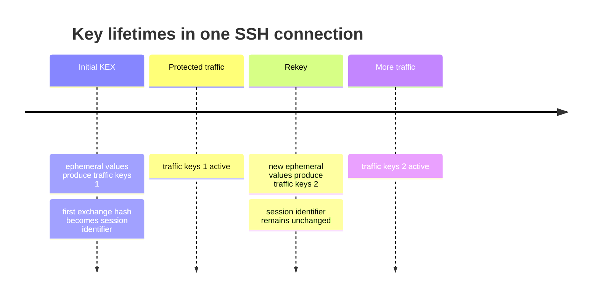

# Security properties and boundaries

“An encrypted connection” both undersells and oversells SSH. Its security is a
chain of distinct claims, each established by a different mechanism and each
with a boundary. This chapter collects those claims and links to the chapters
that explain the mechanisms.

## The chain of claims

| Claim | Established by | Does not provide | Explained in |
| --- | --- | --- | --- |
| Both peers use the same algorithms | `SSH_MSG_KEXINIT`, later covered by the exchange hash `H` | Safe choices: a weak algorithm both sides permit can still win | [Algorithm negotiation](./version-and-negotiation.md) |
| Only the two endpoints know `K` | Ephemeral key agreement | Knowledge of who the other endpoint is | [Key agreement](./crypto-key-agreement.md) |
| The peer holds the host private key | Host-key signature over `H` | Proof that the key belongs to the intended host | [Key exchange](./key-exchange.md#the-host-key-signature-and-the-trust-decision) |
| The host key belongs to the destination | `known_hosts`, a host certificate, or another out-of-band source | Detection of an attacker present at first contact | [Server authentication](./server-authentication.md) |
| Packets are confidential, unmodified, and in order | Keys derived from `K` and `H`; cipher, MAC, and sequence numbers | Hidden timing and sizes; guaranteed delivery | [Symmetric encryption](./crypto-symmetric.md) |
| The user holds a credential the server accepts | A signature over the session identifier, or a password | Password secrecy from the server; strength beyond the weakest allowed method | [User authentication](./user-authentication.md) |
| A channel operation is permitted | Server and client policy for each request | Protection beyond the SSH endpoints | [Channels](./channels.md), [TCP forwarding](./forwarding.md#where-protection-ends) |

Each row relies on the rows above it. A password sent through an encrypted
tunnel is not safe if the tunnel ends at an attacker. A valid user signature
does not authorize a port forward that server policy forbids. A trusted host
key says nothing about whether the server's operating system is compromised.
[RFC 4251 section 9](https://www.rfc-editor.org/rfc/rfc4251#section-9) and the
security considerations of each algorithm RFC give the full discussion.

## What the network attacker can do

Until the host key is verified, assume an active attacker who can read,
change, delete, delay, inject, or replace traffic. If the attacker relays one
exchange but alters a covered value, the endpoints compute different exchange
hashes and the host signature fails. If the attacker instead runs two
self-consistent exchanges and signs the client-facing one with its own host
key, every signature verifies, so the client's trust check must reject that
key. Transcript binding and host-key trust together prevent an unnoticed
downgrade or interception. Neither prevents denial of service: the attacker
can always drop the connection.

After `NEWKEYS`, encryption hides message contents, and packet authentication
with sequence numbers detects modified, replayed, reordered, or deleted
packets within the stream. It does not guarantee delivery; either the peer or
the network can stop the traffic.

The handover into protection needs care of its own. The exchange hash covers
selected handshake fields, not every pre-key packet and not the implicit
sequence numbers.
[Terrapin](./crypto-symmetric.md#terrapin-when-implicit-state-is-not-authenticated)
exploited that gap: packets injected before key activation let an attacker
delete the first protected packets in some modes without breaking later tags,
typically removing the server's extension information.
[Strict key exchange](./version-and-negotiation.md#strict-key-exchange) closes
it by rejecting unexpected messages during the initial exchange and resetting
sequence numbers at each `NEWKEYS`. It protects a connection only when both
peers support it.

## Server proof and server trust

The key-exchange signature proves possession of the private key for the
presented host key. A separate trust rule, outside the protocol, binds that
key to the destination the user intended.

Trust on first use detects a later key change, but it cannot identify an
attacker present on the first connection. A changed key may be a legitimate
rotation or an attack, and the protocol cannot tell which. Host certificates
move the decision to a certification authority the client already trusts.
OpenSSH's [host-key update mechanism](./server-authentication.md#host-key-rotation)
lets a server announce replacement keys through a connection authenticated
with the old key, so planned rotation need not produce a warning.
[SSHFP records](./server-authentication.md#dns-fingerprints-sshfp) publish
host-key fingerprints in DNS and are only as trustworthy as the DNSSEC
validation behind them.
[Server authentication](./server-authentication.md) covers each of these.

## Algorithm negotiation and downgrade resistance

In each category, `SSH_MSG_KEXINIT` negotiation selects the first
client-preferred algorithm that the server also offers. The signed exchange
hash covers both complete `KEXINIT` payloads, so a network attacker cannot
strip strong choices and still produce a valid host signature.

Transcript integrity cannot repair unsafe policy. If both peers offer a weak
algorithm and the client prefers it, authenticated negotiation selects it.
Only offered names can be selected; an implementation may support an algorithm
without enabling it.

Registration is not endorsement. The
[IANA SSH registries](https://www.iana.org/assignments/ssh-parameters/ssh-parameters.xhtml)
record interoperable names, while documents such as
[RFC 9142](https://www.rfc-editor.org/rfc/rfc9142) give current security
recommendations.

## Forward secrecy and rekeying

With ephemeral key agreement, later theft of the server's long-term host key
does not reveal the keys of recorded sessions. This
[forward secrecy](./crypto-key-agreement.md#forward-secrecy) holds only if
fresh ephemeral secrets are generated and then discarded.

[Rekeying](./key-exchange.md#rekeying-a-live-connection) derives new traffic
keys for a live connection, limiting the data protected under one key set and
respecting algorithm-specific
[usage limits](./crypto-symmetric.md#usage-limits-and-rekeying). It does not
undo an exposure that has already happened, and it does not change the
session identifier.

### Harvest now, decrypt later

Forward secrecy assumes the ephemeral exchange itself stays unbroken. An
adversary can record traffic today and decrypt it later if a
cryptographically relevant quantum computer ever breaks elliptic-curve key
agreement. [Hybrid post-quantum key exchange](./crypto-post-quantum.md#harvest-now-decrypt-later)
keeps `K` secret unless both its classical and post-quantum components fail.
OpenSSH uses `mlkem768x25519-sha256` by default since version 10.0, and since
10.1 its client warns when a connection negotiates a key exchange without a
post-quantum component.

Host signatures remain classical, and that
[asymmetry is deliberate](./crypto-post-quantum.md#why-ssh-changed-key-exchange-first):
a signature needs to resist forgery only while the handshake runs, whereas
recorded key-exchange traffic must stay confidential for as long as the data
matters.

## Cryptographic assumptions

Every protocol argument in this guide rests on assumptions that SSH cannot
check:

- **Hardness.** Recovering an ephemeral secret from public key-exchange
  values, or forging a signature without the private key, is infeasible for
  the selected algorithms, and the hash, MAC, and cipher meet their design
  claims. A quantum computer would break the discrete-logarithm and factoring
  problems behind classical key agreement and signatures; see
  [Why quantum computers matter](./crypto-post-quantum.md#why-quantum-computers-matter).
- **Randomness.** Cookies, ephemeral private values, padding, and some
  signature schemes need unpredictable bytes. A weak generator can expose keys
  even when every algorithm is sound; see
  [Randomness](./cryptography-primer.md#randomness).
- **Correct implementation.** Implementations must validate peer inputs, avoid
  timing leaks, erase ephemeral secrets, and follow the exact wire encodings.
  Many practical SSH vulnerabilities have come from this layer, or from how
  primitives were composed, rather than from a broken primitive.
- **Sound policy.** The endpoints must refuse algorithms whose assumptions no
  longer hold, and the client must make a real host-key trust decision.

When one of these fails, a connection can still appear to work perfectly: the
handshake completes, signatures verify, and packets decrypt. Success is not
evidence that the assumptions hold.

## What remains visible

SSH does not hide the network endpoints, connection duration, or traffic
patterns. The identification strings and initial key-exchange packets travel
in cleartext before `NEWKEYS`. Afterwards an observer still sees timing and
TCP segment sizes; whether exact SSH packet lengths are visible depends on
whether the cipher encrypts the length field.

Random padding blurs content lengths; it does not make SSH a traffic-flow
confidentiality system. See
[RFC 4251 section 9.3.9](https://www.rfc-editor.org/rfc/rfc4251#section-9.3.9)
and [Length hiding and traffic analysis](./crypto-symmetric.md#length-hiding-and-traffic-analysis),
which also describes how OpenSSH obscures keystroke timing.

## Authentication is only as strong as allowed policy

A server can require one method or a sequence of factors. If it accepts either
a public-key proof or a password, an attacker targets the password. If it
requires both, `partial success` carries the exchange from the first accepted
method to the next; see
[The server drives policy](./user-authentication.md#the-server-drives-policy).

Passwords and keyboard-interactive responses are protected on the network, but
the server receives them in the clear. Public-key authentication instead signs
[connection-bound data](./crypto-signatures.md#why-signatures-cannot-be-moved-between-connections),
so the private key never leaves the client, its agent, or a
[hardware authenticator](./fido-security-keys.md), and a captured signature
cannot be replayed on another connection.

## Channels cross new trust boundaries

Connection-layer protection ends at the SSH endpoints. Each channel feature
creates a capability that client and server policy must authorize
deliberately:

- **Direct TCP forwarding.** Traffic between the server and the target host is
  unprotected unless the application protocol protects it.
- **Remote forwarding.** A listener on the server may expose a client-side
  service to every machine that can reach it.
- **Agent forwarding.** Anyone who controls the remote host, including its
  administrators, can ask the forwarded agent to sign authentication requests
  for as long as the connection lasts. They cannot copy the keys, but they can
  use them. `ProxyJump` avoids forwarding altogether, and destination
  constraints limit where a forwarded key works; see
  [Agent forwarding](./other-channels.md#agent-forwarding).

## Endpoint security is assumed

SSH cannot protect plaintext at a compromised endpoint. A malicious server sees
every command, keystroke, forwarded byte, password, and interactive response
that legitimately reaches it. A compromised client can steal credentials
before the protocol protects them.

Host authentication answers “which SSH host key took part?” It is not an
attestation that the remote operating system, account, command, or forwarded
destination is trustworthy.

## Questions to ask of any connection state

A precise security description of a connection at some moment answers:

1. Which identities have been authenticated so far, and by what?
2. Which bytes are confidential, which are integrity-protected, and which
   remain observable?
3. Exactly which transcript and sequence state is authenticated?
4. Which decisions come from protocol proof, and which from local policy?
5. Where does SSH protection end for this channel's data?
6. Which assumption would have to fail for these answers to change?

## Check your understanding

1. An attacker on the path rewrites the server's `KEXINIT` to remove every
   algorithm except a weak one that both peers still permit. Why does the
   connection fail, and what would make an equivalent downgrade succeed?
2. The first time you connect to a new server, an attacker intercepts the
   connection with its own host key and you accept the fingerprint prompt.
   Which link in the chain failed, and which later mechanisms, if any, would
   catch it?
3. What did Terrapin exploit, given that the exchange hash is signed and every
   protected packet carries a valid tag?
4. A server's host private key is stolen a year after you recorded a session
   to it. Can the thief decrypt the recording? Would the answer change if the
   thief instead had a large quantum computer?
5. You authenticate to a jump host with agent forwarding enabled. What can a
   root user on the jump host do, and what can they not do?
6. A server accepts either `publickey` or `password`. You always use a
   hardware-backed key. How strong is that account's authentication?

Answers

1. The exchange hash covers both complete `KEXINIT` payloads. The client
   hashes the payload it received, the server hashes the one it sent, so the
   host signature does not verify. A downgrade succeeds without tampering if
   client policy prefers the weak algorithm, or if the attacker holds a host
   key the client trusts and can run a separate exchange with each side.
2. The trust binding between key and destination failed: trust on first use
   cannot detect an attacker present at first contact. Every later signature
   verifies against the attacker's key. A host certificate, a pre-provisioned
   key, or a DNSSEC-validated SSHFP record would have caught it. Connecting
   later directly to the real server would produce a host-key-changed warning.
3. The implicit packet sequence numbers and packets such as `SSH_MSG_IGNORE`
   before `NEWKEYS` are not covered by the exchange hash. Injecting packets
   before key activation and deleting the same number afterwards leaves the
   counters in step, so in some modes later tags still verify. Strict key
   exchange closes the gap.
4. No. The host key only signs; traffic keys came from ephemeral secrets that
   were discarded, which is forward secrecy. A quantum computer could break a
   classical elliptic-curve exchange recorded today and recover the traffic
   keys. A hybrid post-quantum exchange resists that.
5. They can use the forwarded agent socket to sign authentication requests,
   and so log in elsewhere as you, while the connection lasts. They cannot
   extract the private keys from the agent. `ProxyJump` or destination
   constraints avoid this exposure.
6. No stronger than the password. An attacker chooses the weakest method the
   server allows, whichever method you use.

## References

- [RFC 4251](https://www.rfc-editor.org/rfc/rfc4251): SSH protocol
  architecture, especially
  [section 9](https://www.rfc-editor.org/rfc/rfc4251#section-9), security
  considerations
- [RFC 4253](https://www.rfc-editor.org/rfc/rfc4253): SSH transport layer
  protocol
- [RFC 9142](https://www.rfc-editor.org/rfc/rfc9142): key-exchange method
  updates and recommendations
- [IANA SSH protocol parameters](https://www.iana.org/assignments/ssh-parameters/ssh-parameters.xhtml)
- [Strict KEX Internet-Draft](https://datatracker.ietf.org/doc/draft-ietf-sshm-strict-kex/02/)
- Bäumer, Brinkmann, and Schwenk,
  [“Terrapin Attack: Breaking SSH Channel Integrity by Sequence Number Manipulation”](https://www.usenix.org/conference/usenixsecurity24/presentation/b%C3%A4umer),
  USENIX Security 2024
- [RFC 4255](https://www.rfc-editor.org/rfc/rfc4255): SSHFP DNS records
- [OpenSSH release notes](https://www.openssh.com/releasenotes.html), 10.0
  (post-quantum default) and 10.1 (non-post-quantum warning)
- [OpenSSH: post-quantum cryptography](https://www.openssh.com/pq.html)
- [OpenSSH agent restriction](https://www.openssh.com/agent-restrict.html)
