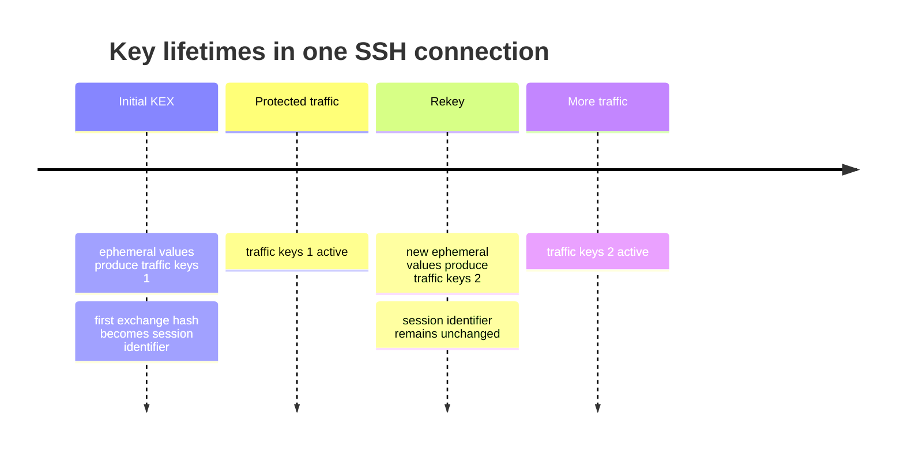

# Security properties and boundaries

SSH is often summarized as “an encrypted connection,” but that description is
too weak. Its security comes from a chain of distinct claims, and each claim
has a boundary.

## The chain of claims

The claims build in order: reliable stream, signed key exchange, trusted
server identity, protected packets, authenticated user, and authorized channel
operations.

Breaking any link changes what later success means. A password sent through an
encrypted tunnel is not safe if the tunnel terminates at an attacker. A valid
user signature does not authorize a port forward unless server policy allows
it. A trusted server may still run a compromised operating system.

The full security discussion spans
[RFC 4251 section 9](https://www.rfc-editor.org/rfc/rfc4251#section-9) and the
security considerations of every algorithm-specific RFC.

## What the network attacker can do

Before host authentication completes, assume an active network attacker can
read, change, delete, delay, or replace traffic. If the attacker changes a
covered value while relaying one exchange, the endpoints form different
exchange hashes and signature verification fails.

A full machine-in-the-middle can instead run two self-consistent exchanges and
sign the client-facing exchange with its own host key. The destination-to-key
trust check must reject that key. Together, transcript binding and host-key
trust prevent an invisible downgrade of signed proposals. Neither prevents
denial of service: an attacker can always drop the connection.

After keys are active, confidentiality hides packet contents and integrity
protection detects changes. Packet authentication does not guarantee delivery;
the peer or network can still stop sending.

The transition into protection matters too. The exchange hash covers selected
handshake fields, not every pre-key packet or the implicit packet counters.
[Terrapin](./crypto-symmetric.md#terrapin-when-implicit-state-is-not-authenticated)
exploited that gap: injecting ignored packets before key activation could let
an attacker remove initial protected packets in affected modes without
invalidating later tags. Removing extension information could change what the
client believed the server supported.

[Strict KEX](./version-and-negotiation.md#strict-key-exchange) addresses this
by restricting initial-exchange messages and resetting sequence numbers at
each `NEWKEYS`. Its
[specification draft](https://datatracker.ietf.org/doc/draft-ietf-sshm-strict-kex/02/)
explains why valid signatures and packet tags alone did not cover that
transition in the original protocol.

## Server proof and server trust

The key-exchange signature proves control of the private key corresponding to
the presented host key. A separate trust rule binds that key to the destination
the user intended.

Trust on first use can detect a later key change, but it cannot identify an
attacker present on the first connection. A changed key can be a legitimate
rotation or an attack; the protocol cannot decide which. That decision needs
information from outside the connection.

## Algorithm negotiation and downgrade resistance

KEXINIT chooses the first client-preferred algorithm also offered by the
server. The signed exchange hash covers both complete KEXINIT payloads, so a
network attacker cannot delete strong choices and still produce a valid host
signature.

The authenticated negotiation can still select a weak algorithm if both peers
offer it and client policy prefers or permits it. Transcript integrity cannot
repair unsafe policy.

An implementation may understand an algorithm without enabling or offering
it. Of the offered algorithms, only mutual names can be selected. Client
preference chooses among those names.

Registration is not endorsement. The
[IANA SSH registries](https://www.iana.org/assignments/ssh-parameters/ssh-parameters.xhtml)
record interoperable names, while documents such as
[RFC 9142](https://www.rfc-editor.org/rfc/rfc9142) give updated security and
implementation recommendations.

## Forward secrecy and rekeying

Ephemeral key agreement means later theft of the server's long-term host key
should not reveal old recorded traffic keys. This is
[forward secrecy](./crypto-key-agreement.md#forward-secrecy). It depends on
fresh ephemeral secrets being generated and discarded.

Rekeying creates new traffic keys for a live connection. It limits the amount
of data protected under one key set and respects algorithm-specific
[usage limits](./crypto-symmetric.md#usage-limits-and-rekeying). It does not
undo exposure that has already occurred and does not change the original
session identifier.

[Hybrid post-quantum key exchange](./crypto-post-quantum.md) addresses a
different future threat: an adversary recording traffic now and later gaining
a cryptographically relevant quantum computer. It strengthens secret
establishment. A traditional host signature remains traditional server
authentication, even when the KEX itself is hybrid. That
[asymmetry is deliberate](./crypto-post-quantum.md#why-ssh-changed-key-exchange-first):
a signature only needs to resist forgery while the handshake is running,
whereas recorded key-exchange traffic must stay confidential for as long as
the data matters.

## Cryptographic assumptions

Every protocol argument in this guide eventually rests on a small set of
assumptions that SSH itself cannot check:

- **Hardness.** Recovering an ephemeral secret from public key-exchange values
  is infeasible for the selected method; forging a signature without the
  private key is infeasible; and the hash, MAC, and cipher behave as their
  designs claim. Quantum computers would break the discrete-logarithm and
  factoring problems behind classical key agreement and signatures, which is
  why hybrid methods add a [post-quantum component](./crypto-post-quantum.md#why-quantum-computers-matter).
- **Randomness.** Cookies, ephemeral private values, padding, and some
  signature schemes need unpredictable random bytes. A weak random generator
  can expose keys even when every algorithm is sound; see
  [Randomness](./cryptography-primer.md#randomness).
- **Correct implementation.** Libraries must validate peer inputs, avoid
  leaking secrets through timing, erase ephemeral secrets, and follow the
  exact wire encodings. Many practical SSH vulnerabilities have come from
  this layer, or from how primitives were composed, rather than from breaking
  a primitive itself.
- **Sound policy.** The endpoints must refuse algorithms whose assumptions no
  longer hold, and the client must make a real host-key trust decision.

When one of these fails, a connection can still appear to work perfectly:
the handshake completes, signatures verify, and packets decrypt. A successful
connection is not evidence that the assumptions hold.

## What remains visible

SSH does not hide the network endpoints, connection duration, or all traffic
patterns. The identification strings and initial key-exchange packets are
visible before `NEWKEYS`. Later encryption hides message contents, but an
observer can still see traffic timing and TCP segment sizes. Exact SSH packet
boundaries depend on whether the cipher exposes packet lengths; TCP segments
are not SSH packets.

Random padding obscures exact content lengths to a degree; it does not make SSH
a traffic-flow confidentiality system. See
[RFC 4251 section 9.3.9](https://www.rfc-editor.org/rfc/rfc4251#section-9.3.9)
and, for which packet constructions expose lengths and how OpenSSH obscures
keystroke timing,
[Length hiding and traffic analysis](./crypto-symmetric.md#length-hiding-and-traffic-analysis).

## Authentication is only as strong as allowed policy

A server can require one method or a sequence of factors. If it accepts either
a strong public-key proof or a weak password, an attacker may target the weaker
route. If it requires both, `partial success` carries the conversation from the
first accepted method to the next.

Passwords and keyboard-interactive responses are protected on the network, but
the authenticated server receives them. Public-key authentication instead
proves possession by signing connection-bound data; the private key need not
leave the client, a signing agent, or a
[hardware authenticator](./crypto-signatures.md#hardware-backed-keys).

## Channels cross new trust boundaries

Connection-layer protection ends at the SSH endpoints.

For a `direct-tcpip` channel, traffic from the server to the target is not
protected by SSH unless that application protocol supplies its own protection.
A remote forward may expose a client-side service to machines which can reach
the server's listener. Agent forwarding delegates access to a signing service
through the remote host. Each feature creates a capability which server and
client policy must deliberately authorize.

## Endpoint security is assumed

SSH cannot protect plaintext from a compromised client or server. A malicious
server can capture commands, terminal input, forwarded data, passwords, and
interactive responses which legitimately reach it. A compromised client can
steal credentials before the protocol protects them.

Host authentication answers “which SSH host key participated?” It is valuable,
but it is not an attestation that the remote operating system, account, command,
or forwarded destination is trustworthy.

## Security review

For any point in a connection, ask:

1. Which identity has been authenticated so far?
2. Which bytes are confidential, integrity-protected, or still observable?
3. Which exact transcript or sequence state is authenticated?
4. Which decision comes from protocol proof, and which comes from local policy?
5. Where does the SSH protection end for this channel's data?
6. Which cryptographic assumption would have to fail for that answer to change?

These questions give a more accurate security description than the single word
“encrypted.”
