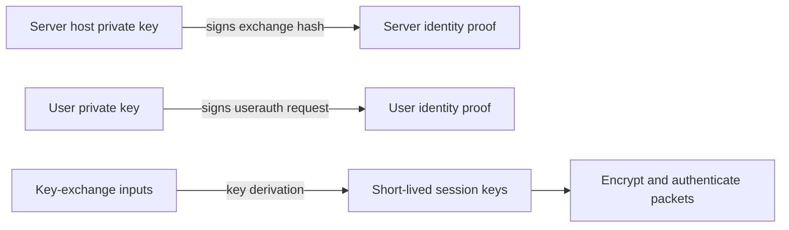
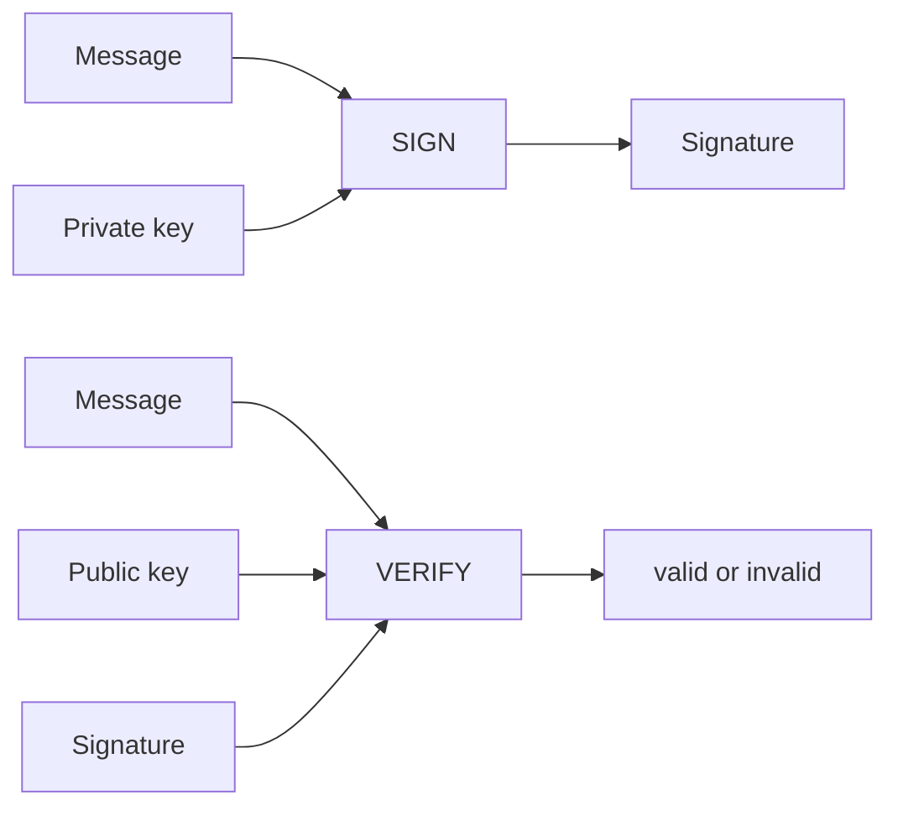
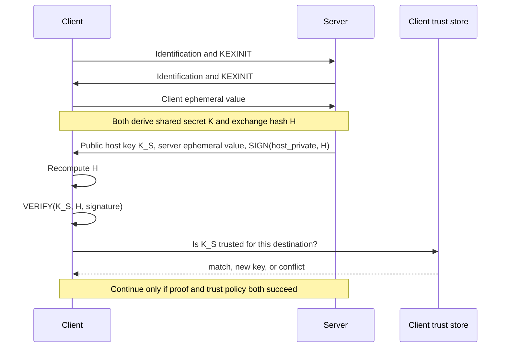
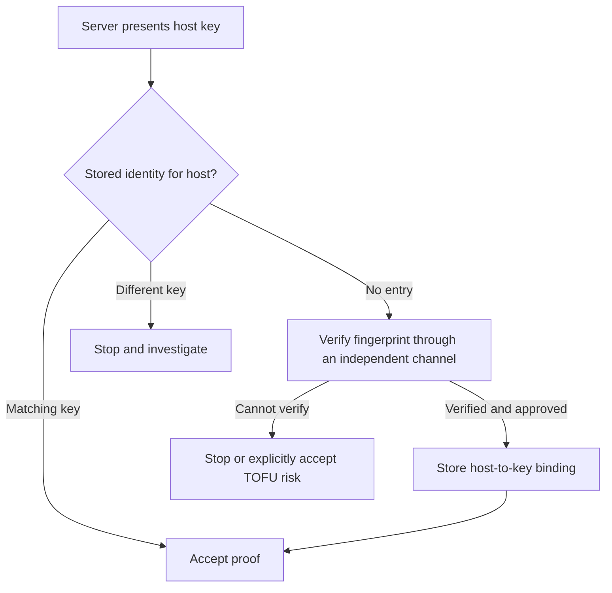
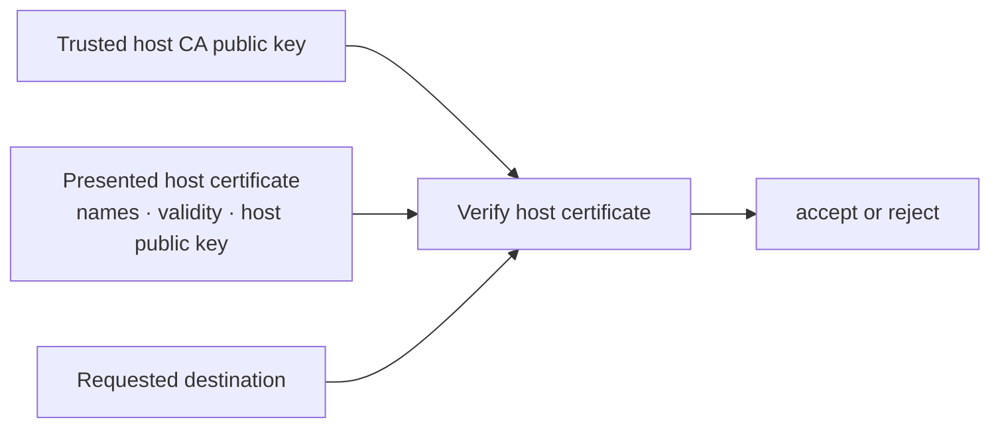
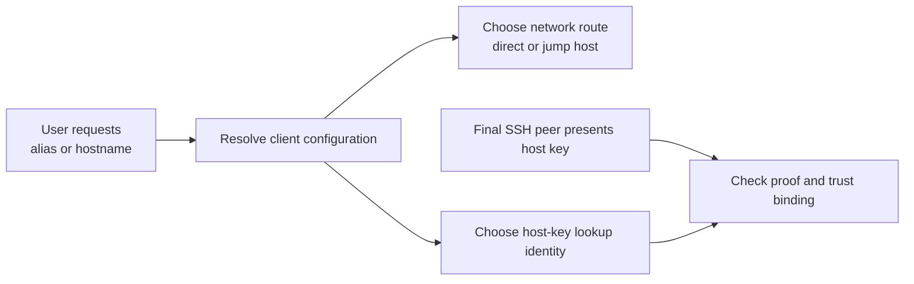
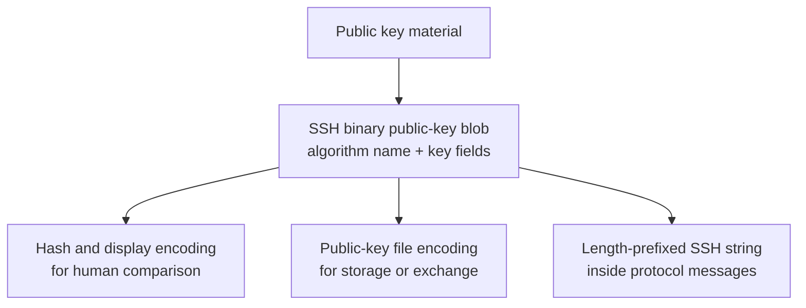

# Server authentication

Before a client sends a password, opens a shell, or forwards a port, it must answer a more basic question: **which server received this connection?** Encryption without this check can create a private tunnel to an attacker.

Server authentication joins two separate facts:

1. The server proves that it controls a private host key.
2. The client decides whether the matching public host key is trusted for the requested host.

The protocol provides the proof. Local policy provides the trust decision. [RFC 4251, Section 4.1](https://www.rfc-editor.org/rfc/rfc4251.html#section-4.1) describes the SSH host-key trust models, while [RFC 4253, Section 7](https://www.rfc-editor.org/rfc/rfc4253.html#section-7) binds the host key into key exchange.

## Learning objectives

After this chapter, you should be able to:

- distinguish a host key from a user key and a session encryption key;
- explain what the server signs during key exchange;
- describe trust on first use and CA-based trust;
- decide safely what to do when a host key is new or has changed; and
- recognize the difference between a wire-format key blob and a public-key file.

## Three kinds of keys

The word *key* is overloaded in SSH. Keep these roles separate:

| Key | Usually persists? | Controlled by | Purpose |
| --- | --- | --- | --- |
| Host key pair | Yes | Server operator | Prove the server's identity |
| User key pair | Yes | User or agent | Prove authorization for an account |
| Session encryption keys | No | This connection's endpoints | Protect packets in this connection |



A host key and a user key can use the same kind of signature algorithm, but they sign different data and are checked against different trust stores. Session keys are symmetric secrets derived by key exchange; they are not entries in `known_hosts` or `authorized_keys`.

## Signing is not encryption

A digital signature is a proof about data, not a container that hides data. At a black-box level:



- `SIGN(private key, message) -> signature`
- `VERIFY(public key, message, signature) -> valid or invalid`

The verifier learns that somebody controlling the private key signed exactly that message. The message and signature need not be secret. By contrast, encryption takes plaintext and an encryption key and produces ciphertext so that an observer cannot read the plaintext.

Modern SSH host keys such as `ssh-ed25519` are signature-only keys; they do not encrypt the connection. [RFC 8709](https://www.rfc-editor.org/rfc/rfc8709.html#section-3) specifies Ed25519 and Ed448 for SSH. RSA keys can also produce signatures using `rsa-sha2-256` or `rsa-sha2-512`, specified by [RFC 8332](https://www.rfc-editor.org/rfc/rfc8332.html). The key-exchange output is what supplies symmetric encryption keys.

## How key exchange authenticates the server

During key exchange, both sides compute an exchange hash `H`. Its inputs include the client and server identification strings, both algorithm-negotiation packets, the server public host key, the ephemeral key-exchange values, and the shared secret. The exact details vary by key-exchange method, but the interface is stable:

```text
HASH(protocol transcript || server host key || shared-secret inputs) -> H
SIGN(server host private key, H) -> signature
```

The first `H` also becomes the connection's session identifier. See [RFC 4253, Sections 7.2 and 8](https://www.rfc-editor.org/rfc/rfc4253.html#section-7.2).



Checking only the signature is insufficient. An attacker can sign with the attacker's own host key. The client must also know that the presented public key belongs to the destination the user intended.

Conversely, finding a matching key in `known_hosts` is insufficient unless the signature over the exchange is valid. The signature proves that the peer currently controls the private half and binds that proof to this particular key-exchange transcript.

## Trust models

### Pre-provisioned host keys

An administrator can distribute a verified host public key before the first connection. The client then accepts only that key for the destination. This is strong and simple, but distributing and rotating entries across many clients takes work.

### Trust on first use

Trust on first use, commonly shortened to TOFU, remembers the key observed on the first connection and requires the same key later.



TOFU detects an attacker who appears only after a trustworthy first connection. It does not detect an attacker present during that first connection. A fingerprint displayed in the same network path is not independent verification; obtain it from an administrator, an authenticated inventory system, a console, or another trusted channel.

### Certification authority

With CA-based trust, the client trusts a CA public key and accepts host identities certified under it, subject to certificate names and validity policy. This moves the maintenance problem from every host key to a smaller set of CA keys.



The architecture permits a CA trust model; certificate encoding and policy are extension-specific. OpenSSH records trusted host CAs with an `@cert-authority` marker in known-hosts files. See the OpenBSD [`sshd(8)` KNOWN_HOSTS FILE FORMAT](https://man.openbsd.org/sshd#SSH_KNOWN_HOSTS_FILE_FORMAT) documentation for that implementation's syntax.

## The `known_hosts` database

In OpenSSH-style clients, `known_hosts` implements a local mapping from a connection identity to one or more acceptable public host keys. A simplified entry looks like this:

```text
host-patterns key-type base64-key optional-comment
```

Host patterns can include hostnames and addresses; non-default ports are commonly represented as `[host]:port`. Hostnames may be hashed to reduce what a stolen file reveals. Hashing hides names at rest, but it does not make an untrusted key trustworthy.

OpenSSH supports two especially important markers:

- `@cert-authority` makes the listed key a trusted signer for host certificates matching the host pattern.
- `@revoked` rejects the listed key if it is encountered.

The file is a trust database, not a record of whatever the network most recently said. Automatically replacing a conflicting key erases the very signal designed to reveal interception or an unexpected server replacement.

### What identity should be looked up?

The trust lookup should follow the destination the user intended and the client's explicit configuration. Details such as aliases, non-default ports, proxy jumps, and host-key aliases can change the lookup name.



A jump host transports bytes toward the final server; it does not replace final-server host verification. Each SSH connection has its own peer identity and trust decision.

## Fingerprints and key formats

A fingerprint is a compact digest of a public key blob. It is useful for comparing keys over a human channel, but it is not an identity by itself: the trusted statement must bind the fingerprint to a particular hostname or host role.

Do not confuse these representations:



[RFC 4716](https://www.rfc-editor.org/rfc/rfc4716.html) defines an SSH2 public-key file format with `BEGIN SSH2 PUBLIC KEY` and `END SSH2 PUBLIC KEY` markers. This is a storage and interchange format, not the framing sent directly as a key-exchange field. OpenSSH also uses its own one-line public-key format in files. These representations are distinct even though both may contain Base64 text.

## Host-key changes

A changed key can be legitimate: a host was rebuilt, an algorithm was retired, a service moved, or keys were rotated. It can also mean DNS or routing manipulation, a misdirected connection, or an active machine-in-the-middle attack.

When a stored binding conflicts:

1. Stop before user authentication. Do not send a password to an unverified peer.
2. Confirm the exact hostname, port, resolved configuration, and route.
3. Obtain the new fingerprint through an independent trusted channel.
4. Understand why the old key changed and whether it should be revoked.
5. Update the narrowest correct trust entry only after verification.

> **Safety note:** Instructions to “just delete `known_hosts`” discard unrelated trust and normalize bypassing warnings. Diagnose and replace the specific stale binding only after verifying the new identity.

Host-key rotation can be designed so old and new keys overlap, letting clients learn the replacement through an already authenticated connection. The precise mechanism depends on client and server extensions, but the invariant remains: a new trust binding needs an authenticated path.

## Protocol review

At the end of server authentication, you should be able to answer all of these questions from the protocol exchange and the client's trust policy:

- Which configured destination identity did I check?
- Which host-key algorithm and exact public key did the server present?
- Was the signature over the exchange hash valid?
- Which trust rule accepted the key: an exact stored key, a verified first-use decision, or a trusted CA?
- If the key conflicted, did I abort before sending user credentials?

Only after both cryptographic proof and trust policy succeed should the client send `SSH_MSG_NEWKEYS`-protected user-authentication traffic.

## Lab: reason about three connections

For each situation, write down whether the signature check succeeds, whether the identity check succeeds, and what the client should do.

1. A known server presents the stored public key and a valid signature.
2. An attacker presents a different public key and a valid signature made by the matching attacker key.
3. A rebuilt server presents a new key that an administrator has independently verified.

The key insight is that situation 2 has valid cryptography but invalid identity. Situation 3 becomes safe only when the trust database is deliberately updated from authenticated information.

## References

- [RFC 4251: The Secure Shell (SSH) Protocol Architecture](https://www.rfc-editor.org/rfc/rfc4251.html), especially Section 4.1.
- [RFC 4253: The Secure Shell (SSH) Transport Layer Protocol](https://www.rfc-editor.org/rfc/rfc4253.html), especially Sections 7 and 8.
- [RFC 4716: The Secure Shell (SSH) Public Key File Format](https://www.rfc-editor.org/rfc/rfc4716.html).
- [RFC 8332: Use of RSA Keys with SHA-256 and SHA-512 in SSH](https://www.rfc-editor.org/rfc/rfc8332.html).
- [RFC 8709: Ed25519 and Ed448 Public Key Algorithms for SSH](https://www.rfc-editor.org/rfc/rfc8709.html).
- [OpenBSD `sshd(8)`: SSH known-hosts file format](https://man.openbsd.org/sshd#SSH_KNOWN_HOSTS_FILE_FORMAT).
