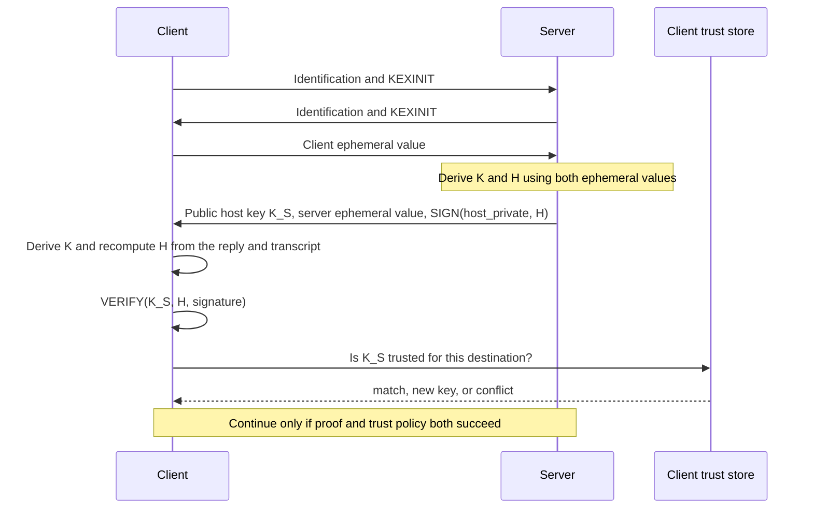
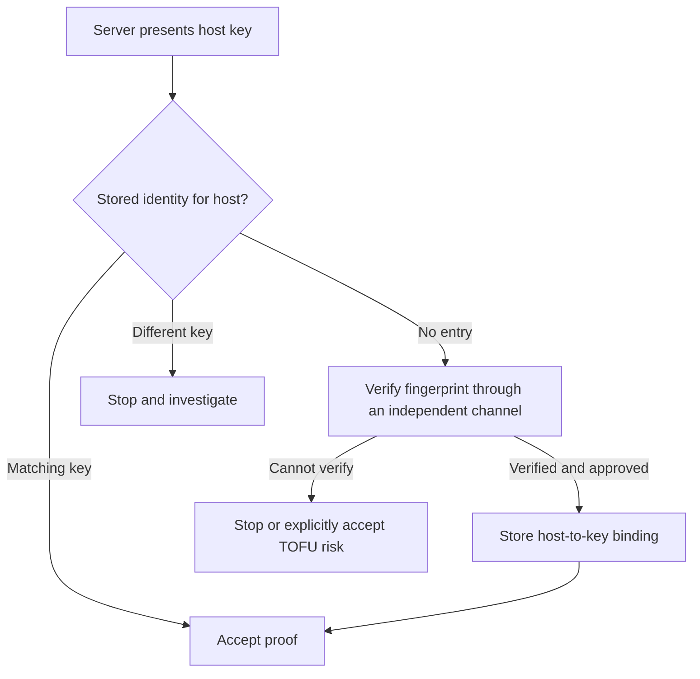
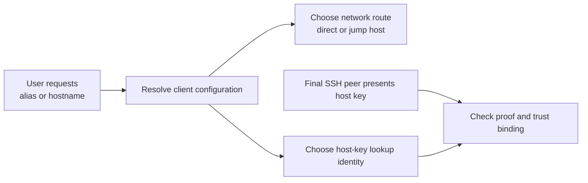
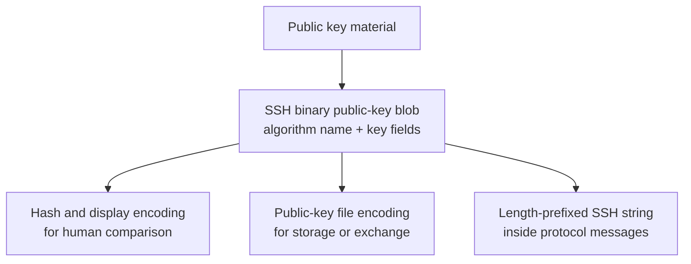

# Server authentication

Before a client sends a password, opens a shell, or forwards a port, it must answer a more basic question: **which server received this connection?** Encryption without this check can create a private tunnel to an attacker.

Server authentication joins two separate facts:

1. The server proves that it controls a private host key.
2. The client decides whether the matching public host key is trusted for the requested host.

The protocol provides the proof. Local policy provides the trust decision.
[RFC 4251, Section 4.1](https://www.rfc-editor.org/rfc/rfc4251.html#section-4.1)
describes the SSH host-key trust models. [RFC 4253, Section
8](https://www.rfc-editor.org/rfc/rfc4253.html#section-8) shows the host key
bound into a signed key exchange.

## From host-key proof to server identity

[Key exchange](./key-exchange.md) explains how the server signs the exchange
hash `H`. The client verifies that
[signature](./crypto-signatures.md#signatures-as-a-black-box) with the public
host key carried in the key-exchange reply. This proves control of the
matching private key and binds the proof to this exchange.

The proof does not name a network destination. An attacker can complete the
same protocol with the attacker's own host key. The client must also apply a
trust rule that binds the presented public key to the destination it intended
to reach.



The two checks are independent. A trusted stored key without a valid exchange
signature proves nothing about the current peer. A valid signature made by an
untrusted key proves control of that key, not the server's identity.

## Trust models

### Pre-provisioned host keys

An administrator can distribute a verified host public key before the first connection. The client then accepts only that key for the destination. This is strong and simple, but distributing and rotating entries across many clients takes work.

### Trust on first use

Trust on first use, commonly shortened to TOFU, remembers the key observed on the first connection and requires the same key later.



TOFU detects an attacker who appears only after a trustworthy first connection. It does not detect an attacker present during that first connection. A fingerprint displayed in the same network path is not independent verification; obtain it from an administrator, an authenticated inventory system, a console, or another trusted channel.

### Certification authority

With CA-based trust, the client trusts a CA public key and accepts host identities certified under it, subject to certificate names and validity policy. This moves the maintenance problem from every host key to a smaller set of CA keys.

The deployed OpenSSH certificate format wraps a host public key with signed
metadata; [Certificates](./crypto-signatures.md#certificates) explains the
signature structure. A client that wants a certificate lists names such as
`ssh-ed25519-cert-v01@openssh.com` in its host-key algorithm proposal. If one
is selected, the certificate takes the place of the plain host key as `K_S`,
and the server still signs `H` with the certified key's private half. A
client validates at least:

- that the certificate is a host certificate, not a user certificate;
- the CA signature and local trust in that CA;
- a principal matching the intended destination;
- the validity interval and revocation policy; and
- every critical option it must understand to accept the certificate.

If the certificate fails these checks, the certificate specification allows a
client to fall back to treating the certified key as a plain host key. That
key then needs an ordinary trust entry; a failed certificate grants nothing.

The key identifier is useful for logs and revocation, but it is not the
hostname match. OpenSSH records trusted host CAs with an `@cert-authority`
marker in `known_hosts`. The format is a deployed extension rather than an
X.509 certificate. See the
[SSH certificate format Internet-Draft](https://datatracker.ietf.org/doc/draft-miller-ssh-cert/),
which replaced OpenSSH's former `PROTOCOL.certkeys` file, and the
[`sshd(8)` known-hosts format](https://man.openbsd.org/sshd#SSH_KNOWN_HOSTS_FILE_FORMAT).

## The `known_hosts` database

In OpenSSH-style clients, `known_hosts` implements a local mapping from a connection identity to one or more acceptable public host keys. A simplified entry looks like this:

```text
host-patterns key-type base64-key optional-comment
```

Host patterns can include hostnames and addresses; non-default ports are commonly represented as `[host]:port`. Hostnames may be hashed to reduce what a stolen file reveals. Hashing hides names at rest, but it does not make an untrusted key trustworthy.

OpenSSH supports two especially important markers:

- `@cert-authority` makes the listed key a trusted signer for host certificates matching the host pattern.
- `@revoked` rejects the listed key if it is encountered.

The file is a trust database, not a record of whatever the network most recently said. Automatically replacing a conflicting key erases the very signal designed to reveal interception or an unexpected server replacement.

### What identity should be looked up?

The trust lookup should follow the destination the user intended and the client's explicit configuration. Details such as aliases, non-default ports, proxy jumps, and host-key aliases can change the lookup name.



A jump host transports bytes toward the final server; it does not replace final-server host verification. Each SSH connection has its own peer identity and trust decision.

## Fingerprints and key formats

A [fingerprint](./crypto-hashes.md#fingerprints) is a compact digest of a public key blob. OpenSSH's default form, such as `SHA256:` followed by Base64 text, names the hash and encodes its output. It is useful for comparing keys over a human channel, but it is not an identity by itself: the trusted statement must bind the fingerprint to a particular hostname or host role.

Compare the complete fingerprint, not just its first and last few characters. A hash makes it infeasible to find a different key with the same full digest, but an attacker can cheaply generate keys until a short prefix or suffix matches; the [cost table](./crypto-hashes.md#compare-the-whole-fingerprint) shows how cheaply. A fingerprint is also only as trustworthy as the channel that delivered the reference value.

Do not confuse these representations:



[RFC 4716](https://www.rfc-editor.org/rfc/rfc4716.html) defines an SSH2 public-key file format with `BEGIN SSH2 PUBLIC KEY` and `END SSH2 PUBLIC KEY` markers. This is a storage and interchange format, not the framing sent directly as a key-exchange field. OpenSSH also uses its own one-line public-key format in files. These representations are distinct even though both may contain Base64 text.

## Host-key changes

A changed key can be legitimate: a host was rebuilt, an algorithm was retired, a service moved, or keys were rotated. It can also mean DNS or routing manipulation, a misdirected connection, or an active machine-in-the-middle attack.

When a stored binding conflicts:

1. Stop before user authentication. Do not send a password to an unverified peer.
2. Confirm the exact hostname, port, resolved configuration, and route.
3. Obtain the new fingerprint through an independent trusted channel.
4. Understand why the old key changed and whether it should be revoked.
5. Update the narrowest correct trust entry only after verification.

> **Safety note:** Instructions to “just delete `known_hosts`” discard unrelated trust and normalize bypassing warnings. Diagnose and replace the specific stale binding only after verifying the new identity.

Host-key rotation can be designed so old and new keys overlap, letting clients learn the replacement through an already authenticated connection. The precise mechanism depends on client and server extensions, but the invariant remains: a new trust binding needs an authenticated path.

OpenSSH deploys such a path with `hostkeys` and `hostkeys-prove` global
requests. After user authentication, the server can advertise its host-key
set. The client asks for possession proofs for new keys; each proof covers the
session identifier and the new host key. The client records a new key only
after verifying its proof through the connection already authenticated by a
trusted key.

This mechanism supports overlap and algorithm migration. It does not make an
unexpected key at the start of an unauthenticated connection trustworthy. The
[host-key update Internet-Draft](https://datatracker.ietf.org/doc/draft-ietf-sshm-hostkey-update/)
documents the deployed protocol.

## Protocol review

At the end of server authentication, you should be able to answer all of these questions from the protocol exchange and the client's trust policy:

- Which configured destination identity did I check?
- Which host-key algorithm and exact public key did the server present?
- Was the signature over the exchange hash valid?
- Which trust rule accepted the key: an exact stored key, a verified first-use decision, or a trusted CA?
- If the key conflicted, did I abort before sending user credentials?

Only after both cryptographic proof and trust policy succeed should the client send `SSH_MSG_NEWKEYS`-protected user-authentication traffic.

## Lab: reason about three connections

For each situation, write down whether the signature check succeeds, whether the identity check succeeds, and what the client should do.

1. A known server presents the stored public key and a valid signature.
2. An attacker presents a different public key and a valid signature made by the matching attacker key.
3. A rebuilt server presents a new key that an administrator has independently verified.

Situation 2 has valid cryptography but invalid identity. Situation 3 becomes
safe only after the trust database is updated from authenticated information.

## References

- [RFC 4251: The Secure Shell (SSH) Protocol Architecture](https://www.rfc-editor.org/rfc/rfc4251.html), especially Section 4.1.
- [RFC 4253: The Secure Shell (SSH) Transport Layer Protocol](https://www.rfc-editor.org/rfc/rfc4253.html), especially Sections 7 and 8.
- [RFC 4716: The Secure Shell (SSH) Public Key File Format](https://www.rfc-editor.org/rfc/rfc4716.html).
- [RFC 8332: Use of RSA Keys with SHA-256 and SHA-512 in SSH](https://www.rfc-editor.org/rfc/rfc8332.html).
- [RFC 8709: Ed25519 and Ed448 Public Key Algorithms for SSH](https://www.rfc-editor.org/rfc/rfc8709.html).
- [OpenBSD `sshd(8)`: SSH known-hosts file format](https://man.openbsd.org/sshd#SSH_KNOWN_HOSTS_FILE_FORMAT).
- [OpenSSH host-key update Internet-Draft](https://datatracker.ietf.org/doc/draft-ietf-sshm-hostkey-update/).
- [SSH certificate format Internet-Draft](https://datatracker.ietf.org/doc/draft-miller-ssh-cert/).
