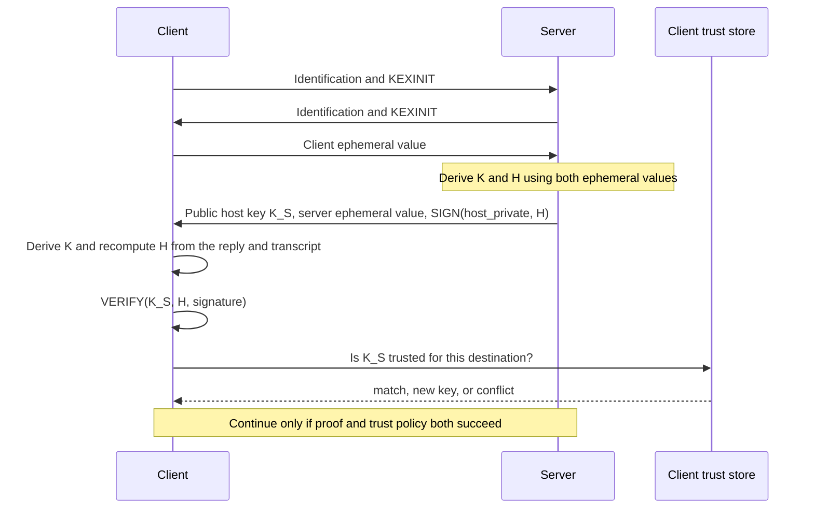
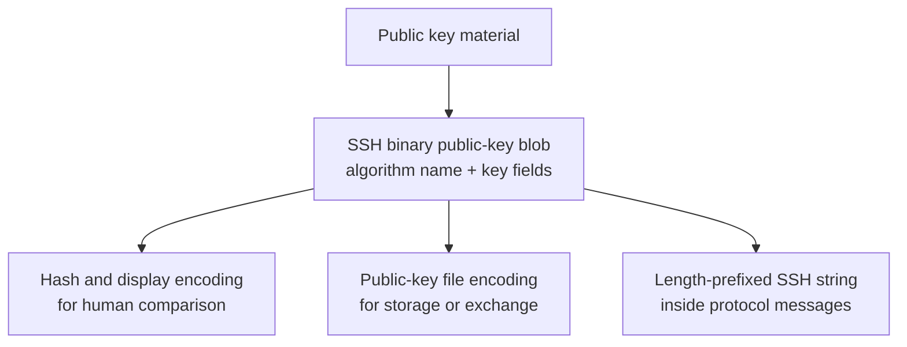
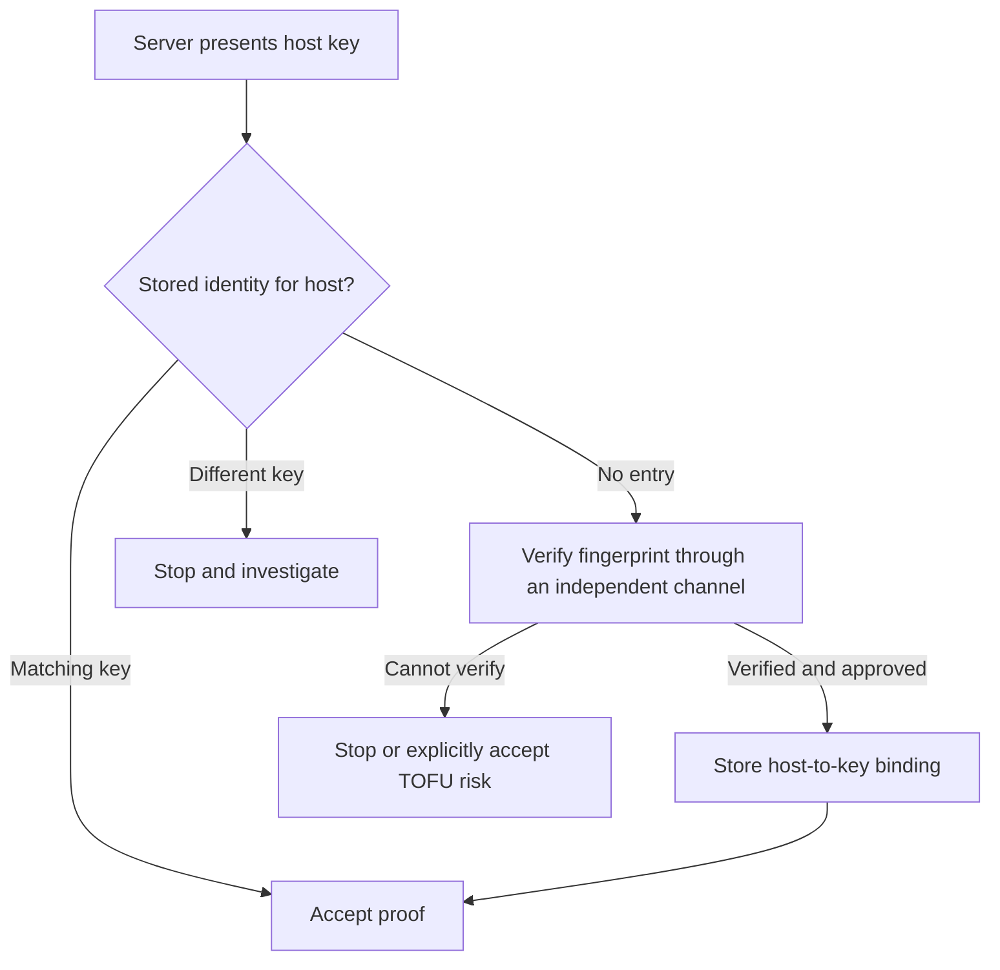
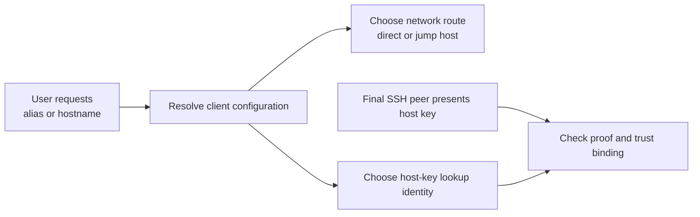
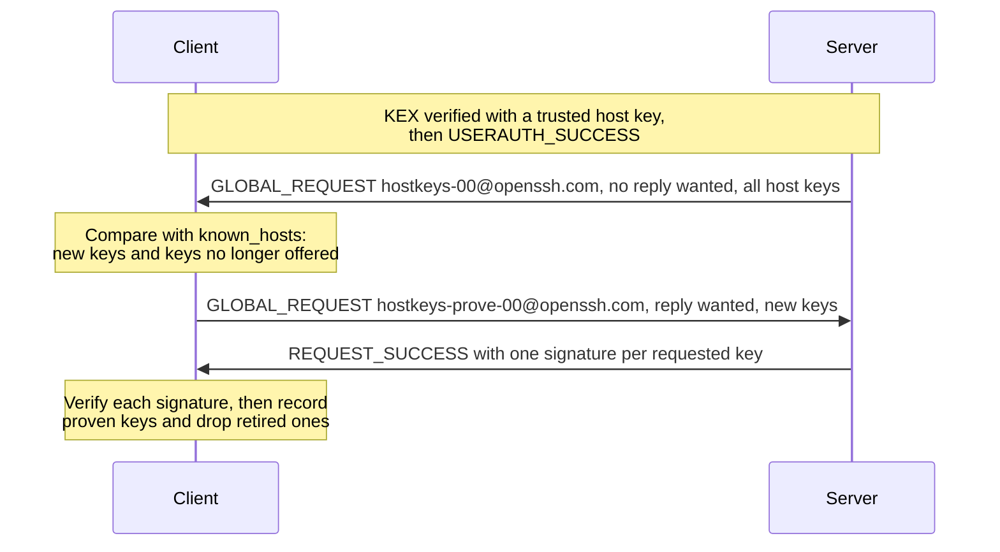

# Server authentication

Before a client sends a password, opens a shell, or forwards a port, it must
know **which server it is talking to**. Encryption without this check can
create a private tunnel to an attacker.

Server authentication joins two separate facts:

1. The server proves that it controls a private host key.
2. The client decides whether the matching public host key is trusted for the
   requested host.

The protocol provides the proof; local policy provides the trust decision.
[RFC 4251, Section 4.1](https://www.rfc-editor.org/rfc/rfc4251.html#section-4.1)
describes the trust models, and
[RFC 4253, Section 8](https://www.rfc-editor.org/rfc/rfc4253.html#section-8)
binds the host key into the signed key exchange.

## From host-key proof to server identity

As [Key exchange](./key-exchange.md) explains, the server signs the exchange
hash `H`, and the client verifies that
[signature](./crypto-signatures.md#signatures-as-a-black-box) with the public
host key `K_S` from the key-exchange reply. This proves control of the
matching private key, bound to this exchange.

The proof names no destination. An attacker can complete the same protocol
with its own host key, so the client must also check that the presented key
belongs to the destination it meant to reach.



The two checks are independent. A trusted stored key without a valid
signature proves nothing about the current peer; a valid signature from an
untrusted key proves control of that key, not the server's identity. Only
when both succeed should the client start user authentication.

## Fingerprints and key formats

A [fingerprint](./crypto-hashes.md#fingerprints) is a short digest of a public
key blob. OpenSSH's default form, `SHA256:` followed by Base64, names the hash
and encodes its output. It is convenient for comparing keys over a human
channel, but it is not an identity by itself: the trusted statement must bind
it to a hostname or host role.

Compare the whole fingerprint. Finding a different key with the same full
digest is infeasible, but generating keys until a short prefix or suffix
matches is cheap; the
[cost table](./crypto-hashes.md#compare-the-whole-fingerprint) shows how
cheap. A fingerprint is also only as trustworthy as the channel that delivered
the reference value.

Keep the representations apart:



[RFC 4716](https://www.rfc-editor.org/rfc/rfc4716.html) defines a public-key
file format framed by `BEGIN SSH2 PUBLIC KEY` and `END SSH2 PUBLIC KEY`, and
OpenSSH uses its own one-line format. Both are storage formats containing
Base64 text; neither is what appears on the wire as `K_S`.

## Trust models

### Pre-provisioned host keys

An administrator distributes a verified host public key before the first
connection, and the client accepts only that key for the destination. This is
strong and simple, but keeping entries current across many clients takes
work.

### Trust on first use

Trust on first use (TOFU) records the key seen on the first connection and
requires the same key afterwards.



TOFU detects an attacker who appears after a trustworthy first connection,
but not one present during it. A fingerprint shown over the same network path
is not independent verification; get it from an administrator, an
authenticated inventory, a console, or another trusted channel.

OpenSSH's `StrictHostKeyChecking` sets the policy for unknown keys: `ask` (the
default) prompts, `accept-new` records them silently, and `yes` refuses any
key not already known. In every mode except `no`, a *changed* key stops the
connection
([`ssh_config(5)`](https://man.archlinux.org/man/ssh_config.5#StrictHostKeyChecking)).

### Certification authority

With CA-based trust, the client trusts a CA public key and accepts host keys
that CA has certified. Maintenance shrinks from one entry per host to a few
CA keys.

An OpenSSH host certificate wraps the host public key with metadata signed by
the CA; [Certificates](./crypto-signatures.md#certificates) describes the
structure. A client that accepts certificates lists names such as
`ssh-ed25519-cert-v01@openssh.com` in its host-key algorithm proposal. If one
is selected, the certificate is sent as `K_S`, and the server still signs `H`
with the certified key's private half. The
[certificate format Internet-Draft](https://datatracker.ietf.org/doc/draft-miller-ssh-cert/)
(which replaced OpenSSH's `PROTOCOL.certkeys`) requires the client to check:

- **role**: the certificate is a host certificate, not a user certificate;
- **CA signature and trust**: the CA signature is valid, the signing key is
  not itself a certificate, and a `known_hosts` line marked
  `@cert-authority` lists that CA key with a host pattern matching the
  destination;
- **principals**: one of the certificate's principals matches the destination
  name, which for OpenSSH is the name the user gave, the `HostKeyAlias`, or
  the canonicalized hostname;
- **validity**: the current time lies within the certificate's validity
  interval;
- **critical options**: none are defined for host certificates, so any
  critical option is unrecognized and makes the certificate unacceptable.

The CA's host pattern and the certificate's principals are separate checks: a
CA trusted for `*.example.com` cannot vouch for `bank.example.org`, and a
certificate for `db1.example.com` does not cover `db2.example.com`. The key
identifier appears in logs and can be revoked, but it is not matched against
the hostname.

Certificates limit their own lifetime. For earlier withdrawal, OpenSSH
refuses a host key or CA key listed on a `@revoked` line in `known_hosts` or
in the file named by `RevokedHostKeys`; the latter may be a key revocation
list (KRL), which can also revoke certificates by serial number or key
identifier.

If a certificate fails these checks, OpenSSH's client retries with the
certified key treated as a plain host key, which then needs an ordinary
`known_hosts` entry. A failed certificate grants nothing on its own.

### DNS fingerprints (SSHFP)

An SSHFP DNS record publishes a host-key fingerprint under the host's DNS
name ([RFC 4255](https://www.rfc-editor.org/rfc/rfc4255.html)). Each record
holds an algorithm number, a fingerprint type, and a digest of the SSH
public-key blob:

| Field | Values |
| --- | --- |
| Algorithm | 1 RSA, 2 DSA ([RFC 4255](https://www.rfc-editor.org/rfc/rfc4255.html)); 3 ECDSA ([RFC 6594](https://www.rfc-editor.org/rfc/rfc6594.html)); 4 Ed25519 ([RFC 7479](https://www.rfc-editor.org/rfc/rfc7479.html)); 6 Ed448 ([RFC 8709](https://www.rfc-editor.org/rfc/rfc8709.html)) |
| Fingerprint type | 1 SHA-1 (RFC 4255); 2 SHA-256 (RFC 6594) |

The client looks up the records for the name it is connecting to and accepts
the key if both the algorithm and the digest match a record. This moves trust
to the DNS zone, so it holds only with DNSSEC: RFC 4255 says a key verified
this way **must not** be trusted unless the SSHFP answer was authenticated by
DNSSEC. Most clients learn that from their resolver, so the path to a
validating resolver must itself be trusted. RFC 4255 also recommends checking
local `known_hosts` before DNS when users type unqualified names, since a
manipulated DNS search path could otherwise send the client to a different
host whose SSHFP records match.

OpenSSH enables the check with `VerifyHostKeyDNS`
([`ssh_config(5)`](https://man.archlinux.org/man/ssh_config.5#VerifyHostKeyDNS)):

- `yes`: trust a key matching a DNSSEC-validated ("secure") fingerprint
  without asking; an insecure match is treated as `ask`;
- `ask`: report whether a matching fingerprint was found, but still confirm
  new keys according to `StrictHostKeyChecking`;
- `no` (the default): do not consult DNS.

`ssh-keygen -r hostname` prints the SSHFP records for a server's host keys.

## The `known_hosts` database

In OpenSSH, `known_hosts` maps connection identities to acceptable host keys
or CA keys. Each line has the form
([`sshd(8)`](https://man.archlinux.org/man/sshd.8#SSH_KNOWN_HOSTS_FILE_FORMAT)):

```text
[marker] host-patterns key-type base64-key [comment]
```

Host patterns are comma-separated names or addresses with `*` and `?`
wildcards and `!` negation; a non-default port is written `[host]:port`.
Names may be hashed so a stolen file reveals less, but hashing does not make
an untrusted key trustworthy. The optional marker is `@cert-authority` (the
key is a CA trusted for host certificates matching the patterns) or
`@revoked` (the key must never be accepted). A system-wide
`ssh_known_hosts` file and the per-user file are both consulted.

The file is a trust database, not a record of whatever the network last said.
Automatically replacing a conflicting key erases the signal meant to reveal
interception or an unexpected server replacement.

### What identity should be looked up?

The lookup follows the destination the user intended and the client's
explicit configuration. Aliases, non-default ports, jump hosts, and
`HostKeyAlias` can all change the lookup name.



A jump host relays bytes toward the final server; it does not replace
verification of the final server. Each SSH connection has its own peer and
its own trust decision.

## Host-key changes

A changed key can be legitimate: the host was rebuilt, an algorithm was
retired, a service moved, or keys were rotated. It can also mean DNS or
routing manipulation, a misdirected connection, or an active
machine-in-the-middle attack. The protocol cannot tell these apart.

When a stored binding conflicts:

1. Stop before user authentication; send no credentials to an unverified peer.
2. Confirm the exact hostname, port, resolved configuration, and route.
3. Obtain the new fingerprint through an independent trusted channel.
4. Find out why the key changed and whether the old one should be revoked.
5. Update the narrowest correct trust entry only after verification.

> **Safety note:** Advice to “just delete `known_hosts`” discards unrelated
> trust and trains users to bypass warnings. Replace only the specific stale
> binding, and only after verifying the new identity.

## Host-key rotation

A server can avoid that conflict by letting clients learn a new key *before*
the old one is retired, over a connection the old key has already
authenticated. OpenSSH deploys this as two global requests, now specified in
the
[host-key update Internet-Draft](https://datatracker.ietf.org/doc/draft-ietf-sshm-hostkey-update/)
(standard names `hostkeys` and `hostkeys-prove`; OpenSSH uses the vendor
names shown below).



1. After user authentication, the server sends `hostkeys-00@openssh.com`
   listing every host public key it has, at most once per connection.
2. For each advertised key the client has not recorded, it sends
   `hostkeys-prove-00@openssh.com` asking for proof of possession.
3. The server answers with one signature per requested key, each made with
   that key over:

   ```text
   string  "hostkeys-prove-00@openssh.com"
   string  session identifier
   string  host key blob
   ```

4. The client verifies every signature before recording any new key, and may
   remove recorded keys the server no longer advertises.

**Why the proof is needed.** Public keys are public: any server could
advertise another server's key. If a client recorded advertised keys without
proof, a malicious server could have the client accept a legitimate server's
key under the malicious server's name, then forward later connections there,
so actions meant for one host would happen on the other. The signature
covers the [session identifier](./key-exchange.md#session-identifier-versus-exchange-hash),
so it proves possession of the private key *now, on this connection*, and
cannot be replayed from elsewhere.

**What it does not do.** Keys learned this way are only as trustworthy as the
key that authenticated the connection. The mechanism does not help on first
contact, and it does not help after an unannounced change: if the old key is
already gone, the client sees an ordinary conflict. An attacker who was
accepted on first use can use it to plant more keys of its own.

OpenSSH controls the client side with `UpdateHostKeys`
([`ssh_config(5)`](https://man.archlinux.org/man/ssh_config.5#UpdateHostKeys)): `yes`,
`no`, or `ask`. It is on by default unless the user has changed
`UserKnownHostsFile` or enabled `VerifyHostKeyDNS`. The client accepts updates
only when the connection was authenticated with a plain key (not a
certificate) that the user's own `known_hosts` already held or the user had
just explicitly accepted.

## Lab: reason about four connections

For each situation, decide whether the signature check succeeds, whether the
identity check succeeds, and what the client should do.

1. A known server presents the stored public key and a valid signature.
2. An attacker presents a different public key and a valid signature made by
   the matching attacker key.
3. A rebuilt server presents a new key that an administrator has
   independently verified.
4. A server presents a key with no `known_hosts` entry; an SSHFP record
   matches, but the resolver did not validate it with DNSSEC.

Situation 2 has valid cryptography but no valid identity. Situation 3 becomes
safe only after the trust database is updated from verified information.
Situation 4 is no better than an unverified first use: with `VerifyHostKeyDNS
yes`, OpenSSH falls back to asking.

## Check your understanding

1. The signature over `H` verifies. Why is that not enough to continue?
2. A `known_hosts` line reads `@cert-authority *.example.com ssh-ed25519 …`.
   The server `db1.example.com` presents a certificate from that CA whose only
   principal is `web1.example.com`. Is it accepted?
3. Why must an SSHFP match be DNSSEC-validated before it can replace a user's
   confirmation?
4. Why does a client ask for `hostkeys-prove` signatures instead of recording
   the keys in the `hostkeys` advertisement?
5. A server's key changed without any prior rotation announcement. Does
   `UpdateHostKeys` help?
6. The host key conflicts with the stored entry. What should the client do
   before sending a password?

<details>
<summary>Answers</summary>

1. It proves only that the peer holds the private key for `K_S`. The client
   must still check that `K_S` is trusted for the intended destination; an
   attacker can sign with its own key.
2. No. The CA pattern matches, but no principal matches `db1.example.com`.
   (OpenSSH then retries with the certified key as a plain key, which needs
   its own `known_hosts` entry.)
3. Without DNSSEC, an attacker who can spoof DNS answers can publish a
   fingerprint for its own key. RFC 4255 forbids trusting unauthenticated
   SSHFP records.
4. Anyone can advertise a public key. The signature over the session
   identifier proves the server holds the private key now, which stops a
   malicious server from planting another server's key under its own name.
5. No. The mechanism only works over a connection authenticated with an
   already trusted key; after an unannounced change the client sees an
   ordinary conflict.
6. Stop before user authentication, confirm the destination and route, and
   verify the new fingerprint through an independent channel before updating
   the specific trust entry.

</details>

## References

- [RFC 4251 — SSH Protocol Architecture](https://www.rfc-editor.org/rfc/rfc4251.html), Section 4.1.
- [RFC 4253 — SSH Transport Layer Protocol](https://www.rfc-editor.org/rfc/rfc4253.html), Sections 7 and 8.
- [RFC 4255 — Using DNS to Securely Publish SSH Key Fingerprints](https://www.rfc-editor.org/rfc/rfc4255.html).
- [RFC 4716 — SSH Public Key File Format](https://www.rfc-editor.org/rfc/rfc4716.html).
- [RFC 6594 — Use of the SHA-256 Algorithm with RSA, DSA, and ECDSA in SSHFP Resource Records](https://www.rfc-editor.org/rfc/rfc6594.html).
- [RFC 7479 — Using Ed25519 in SSHFP Resource Records](https://www.rfc-editor.org/rfc/rfc7479.html).
- [RFC 8332 — Use of RSA Keys with SHA-256 and SHA-512 in SSH](https://www.rfc-editor.org/rfc/rfc8332.html).
- [RFC 8709 — Ed25519 and Ed448 Public Key Algorithms for SSH](https://www.rfc-editor.org/rfc/rfc8709.html).
- [SSH certificate format Internet-Draft](https://datatracker.ietf.org/doc/draft-miller-ssh-cert/).
- [Host key update mechanism for SSH Internet-Draft](https://datatracker.ietf.org/doc/draft-ietf-sshm-hostkey-update/).
- [OpenBSD `ssh_config(5)`](https://man.archlinux.org/man/ssh_config.5): `StrictHostKeyChecking`, `VerifyHostKeyDNS`, `UpdateHostKeys`, `RevokedHostKeys`, `HostKeyAlias`.
- [OpenBSD `sshd(8)`: SSH known-hosts file format](https://man.archlinux.org/man/sshd.8#SSH_KNOWN_HOSTS_FILE_FORMAT).
