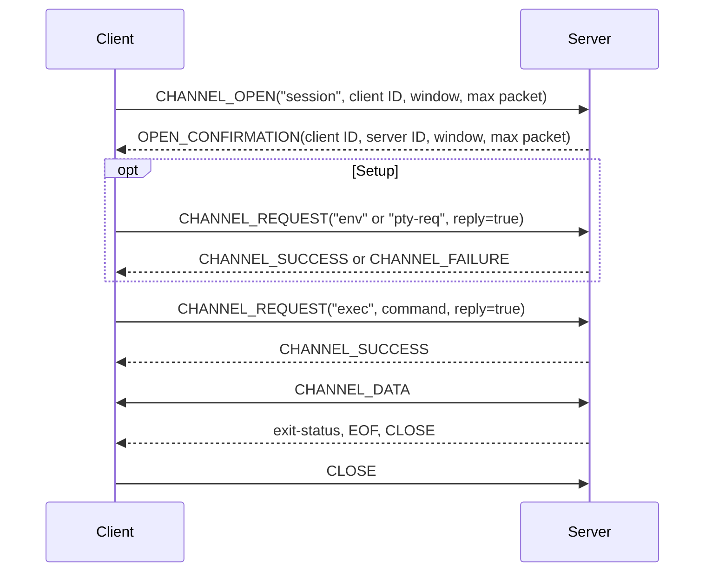
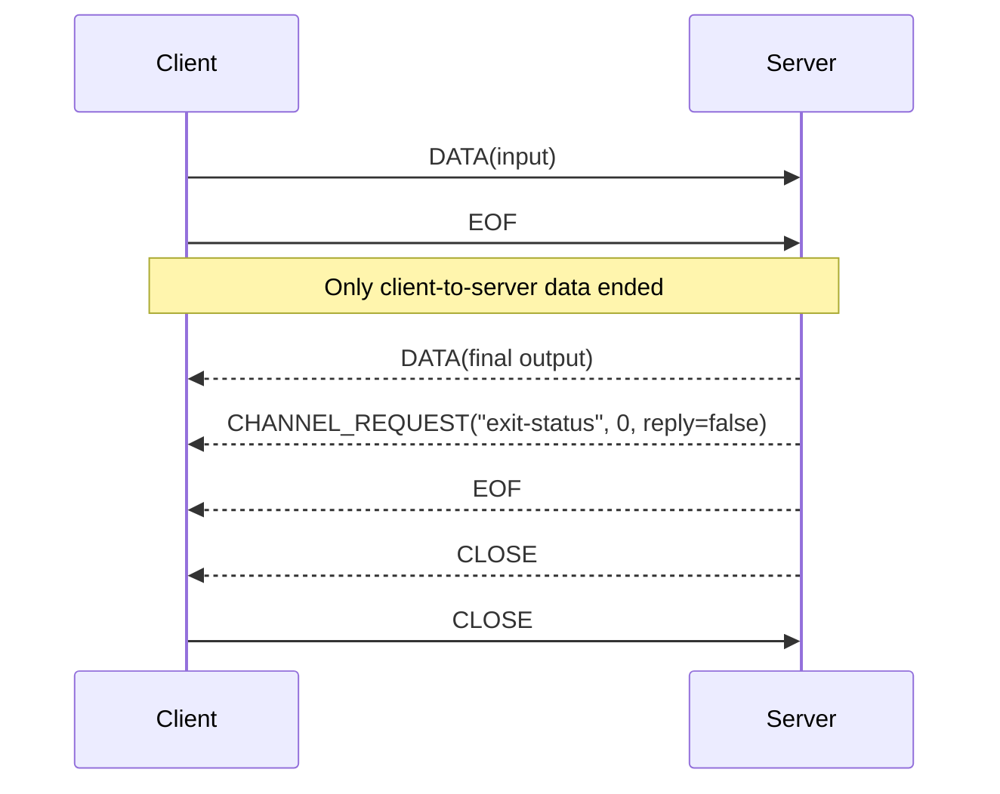

# Sessions: commands, terminals, and subsystems

A `session` channel carries one remote program. The program can be a shell, a
command, or a named subsystem. Opening the channel does not start the program;
the client starts it with a channel request.

Several session channels can share one SSH connection. Each has independent
data, flow control, exit information, and close state. This chapter applies
the mechanics from [Channels and flow control](./channels.md).

## Open, prepare, start

A client first opens a channel of type `session`. The open message contains no
command or terminal settings. RFC 4254 recommends that clients reject
server-initiated `session` opens; the normal direction is client to server.

After confirmation, the client may send setup requests such as `env` and
`pty-req`. It then sends exactly one start request:

| Request | Request-specific data | Meaning |
| --- | --- | --- |
| `shell` | none | Start the account's default shell. |
| `exec` | command string | Ask the server to execute a command. |
| `subsystem` | subsystem name | Start a configured service such as `sftp`. |

Only one of these requests can succeed on a session channel.



The request's `want reply` flag matters. A client should request a reply when
later behavior depends on success. Otherwise a refused `exec` request can look
like a command that produced no output and closed immediately.

## `exec` carries a string, not an argument vector

The `exec` request contains one SSH string. RFC 4254 does not define an array
of arguments, quoting rules, a shell language, or a character encoding for it.
The server decides how to interpret the string.

```text
string "exec"
boolean want_reply
string command
```

A client therefore cannot infer a portable `argv` boundary from the wire.
Quoting rules used by a command-line SSH program belong to that program and
the remote execution environment, not to the SSH connection protocol.

## A PTY changes the byte-stream environment

`pty-req` asks the server to attach the remote program to a pseudo-terminal.
It supplies a terminal type, character and pixel dimensions, and encoded
terminal modes. The request is separate from `shell` or `exec`.

```text
string "pty-req"
boolean want_reply
string terminal type
uint32 columns
uint32 rows
uint32 pixel width
uint32 pixel height
string encoded terminal modes
```

Without a PTY, a session behaves more like ordinary input, output, and error
streams. With a PTY, terminal line discipline can echo input, translate bytes,
interpret control characters, and combine output streams. A binary protocol
or machine-readable command normally should not request a PTY.

After a terminal size changes, the client can send `window-change`. This is a
channel request with the new dimensions. The client should set its `want reply`
flag to false. It is unrelated to `SSH_MSG_CHANNEL_WINDOW_ADJUST`: terminal
dimensions describe a display, while a channel window controls data credit.

The terminal-mode string is its own compact protocol: opcode/value pairs end
with `TTY_OP_END`. It is not a native `termios` structure and should not be
copied as one.

## Environment requests are policy requests

An `env` request carries a name and value. The server may reject it, and many
servers accept only configured names. The request does not modify the SSH
transport or the server process that handles the connection; it asks the
server to construct part of the new program's environment.

Environment values cross a privilege boundary. A server needs policy for
variables that affect library loading, command lookup, localization, or
application configuration.

## Data and extended data

The client usually sends program input with `SSH_MSG_CHANNEL_DATA`. The server
uses the same message for normal output. It may use
`SSH_MSG_CHANNEL_EXTENDED_DATA` with type `SSH_EXTENDED_DATA_STDERR` for the
error stream.

Both message types consume the same receive window. Their SSH message
boundaries do not become record boundaries in the program's byte stream.

When a PTY is present, the remote terminal normally presents one combined
output stream. A client must not assume that extended data will preserve a
separate standard-error stream in that case.

## Signals and process completion

The client can request `signal` on a session channel. SSH uses signal names
such as `TERM`, without the `SIG` prefix. Whether the server can deliver a
signal, and what the remote program does with it, is outside the protocol.

The server reports completion with channel requests sent in the other
direction:

- `exit-status` carries a `uint32` process status;
- `exit-signal` reports signal termination and may include error text.

These reports do not close the channel. A client can receive final data, an
exit report, EOF, and CLOSE as separate events. TCP EOF is not a substitute
for an SSH exit status: it ends the entire transport and may leave the command
result unknown.



## Subsystems

A subsystem is a named protocol service carried inside the session channel.
After a successful `subsystem` request, channel data belongs to that subsystem
protocol. SSH still supplies transport protection, multiplexing, flow control,
and channel closure, but it does not interpret the subsystem messages.

SFTP is the common example. “SFTP over SSH” means that SFTP packets are the
application byte stream of a session channel; SFTP is not an SSH channel type
and is not the same protocol as SCP.

## Trace a command correctly

For one command channel, record these events separately:

1. channel open confirmation;
2. optional setup-request results;
3. start-request result;
4. input EOF, if sent;
5. normal and extended output;
6. exit status or exit signal, if sent; and
7. any EOF events, then CLOSE sent and received.

This prevents three common mistakes: treating channel open as command start,
treating EOF as full close, and treating transport loss as a zero exit status.

## References

- [RFC 4254, Section 5 — Channels](https://www.rfc-editor.org/rfc/rfc4254.html#section-5)
- [RFC 4254, Section 6 — Interactive Sessions](https://www.rfc-editor.org/rfc/rfc4254.html#section-6)
