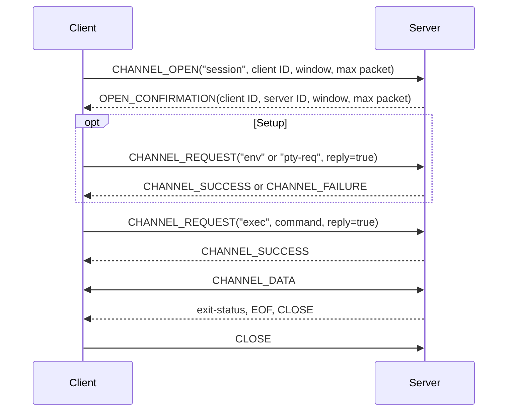

# Sessions: commands, terminals, and subsystems

A `session` channel carries one remote program: a shell, a command, or a named
subsystem. Opening the channel does not start the program; a channel request
does. Several session channels can share one connection, each with its own
data, flow control, exit information, and close state, as described in
[Channels and flow control](./channels.md).

## Open, prepare, start

The client first opens a channel of type `session`. The open message carries
no command or terminal settings. RFC 4254 recommends that clients reject
server-initiated `session` opens.

After confirmation, the client may send setup requests such as `env` and
`pty-req`. It then starts a program with exactly one of these requests:

| Request | Request-specific data | Meaning |
| --- | --- | --- |
| `shell` | none | Start the account's default shell. |
| `exec` | command string | Ask the server to execute a command. |
| `subsystem` | subsystem name | Start a configured service such as `sftp`. |

Only one start request can succeed per channel. After a failure the client may
try another or close the channel; after a success, running another program
needs a new session channel.



Request a reply to the start request. Without one, a refused `exec` looks like
a command that printed nothing and exited.

## Session requests at a glance

All session control travels as `SSH_MSG_CHANNEL_REQUEST` on the session
channel. Some requests flow from the server to the client.

| Request | Sent by | `want reply` | Purpose | Defined in |
| --- | --- | --- | --- | --- |
| `pty-req` | client | usually true | Allocate a pseudo-terminal | RFC 4254 §6.2 |
| `x11-req` | client | usually true | Enable X11 forwarding | RFC 4254 §6.3 |
| `auth-agent-req@openssh.com` | client | either | Enable agent forwarding | RFC 9987 §7.2 |
| `env` | client | either | Set one environment variable | RFC 4254 §6.4 |
| `shell`, `exec`, `subsystem` | client | should be true | Start the program | RFC 4254 §6.5 |
| `window-change` | client | false | Report new terminal dimensions | RFC 4254 §6.7 |
| `signal` | client | false | Deliver a signal to the program | RFC 4254 §6.9 |
| `break` | client | either | Send a serial-line BREAK | RFC 4335 |
| `xon-xoff` | server | false | Say whether the client may handle Ctrl-S/Ctrl-Q | RFC 4254 §6.8 |
| `exit-status` | server | false | Report the exit code | RFC 4254 §6.10 |
| `exit-signal` | server | false | Report death by signal | RFC 4254 §6.10 |

`x11-req` and agent forwarding make the server open new channels back to the
client; [Agent, X11, and Unix-socket forwarding](./other-channels.md) covers
them.

## `exec` carries a string, not an argument vector

The `exec` request contains one SSH string:

```text
string "exec"
boolean want_reply
string command
```

RFC 4254 defines no argument array, quoting rules, shell language, or
character encoding for it; the server decides how to interpret it. A client
cannot infer portable `argv` boundaries from the wire.

OpenSSH's server, for example, passes the string to the account's shell with
`-c`, so `printf '%s\n' "$HOME"` expands the *remote* `HOME`. Local shell
quoting decides which bytes reach the SSH client in the first place. These are
two rounds of interpretation, and SSH provides no escaping between them. See
the [`sshd(8)` login process](https://man.archlinux.org/man/sshd.8#LOGIN_PROCESS).

## A PTY changes the byte-stream environment

`pty-req` asks the server to attach the program to a pseudo-terminal:

```text
string "pty-req"
boolean want_reply
string terminal type (TERM value, e.g. "xterm-256color")
uint32 columns
uint32 rows
uint32 pixel width
uint32 pixel height
string encoded terminal modes
```

Zero dimensions are ignored, and nonzero character dimensions override pixel
dimensions. Without a PTY, a session is plain input, output, and error streams.
With one, the remote line discipline can echo input, translate bytes, turn
control characters into signals, and merge output streams. Binary protocols and
machine-readable commands should not request a PTY.

The terminal-mode string is its own compact encoding, not a native `termios`
structure. It is a sequence of one-byte opcodes, each followed by a `uint32`
argument for opcodes 1–159, ending with `TTY_OP_END` (0). Opcodes follow POSIX
names: control characters such as `VINTR` (1), flags such as `ECHO` (53), and
line speeds `TTY_OP_ISPEED`/`TTY_OP_OSPEED` (128/129). The client sends the
modes it knows; the server ignores those it does not.

```text
01 00 00 00 03    VINTR = 3 (Ctrl-C)
35 00 00 00 01    ECHO = 1 (on)
80 00 00 96 00    TTY_OP_ISPEED = 38400
00                TTY_OP_END
```

Three other requests concern terminals:

- `window-change` carries new dimensions when the local terminal is resized,
  always with `want reply` false. It is unrelated to
  `SSH_MSG_CHANNEL_WINDOW_ADJUST`: one describes a display, the other data
  credit.
- `xon-xoff` flows from server to client. It tells the client whether it may
  handle Ctrl-S/Ctrl-Q locally for faster response; the client may ignore it.
- `break` ([RFC 4335](https://www.rfc-editor.org/rfc/rfc4335.html)) asks for a
  BREAK of a given length in milliseconds, which matters when the session ends
  at a serial console. The server replies success only if it sent a BREAK.

## Environment requests are policy requests

An `env` request carries a name and a value. It asks the server to add them to
the new program's environment; it does not change the SSH transport or the
server process. Servers often accept only configured names (OpenSSH's
`AcceptEnv`), because variables that affect library loading, command lookup,
or configuration cross a privilege boundary.

## Data and extended data

The client sends program input as `SSH_MSG_CHANNEL_DATA`. The server sends
normal output the same way and may send the error stream as
`SSH_MSG_CHANNEL_EXTENDED_DATA` with type `SSH_EXTENDED_DATA_STDERR` (1).

Both consume the same receive window, and SSH message boundaries are not
record boundaries in the program's byte stream. With a PTY, the remote terminal
normally merges output into one stream, so a client must not expect a separate
stderr.

## Signals and process completion

A client can send `signal` with a name such as `TERM` (no `SIG` prefix).
Whether the server delivers it, and what the program does, is outside the
protocol.

The server reports completion with requests in the other direction:

- `exit-status` carries a `uint32` exit code;
- `exit-signal` carries the signal name, a core-dumped flag, an error message,
  and a language tag.

Both use `want_reply = false` and neither closes the channel: final data, the
exit report, EOF, and CLOSE are separate events. RFC 4254 recommends sending a
status but does not require it, so even a complete CLOSE handshake can leave
the result unknown. `CHANNEL_SUCCESS` for `exec` means the start was accepted,
not that the command succeeded
([RFC 4254, Section 6.10](https://www.rfc-editor.org/rfc/rfc4254#section-6.10)).

A TCP EOF is not an exit status: it ends the whole transport. If the transport
disappears after an `exec` request, the client may not know whether the
command started, finished, or changed remote state; even a missing success
reply does not prove the request was refused. The protocol cannot resume the
old channel after reconnecting, so retrying a command that appends to a file
may append twice. Such uncertainty needs an application-level check before
retrying.

## Worked exchange: send input and collect a result

An authenticated client starts `cat` without a PTY. The client calls the
channel `7`; the server calls it `42`. Both advertise a 16-byte receive window
and an 8-byte maximum packet, tiny values chosen to make the accounting
visible.

| Direction | Message or event | What changes |
| --- | --- | --- |
| C → S | `CHANNEL_OPEN("session", sender=7, window=16, max=8)` | Client offers 16 bytes of receive credit. |
| S → C | `OPEN_CONFIRMATION(recipient=7, sender=42, window=16, max=8)` | Client learns the server ID and its receive credit. |
| C → S | `CHANNEL_REQUEST(recipient=42, "exec", reply=true, "cat")` | Client asks to start the command. |
| S → C | `CHANNEL_SUCCESS(recipient=7)` | Start accepted; no process result yet. |
| C → S | `CHANNEL_DATA(recipient=42, "hello\n")` | Six bytes reduce server-granted credit from 16 to 10. |
| C → S | `CHANNEL_EOF(recipient=42)` | No more input; output remains open. |
| S → C | `CHANNEL_DATA(recipient=7, "hello\n")` | Six bytes reduce client-granted credit from 16 to 10. |
| S → C | `CHANNEL_EOF(recipient=7)` | No more output; requests can still arrive. |
| S → C | `CHANNEL_REQUEST(recipient=7, "exit-status", reply=false, 0)` | Server reports successful completion. |
| S → C | `CHANNEL_CLOSE(recipient=7)` | Server starts the close handshake. |
| C → S | `CHANNEL_CLOSE(recipient=42)` | Close completes; each peer may reuse its ID. |

`\n` is one LF byte. Control messages consume no credit and six bytes fit both
limits, so no `WINDOW_ADJUST` is needed. Other orderings are valid: `cat` may
echo before the client's EOF, and the exit report may precede the server's
EOF. The events stay distinct either way.

## Subsystems

A subsystem is a named protocol carried in a session channel. After a
successful `subsystem` request, channel data belongs to that protocol; SSH
still supplies protection, multiplexing, flow control, and closure, but does
not interpret the messages. Server configuration maps names to programs (in
OpenSSH, the `Subsystem` directive in `sshd_config`).

SFTP is the common case. The SFTP client and server exchange SFTP packets as
the session's byte stream, starting with an `SSH_FXP_INIT`/`SSH_FXP_VERSION`
version handshake. SFTP is not an SSH channel type, and it is not SCP, which
runs a remote `scp` command through `exec` (OpenSSH's `scp` has used SFTP by
default since 9.0). The SFTP drafts never became an RFC; OpenSSH implements
version 3, from
[draft-ietf-secsh-filexfer-02](https://www.openssh.org/txt/draft-ietf-secsh-filexfer-02.txt),
plus extensions.

Because a server often starts subsystems through the user's shell, stray
output from shell startup files can land in the channel before the subsystem
speaks. RFC 4254 therefore advises subsystem protocols to begin with a
recognizable handshake, as SFTP's version exchange does.

## Lab: trace a command

1. Run `ssh -v host 'exit 3'`. In the debug output, find `Sending command:`
   (the `exec` request) and the incoming channel request reported as
   `rtype exit-status`, before the channel closes.
2. Run `ssh host 'echo out; echo err >&2' 2>/dev/null`. Only `out` appears,
   because `err` arrived as extended data and went to local stderr.
3. Repeat with `-t` to request a PTY. Both lines now appear: the remote
   terminal merged the streams before SSH saw them.

## Check your understanding

1. A client receives `OPEN_CONFIRMATION` for a session. Is a program running?
2. How many arguments does the server see in `exec("ls 'my dir'")`?
3. Why should a script that parses command output avoid requesting a PTY?
4. What does `window-change` have to do with `WINDOW_ADJUST`?
5. A command's channel closes without `exit-status`. What was the exit code?
6. Why is SFTP called a subsystem rather than a channel type?

<details>
<summary>Answers</summary>

1. No. A program starts only after a successful `shell`, `exec`, or
   `subsystem` request.
2. SSH does not say. The request carries one string; the server decides how to
   split it. OpenSSH's server hands it to the user's shell, which would see
   `ls` and `my dir`.
3. A PTY can echo input, translate line endings, interpret control characters,
   and merge stderr into stdout, all of which alter the byte stream.
4. Nothing. `window-change` reports terminal dimensions; `WINDOW_ADJUST` grants
   flow-control credit.
5. Unknown. Exit reports are recommended but optional, and neither CLOSE nor a
   TCP EOF implies a status.
6. It runs inside an ordinary `session` channel, started by a `subsystem`
   request; SSH carries its packets as channel data without interpreting them.

</details>

## References

- [RFC 4254, Section 5 — Channels](https://www.rfc-editor.org/rfc/rfc4254.html#section-5)
- [RFC 4254, Section 6 — Interactive Sessions](https://www.rfc-editor.org/rfc/rfc4254.html#section-6)
- [RFC 4254, Section 8 — Encoding of Terminal Modes](https://www.rfc-editor.org/rfc/rfc4254.html#section-8)
- [RFC 4335: The Secure Shell (SSH) Session Channel Break Extension](https://www.rfc-editor.org/rfc/rfc4335.html)
- [RFC 9987: Secure Shell (SSH) Agent Protocol](https://www.rfc-editor.org/rfc/rfc9987.html)
- [draft-ietf-secsh-filexfer-02: SSH File Transfer Protocol (version 3)](https://www.openssh.org/txt/draft-ietf-secsh-filexfer-02.txt)
- [OpenSSH protocol extensions (`PROTOCOL`)](https://github.com/openssh/openssh-portable/blob/master/PROTOCOL)
- [`sshd(8)`](https://man.archlinux.org/man/sshd.8) and [`sshd_config(5)`](https://man.archlinux.org/man/sshd_config.5)
