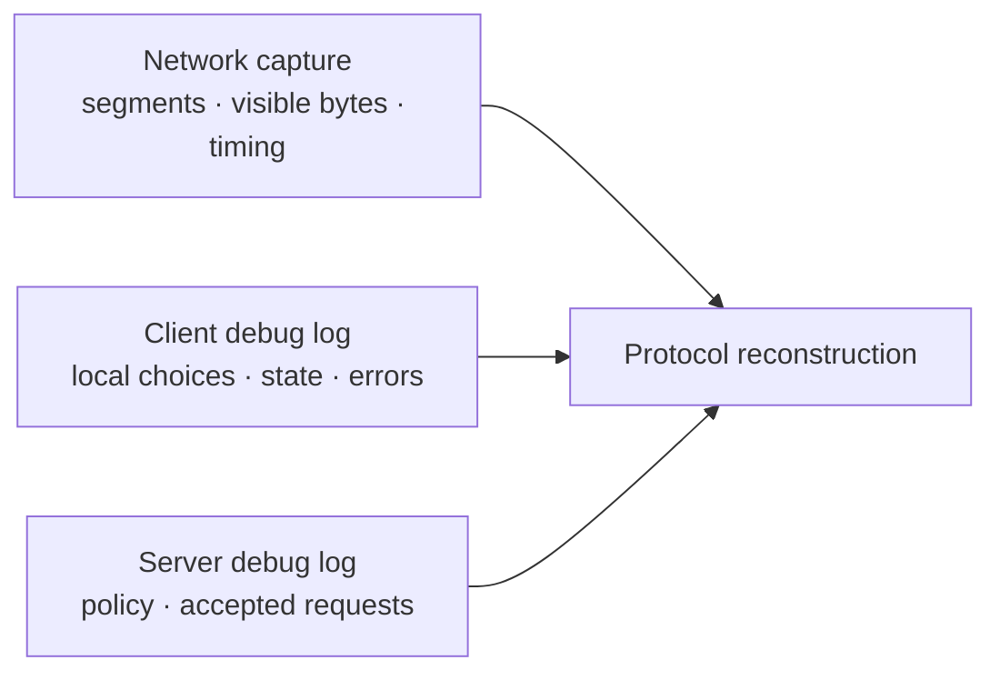
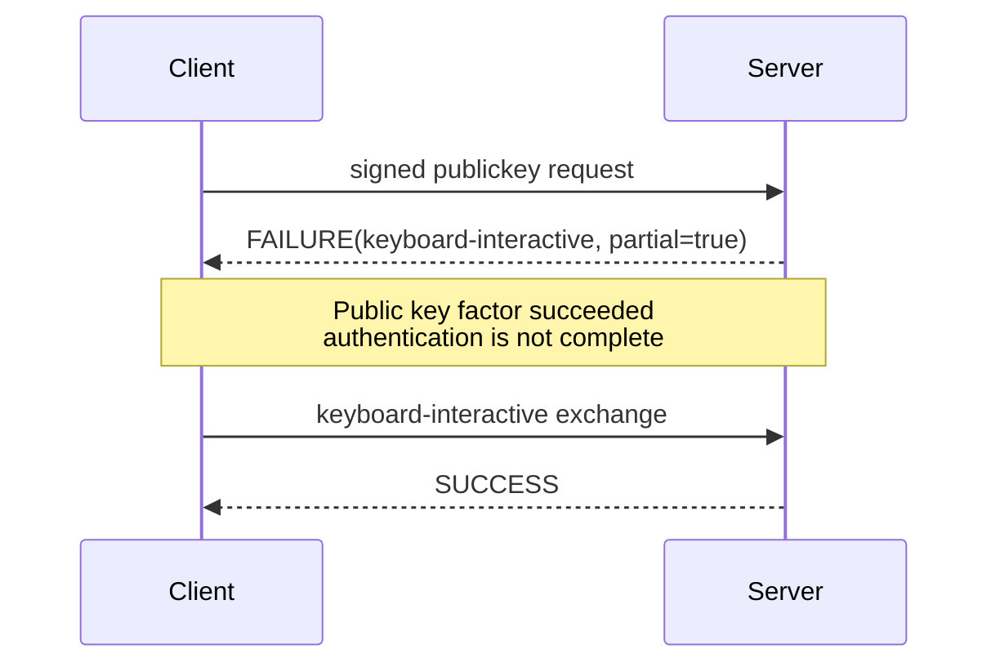
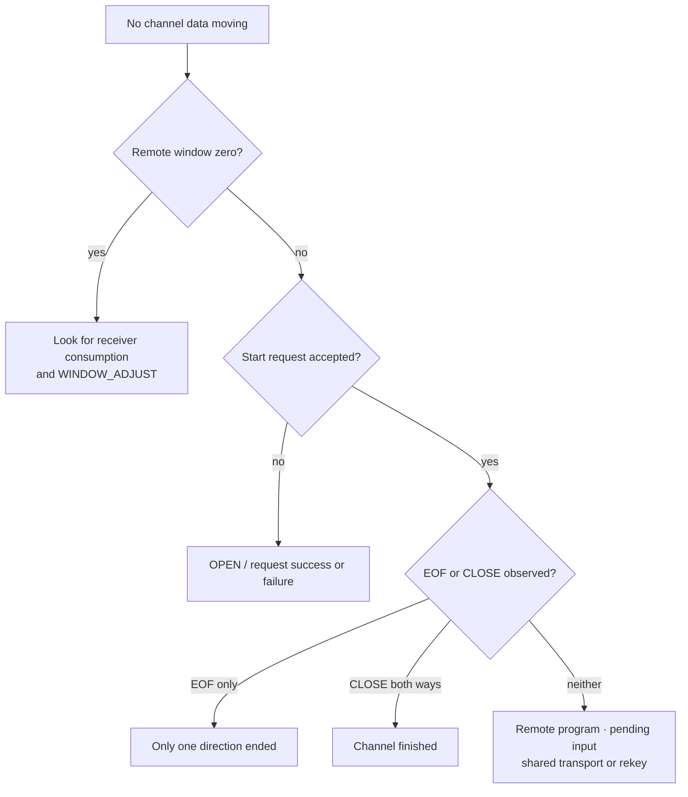

# Reading traces and diagnosing failures

A useful SSH trace reconstructs each peer's protocol state, the direction of
each message, and the security properties active at that point. Log lines are
only source material.

## Three views of one connection



A packet capture shows what crossed one observation point, but after
`NEWKEYS` it cannot show message contents. A client log shows what the client
believed it sent or received, usually after decoding and validation. A server
log can reveal why local policy rejected a request. None is a complete,
independent transcript.

A capture presents TCP segments, not SSH packets. One SSH packet can span
several segments and one segment can carry several packets; TCP
retransmissions do not mean SSH processed the same bytes twice. Each direction
is line-oriented until its identification line ends and binary from the next
byte, and the two directions cross that boundary at different times.

Debug output may contain hostnames, usernames, paths, fingerprints, commands,
and authentication details; sanitize it before sharing. Banner and error text
supplied by the peer is untrusted, even inside a trusted program's log.

## Keep observations and inferences separate

Suppose a client log says:

```text
kex: algorithm: mlkem768x25519-sha256
kex: host key algorithm: ssh-ed25519
```

This directly reports the names the client selected. You may infer that each
name appeared in both `KEXINIT` proposals and was the first entry in the
client's list that the server also offered. Proving that from the wire needs
both complete proposals.

Likewise, opaque bytes after `NEWKEYS` show traffic where protected packets are
expected. Without the keys, a capture cannot verify their tags or show that
either endpoint accepted them. Only endpoint logs connect that traffic to
authentication or command success.

## Diagnose by boundary

The last boundary a connection passed narrows the search more than any single
error line. [Observe a connection](./first-connection.md#turn-the-log-into-phases)
shows how to split a successful log into these phases.


Common OpenSSH client messages map onto those boundaries:

| Message | Phase | What it tells you |
| --- | --- | --- |
| `ssh: connect to host … port 22: Connection refused` (or `timed out`) | TCP | No SSH-level exchange happened: wrong address or port, no listener, or a filter. |
| `Connection closed by … port 22` before any remote version appears in `-v` output | Identification | The server dropped the connection before identifying itself, for example because of `MaxStartups`, `PerSourcePenalties`, or an access rule. |
| `Unable to negotiate with … port 22: no matching key exchange method found. Their offer: …` | Negotiation | No common entry in one category. Variants name the host key type, cipher, MAC, or compression method. |
| `** WARNING: connection is not using a post-quantum key exchange algorithm.` | Negotiation | Not a failure: the selected method has no post-quantum component (OpenSSH 10.1 and later). |
| `The authenticity of host '…' can't be established.` | Host trust | No stored binding exists; the client is asking for a trust decision. |
| `WARNING: REMOTE HOST IDENTIFICATION HAS CHANGED!` followed by `Host key verification failed.` | Host trust | The presented key conflicts with the stored binding. |
| `Corrupted MAC on input.` or `message authentication code incorrect` | Protected transport | A received packet failed authentication. |
| `user@host: Permission denied (publickey).` | User authentication | The client ran out of methods to try; the parentheses hold the server's last list of methods that can continue. |
| `Received disconnect from … port 22:2: Too many authentication failures` | User authentication | The server's attempt limit (`MaxAuthTries`, default 6) was reached, often by an agent offering many keys. |
| `channel 0: open failed: administratively prohibited: …` | Connection | Server policy refused a channel, such as a forwarding it does not permit. |
| `Timeout, server … not responding.` | Connection | `ServerAliveInterval` keepalives went unanswered `ServerAliveCountMax` times. |

The subsections below cover the cases where the obvious reading is misleading.

### No matching algorithm

Compare the one `KEXINIT` category the error names: KEX method, host-key
algorithm, or one direction's cipher, MAC, or compression. OpenSSH prints the
server's offer; `ssh -G host` shows the client's list. The winner would be the
first client entry present in the server's list; see
[the selection rule](./version-and-negotiation.md#the-selection-rule-client-preference-wins).

Do not fix the mismatch by enabling every legacy name. Find out whether either
side can offer a mutually acceptable current algorithm, and why its policy
excluded it.

### Packet authentication failure

After `NEWKEYS`, a packet whose MAC or AEAD tag does not verify ends the
connection. OpenSSH logs `Corrupted MAC on input.` when a separate MAC fails
and ends with `message authentication code incorrect`; with an AEAD cipher
such as `chacha20-poly1305@openssh.com` only the second message appears.

The failure proves only that the received bytes did not match what the key and
sequence number predict. The cause may be a middlebox or faulty path altering
bytes, a bug in one negotiated algorithm, or deliberate tampering. The protocol
cannot tell which and must never use the packet anyway; see
[Symmetric encryption and packet protection](./crypto-symmetric.md). Note the
cipher and MAC negotiated in each direction: a failure that follows one
algorithm across paths suggests an implementation bug, while one that follows
a path suggests the network.

### Host-key conflict

A changed host key is not a user-authentication failure: the client stops
before user authentication starts. Record the requested destination,
effective port or `HostKeyAlias`, any jump host, the presented fingerprint,
and the stored `known_hosts` entry. OpenSSH refuses to continue unless
`StrictHostKeyChecking` is off, and even then disables password and
keyboard-interactive authentication and all forwarding for that connection.
Verify a legitimate rotation through an independent channel before replacing
the specific entry; see [Server authentication](./server-authentication.md).

The warning also shows that the key was presented and checked against stored
trust. OpenSSH does that check before it verifies the signature over `H`, so
the warning does not show that the peer holds the key's private half; other
clients may order the checks differently.

### User authentication rejected

Track each `SSH_MSG_USERAUTH_FAILURE` as a pair: its method list and its
`partial success` flag. A valid public-key signature can be accepted as one
factor without completing authentication. Message number 60 must be read from
the active method's state, not from the number alone. With a FIDO security
key, a missed touch or an unmet PIN policy also looks like an ordinary
failure; see
[Limits and failure modes](./fido-security-keys.md#limits-and-failure-modes).



### A channel appears to hang

Check the two channel directions separately. A sender whose remote window is
zero must wait for `SSH_MSG_CHANNEL_WINDOW_ADJUST`, while the other direction
and other channels may continue. Local EOF ends one data direction only; final
output and exit status can legitimately arrive after the client has sent EOF.

If several channels stall together, examine the shared TCP connection and
whether a rekey is in progress. If one command stalls while other channels
work, check that both stdout and stderr are being consumed, since they share
that channel's receive window, or whether the process is waiting for input
EOF rather than for window space.



A successful [keepalive](./channels.md#keepalives-and-evidence-of-liveness)
shows that the SSH peer is responsive, not that the stalled channel is making
progress. If the connection is lost, treat the command's outcome as unknown,
not failed, before deciding whether to retry.

## Read disconnects in context

`SSH_MSG_DISCONNECT` carries a reason code, a description, and a language tag
([RFC 4253 section 11.1](https://www.rfc-editor.org/rfc/rfc4253#section-11.1)).
OpenSSH prints the code after the port, as in `port 22:2:`.
[RFC 4250 section 4.2.2](https://www.rfc-editor.org/rfc/rfc4250#section-4.2.2)
assigns 15 codes, including:

| Code | Name |
| --- | --- |
| 2 | `SSH_DISCONNECT_PROTOCOL_ERROR` |
| 3 | `SSH_DISCONNECT_KEY_EXCHANGE_FAILED` |
| 5 | `SSH_DISCONNECT_MAC_ERROR` |
| 11 | `SSH_DISCONNECT_BY_APPLICATION` |
| 12 | `SSH_DISCONNECT_TOO_MANY_CONNECTIONS` |
| 14 | `SSH_DISCONNECT_NO_MORE_AUTH_METHODS_AVAILABLE` |

Treat the code as coarse evidence. OpenSSH sends 11 (“disconnected by user”)
when a client exits normally and 2 for almost every other disconnect it
initiates, including “Too many authentication failures”, so the description
usually says more. That description is peer-controlled text and may be vague.
An abrupt TCP close carries no SSH reason at all, and a packet authentication
failure may deliberately reveal little because processing unauthenticated data
would be unsafe.

## Check your understanding

1. A capture shows 1,448-byte TCP segments throughout a file transfer. What
   does that tell you about SSH packet sizes?
2. The client log shows `kex: algorithm: curve25519-sha256`. What can you
   conclude about the two `KEXINIT` proposals, and what would you need to
   prove it?
3. `ssh` prints `Permission denied (keyboard-interactive).` although the
   server accepted your public key. What most likely happened?
4. A server's log shows
   `Received disconnect from 192.0.2.7 port 51234:11: disconnected by user`.
   Is that a problem?
5. `Corrupted MAC on input.` appears only on connections through one office
   VPN, whatever the server. Where do you look first, and why must SSH not
   simply retry the packet?
6. An `exec` command's output stops midway, while a second session on the same
   connection keeps working. Name two protocol-level explanations.

<details>
<summary>Answers</summary>

1. Nothing definite. TCP segment sizes reflect the path MTU and the sender's
   TCP stack; SSH packets can span or share segments, and many ciphers also
   hide the packet length field.
2. That `curve25519-sha256` appeared in both proposals and was the first entry
   in the client's KEX list that the server also offered. Proving it requires
   both complete `KEXINIT` payloads, from a capture or both endpoint logs.
3. The public key was accepted as one factor (`partial success` true), and the
   server then required `keyboard-interactive`, which the client could not or
   did not complete. The parentheses list the methods that could continue,
   not the ones the client tried.
4. No. Reason 11 is `SSH_DISCONNECT_BY_APPLICATION`, which the OpenSSH client
   sends when it exits normally.
5. The VPN path, since the failure follows the path rather than an algorithm
   or server. SSH must discard the connection because a failed tag means the
   bytes are not what the peer sent; using them would give up integrity.
6. The command's channel window is exhausted because the client is not
   consuming stdout or stderr, so no `WINDOW_ADJUST` is sent; or the remote
   program is blocked waiting for input EOF that the client never sent. Since
   the other channel works, the shared transport and rekeying are unlikely.

</details>

## References

- [RFC 4250 section 4.2.2](https://www.rfc-editor.org/rfc/rfc4250#section-4.2.2):
  disconnect reason codes
- [RFC 4253 section 11](https://www.rfc-editor.org/rfc/rfc4253#section-11):
  disconnect, ignore, and debug messages
- [RFC 4252 section 5.1](https://www.rfc-editor.org/rfc/rfc4252#section-5.1):
  authentication failure responses and `partial success`
- [RFC 4254 section 5](https://www.rfc-editor.org/rfc/rfc4254#section-5):
  channel windows, EOF, and close
- [IANA SSH protocol parameters](https://www.iana.org/assignments/ssh-parameters/ssh-parameters.xhtml):
  message numbers and disconnect reasons
- [`ssh(1)`](https://man.archlinux.org/man/ssh.1) and
  [`ssh_config(5)`](https://man.archlinux.org/man/ssh_config.5): `-v`, `-G`,
  `StrictHostKeyChecking`, `ServerAliveInterval`
- [`sshd_config(5)`](https://man.archlinux.org/man/sshd_config.5): `MaxAuthTries`,
  `MaxStartups`, `PerSourcePenalties`
- [OpenSSH portable source](https://github.com/openssh/openssh-portable),
  `packet.c` and `sshconnect.c`, for the exact message texts
