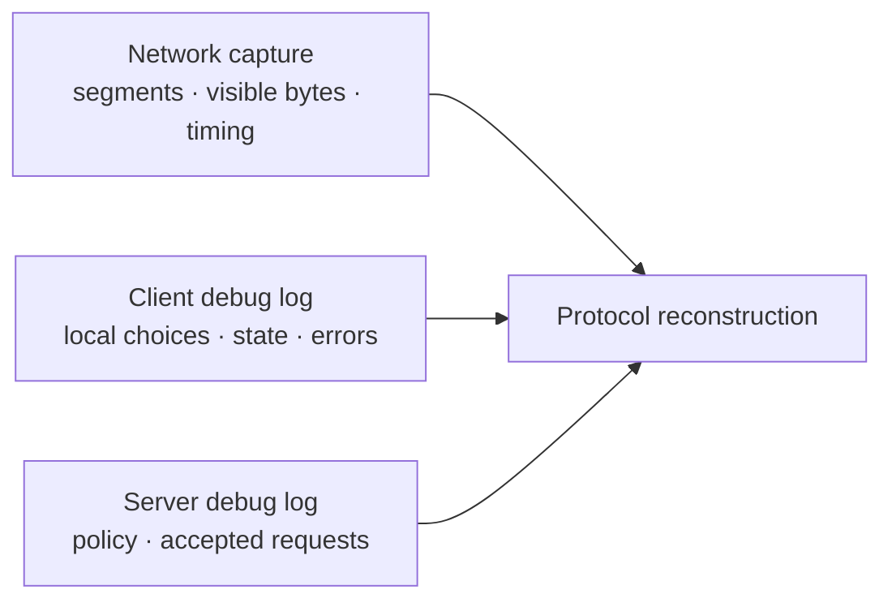
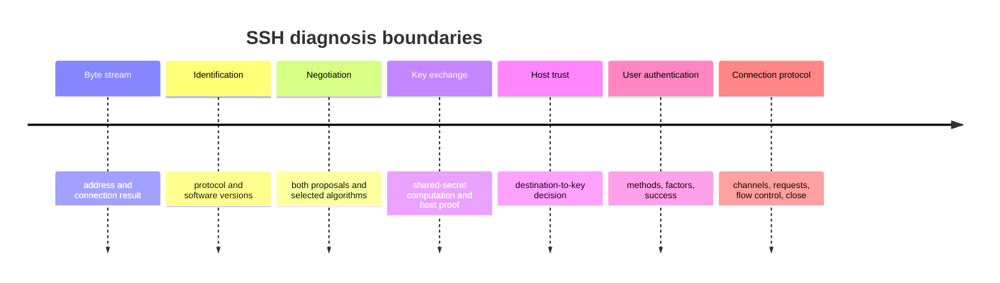
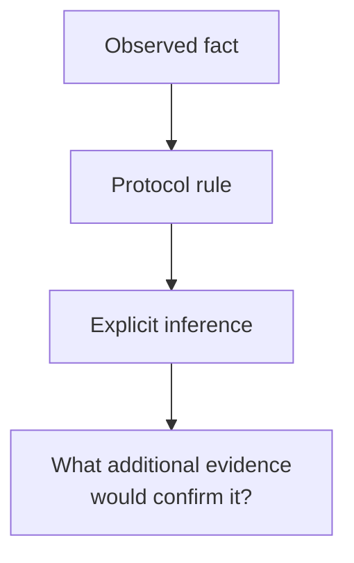
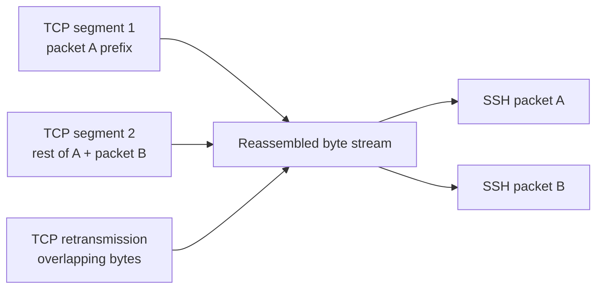
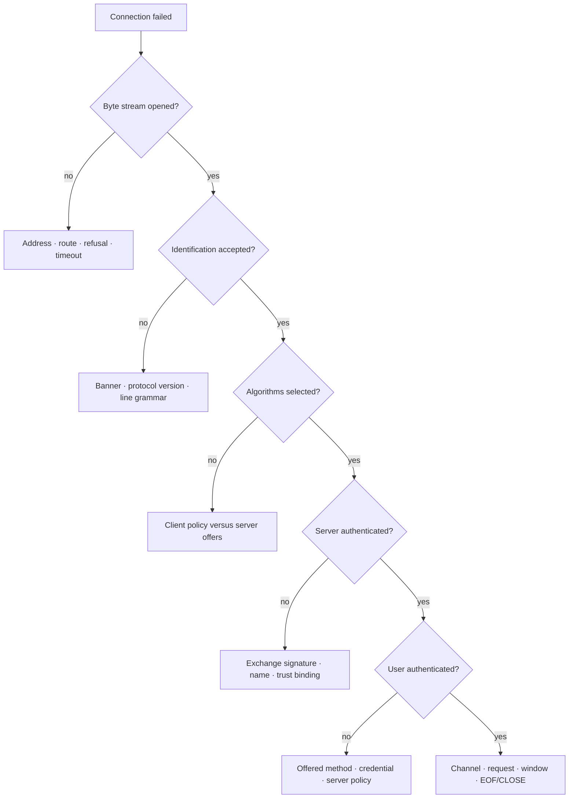
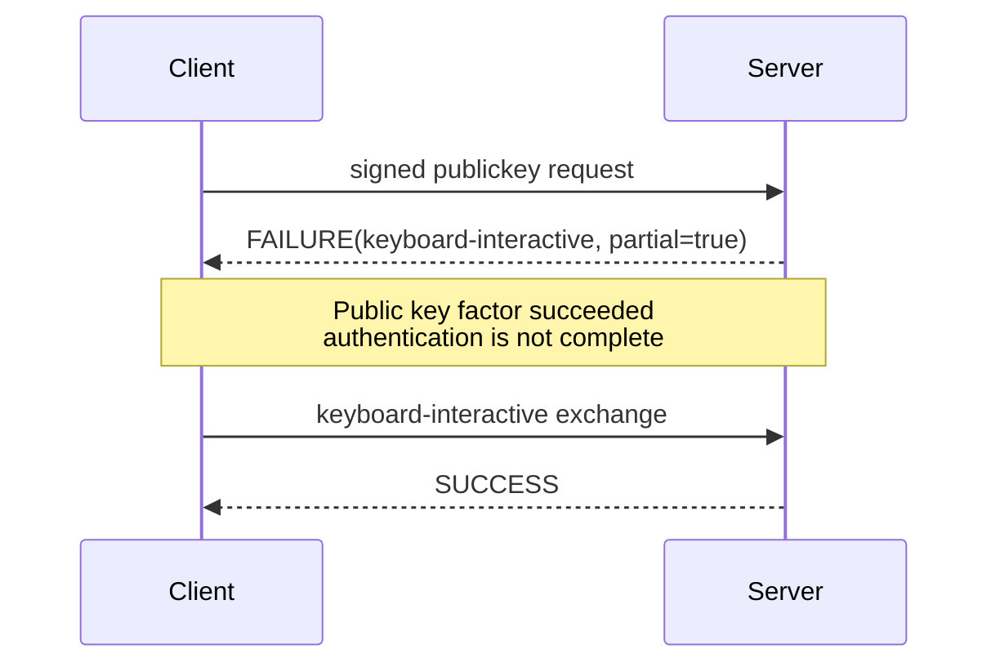
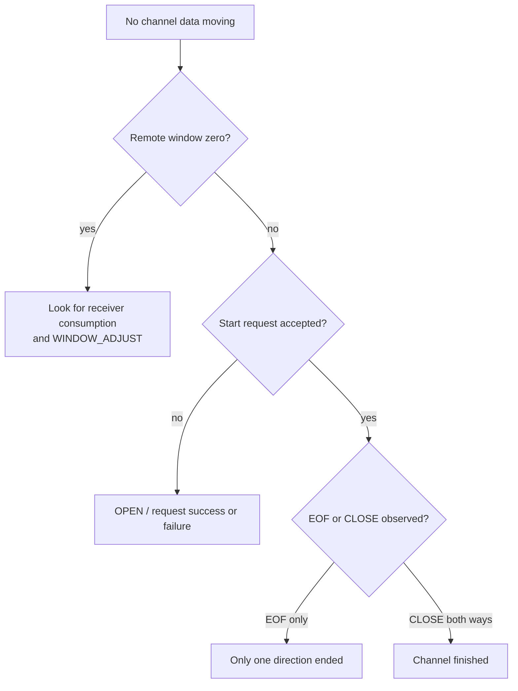

# Reading traces and diagnosing failures

A useful SSH trace is not just a list of log lines. It is a reconstruction of
which protocol state each peer believed it was in, which direction a message
moved, and which security properties were active at that moment.

## Three views of one connection



A packet capture shows what crossed an observation point, but after `NEWKEYS`
it normally cannot show message contents. A client log shows what the client
believed it sent or received, often after decoding and validation. A server log
can reveal why local policy rejected a request. None is a perfect, independent
transcript of the whole system.

Debug output may contain hostnames, usernames, paths, fingerprints, commands,
and authentication details. Sanitize it before sharing. Peer-supplied banner or
error text is untrusted even when it appears in a trusted program's log.

## Annotate the phase first

Start by placing every observation on the connection timeline.



The last completed boundary narrows the failure dramatically. For example, a
host-key warning occurs after the peers found compatible algorithms and the
client could validate the exchange signature, but before it accepted the
server identity or sent credentials.

## Keep observations and inferences separate

Suppose a client log says:

```text
kex: algorithm: curve25519-sha256
kex: host key algorithm: ssh-ed25519
```

This directly reports the client's selected names. You may infer that each
name appeared in both KEXINIT proposals and that it was the first mutually
supported value in the client's corresponding list. To prove that inference
from the wire, you would need both complete proposals.

Similarly, seeing ciphertext after `NEWKEYS` proves that protected packet bytes
were exchanged, not that user authentication or a command succeeded.



## TCP segments are not SSH packets

A capture tool presents TCP segments according to where it observed the
stream. SSH packet boundaries can cross segments, and one segment can contain
several SSH packets. Retransmissions are TCP behavior and do not mean SSH
processed the same logical bytes twice.



Before binary packets, the identification exchange is line-oriented. The first
byte after the server identification line's LF belongs to the binary stream.
Keeping that transition visible prevents a pre-banner line or coalesced first
packet from being misread.

## Diagnose by boundary



### No matching algorithm

Compare the relevant KEXINIT category, not a single undifferentiated list. A
failure might concern the KEX method, host-key algorithm, one direction's
cipher, MAC, or compression. The correct selection is the first client-listed
value also present on the server list.

Do not solve the mismatch by blindly enabling every legacy name. Determine
whether one side can offer a mutually acceptable current algorithm and why its
policy excluded that choice.

### Host-key conflict

A changed-host-key failure is not a user-authentication failure. Record the
requested destination identity, effective port or host-key alias, route through
any jump host, presented fingerprint, and stored trust rule. Verify a legitimate
rotation through an independent channel before updating the narrow binding.

### User authentication rejected

Track each `SSH_MSG_USERAUTH_FAILURE` as a pair: its current method list and
`partial success` flag. A valid public-key signature can be accepted as one
factor without completing authentication. Method number 60 must be interpreted
from the active method state, not from the number alone.



### A channel appears to hang

Check the two channel directions independently. A sender with zero remote
window must wait for `WINDOW_ADJUST`; the other channel direction and other
logical channels may continue. Local EOF ends only one data direction. Final
output and exit status may legitimately arrive after the client has sent EOF.



## Read disconnects in context

`SSH_MSG_DISCONNECT` carries a reason code, description, and language tag. The
reason is useful evidence, but the description is peer-controlled text and may
be vague. Abrupt TCP EOF carries no SSH reason at all. A packet authentication
failure may intentionally reveal little because processing unauthenticated data
would be unsafe.

The message-number and disconnect-reason registries are collected by
[IANA](https://www.iana.org/assignments/ssh-parameters/ssh-parameters.xhtml),
with the original transport behavior in
[RFC 4253 section 11](https://www.rfc-editor.org/rfc/rfc4253#section-11).

## Trace review

For each important line or packet, write down:

- its direction and protocol layer;
- the state before and after it;
- whether its contents were cleartext or protected;
- which identity or channel it concerned; and
- whether your conclusion is directly observed or inferred from a protocol
  rule.

That discipline turns a verbose log into a protocol explanation and prevents a
late symptom—such as a closed channel—from being mistaken for the earlier cause.
