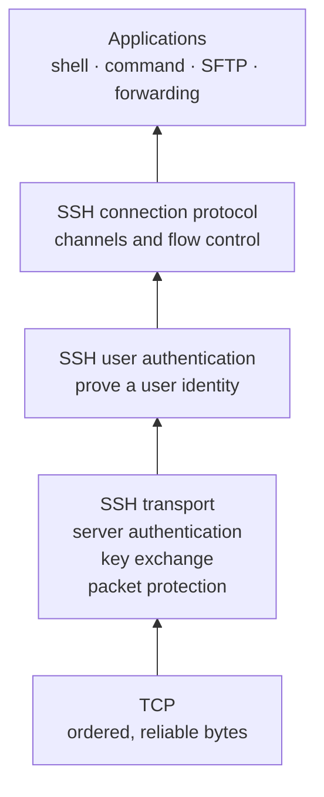
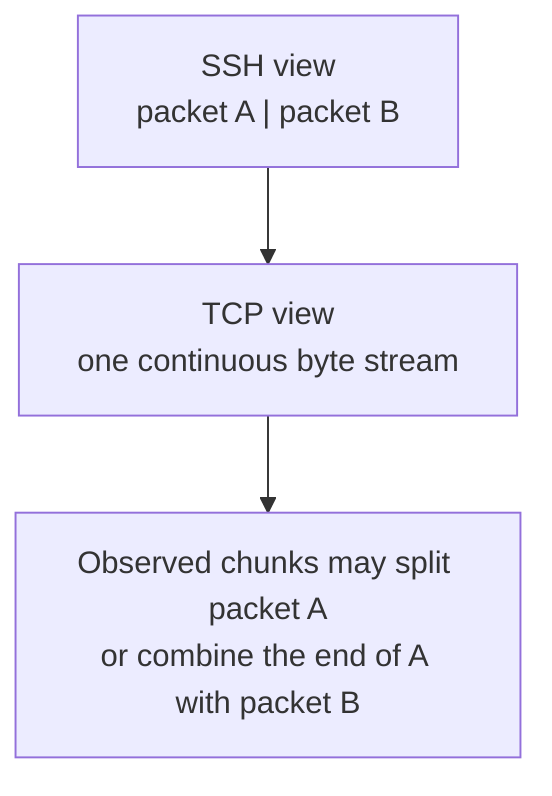
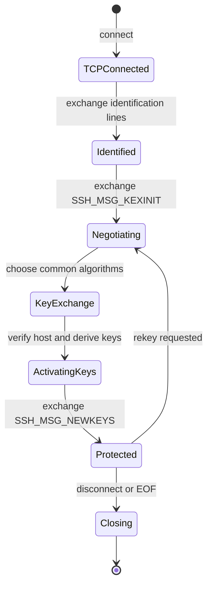
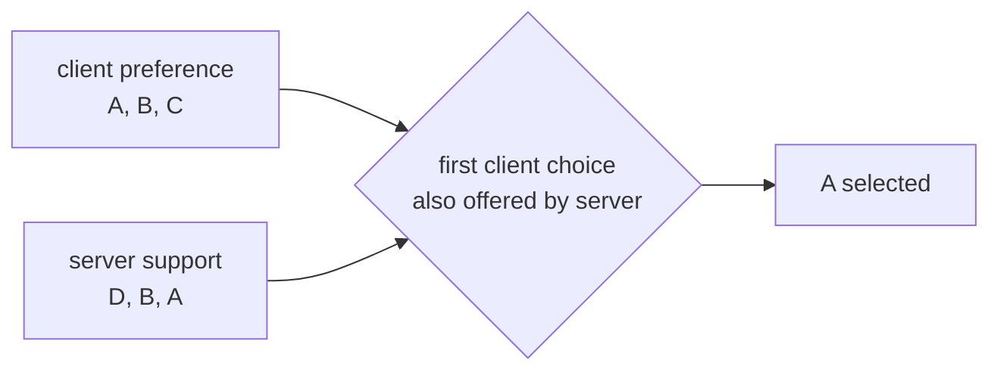
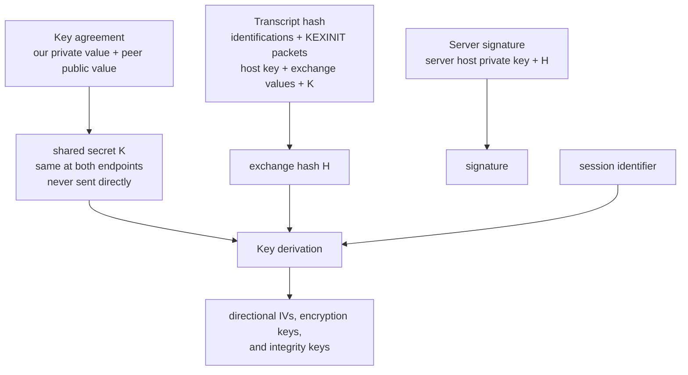
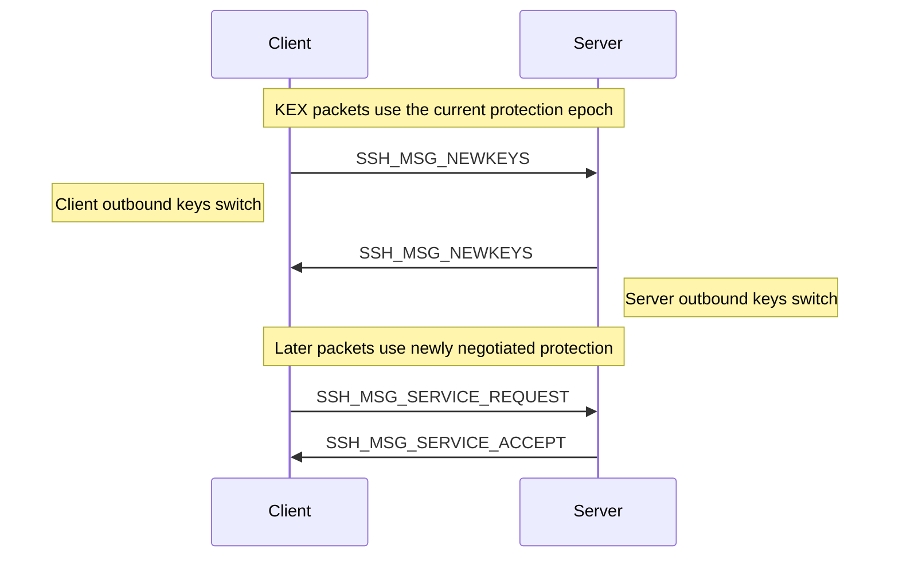

# The SSH transport protocol

The SSH transport protocol turns a TCP connection into an authenticated,
confidential byte transport for the SSH protocols above it. It negotiates
algorithms, authenticates the server, establishes fresh keys, protects packets,
and can replace those keys later without closing the connection.

It is useful to be precise about what that does **not** mean. The transport
authenticates a server host key, but the client still has to decide whether that
key belongs to the intended server. It also does not authenticate the user or
create shells and forwarded connections. Those are jobs for the user
authentication and connection protocols.

[RFC 4251 describes this layered architecture](https://www.rfc-editor.org/rfc/rfc4251#section-4),
while [RFC 4253 specifies the transport protocol](https://www.rfc-editor.org/rfc/rfc4253).



## What the transport layer provides

After a successful key exchange, each direction has negotiated algorithms and
independent key material. The transport can then provide:

- **Server authentication.** A signature proves that the peer controls the
  private key corresponding to the presented host key. A known-hosts check or
  another trust mechanism connects that cryptographic identity to a hostname.
- **Confidentiality.** Encryption makes protected packet contents unreadable to
  a passive observer.
- **Integrity and authenticity.** A MAC or an authenticated-encryption tag lets
  the receiver detect modification and forgery.
- **Optional compression.** If negotiated, payloads can be compressed before
  packet encryption. Compression is not itself a security property.

These properties apply to SSH binary packets, not to the preceding TCP handshake
or to the clear-text SSH identification strings.

## TCP is a byte stream, not a packet service

SSH normally runs over TCP. The transport relies on TCP to deliver bytes in
order, without duplication, or to report that the connection has failed. TCP
does not preserve the boundaries of an application's writes.



Consequently, TCP segment and read boundaries have no protocol meaning. One
observed chunk can contain half a length field or several SSH packets. SSH's own
framing determines the boundaries; an EOF in the middle of an identification
line or binary packet is a truncated SSH connection.

The byte-stream assumption also means that SSH must define its own framing. The
identification exchange uses lines; all subsequent messages use the binary
packet format covered in [SSH binary packets and data types](./binary-packets.md).

## Phase 1: identification exchange

Immediately after TCP setup, each endpoint sends a line shaped like:

```text
SSH-2.0-software-version optional comments\r\n
```

This is not an SSH binary packet. Its purpose is to confirm the protocol version
and identify the implementation. The server may send other lines before its SSH
identification line; the client must be prepared to skip them, while the client
must send its identification as its first line. The complete SSH identification
line, including its line ending, is limited to 255 characters. The exact grammar
and compatibility rules are in
[RFC 4253, section 4.2](https://www.rfc-editor.org/rfc/rfc4253#section-4.2).

Both identification strings are later included in the key-exchange transcript.
An attacker therefore cannot silently change them once the client has verified
the server's key-exchange signature.

## The transport state machine

A typical client moves through these states. Failure at any stage ends the
connection; successful rekeying returns to protected transport without
restarting user authentication or channels.



"Protected" is not one global state transition. The sending and receiving
directions switch keys independently when the corresponding `SSH_MSG_NEWKEYS` is
sent or received. There can therefore be a brief interval in which one direction
uses new keys while the other still uses the previous protection epoch.

## Phase 2: negotiation

Each side sends `SSH_MSG_KEXINIT` with ordered name-lists for key exchange, host
keys, encryption, integrity, compression, and languages. For most categories,
the selected algorithm is the first algorithm on the client's list that also
appears on the server's list. The two encryption, integrity, and compression
directions are negotiated separately.



Algorithm selection and security policy are distinct. The algorithms used as
examples in the original SSH transport RFC are not all good policy choices
today. In addition to each algorithm's specification, consult the updated
key-exchange recommendations in
[RFC 9142](https://www.rfc-editor.org/rfc/rfc9142). Recognizing a legacy
algorithm does not require offering or accepting it.

## Phase 3: key exchange and server authentication

Key-exchange methods differ in their mathematical details, but their role in the
protocol can be understood through a few cryptographic black boxes:



- **Key agreement** takes one side's private ephemeral value and the other
  side's public value, and produces the same shared secret `K` at both ends.
  The public values may cross the network; the private values and `K` do not.
- **A cryptographic hash** takes an arbitrary byte transcript and produces a
  fixed-size digest `H`. Changing any covered byte changes the digest with
  overwhelming probability.
- **A digital signature** takes `H` and the server's host private key. Verification
  takes `H`, the signature, and the public host key, and answers whether they
  match. This binds the negotiated exchange to that host key.
- **Key derivation** expands `K`, `H`, the session identifier, and labels into
  distinct keys for each purpose and direction. Reusing one raw key everywhere
  would lose that separation.

The first exchange hash becomes the **session identifier** and remains the
session identifier through later rekeys. The formulas and exact transcript
fields are defined in
[RFC 4253, sections 7 and 8](https://www.rfc-editor.org/rfc/rfc4253#section-7).

A valid signature says "the owner of this host private key participated in this
exchange." It does not by itself say "this key belongs to `example.com`." The
client must compare the host key with a trusted value, certificate authority, or
an explicitly accepted first-use record before treating the server as
authenticated.

## Phase 4: activating and using keys

Once a side has computed the new keys, it sends `SSH_MSG_NEWKEYS`. Its next sent
packet uses the new outbound keys. After it receives the peer's
`SSH_MSG_NEWKEYS`, the next packet it receives uses the new inbound keys. The
diagram shows one possible ordering; the protocol does not require the client to
send `NEWKEYS` first.



On the first key exchange, "current protection" means no encryption and no MAC.
During rekeying, key-exchange packets are carried under the old protection until
the directional `NEWKEYS` transition. Upper-layer traffic may be delayed while a
key exchange is in progress; the rules are specified in
[RFC 4253, section 7.1](https://www.rfc-editor.org/rfc/rfc4253#section-7.1).

Encryption is another useful black box: it accepts a plaintext packet, a secret
key, and mode-specific state, and emits ciphertext. Decryption reverses that
mapping. A MAC accepts a secret integrity key and packet data and emits a short
tag; recomputing and comparing the tag detects alteration. Authenticated
encryption combines confidentiality and integrity in one construction. The
negotiated algorithm specification determines the exact packet processing order.

## Rekeying is part of normal operation

Either endpoint can start a new key exchange by sending another `KEXINIT`.
Rekeying limits the amount of traffic protected by one set of keys and can update
algorithms. It does not open a new TCP connection, change the session identifier,
or discard authenticated users and open channels.

RFC 4253 recommends changing keys after one gigabyte of transmitted data or one
hour of connection time, whichever comes first, and permits algorithms to impose
stricter limits. See
[RFC 4253, section 9](https://www.rfc-editor.org/rfc/rfc4253#section-9).
These limits apply to a protection epoch; rekeying replaces the keys while the
logical SSH connection continues.

## Protocol review

Check that you can explain these boundaries before moving on:

- Which properties come from TCP, and which are added by the SSH transport?
- Why does a valid exchange signature not by itself establish that a host key
  belongs to the requested hostname?
- Which transcript value stays constant across rekeys, and which keys change?
- After the client sends `NEWKEYS` but before it receives the server's
  `NEWKEYS`, which protection epoch applies in each direction?

The last question is the reason the transition is best understood as two
directional events rather than one connection-wide switch.
