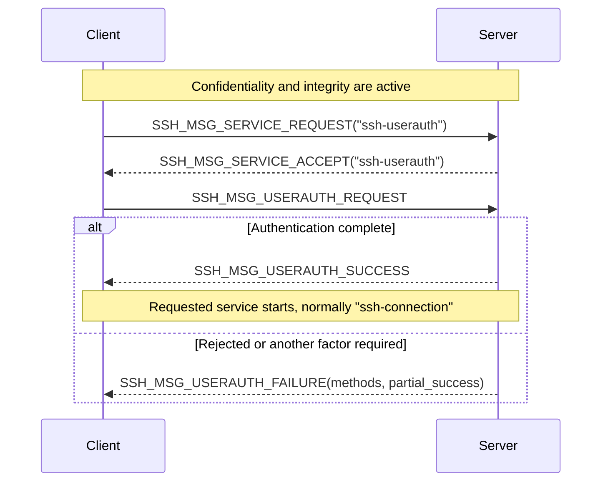
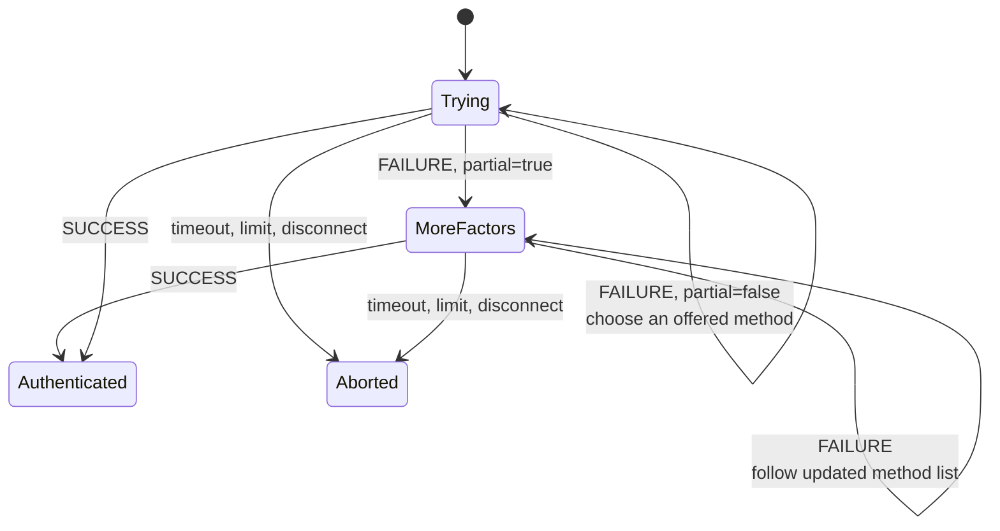
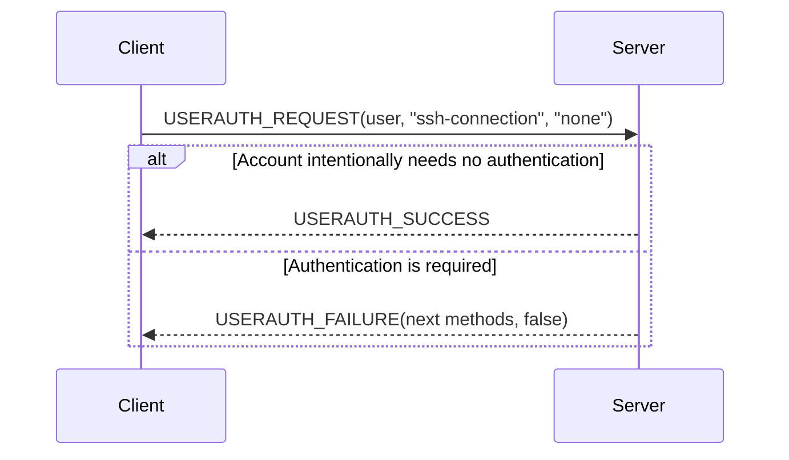
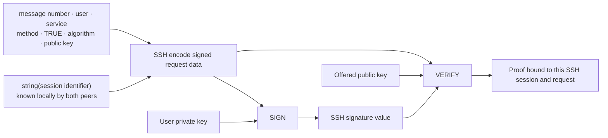
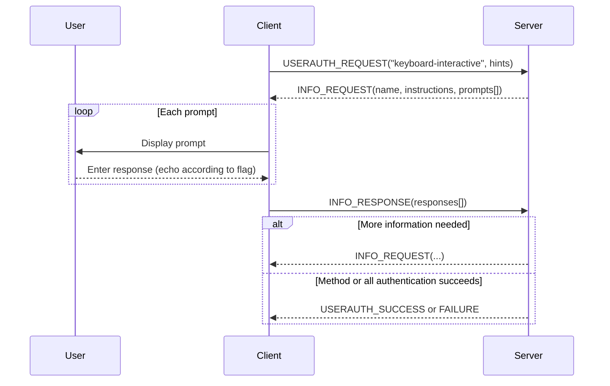
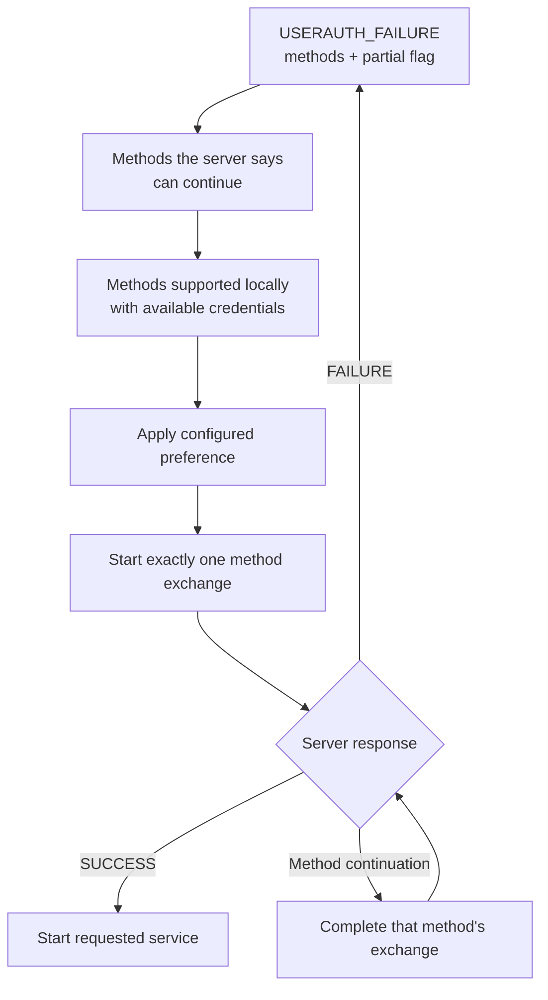

# User authentication

Once the protected transport is active and the server's host key is trusted,
the client can ask the server to authenticate a user. This phase answers a
different question from host verification:

- **Server authentication:** is this the intended server?
- **User authentication:** may this peer act as a particular account?

This guide assumes that client policy requires confidentiality and integrity
before user authentication. The SSH framework has a `none` cipher for unusual
configurations. A safe client does not use password authentication without
confidentiality. [RFC 4252](https://www.rfc-editor.org/rfc/rfc4252.html)
specifies the authentication framework and core methods;
[RFC 4256](https://www.rfc-editor.org/rfc/rfc4256.html) specifies the generic
interactive method.

## Entering the authentication service

After key exchange, the client requests the `ssh-userauth` service using the transport protocol's service mechanism. The server accepts it before authentication requests begin.



Every `SSH_MSG_USERAUTH_REQUEST` begins with the same fields:

```text
byte      SSH_MSG_USERAUTH_REQUEST
string    user name
string    service name
string    method name
...       method-specific fields
```

The `service name` here is the service to run *after* authentication, normally `ssh-connection`; it is not `ssh-userauth`. The username and service are repeated in every request. If either changes, the server must clear any accumulated authentication state. Authentication progress therefore belongs to one particular `(user, requested service)` pair. See [RFC 4252, Section 5](https://www.rfc-editor.org/rfc/rfc4252.html#section-5).

## The server drives policy

On rejection, the server returns:

```text
byte       SSH_MSG_USERAUTH_FAILURE
name-list  authentications that can continue
boolean    partial success
```

The list says which method names may productively continue *at that point*. It is not a permanent capability list. The boolean is true when the just-completed method succeeded but policy requires another authentication method. Only `SSH_MSG_USERAUTH_SUCCESS` means authentication is complete.



For example, a server that requires a public key and then an interactive one-time code may reply after the valid signature with `partial success = true` and a next-method list containing `keyboard-interactive`.

Do not infer account existence from a method list. Servers may return bogus or uniform-looking failures for unknown accounts to reduce username enumeration. Authentication also has finite time and attempt limits; [RFC 4252, Section 4](https://www.rfc-editor.org/rfc/rfc4252.html#section-4) recommends server-side limits rather than allowing indefinite retries.

## The `none` method

`none` has no method-specific fields. It is primarily a discovery request:



The server must not advertise `none` in its method list. It accepts `none` only when the user is actually allowed access without authentication. A client can use the failure response to seed method selection, but it must tolerate servers that provide a limited or policy-shaped list. See [RFC 4252, Section 5.2](https://www.rfc-editor.org/rfc/rfc4252.html#section-5.2).

## Public-key authentication

Public-key authentication proves possession of a user's private key. The server performs two independent checks:

1. Is this public key authorized for this user under current policy?
2. Does the signature verify with that public key?

Passing only one check is not enough.

### Optional key query

The client may first ask whether a public key is potentially acceptable without creating a signature:

```text
byte      SSH_MSG_USERAUTH_REQUEST
string    user name
string    service name
string    "publickey"
boolean   FALSE
string    public key algorithm name
string    public key blob
```

The server responds with `SSH_MSG_USERAUTH_PK_OK` echoing the algorithm and blob, or with `SSH_MSG_USERAUTH_FAILURE`. The query can avoid unlocking a private key, invoking a hardware token, or doing an expensive signing operation for a key the server will not use.

`PK_OK` is not authentication success and is not a guarantee that the later signed request will satisfy all policy. It merely permits the client to proceed with that key.

### Signed request

The client may follow the query with a signed request, or skip the query and send the signed form immediately:

```text
byte      SSH_MSG_USERAUTH_REQUEST
string    user name
string    service name
string    "publickey"
boolean   TRUE
string    public key algorithm name
string    public key blob
string    signature
```

The signed data starts with the session identifier encoded as an SSH `string`,
then the request's message-number byte and every field through the public-key
blob. The signature field itself is excluded. Packet lengths, padding, MACs,
and sequence numbers are also outside this signature's input.

The session identifier is not an extra field in the transmitted request:
both peers already know it from the first key exchange. Including it in the
signed data binds the proof to that connection, and it remains unchanged
across later rekeys.



Binding the signature to the session identifier prevents an observed authentication signature from being replayed on a different SSH connection. Binding the username, service, and key prevents those fields from being substituted after signing. The exact byte sequence is defined by [RFC 4252, Section 7](https://www.rfc-editor.org/rfc/rfc4252.html#section-7): the signature covers the SSH binary encodings, not a textual rendering of the fields.

### Signature algorithm versus key format

The key blob and signature algorithm are related but not always named alike. For RSA, [RFC 8332](https://www.rfc-editor.org/rfc/rfc8332.html) defines the SHA-2 signature names `rsa-sha2-256` and `rsa-sha2-512` while retaining the `ssh-rsa` encoding for the RSA public-key blob. The outer signature algorithm string therefore need not equal the format name inside the key blob.

Disabling `ssh-rsa` *signatures* disables RSA with SHA-1; it does not inherently
disable RSA keys used with SHA-2. A stored RSA key can keep the same public-key
blob and fingerprint while the signature algorithm changes.

The host-key algorithm chosen during KEX also does not select the user's key
or signature algorithm. A connection can authenticate an Ed25519 server host
key and then authenticate the user with an RSA/SHA-2 signature. These are
separate proofs, checked by different peers under different policies.

[RFC 8709](https://www.rfc-editor.org/rfc/rfc8709.html) specifies `ssh-ed25519` and `ssh-ed448`, whose keys are used only for signing. These signatures prove possession; they do not encrypt the request or channel data.

A private-key *passphrase* is also distinct from the account password. The passphrase usually decrypts a local private-key file or unlocks a signing device. It should not be placed in an SSH userauth packet. A signing agent can return a signature without disclosing the private key to the SSH client.

### Discovering acceptable signature algorithms

The server can send the `server-sig-algs` extension in
`SSH_MSG_EXT_INFO`. Its value is a name-list of public-key algorithms that the
server can process in a `publickey` authentication request.

This is especially useful for RSA keys. The stored key blob can still use the
`ssh-rsa` format while the authentication signature uses `rsa-sha2-256` or
`rsa-sha2-512`. The extension lets the client choose a usable signature
algorithm without trying each one as an authentication attempt.

The extension describes protocol capability, not account authorization. A
listed algorithm can still fail because the key is not authorized, a required
factor is missing, or server policy rejects the request. If the extension is
absent, the client cannot infer that a particular algorithm is unsupported.

[RFC 8308, Section 3.1](https://www.rfc-editor.org/rfc/rfc8308.html#section-3.1)
defines `server-sig-algs` and its timing.

### Host-bound public-key authentication

Agent forwarding lets a remote host ask an agent to sign a standard userauth
request for another SSH connection. The session identifier binds that request
to the new connection, but it does not tell the agent which server host key
the connection accepted.

OpenSSH's deployed `publickey-hostbound-v00@openssh.com` method adds the
initial server host key to the signed request. A compatible agent can then
apply destination constraints using both the userauth request and the server
identity. This narrows delegated signing authority; it does not make a
compromised server harmless.

This is an OpenSSH extension, not a core RFC 4252 method. Servers advertise it
through extension information. Its wire format is documented in the
[OpenSSH protocol extensions](https://github.com/openssh/openssh-portable/blob/master/PROTOCOL).

## Password authentication

The normal password request adds a false change-password flag and the password:

```text
byte      SSH_MSG_USERAUTH_REQUEST
string    user name
string    service name
string    "password"
boolean   FALSE
string    plaintext password
```

“Plaintext” describes the field before transport protection. With the safe
policy assumed here, the transport encrypts the complete packet. This method
does not hash the password. Hashing it in the client would only create a
password-equivalent value unless the server protocol expected that value.

The server may send `SSH_MSG_USERAUTH_PASSWD_CHANGEREQ` for an expired password. A retry with the boolean set to true carries both the old and new passwords. [RFC 4252, Section 8](https://www.rfc-editor.org/rfc/rfc4252.html#section-8) gives the complete formats and response meanings.

> **Safety note:** RFC 4252 recommends disabling password authentication when
> the transport does not provide confidentiality. A password, old or new, is
> secret even though the wire layout calls it a plaintext field.

Password authentication is one request with one password field. It is not the same wire protocol as keyboard-interactive, even when both cause a terminal to display `Password:`.

## Keyboard-interactive authentication

The `keyboard-interactive` method is a generic series of server prompts and client answers. It can support one-time passwords, challenge-response systems, password-expiry dialogs, and multi-step authentication without teaching the client each backend mechanism.

The initial request contains language and submethod hints but no answers:

```text
byte      SSH_MSG_USERAUTH_REQUEST
string    user name
string    service name
string    "keyboard-interactive"
string    language tag
string    submethods
```

The server then sends one or more `SSH_MSG_USERAUTH_INFO_REQUEST` messages. Each includes a name, instructions, language tag, a prompt count, and that many `(prompt, echo)` pairs. The client replies with `SSH_MSG_USERAUTH_INFO_RESPONSE`, a response count, and exactly that many response strings.



Only one information request may be outstanding at a time, but the client must handle multiple request-response rounds. A request with zero prompts can carry informational text; the client still answers with a zero-response message. The `echo` boolean controls whether the user's input should be shown: false is appropriate for secrets, while true may be appropriate for a visible identifier. See [RFC 4256, Sections 3.2 and 3.3](https://www.rfc-editor.org/rfc/rfc4256.html#section-3.2).

The prompts, instructions, banners, and error descriptions came from the remote server. Even after host authentication, treat them as untrusted display data:

- filter terminal control characters and avoid interpreting markup;
- make it clear which host is requesting input;
- do not guess that every hidden prompt is an account password;
- do not autofill secrets based only on prompt text.

This matters because a compromised but correctly identified server can still present misleading prompts.

## Authentication policy flow

Method choice combines the server's current policy with the methods, credentials, and preferences available to the client.



Method-specific message numbers overlap. For example, message number 60 means `SSH_MSG_USERAUTH_PK_OK`, `SSH_MSG_USERAUTH_PASSWD_CHANGEREQ`, or `SSH_MSG_USERAUTH_INFO_REQUEST` depending on the active method. The numeric byte alone does not determine the message's meaning; the preceding method exchange supplies the necessary context.

A client may abandon a method that needs further messages by sending a new
`SSH_MSG_USERAUTH_REQUEST`, but it must first have received a response to the
previous request. The server abandons that method without sending an extra
`FAILURE` for the aborted exchange. For example, after receiving an interactive
prompt, the client can switch methods instead of answering it. These ordering
rules keep replies attributable to the correct attempt; see
[RFC 4252, Section 5.1](https://www.rfc-editor.org/rfc/rfc4252.html#section-5.1).

## Authentication banners

Before success, the server may send `SSH_MSG_USERAUTH_BANNER` containing text for the user. It does not change method state and is not a prompt. Displaying it is usually helpful, but apply the same control-character filtering used for interactive prompts. See [RFC 4252, Section 5.4](https://www.rfc-editor.org/rfc/rfc4252.html#section-5.4).

## Protocol review

Authentication is complete only when the exchange satisfies all of these protocol properties:

- the server host identity was accepted before any credential was sent;
- the transport supplies confidentiality and integrity;
- the client received exactly one `SSH_MSG_USERAUTH_SUCCESS`;
- method-specific messages were interpreted in the context of the active method;
- a public-key signature covered the exact RFC-defined binary fields;
- `partial success` caused another factor to be attempted rather than success; and
- password and interactive-response fields were recognized as secrets protected by the transport.

## Lab: trace a two-factor login

Sketch the messages for a policy requiring `publickey` followed by `keyboard-interactive`. Include:

1. the `ssh-userauth` service request;
2. an optional unsigned public-key query;
3. the signed public-key request;
4. failure with `partial success = true` and an updated method list;
5. a one-prompt keyboard-interactive round; and
6. the final success message.

For every message, record the active authentication method and whether the packet contains secret data. This exercise exposes both the context-dependent meaning of message number 60 and the difference between a completed method and completed authentication.

## References

- [RFC 4252: The Secure Shell (SSH) Authentication Protocol](https://www.rfc-editor.org/rfc/rfc4252.html).
- [RFC 4256: Generic Message Exchange Authentication for SSH](https://www.rfc-editor.org/rfc/rfc4256.html).
- [RFC 4716: The Secure Shell (SSH) Public Key File Format](https://www.rfc-editor.org/rfc/rfc4716.html).
- [RFC 8332: Use of RSA Keys with SHA-256 and SHA-512 in SSH](https://www.rfc-editor.org/rfc/rfc8332.html).
- [RFC 8709: Ed25519 and Ed448 Public Key Algorithms for SSH](https://www.rfc-editor.org/rfc/rfc8709.html).
