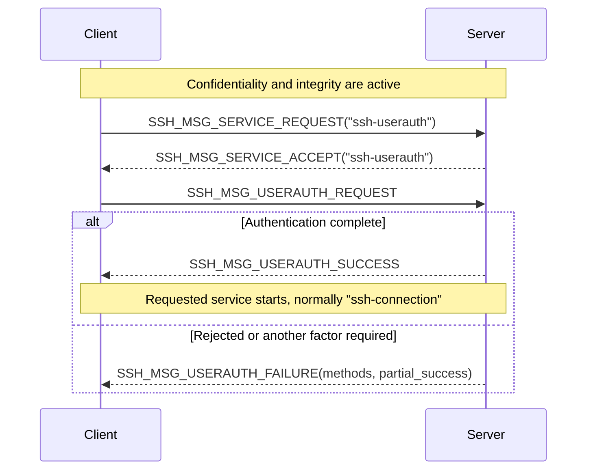
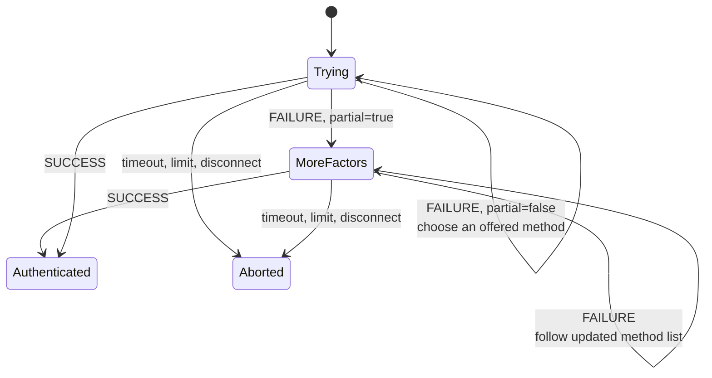
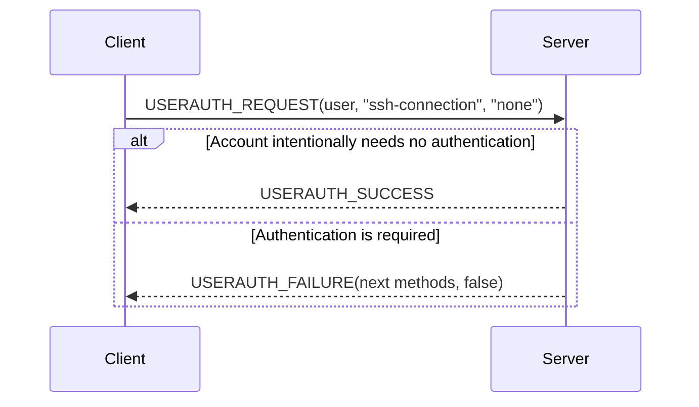
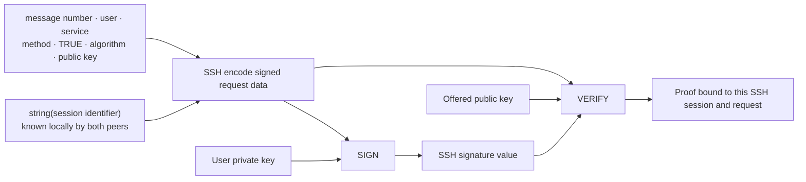
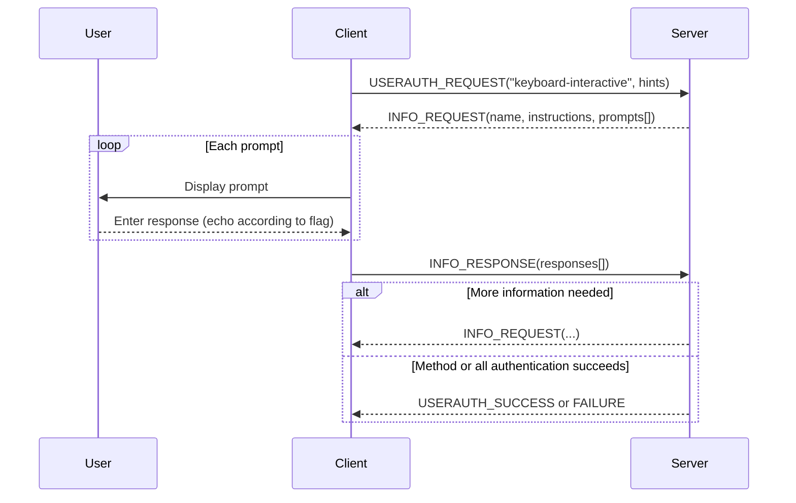
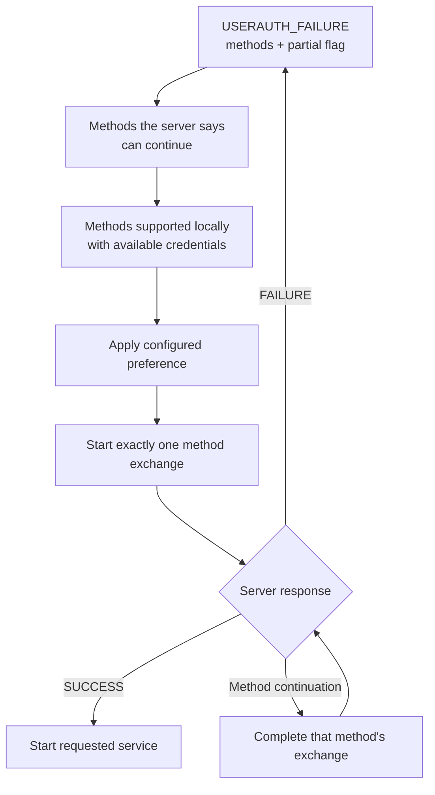

# User authentication

Once the transport is protected and the server's host key is trusted, the
client asks the server to authenticate a user. This answers a different
question from host verification:

- **Server authentication:** is this the intended server?
- **User authentication:** may this peer act as a particular account?

This guide assumes the client requires confidentiality and integrity before
user authentication. The framework permits a `none` cipher, but a safe client
never sends a password without confidentiality.
[RFC 4252](https://www.rfc-editor.org/rfc/rfc4252.html) specifies the
authentication framework and core methods;
[RFC 4256](https://www.rfc-editor.org/rfc/rfc4256.html) specifies the generic
interactive method.

## Entering the authentication service

After key exchange, the client requests the `ssh-userauth` service with the
transport's service request. Authentication requests begin once the server
accepts it.



Every `SSH_MSG_USERAUTH_REQUEST` begins with the same fields:

```text
byte      SSH_MSG_USERAUTH_REQUEST
string    user name
string    service name
string    method name
...       method-specific fields
```

The `service name` is the service to run *after* authentication, normally
`ssh-connection`, not `ssh-userauth`. Every request repeats the user name and
service. If either changes, the server must discard accumulated
authentication state, so progress belongs to one `(user, service)` pair. See
[RFC 4252, Section 5](https://www.rfc-editor.org/rfc/rfc4252.html#section-5).

## The server drives policy

On rejection, the server returns:

```text
byte       SSH_MSG_USERAUTH_FAILURE
name-list  authentications that can continue
boolean    partial success
```

The list names the methods that may productively continue *at this point*;
it is not a permanent capability list. `partial success` is true when the
request just answered succeeded but policy requires another method. Only
`SSH_MSG_USERAUTH_SUCCESS` completes authentication.



For example, a server that requires a public key and then a one-time code
(OpenSSH: `AuthenticationMethods publickey,keyboard-interactive`) answers the
valid signature with `partial success = true` and a list containing
`keyboard-interactive`.

Method names a client commonly meets in the list:

| Method | Defined in | Proves |
| --- | --- | --- |
| `publickey` | RFC 4252 | Possession of a user private key |
| `password` | RFC 4252 | Knowledge of the account password |
| `keyboard-interactive` | RFC 4256 | Answers to server-chosen prompts |
| `hostbased` | RFC 4252 | The client *host's* identity; the server trusts that host's user names |
| `gssapi-with-mic` | RFC 4462 | A GSS-API (usually Kerberos) credential |
| `publickey-hostbound-v00@openssh.com` | OpenSSH | Like `publickey`, with the server host key signed in |

Do not infer account existence from the list. Servers may return uniform
failures for unknown accounts to hinder username enumeration.
[RFC 4252, Section 4](https://www.rfc-editor.org/rfc/rfc4252.html#section-4)
recommends server-side time and attempt limits rather than indefinite
retries.

## The `none` method

`none` has no method-specific fields. It is mainly a discovery request:



The server must not list `none` as a method that can continue, and accepts
it only when the user may log in without authentication. A client can seed
method selection from the failure, but must tolerate a limited or
policy-shaped list. See
[RFC 4252, Section 5.2](https://www.rfc-editor.org/rfc/rfc4252.html#section-5.2).

## Public-key authentication

Public-key authentication proves possession of a user's private key with a
[digital signature](./crypto-signatures.md#signatures-as-a-black-box). The
server makes two independent checks, and both must pass:

1. Is this public key authorized for this user under current policy?
2. Does the signature verify with that public key?

### Optional key query

The client may first ask whether a key is acceptable, without signing:

```text
byte      SSH_MSG_USERAUTH_REQUEST
string    user name
string    service name
string    "publickey"
boolean   FALSE
string    public key algorithm name
string    public key blob
```

The server answers with `SSH_MSG_USERAUTH_PK_OK`, echoing the algorithm name
and key blob, or with `SSH_MSG_USERAUTH_FAILURE`. The query spares the client
from unlocking a private key, touching a hardware token, or signing for a key
the server will reject.

`PK_OK` is neither success nor a promise that the signed request will satisfy
policy. It only invites the client to continue with that key.

### Signed request

The client sends the signed form after `PK_OK`, or directly without a query:

```text
byte      SSH_MSG_USERAUTH_REQUEST
string    user name
string    service name
string    "publickey"
boolean   TRUE
string    public key algorithm name
string    public key blob
string    signature
```

The signed data is the session identifier encoded as an SSH `string`,
followed by the request's message-number byte and every field through the
public-key blob. It excludes the signature field itself, and the packet
length, padding, MAC, and sequence number.

The session identifier is not transmitted in the request: both peers know it
from the first key exchange, and it stays the same across rekeys. Signing it
binds the proof to this connection.



The session identifier stops an observed signature from being replayed on
another connection. Covering the user name, service, and key stops those
fields from being substituted after signing. The signature covers the SSH
binary encodings, not a textual rendering; the exact bytes are in
[RFC 4252, Section 7](https://www.rfc-editor.org/rfc/rfc4252.html#section-7).

### Signature algorithm versus key format

The key blob and the signature algorithm are related but need not share a
name. For [RSA](./crypto-signatures.md#rsa),
[RFC 8332](https://www.rfc-editor.org/rfc/rfc8332.html) defines the SHA-2
signature algorithms `rsa-sha2-256` and `rsa-sha2-512` but keeps the `ssh-rsa`
encoding for the public-key blob. Disabling `ssh-rsa` *signatures* disables
RSA with SHA-1, not RSA keys: the same key, blob, and fingerprint keep working
with a SHA-2 signature algorithm.

The host-key algorithm chosen during key exchange does not select the user's
algorithm either. A connection can authenticate an Ed25519 host key and then
an RSA/SHA-2 user signature: separate proofs, checked by different peers
under different policies.

[RFC 8709](https://www.rfc-editor.org/rfc/rfc8709.html) specifies
`ssh-ed25519` and `ssh-ed448`, signing-only keys; see
[Ed25519](./crypto-signatures.md#ed25519). Signatures prove possession; they
do not encrypt anything.

A private-key *passphrase* is not the account password. It decrypts a local
key file or unlocks a signing device, and never appears in a userauth packet.
An agent can return a signature without revealing the private key to the
client.

### Discovering acceptable signature algorithms

A server that received `ext-info-c` in the client's `SSH_MSG_KEXINIT` may send
`SSH_MSG_EXT_INFO` (see
[Extension negotiation](./version-and-negotiation.md#extension-negotiation-with-ext-info-)).
Its `server-sig-algs` extension is a name-list of the public-key algorithms
the server can process in a `publickey` request.

This matters most for RSA: the key blob stays `ssh-rsa` while the signature
uses `rsa-sha2-256` or `rsa-sha2-512`. The extension lets the client pick a
usable algorithm without spending authentication attempts on trial and error.

It describes capability, not authorization. A listed algorithm can still fail
because the key is not authorized, another factor is required, or policy
rejects it. [RFC 8308, Section 3.1](https://www.rfc-editor.org/rfc/rfc8308.html#section-3.1)
requires a server that sends it to list every algorithm it might accept, but
notes that early servers did not, so a client may still try an unlisted
algorithm. If the extension is absent, the client learns nothing either way.

### User certificates

OpenSSH also lets a user authenticate with a
[certificate](./crypto-signatures.md#certificates): the user's public key plus
metadata, signed by a user certification authority (CA). The metadata names
the *principals* the key may log in as, a validity interval, *critical
options* such as `force-command` or `source-address`, and *extensions* such as
`permit-pty`.

The client offers a certificate like any other key: the `publickey` request
carries a certificate algorithm name, such as
`ssh-ed25519-cert-v01@openssh.com`, and the encoded certificate in place of
the key blob. The certified key's private half still signs, in the plain
algorithm's signature format, over the usual session-bound data.

Only the authorization check changes. Instead of looking up this exact key
for the account, the server trusts a user CA key, in OpenSSH through
[`TrustedUserCAKeys`](https://man.openbsd.org/sshd_config#TrustedUserCAKeys)
or a `cert-authority` line in `authorized_keys`. It verifies the CA's
signature, confirms a currently valid user certificate, maps the requested
user name to an acceptable principal, and refuses any critical option it does
not understand. The user's signature must still verify with the certified
key.

Key distribution thus moves from every server to the CA, as host certificates
do for clients, and a short validity interval limits how long a lost key
stays useful. The format is specified in the
[SSH certificate Internet-Draft](https://datatracker.ietf.org/doc/draft-miller-ssh-cert/).

### Hardware-backed security keys

Names such as `sk-ssh-ed25519@openssh.com` and
`sk-ecdsa-sha2-nistp256@openssh.com` identify
[hardware-backed keys](./crypto-signatures.md#hardware-backed-keys) whose
private half stays inside a FIDO authenticator, such as a USB security key.
Two differences are visible on the wire:

- the public-key blob adds an *application* string, typically `ssh:`; and
- the signature carries a flags byte and a signature counter, because the
  authenticator signs a structure containing them along with a hash of the
  usual signed data.

The flags record whether the user confirmed presence, typically by touching
the device, and optionally whether the device verified the user, for example
with a PIN. The server checks them against policy; OpenSSH requires presence
by default. To the server a security key is still one factor.
[FIDO security keys](./fido-security-keys.md) covers these keys in detail.

### Host-bound public-key authentication

With [agent forwarding](./other-channels.md#agent-forwarding), a remote host
can ask your agent to sign a userauth request for a connection that host
opened. The session identifier binds the signature to that connection, but it
is an opaque hash: it does not tell the agent which server is at the other
end.

OpenSSH 8.9 added the `publickey-hostbound-v00@openssh.com` method. It is
`publickey` with a different name and one extra field:

```text
byte      SSH_MSG_USERAUTH_REQUEST
string    user name
string    service name
string    "publickey-hostbound-v00@openssh.com"
boolean   has signature
string    public key algorithm name
string    public key blob
string    server host key            from the initial key exchange
string    signature                  only if has signature is TRUE
```

Because the whole request is signed, the signer now sees the destination
user, the server's identity, and the session identifier together. The server
checks that the host key field is its own initial host key and otherwise
verifies as for `publickey`.

The agent combines this with `session-bind@openssh.com` messages, in which
each `ssh` on a forwarding path reports its connection's session identifier
and host key, proven by the server's key-exchange signature. It can then
enforce destination constraints added with `ssh-add -h`, refusing to sign for
servers or paths the user did not permit. On a forwarded agent connection it
refuses plain `publickey` requests for constrained keys, since they lack the
host key. This narrows delegated signing authority; a compromised host can
still use any key permitted through it.

A server advertises the method with the `EXT_INFO` extension
`publickey-hostbound@openssh.com`, value `"0"`, and clients should prefer it
when advertised. OpenSSH's `PubkeyAuthentication` option accepts `unbound` and
`host-bound` as well as `yes` and `no`. The wire format is in the
[OpenSSH `PROTOCOL` file](https://github.com/openssh/openssh-portable/blob/master/PROTOCOL),
Section 3.1; the agent side is in
[`PROTOCOL.agent`](https://github.com/openssh/openssh-portable/blob/master/PROTOCOL.agent)
and [SSH agent restriction](https://www.openssh.com/agent-restrict.html).

## Password authentication

The normal password request adds a false change-password flag and the
password:

```text
byte      SSH_MSG_USERAUTH_REQUEST
string    user name
string    service name
string    "password"
boolean   FALSE
string    plaintext password
```

"Plaintext" describes the field before transport protection; under the
policy assumed here, the transport encrypts the whole packet. The method does
not hash the password: a client-side hash would just become a
password-equivalent value.

For an expired password the server may send
`SSH_MSG_USERAUTH_PASSWD_CHANGEREQ`; the retry sets the boolean to true and
carries both old and new passwords.
[RFC 4252, Section 8](https://www.rfc-editor.org/rfc/rfc4252.html#section-8)
gives the formats and responses, and recommends disabling password
authentication when the transport lacks confidentiality.

Password authentication is one request with one password field. It is a
different wire protocol from keyboard-interactive, even when both make a
terminal show `Password:`.

## Keyboard-interactive authentication

`keyboard-interactive` is a generic series of server prompts and client
answers. It carries one-time passwords, challenge-response systems,
password-expiry dialogs, and multi-step logins without the client knowing
each backend mechanism.

The initial request carries language and submethod hints but no answers:

```text
byte      SSH_MSG_USERAUTH_REQUEST
string    user name
string    service name
string    "keyboard-interactive"
string    language tag
string    submethods
```

The server then sends one or more `SSH_MSG_USERAUTH_INFO_REQUEST` messages,
each with a name, instructions, a language tag, and a list of
`(prompt, echo)` pairs. The client replies with
`SSH_MSG_USERAUTH_INFO_RESPONSE` carrying exactly one response per prompt.



Only one information request is outstanding at a time, but there may be many
rounds. A request with zero prompts can carry informational text and still
needs a zero-response reply. `echo` says whether to show the user's input:
false for secrets, true for something like a visible identifier. See
[RFC 4256, Sections 3.2 and 3.3](https://www.rfc-editor.org/rfc/rfc4256.html#section-3.2).

## Host-based and GSS-API authentication

Two more standard methods may appear in the method list:

- **`hostbased`** ([RFC 4252, Section 9](https://www.rfc-editor.org/rfc/rfc4252.html#section-9)):
  the request names the client host and the user's name on it, and is signed
  with the client *host's* private key. The server verifies the host and
  then authorizes by host and user name, like `.rhosts` but with a real host
  proof. The user proves nothing; ordinary users must not be able to read the
  host key, so OpenSSH signs through the privileged `ssh-keysign` helper.
- **`gssapi-with-mic`** ([RFC 4462, Section 3](https://www.rfc-editor.org/rfc/rfc4462.html#section-3)):
  the client and server run a GSS-API mechanism, usually Kerberos, by
  exchanging opaque tokens, and the client finishes with a message integrity
  code (MIC) over data including the session identifier. This lets a single
  sign-on credential log in without SSH keys.

Both are optional and usually disabled; a client may simply skip methods it
does not support.

## Authentication policy flow

The client chooses its next method from the server's current list, the
methods it supports, the credentials it holds, and its configured preference.



Method-specific message numbers overlap. Number 60 is
`SSH_MSG_USERAUTH_PK_OK`, `SSH_MSG_USERAUTH_PASSWD_CHANGEREQ`,
`SSH_MSG_USERAUTH_INFO_REQUEST`, or `SSH_MSG_USERAUTH_GSSAPI_RESPONSE`,
depending on the active method. The byte alone does not determine the
meaning; the method exchange in progress does.

A client may abandon a method mid-exchange by sending a new
`SSH_MSG_USERAUTH_REQUEST`, for example instead of answering an interactive
prompt, but only after it has received a response to its previous request.
The server abandons the old method without sending a `FAILURE` for it. These
rules keep each reply attributable to the right attempt; see
[RFC 4252, Section 5.1](https://www.rfc-editor.org/rfc/rfc4252.html#section-5.1).

## Banners and other server text

At any point after authentication starts and before it succeeds, the server
may send:

```text
byte      SSH_MSG_USERAUTH_BANNER
string    message        UTF-8, lines separated by CRLF
string    language tag
```

Servers use it for legal warnings and login notices (OpenSSH: the `Banner`
option). It is not a prompt, needs no reply, and does not change method
state. The client should display it by default, but may let the user
suppress it; see
[RFC 4252, Section 5.4](https://www.rfc-editor.org/rfc/rfc4252.html#section-5.4).

Banners, prompts, instructions, and error descriptions all come from the
server. Even after host authentication, treat them as untrusted display data,
because a compromised but correctly identified server can still present
misleading text:

- filter terminal control characters, as RFC 4252 requires for banners, and
  do not interpret markup;
- make it clear which host is asking for input;
- do not assume that every hidden prompt is the account password;
- do not autofill secrets based only on prompt text.

## Lab: trace a two-factor login

Sketch the messages for a policy requiring `publickey` followed by
`keyboard-interactive`. Include:

1. the `ssh-userauth` service request;
2. an optional unsigned public-key query;
3. the signed public-key request;
4. failure with `partial success = true` and an updated method list;
5. a one-prompt keyboard-interactive round; and
6. the final success message.

For each message, record the active method and whether the packet carries
secret data. The exercise exposes the context-dependent meaning of message
number 60 and the difference between a completed method and completed
authentication.

## Check your understanding

1. A client receives `SSH_MSG_USERAUTH_FAILURE` with `partial success = true`
   after a signed `publickey` request. Is the user authenticated? What should
   the client do next?
2. What does `SSH_MSG_USERAUTH_PK_OK` promise, and why is the key query
   especially useful for hardware-backed keys?
3. An attacker records a signed `publickey` request from one connection and
   replays it on a new connection to the same server. Why does verification
   fail?
4. A server's `server-sig-algs` lists `rsa-sha2-512` but not `ssh-rsa`. Can
   the user still log in with an existing RSA key? What does the list not
   tell the client?
5. The client receives message number 60. How does it know what the message
   means?
6. What does `publickey-hostbound-v00@openssh.com` add to the signed data, and
   who uses the extra information?

<details>
<summary>Answers</summary>

1. No. The public-key method succeeded, but policy requires another method.
   The client must continue with a method from the updated list and treat
   only `SSH_MSG_USERAUTH_SUCCESS` as completion.
2. Only that the server would accept a signature from this key at this point;
   it is not authentication, and the signed request can still fail policy.
   The query avoids a touch or PIN prompt for keys the server will reject.
3. The signed data begins with the session identifier of the original
   connection. The new connection has a different session identifier, so the
   server rebuilds different signed data and the signature does not verify.
4. Yes. The key blob stays `ssh-rsa`; the client signs with `rsa-sha2-512`.
   The list states capability only: it does not say the key is authorized or
   that no other factor is required.
5. From the method exchange in progress: after a `publickey` query it is
   `PK_OK`, after a `password` request `PASSWD_CHANGEREQ`, during
   `keyboard-interactive` `INFO_REQUEST`, and during `gssapi-with-mic`
   `GSSAPI_RESPONSE`.
6. The server's host key from the initial key exchange. The server checks it
   matches its own key; `ssh-agent` uses it, together with session-binding
   messages, to enforce destination constraints on keys that were forwarded.

</details>

## References

- [RFC 4252: The Secure Shell (SSH) Authentication Protocol](https://www.rfc-editor.org/rfc/rfc4252.html).
- [RFC 4256: Generic Message Exchange Authentication for SSH](https://www.rfc-editor.org/rfc/rfc4256.html).
- [RFC 4462: GSS-API Authentication and Key Exchange for SSH](https://www.rfc-editor.org/rfc/rfc4462.html).
- [RFC 8308: Extension Negotiation in SSH](https://www.rfc-editor.org/rfc/rfc8308.html) (`server-sig-algs`).
- [RFC 8332: Use of RSA Keys with SHA-256 and SHA-512 in SSH](https://www.rfc-editor.org/rfc/rfc8332.html).
- [RFC 8709: Ed25519 and Ed448 Public Key Algorithms for SSH](https://www.rfc-editor.org/rfc/rfc8709.html).
- [SSH certificate format Internet-Draft](https://datatracker.ietf.org/doc/draft-miller-ssh-cert/).
- [OpenSSH `PROTOCOL`](https://github.com/openssh/openssh-portable/blob/master/PROTOCOL)
  (host-bound public-key authentication) and
  [`PROTOCOL.agent`](https://github.com/openssh/openssh-portable/blob/master/PROTOCOL.agent)
  (session binding, destination constraints).
- [OpenSSH: SSH agent restriction](https://www.openssh.com/agent-restrict.html).
- [OpenSSH `PROTOCOL.u2f`](https://github.com/openssh/openssh-portable/blob/master/PROTOCOL.u2f):
  security-key formats and signatures.
- [`sshd_config(5)`](https://man.openbsd.org/sshd_config) (`AuthenticationMethods`,
  `Banner`, `TrustedUserCAKeys`) and
  [`ssh_config(5)`](https://man.openbsd.org/ssh_config#PubkeyAuthentication).
