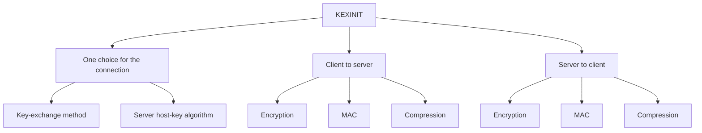
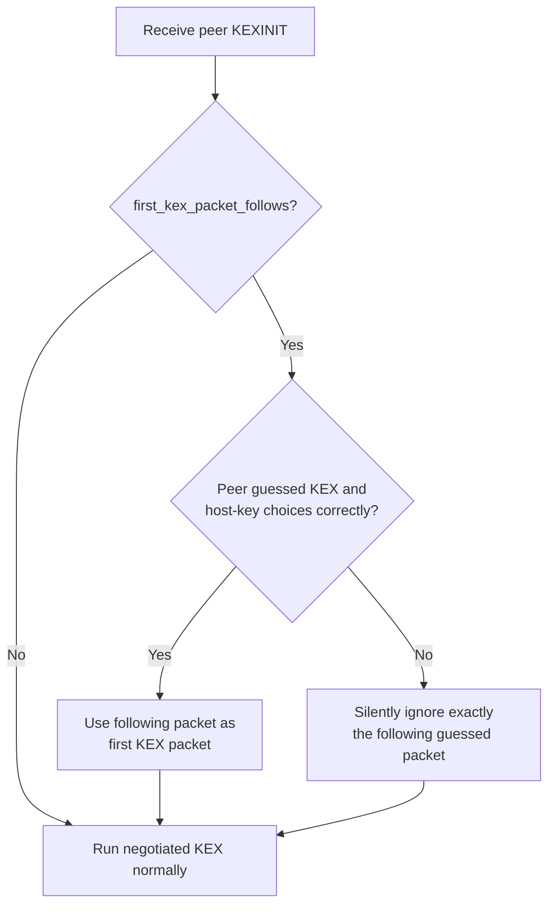
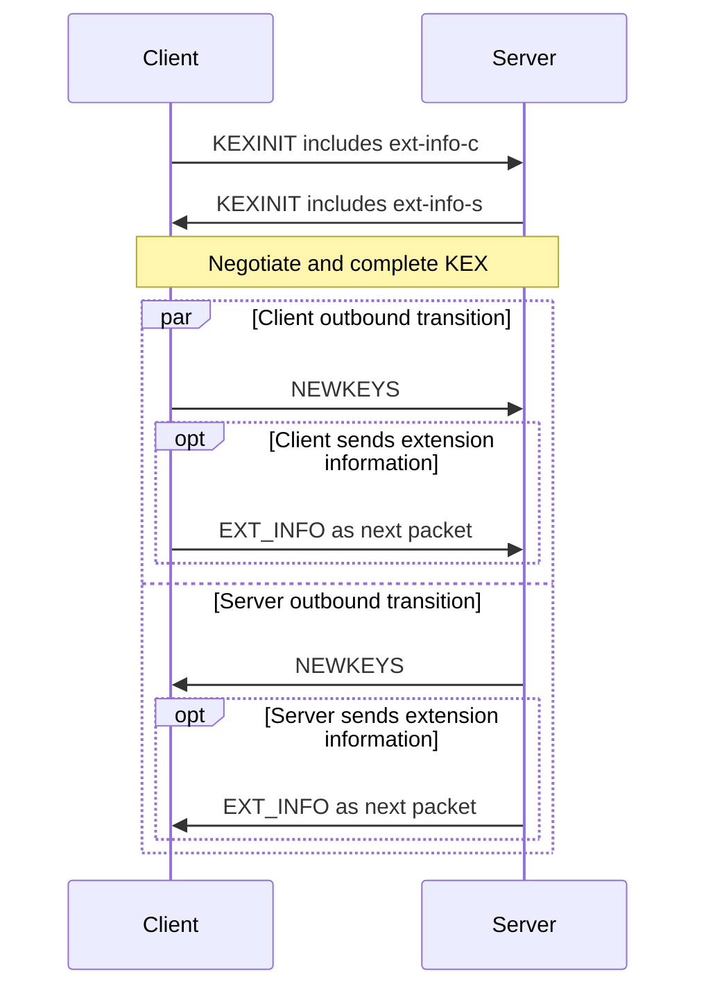

# Algorithm negotiation

After identification, the peers choose the algorithms that will protect the
connection. Each sends an ordered proposal in `SSH_MSG_KEXINIT`, and both
apply the same deterministic selection rule. The binary types used here come
from [SSH binary packets and data types](./binary-packets.md);
[Cryptography as protocol building blocks](./cryptography-primer.md)
explains what the selected algorithms do.

## `SSH_MSG_KEXINIT` carries proposals

In the initial exchange, `SSH_MSG_KEXINIT` travels unprotected. Its exact
payload is later included in the signed exchange hash. The payload contains:

```text
byte        SSH_MSG_KEXINIT (20)
byte[16]    random cookie
name-list   key exchange algorithms
name-list   server host key algorithms
name-list   encryption algorithms, client to server
name-list   encryption algorithms, server to client
name-list   MAC algorithms, client to server
name-list   MAC algorithms, server to client
name-list   compression algorithms, client to server
name-list   compression algorithms, server to client
name-list   languages, client to server
name-list   languages, server to client
boolean     first_kex_packet_follows
uint32      reserved (zero)
```

A `name-list` is a comma-separated sequence encoded as an SSH string; names
cannot contain commas, and an empty list has zero bytes of content. Order
expresses preference, leftmost first.

Encryption, MAC, and compression are negotiated separately for each
direction, so a connection could use different ciphers for client-to-server
and server-to-client traffic. Most proposals are symmetrical, but the fields
remain separate decisions.



The 16-byte cookie is a [random value](./cryptography-primer.md#randomness)
chosen by the sender. Because both complete `KEXINIT` payloads enter the
exchange hash, the two cookies make every handshake transcript unique; RFC
4253 gives the purpose as ensuring that neither side alone can fully
determine the keys and the session identifier. The cookie plays no part in
algorithm selection.

## The selection rule: client preference wins

In each category, the result is **the first compatible algorithm in the
client's list that also appears in the server's list**. This holds for the
server-to-client direction too, and whichever peer does the calculation.

```text
client: curve25519-sha256,ecdh-sha2-nistp256,diffie-hellman-group14-sha256
server: diffie-hellman-group14-sha256,curve25519-sha256
```

The result is `curve25519-sha256`: it is the client's first choice that the
server supports. The server listing it second does not matter.

"Compatible" matters because categories depend on each other. A KEX method
is usable only if a mutually supported host-key algorithm has the capability
it needs; for the signed methods in this guide, that is a signature-capable
host key. The host-key choice then follows the client's order among the
compatible mutual names.

For a cipher paired with a separate MAC, both categories need a match. The
[AEAD](./crypto-symmetric.md#three-ways-to-combine-encryption-and-integrity)
ciphers `aes128-gcm@openssh.com`, `aes256-gcm@openssh.com`, and
`chacha20-poly1305@openssh.com` supply their own integrity protection, so
selecting one skips MAC negotiation for that direction, and disjoint MAC
lists do not make it fail. This differs from the original AES-GCM
negotiation in RFC 5647; see the
[OpenSSH transport extensions](https://github.com/openssh/openssh-portable/blob/master/PROTOCOL)
and the [AES-GCM Internet-Draft](https://datatracker.ietf.org/doc/draft-miller-sshm-aes-gcm/).

Language lists may be empty and need no match. If any *required* category has
no compatible match, negotiation fails; neither endpoint invents a fallback.

### A worked multi-category example

| Category | Client preference order | Server support | Selected |
| --- | --- | --- | --- |
| KEX | `curve25519-sha256`, `ecdh-sha2-nistp256` | `ecdh-sha2-nistp256`, `curve25519-sha256` | `curve25519-sha256` |
| Host key | `ssh-ed25519`, `rsa-sha2-256` | `rsa-sha2-256` | `rsa-sha2-256` |
| Encryption C→S | `aes128-gcm@openssh.com`, `cipher-a` | `cipher-a`, `aes128-gcm@openssh.com` | `aes128-gcm@openssh.com` |
| Encryption S→C | `cipher-b`, `cipher-a` | `cipher-a`, `cipher-b` | `cipher-b` |
| MAC C→S | `hmac-sha2-256` | `hmac-sha2-512` | Skipped; GCM supplies the tag |
| MAC S→C | `hmac-sha2-256` | `hmac-sha2-512`, `hmac-sha2-256` | `hmac-sha2-256`; `cipher-b` needs a MAC |
| Compression C→S | `none` | `none`, `zlib` | `none` |

The placeholder cipher names show the ordering rule without implying a
configuration recommendation. For current KEX guidance, see
[RFC 9142](https://www.rfc-editor.org/rfc/rfc9142.html), which updates RFC
4253.

The figure below starts from this example. Edit either peer's name-lists,
give a category separate lists per direction, or pick a preset to see what
each category selects and why earlier client entries were passed over. It also
shows which of the [markers](#markers-in-the-kex-algorithm-list) described
below take effect and whether a guessed first KEX packet would be used.

<div class="ssh-widget" data-widget="negotiation">
<p class="w-fallback">Interactive figure: editable client and server
name-lists for KEX, host key, encryption, MAC, and compression. For each
category it marks the first client entry that the server also lists, explains
why earlier entries were skipped, and reports failures, AEAD ciphers that make
the MAC irrelevant, the ext-info and strict-KEX markers, and whether a guessed
KEX packet would be used.</p>
</div>

### No “chosen algorithms” message

Neither peer announces the result. Both hold the same two ordered proposals
and run the same rule, so both reach the same selection. Each keeps the
exact original `KEXINIT` payloads, because they are transcript inputs.

## The guessed-packet optimization

The `first_kex_packet_follows` boolean saves a round trip. A peer may guess
the negotiated KEX and host-key algorithms from the first entries of the two
proposals and send its first method-specific KEX packet straight after its
`KEXINIT`. If the guess is wrong, the receiver silently discards exactly that
one packet and continues with the negotiated method.



A client that never guesses must still implement the receiving side: a
server's wrong guess is discarded, not parsed as the first packet of the
negotiated method.

## Markers in the KEX algorithm list

The `kex_algorithms` field also carries capability markers. They look like
algorithm names but are never runnable KEX methods, and they are only
meaningful in each peer's first `KEXINIT`.

### Extension negotiation with `ext-info-*`

[RFC 8308](https://www.rfc-editor.org/rfc/rfc8308.html#section-2) defines two
role-specific markers:

- `ext-info-c`: the client can receive extension information from the
  server;
- `ext-info-s`: the server can receive extension information from the
  client.

The different suffixes ensure the two never match and get selected as the KEX
method (if one somehow were, both peers must disconnect). A peer that sees
the other's marker *may* send `SSH_MSG_EXT_INFO`, but need not.



`SSH_MSG_EXT_INFO` carries a count followed by name/value pairs. Unknown
names must be ignored. A value is an arbitrary SSH string, not necessarily
UTF-8 or a name-list, so each extension's specification defines how to parse
it. The most visible example is `server-sig-algs`, which lists the signature
algorithms the server accepts for public-key user authentication; see
[User authentication](./user-authentication.md).

Timing is directional. After the initial KEX, `EXT_INFO` must be the sender's
first packet after its first `NEWKEYS`. A server may also send a second
`EXT_INFO` immediately before `SSH_MSG_USERAUTH_SUCCESS`. Extension
negotiation never changes the algorithms already chosen by `KEXINIT`.

### Strict key exchange

Strict KEX is a deployed extension designed in response to the
[Terrapin](./crypto-symmetric.md#terrapin-when-implicit-state-is-not-authenticated)
prefix-truncation attack. It is unrelated to OpenSSH's
`StrictHostKeyChecking` option.

Support is announced with role-specific pseudo-algorithms. The deployed names
are `kex-strict-c-v00@openssh.com` and `kex-strict-s-v00@openssh.com`; the
[strict KEX Internet-Draft](https://datatracker.ietf.org/doc/draft-ietf-sshm-strict-kex/)
also defines the standard names `kex-strict-c` and `kex-strict-s`. Strict KEX
activates only when client and server markers are the same form (both
standard or both pre-standard), so implementations are advised to offer both.

When strict KEX is active:

- the initial `KEXINIT` must be the peer's first binary packet;
- during the initial exchange, any message other than the expected
  negotiation and KEX messages, including `IGNORE` and `DEBUG`, terminates the
  connection; and
- each direction's packet sequence number resets to zero immediately after
  its `NEWKEYS`, for the initial exchange and every rekey.

The base protocol tolerates generic transport messages during KEX. Those
messages are outside the exchange hash but still advance the implicit
sequence numbers, which is the gap Terrapin exploits. Strict KEX closes it.

> **Protocol-design lesson**
>
> “Authenticated later” works only when the later authenticator covers all
> security-relevant state. Strict KEX brings the packet sequence numbers used
> by the protected transport back in line with the signed transcript.

## Compatibility and registries

Algorithm names, not version numbers, are SSH's extension point. A new
method is deployed by adding its name to proposals; old peers ignore names
they do not know and select a mutual alternative.

The authoritative name lists are the
[IANA SSH protocol-parameter registries](https://www.iana.org/assignments/ssh-parameters/ssh-parameters.xhtml).
[RFC 9519](https://www.rfc-editor.org/rfc/rfc9519.html) changed their
registration policy. Registration says nothing about whether an algorithm is
safe to enable; consult each method's RFC and current guidance such as RFC
9142.

## Check your understanding

1. The server prefers `B,A`; the client prefers `A,B`; both support both.
   Which algorithm is selected?
2. Why is there no message announcing the negotiated algorithms?
3. Both peers select `aes128-gcm@openssh.com` but offer disjoint MAC lists.
   Does that direction fail negotiation?
4. A server sets `first_kex_packet_follows` but guessed the wrong KEX method.
   What does the client do with the next packet?
5. Does `ext-info-c` mean “the client will send `EXT_INFO`” or “the client can
   receive `EXT_INFO`”?
6. What state does strict KEX protect that the original exchange hash did not
   fully bind?

<details>
<summary>Answers</summary>

1. `A`: selection follows the client's preference order.
2. Both peers have both proposals and apply the same deterministic rule, so
   they compute the same result independently.
3. No. An AEAD cipher supplies integrity, so MAC negotiation is skipped for
   that direction.
4. It silently discards that one guessed packet and continues with the
   negotiated method.
5. It means the client is prepared to receive it from the server.
6. Which packets may appear during the initial KEX, and the packet
   sequence-number state at the switch to new keys.

</details>

## References

- [RFC 4253 — SSH Transport Layer Protocol](https://www.rfc-editor.org/rfc/rfc4253.html), especially Section 7.
- [RFC 8308 — Extension Negotiation in SSH](https://www.rfc-editor.org/rfc/rfc8308.html).
- [RFC 9142 — SSH KEX Method Updates and Recommendations](https://www.rfc-editor.org/rfc/rfc9142.html).
- [RFC 9519 — Update to the IANA SSH Registry Requirements](https://www.rfc-editor.org/rfc/rfc9519.html).
- [IANA Secure Shell (SSH) Protocol Parameters](https://www.iana.org/assignments/ssh-parameters/ssh-parameters.xhtml).
- [Strict KEX Internet-Draft](https://datatracker.ietf.org/doc/draft-ietf-sshm-strict-kex/).
- [AES-GCM for SSH Internet-Draft](https://datatracker.ietf.org/doc/draft-miller-sshm-aes-gcm/).
- [OpenSSH `PROTOCOL`](https://github.com/openssh/openssh-portable/blob/master/PROTOCOL) for deployed extensions.
