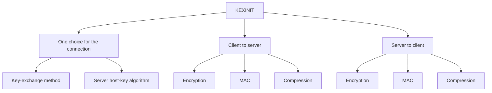
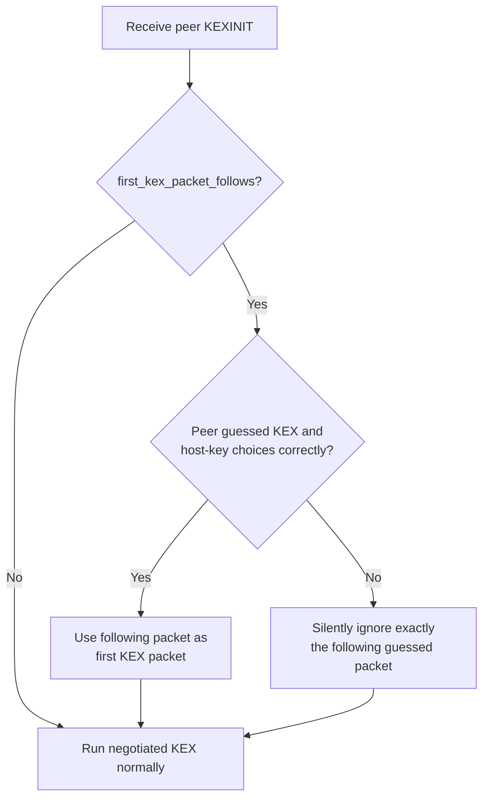
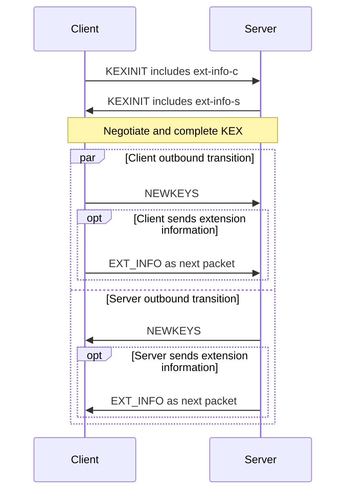

# Algorithm negotiation

After identification, the peers choose the algorithms that will protect the
connection. Each endpoint sends an ordered proposal in `SSH_MSG_KEXINIT`.
Both then apply the same deterministic selection rule.

This chapter assumes the binary types and packet framing from
[SSH binary packets and data types](./binary-packets.md). The next chapter,
[Cryptography as protocol building blocks](./cryptography-primer.md),
introduces the cryptographic operations used by the selected algorithms.

## `SSH_MSG_KEXINIT` carries proposals

During the initial exchange, each peer normally sends an unprotected
`SSH_MSG_KEXINIT` packet. Its exact payload is later included in the signed
exchange hash.

Conceptually, the payload contains:

```text
byte        SSH_MSG_KEXINIT (20)
byte[16]    random cookie
name-list   key exchange algorithms
name-list   server host key algorithms
name-list   encryption algorithms, client to server
name-list   encryption algorithms, server to client
name-list   MAC algorithms, client to server
name-list   MAC algorithms, server to client
name-list   compression algorithms, client to server
name-list   compression algorithms, server to client
name-list   languages, client to server
name-list   languages, server to client
boolean     first_kex_packet_follows
uint32      reserved (zero)
```

A `name-list` is a comma-separated sequence encoded as an SSH string. Names
must not contain commas. Ordering expresses preference: left is preferred over
right. An empty name-list has zero bytes of content.

The two directions are negotiated independently. A connection can therefore,
at least in protocol terms, choose different ciphers or compression methods
for client-to-server and server-to-client traffic. Most modern proposals are
symmetrical, but the directional fields remain separate protocol decisions.



The 16-byte cookie must be a
[random value](./cryptography-primer.md#randomness) chosen by the sender.
Because each complete `KEXINIT` payload later enters the exchange hash, the
two cookies make every handshake transcript unique. RFC 4253 states the
purpose: neither side alone can fully determine the keys and the session
identifier. The cookie has no role in the selection rule.

## The selection rule: client preference wins

The basic rule is to choose the **first compatible algorithm in the client's
list that also appears in the server's list**. This rule applies even when
the server is performing the calculation and even for the server-to-client
direction. Compatibility matters because some categories depend on others.

Suppose the proposals are:

```text
client: curve25519-sha256,ecdh-sha2-nistp256,diffie-hellman-group14-sha256
server: diffie-hellman-group14-sha256,curve25519-sha256
```

The result is `curve25519-sha256`, because it is the first client preference
that the server also supports. It does not matter that the server listed it
second.

The KEX method must have a mutually supported host-key algorithm with the
capability it requires. For the signed methods in this guide, that means a
signature-capable host key. The host-key choice then follows the client's
order among the compatible mutual names. A shared KEX name alone is therefore
not enough to establish compatibility.

For encryption with a separate MAC, both categories need a match. The deployed
[AEAD](./crypto-symmetric.md#three-ways-to-combine-encryption-and-integrity)
modes `aes128-gcm@openssh.com`, `aes256-gcm@openssh.com`, and
`chacha20-poly1305@openssh.com` instead supply their own integrity protection:
selecting one as the cipher skips the separate MAC negotiation in that
direction. Disjoint MAC lists do not make that AEAD choice fail. This differs
from the original AES-GCM negotiation in RFC 5647; see the
[OpenSSH transport extensions](https://github.com/openssh/openssh-portable/blob/master/PROTOCOL)
and the [AES-GCM specification draft](https://datatracker.ietf.org/doc/draft-miller-sshm-aes-gcm/).

Language lists may be empty and do not need a match. If a *required* choice
has no compatible match, negotiation fails; neither endpoint silently invents
a fallback.

### A worked multi-category example

| Category | Client preference order | Server support | Selected |
| --- | --- | --- | --- |
| KEX | `curve25519-sha256`, `ecdh-sha2-nistp256` | `ecdh-sha2-nistp256`, `curve25519-sha256` | `curve25519-sha256` |
| Host key | `ssh-ed25519`, `rsa-sha2-256` | `rsa-sha2-256` | `rsa-sha2-256` |
| Encryption C→S | `aes128-gcm@openssh.com`, `cipher-a` | `cipher-a`, `aes128-gcm@openssh.com` | `aes128-gcm@openssh.com` |
| Encryption S→C | `cipher-b`, `cipher-a` | `cipher-a`, `cipher-b` | `cipher-b` |
| MAC C→S | `hmac-sha2-256` | `hmac-sha2-512` | Skipped; GCM supplies the tag |
| Compression C→S | `none` | `none`, `zlib` | `none` |

The placeholder cipher names make the ordering rule visible without implying a
configuration recommendation. Algorithm policy changes over time; [RFC
9142](https://www.rfc-editor.org/rfc/rfc9142.html) updates KEX guidance that was
originally published in RFC 4253.

### No “chosen algorithms” message

Neither peer sends a separate result. Both have the same two ordered proposals
and run the same deterministic rule, so both derive the same selection.

The exact original `KEXINIT` payloads must be retained because they later
become transcript inputs.

## The guessed-packet optimization

The `first_kex_packet_follows` boolean supports a latency optimization from the
base protocol. A peer may guess the outcome from the first entries in the
proposals and send the first method-specific KEX packet immediately after its
`KEXINIT`.

If the guess is wrong, the receiver silently ignores that one guessed packet,
then continues with the actual negotiated method. If the boolean is false,
there is no guessed packet to discard.



This is a wire-level rule even when the local endpoint never makes a guess: a
peer's wrong guessed packet is consumed and ignored rather than interpreted as
the first packet of the negotiated method.

## Markers in the KEX algorithm list

The `kex_algorithms` field is also used for capability markers. These look like
algorithm names but are not runnable KEX methods.

### Extension negotiation with `ext-info-*`

[RFC 8308](https://www.rfc-editor.org/rfc/rfc8308.html#section-2) defines two
role-specific markers:

- a client includes `ext-info-c` to say it can receive extension information
  from a server;
- a server includes `ext-info-s` to say it can receive extension information
  from a client.

The different suffixes deliberately prevent them from matching each other and
being selected as the KEX method. A peer that sees the appropriate marker may
send `SSH_MSG_EXT_INFO`; it is not required to do so.

The markers belong in the initial `KEXINIT`, not later rekey proposals. They
advertise a capability for the connection rather than an algorithm to
renegotiate on every KEX.



`SSH_MSG_EXT_INFO` contains a count followed by extension-name/value pairs.
Unknown extension names must be ignored. A value is an arbitrary SSH string,
not necessarily UTF-8 or a comma-separated list, so its named specification
defines how to parse it.

The most visible example is `server-sig-algs`. It lets a server report the
public-key signature algorithms it can process during user authentication.
The user-authentication chapter follows that decision.

The first opportunity is directional: if an endpoint sends `EXT_INFO` after
the initial KEX, it must be that sender's next packet after its first
`NEWKEYS`. RFC 8308 also permits a server to send a replacement `EXT_INFO`
immediately before `SSH_MSG_USERAUTH_SUCCESS`. Extension negotiation does not
change the algorithm choices already made by `KEXINIT`.

### Strict key exchange

Strict key exchange is a deployed protocol extension designed in response to
the [Terrapin](./crypto-symmetric.md#terrapin-when-implicit-state-is-not-authenticated)
class of prefix-truncation attacks. It is unrelated to OpenSSH's
similarly named `StrictHostKeyChecking` user option.

Support is announced with role-specific pseudo-algorithms. Deployed names
include `kex-strict-c-v00@openssh.com` and
`kex-strict-s-v00@openssh.com`; the current specification also defines the
standard-form names `kex-strict-c` and `kex-strict-s`. Strict KEX activates
when the client/server pair uses the same form: either both standard names or
both pre-standard names. A standard name on one side does not pair with a
pre-standard name on the other. See the
[strict KEX Internet-Draft](https://datatracker.ietf.org/doc/draft-ietf-sshm-strict-kex/02/)
and OpenSSH's [protocol extension documentation](https://github.com/openssh/openssh-portable/blob/master/PROTOCOL).

When strict KEX is active:

- the initial `KEXINIT` must be the peer's first binary protocol packet;
- only the expected negotiation and method-specific KEX messages are accepted
  during the initial exchange; and
- packet sequence numbers reset just after each direction's `NEWKEYS`, for the
  initial exchange and later rekeys.

The base RFC allows some generic transport messages during KEX. Strict KEX
narrows that grammar: an unexpected `IGNORE`, `DEBUG`, or other non-KEX message
during the initial exchange causes termination instead of being tolerated.
That constraint prevents an attacker from using legal-but-unexpected packets
to manipulate the implicit sequence-number state.

> **Protocol-design lesson**
>
> “Authenticated later” works only when the later authenticator covers all
> security-relevant state. Strict KEX closes gaps between the signed transcript
> and the packet sequence numbers used by the protected transport.

## Compatibility and registries

SSH algorithm names are extensibility points rather than version bumps. New
methods can be deployed by adding names to proposals, while old peers ignore
names they do not know and select a mutual alternative.

The authoritative sets of names live in the IANA SSH protocol-parameter
registries. [RFC 9519](https://www.rfc-editor.org/rfc/rfc9519.html) changed the
registration policy for registries including KEX, encryption, MAC, compression,
extension, and public-key algorithm names. It does not define a cryptographic
algorithm or say which algorithm is safe to enable; use each method's RFC and
current algorithm-guidance documents for that.

## Check your understanding

1. A server sends two notice lines and then `SSH-2.0-server\r\n`. Where does the
   binary packet stream begin?
2. The server prefers `B,A`; the client prefers `A,B`; both support both. Which
   algorithm is selected?
3. Why can a network attacker read an identification string but not silently
   rewrite it in a successful authenticated handshake?
4. Does `ext-info-c` mean “the client will send `EXT_INFO`” or “the client can
   receive `EXT_INFO`”?
5. What state does strict KEX protect that the original exchange hash did not
   fully bind?
6. Both peers select `aes128-gcm@openssh.com` but offer disjoint MAC lists.
   Does that direction fail negotiation?

<details>
<summary>Answers</summary>

1. At the first byte after the LF terminating the `SSH-2.0-server` line.
2. `A`: selection always follows client preference order.
3. The exact line, without CRLF, is an input to the exchange hash that the
   server signs. A rewrite makes the client and server transcripts differ.
4. It means the client is prepared to receive it from the server.
5. The ordering of packets during initial KEX and the packet sequence-number
   state at the transition to new keys.
6. No. This AEAD cipher supplies integrity and skips separate MAC negotiation.

</details>

## References

- [RFC 4253 — SSH Transport Layer Protocol](https://www.rfc-editor.org/rfc/rfc4253.html), especially Section 7.
- [RFC 8308 — Extension Negotiation in SSH](https://www.rfc-editor.org/rfc/rfc8308.html).
- [RFC 9142 — SSH KEX Method Updates and Recommendations](https://www.rfc-editor.org/rfc/rfc9142.html).
- [RFC 9519 — Update to the IANA SSH Registry Requirements](https://www.rfc-editor.org/rfc/rfc9519.html).
- [Strict KEX Internet-Draft](https://datatracker.ietf.org/doc/draft-ietf-sshm-strict-kex/02/) and [OpenSSH `PROTOCOL`](https://github.com/openssh/openssh-portable/blob/master/PROTOCOL) for the deployed extension.
