# Version exchange and algorithm negotiation

Before SSH can encrypt a byte, the peers must answer two questions:

1. Do we speak compatible versions of the SSH protocol?
2. Which algorithms will we use for this connection?

This chapter follows those decisions from the first cleartext line through
`SSH_MSG_KEXINIT`. The next chapter, [Key exchange](./key-exchange.md), runs the
chosen key-exchange method and turns its output into traffic keys.

The normative foundation is [RFC 4253, Sections 4 and
7](https://www.rfc-editor.org/rfc/rfc4253.html#section-4). Extension negotiation
was added later by [RFC 8308](https://www.rfc-editor.org/rfc/rfc8308.html).

## Learning objectives

By the end of this chapter, you should be able to:

- recognise an SSH identification exchange without mistaking a pre-banner for the
  protocol line;
- explain why identification strings are security-relevant even though they
  are sent in cleartext;
- read the name-lists in `SSH_MSG_KEXINIT`;
- calculate the selected algorithm in every category;
- distinguish real key-exchange methods from negotiation markers such as
  `ext-info-c`; and
- describe what extension negotiation and strict key exchange change.

## From text to binary

The SSH transport begins in an unusual way: one line-oriented text exchange is
followed immediately by a binary packet protocol.

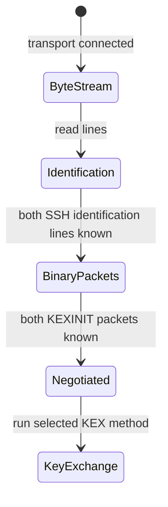

There is no length prefix or content-type marker at the transition. The LF that
ends the server's identification line is the boundary: the very next byte is
the first byte of the SSH binary packet stream.

## Identification exchange

Each side sends an identification string in this form:

```text
SSH-protoversion-softwareversion SP comments CR LF
```

For SSH version 2, a typical exchange is:

```text
SSH-2.0-CourseClient_0.1<CR><LF>
SSH-2.0-ExampleServer_4.2 staging<CR><LF>
```

The comment and the space before it are optional. The line is at most 255
characters including CRLF, must not contain a NUL byte, and uses printable
US-ASCII—with tighter restrictions for the version fields. Protocol version
`2.0` is the version described by the modern SSH RFCs. The historical value
`1.99` also announces compatibility with version 2; it does **not** mean a new
version between 1 and 2. See [RFC 4253, Sections 4.2 and
5](https://www.rfc-editor.org/rfc/rfc4253.html#section-4.2).

Both peers may send without waiting for the other. The exchange therefore has
no request/response order even if a packet capture happens to show one side
first.

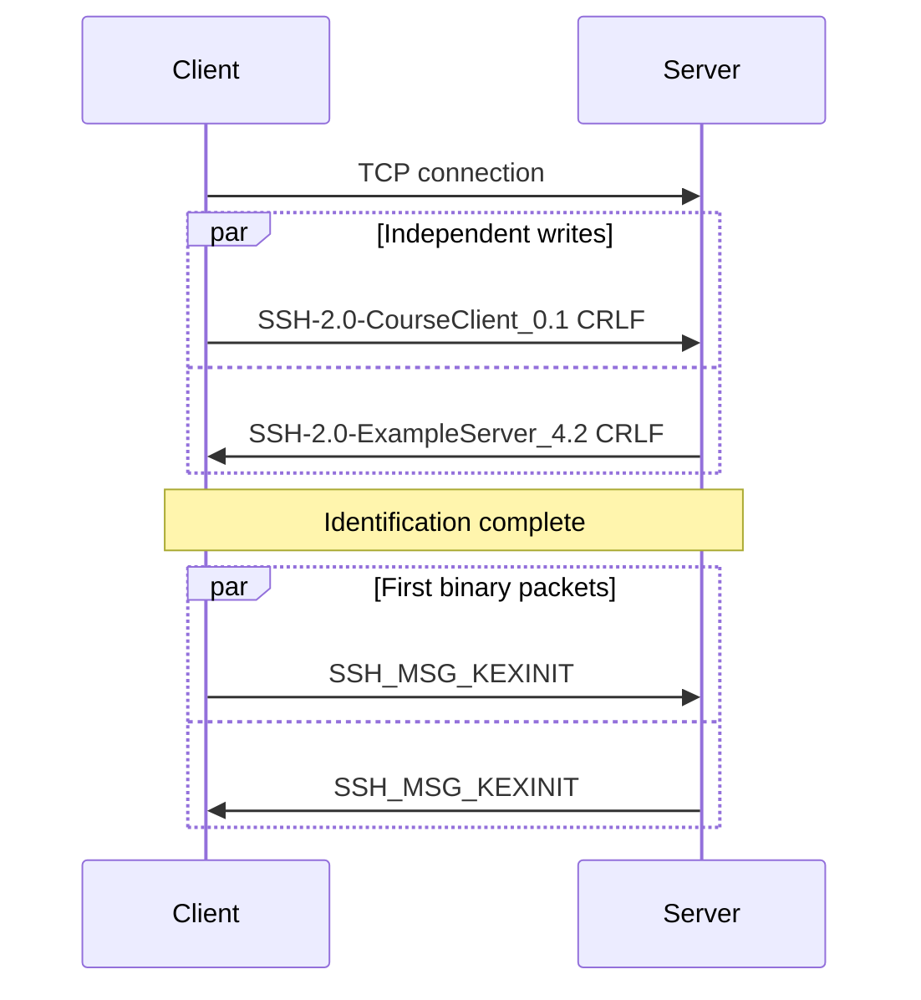

### The server pre-banner caveat

A server may send lines *before* its SSH identification line. This facility was
intended for messages from wrappers and gateways. A conforming client must
accept it.

```text
This system is restricted to authorised users.<CR><LF>
Maintenance window: Sunday 02:00 UTC.<CR><LF>
SSH-2.0-ExampleServer_4.2<CR><LF>
```

Pre-banner lines must not begin with `SSH-`; the first line that does is the
identification candidate. A client may ignore or display preceding text. If it
displays it, RFC 4253 recommends filtering terminal control characters.

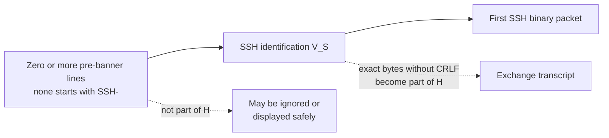

The allowance is asymmetric: it applies to server output, not to client
output.

### Cleartext, but bound into the handshake

Identification lines are visible to the network. They are not secrets and can
reveal implementation names or compatibility hints. They nevertheless become
inputs to the exchange hash during key exchange, with CRLF removed.

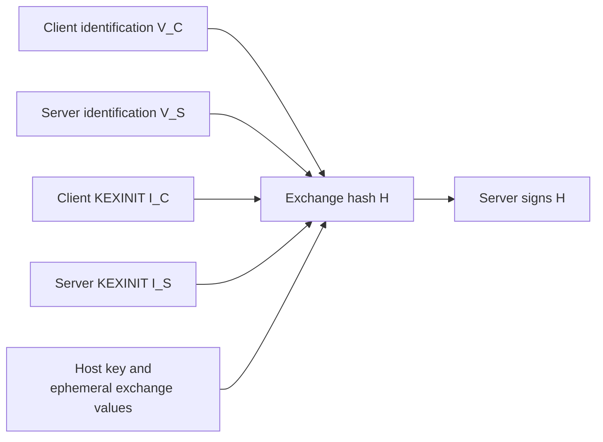

An active attacker can alter a cleartext line while it is in flight, but then
the peers calculate different exchange hashes and signature verification
fails. This is an example of *transcript binding*: early unauthenticated bytes
are authenticated retrospectively by a later signature.

> **Transcript invariant**
>
> The exchange hash uses the exact identification bytes before CRLF, not a
> normalized reconstruction of the parsed fields. Spacing and comments are
> therefore part of the authenticated transcript.

## `SSH_MSG_KEXINIT`: proposals, not a selection

After identification, each peer sends `SSH_MSG_KEXINIT` as an SSH binary
packet. At this point there are no negotiated keys, so this first packet is
normally unencrypted and unauthenticated. Its exact payload is later included
in the signed exchange hash.

Conceptually, the payload contains:

```text
byte        SSH_MSG_KEXINIT (20)
byte[16]    random cookie
name-list   key exchange algorithms
name-list   server host key algorithms
name-list   encryption algorithms, client to server
name-list   encryption algorithms, server to client
name-list   MAC algorithms, client to server
name-list   MAC algorithms, server to client
name-list   compression algorithms, client to server
name-list   compression algorithms, server to client
name-list   languages, client to server
name-list   languages, server to client
boolean     first_kex_packet_follows
uint32      reserved (zero)
```

A `name-list` is a comma-separated sequence encoded as an SSH string. Names
must not contain commas. Ordering expresses preference: left is preferred over
right. An empty name-list has zero bytes of content.

The two directions are negotiated independently. A connection can therefore,
at least in protocol terms, choose different ciphers or compression methods
for client-to-server and server-to-client traffic. Most modern proposals are
symmetrical, but the directional fields remain separate protocol decisions.

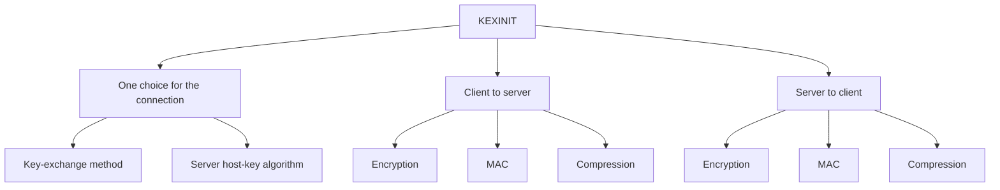

The 16-byte cookie makes otherwise identical proposals distinct. It is not an
algorithm-selection nonce and has no role in the selection rule.

## The selection rule: client preference wins

For each category, choose the **first algorithm in the client's list that also
appears in the server's list**. This rule applies even when the server is
performing the calculation and even for the server-to-client direction.

Suppose the proposals are:

```text
client: curve25519-sha256,ecdh-sha2-nistp256,diffie-hellman-group14-sha256
server: diffie-hellman-group14-sha256,curve25519-sha256
```

The result is `curve25519-sha256`, because it is the first client preference
that the server also supports. It does not matter that the server listed it
second.

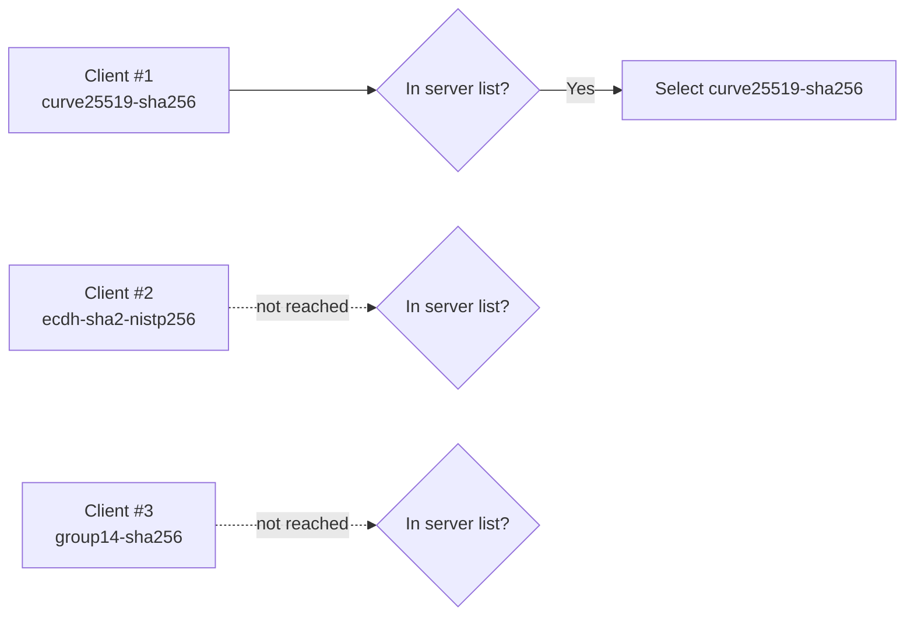

Equivalent pseudocode is:

```text
for candidate in client_preferences:
    if candidate is in server_supported:
        return candidate
fail key exchange: no mutually supported algorithm
```

For a host-key algorithm, the candidate must also have the capability required
by the chosen key-exchange method—for example, it must be able to make a
signature when the KEX method requires one. If any required category has no
match, negotiation fails; neither endpoint silently invents a fallback.

### A worked multi-category example

| Category | Client preference order | Server support | Selected |
| --- | --- | --- | --- |
| KEX | `curve25519-sha256`, `ecdh-sha2-nistp256` | `ecdh-sha2-nistp256`, `curve25519-sha256` | `curve25519-sha256` |
| Host key | `ssh-ed25519`, `rsa-sha2-256` | `rsa-sha2-256` | `rsa-sha2-256` |
| Encryption C→S | `cipher-a`, `cipher-b` | `cipher-b`, `cipher-a` | `cipher-a` |
| Encryption S→C | `cipher-b`, `cipher-a` | `cipher-a`, `cipher-b` | `cipher-b` |
| Compression C→S | `none` | `none`, `zlib` | `none` |

The placeholder cipher names make the ordering rule visible without implying a
configuration recommendation. Algorithm policy changes over time; [RFC
9142](https://www.rfc-editor.org/rfc/rfc9142.html) updates KEX guidance that was
originally published in RFC 4253.

### No “chosen algorithms” message

Neither peer sends a separate result. Both have the same two ordered proposals
and run the same deterministic rule, so both derive the same selection.

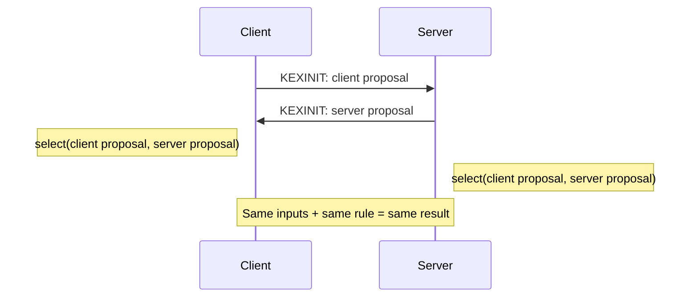

This also explains why the exact original `KEXINIT` payloads must be retained:
they are transcript inputs later, not merely temporary configuration data.

## The guessed-packet optimization

The `first_kex_packet_follows` boolean supports a latency optimization from the
base protocol. A peer may guess the outcome from the first entries in the
proposals and send the first method-specific KEX packet immediately after its
`KEXINIT`.

If the guess is wrong, the receiver silently ignores that one guessed packet,
then continues with the actual negotiated method. If the boolean is false,
there is no guessed packet to discard.

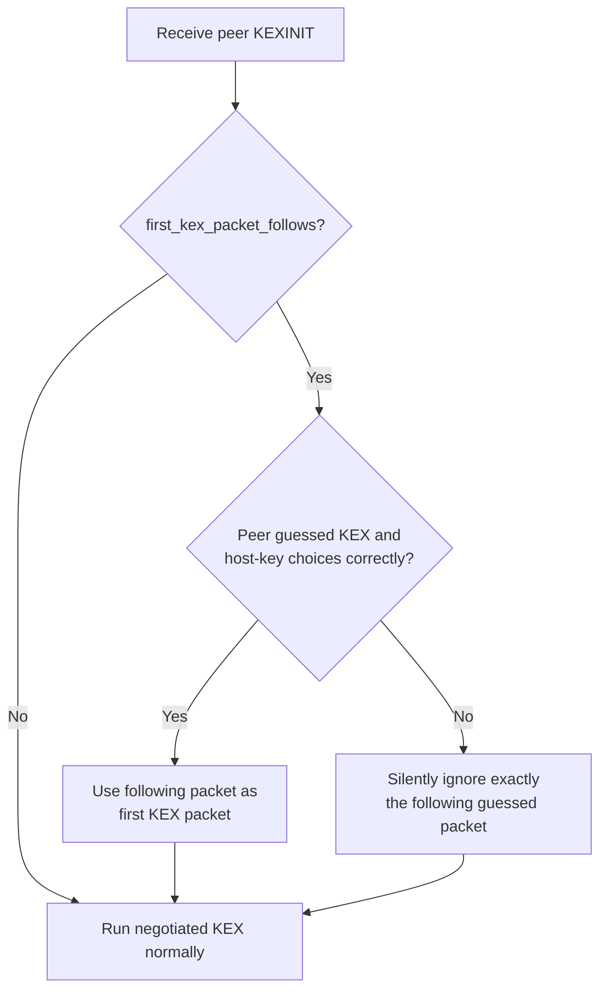

This is a wire-level rule even when the local endpoint never makes a guess: a
peer's wrong guessed packet is consumed and ignored rather than interpreted as
the first packet of the negotiated method.

## Markers in the KEX algorithm list

The `kex_algorithms` field is also used for capability markers. These look like
algorithm names but are not runnable KEX methods.

### Extension negotiation with `ext-info-*`

[RFC 8308](https://www.rfc-editor.org/rfc/rfc8308.html#section-2) defines two
role-specific markers:

- a client includes `ext-info-c` to say it can receive extension information
  from a server;
- a server includes `ext-info-s` to say it can receive extension information
  from a client.

The different suffixes deliberately prevent them from matching each other and
being selected as the KEX method. A peer that sees the appropriate marker may
send `SSH_MSG_EXT_INFO`; it is not required to do so.

The markers belong in the initial `KEXINIT`, not later rekey proposals. They
advertise a capability for the connection rather than an algorithm to
renegotiate on every KEX.

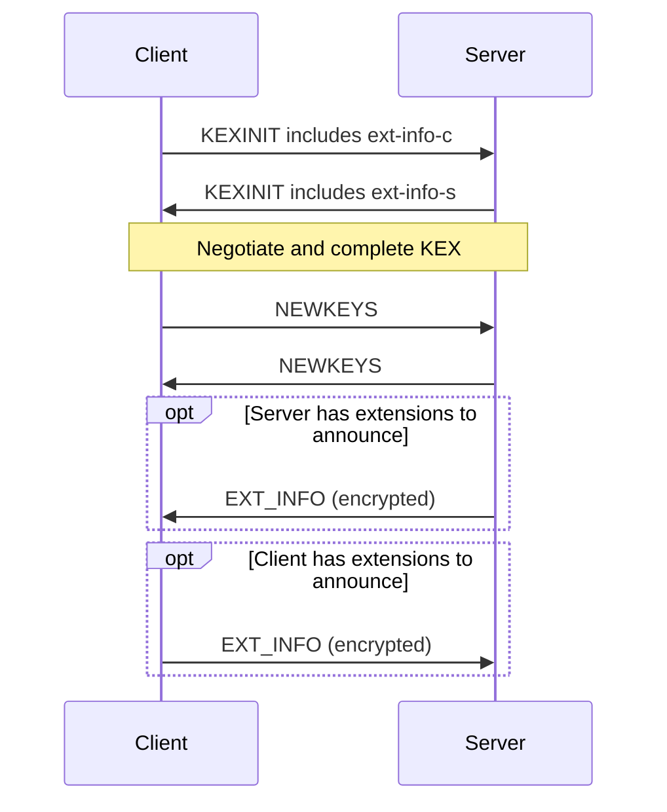

`SSH_MSG_EXT_INFO` contains a count followed by extension-name/value pairs.
Unknown extension names must be ignored. A value is an arbitrary SSH string,
not necessarily UTF-8 or a comma-separated list, so its named specification
defines how to parse it.

The first opportunity is immediately after the sender's first `NEWKEYS`.
RFC 8308 also permits a server to send a replacement `EXT_INFO` immediately
before `SSH_MSG_USERAUTH_SUCCESS`. Extension negotiation does not change the
algorithm choices already made by `KEXINIT`.

### Strict key exchange

Strict key exchange is a deployed protocol extension designed in response to
the Terrapin class of prefix-truncation attacks. It is unrelated to OpenSSH's
similarly named `StrictHostKeyChecking` user option.

Support is announced with role-specific pseudo-algorithms. Deployed names
include `kex-strict-c-v00@openssh.com` and
`kex-strict-s-v00@openssh.com`; the current specification also defines the
standard-form names `kex-strict-c` and `kex-strict-s`. The two peers must offer
matching forms. See the [strict KEX Internet-Draft](https://datatracker.ietf.org/doc/draft-ietf-sshm-strict-kex/)
and OpenSSH's [protocol extension documentation](https://github.com/openssh/openssh-portable/blob/master/PROTOCOL).

When strict KEX is active:

- the initial `KEXINIT` must be the peer's first binary protocol packet;
- only the expected negotiation and method-specific KEX messages are accepted
  during the initial exchange; and
- packet sequence numbers reset just after each direction's `NEWKEYS`, for the
  initial exchange and later rekeys.

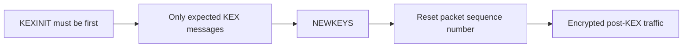

The base RFC allows some generic transport messages during KEX. Strict KEX
narrows that grammar: an unexpected `IGNORE`, `DEBUG`, or other non-KEX message
during the initial exchange causes termination instead of being tolerated.
That constraint prevents an attacker from using legal-but-unexpected packets
to manipulate the implicit sequence-number state.

> **Protocol-design lesson**
>
> “Authenticated later” works only when the later authenticator covers all
> security-relevant state. Strict KEX closes gaps between the signed transcript
> and the packet sequence numbers used by the encrypted transport.

## Compatibility and registries

SSH algorithm names are extensibility points rather than version bumps. New
methods can be deployed by adding names to proposals, while old peers ignore
names they do not know and select a mutual alternative.

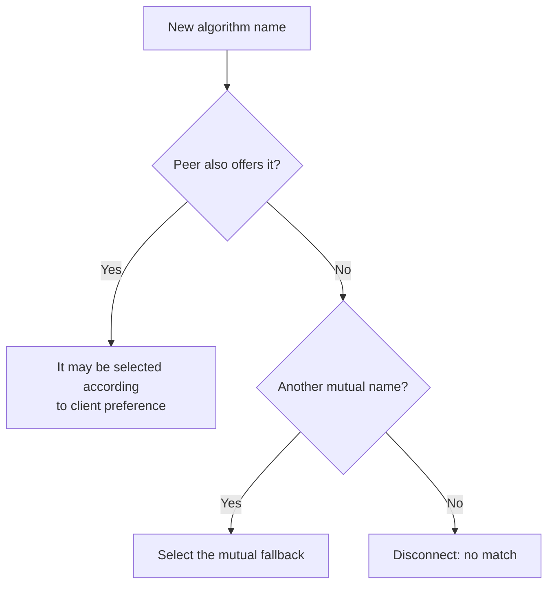

The authoritative sets of names live in the IANA SSH protocol-parameter
registries. [RFC 9519](https://www.rfc-editor.org/rfc/rfc9519.html) changed the
registration policy for registries including KEX, encryption, MAC, compression,
extension, and public-key algorithm names. It does not define a cryptographic
algorithm or say which algorithm is safe to enable; use each method's RFC and
current algorithm-guidance documents for that.

## Check your understanding

1. A server sends two notice lines and then `SSH-2.0-server\r\n`. Where does the
   binary packet stream begin?
2. The server prefers `B,A`; the client prefers `A,B`; both support both. Which
   algorithm is selected?
3. Why can a network attacker read an identification string but not silently
   rewrite it in a successful authenticated handshake?
4. Does `ext-info-c` mean “the client will send `EXT_INFO`” or “the client can
   receive `EXT_INFO`”?
5. What state does strict KEX protect that the original exchange hash did not
   fully bind?

<details>
<summary>Answers</summary>

1. At the first byte after the LF terminating the `SSH-2.0-server` line.
2. `A`: selection always follows client preference order.
3. The exact line, without CRLF, is an input to the exchange hash that the
   server signs. A rewrite makes the client and server transcripts differ.
4. It means the client is prepared to receive it from the server.
5. The ordering of packets during initial KEX and the packet sequence-number
   state at the transition to new keys.

</details>

## Primary references

- [RFC 4253 — SSH Transport Layer Protocol](https://www.rfc-editor.org/rfc/rfc4253.html), especially Sections 4, 7, and 8.
- [RFC 8308 — Extension Negotiation in SSH](https://www.rfc-editor.org/rfc/rfc8308.html).
- [RFC 9142 — SSH KEX Method Updates and Recommendations](https://www.rfc-editor.org/rfc/rfc9142.html).
- [RFC 9519 — Update to the IANA SSH Registry Requirements](https://www.rfc-editor.org/rfc/rfc9519.html).
- [Strict KEX Internet-Draft](https://datatracker.ietf.org/doc/draft-ietf-sshm-strict-kex/) and [OpenSSH `PROTOCOL`](https://github.com/openssh/openssh-portable/blob/master/PROTOCOL) for the deployed extension.
